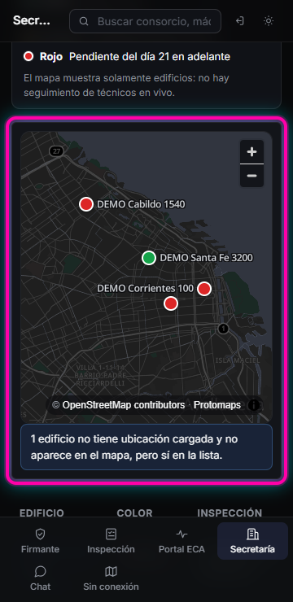
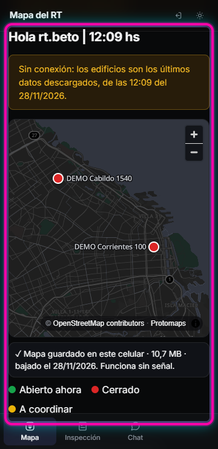

# Instalar y probar la app en un celular Android

Guía para abrir la app que corre en una PC de desarrollo desde el Chrome de un celular Android, instalarla como app y probar lo que el RT necesita en la calle: **que funcione sin wifi y sin señal**.

- **Para quién:** quien vaya a probar en un celular (desarrollo y QA). No hace falta saber de Android.
- **Última revisión:** 28/11/2026, con el mapa de CABA sin conexión (HU-16 RF-03) y el mapa nuevo en las 8 pantallas donde se usa (HU-16 RF-04 y RF-05). En el 5.1 se corrigió la ruta a la pantalla del mapa: «Estado del Sistema» ya no existe, ahora es **Mapa sin conexión**.
- **Estado:** todo lo de esta guía se probó en Chromium de escritorio con Playwright. **Todavía no se corrió en un Android real**: los pasos del celular (certificado, `adb`, gestos táctiles) están escritos a partir de cómo funciona Android y hay que confirmarlos en la primera prueba. Al final hay una tabla para anotar el resultado.

## 1. Por qué hay que hacer todo esto

- La app **solo funciona por HTTPS**: la cookie de sesión se emite con `secure`, así que por `http://` no se puede iniciar sesión.
- El certificado de desarrollo (mkcert) está emitido para `localhost`, `127.0.0.1` y `::1`. Para que el Chrome del celular lo acepte hay que instalar en el celular la autoridad (CA) de mkcert.
- El camino más simple es **por cable USB**: con `adb reverse` el `localhost` del celular pasa a ser el `localhost` de la PC. No hace falta tocar la red, el firewall ni el certificado.
- Para probar **sin conexión** hay que usar la app **compilada** (`npm run preview`), no el servidor de desarrollo: el service worker de desarrollo no guarda la app entera.

## 2. Qué necesitás

| En la PC | En el celular |
|---|---|
| El repo clonado, con `npm install` hecho | Android con Chrome actualizado |
| Docker prendido (la base de datos) | Cable USB que transmita datos (no solo carga) |
| mkcert instalado y el certificado generado (`npm run certs`) | Bloqueo de pantalla configurado (Android lo exige para instalar un certificado) |
| El archivo del mapa (viene en el repositorio: no hace falta generarlo) | |
| `adb` (ver 3.1) | |

## 3. Preparación (una sola vez)

### 3.1 En la PC: `adb`

1. Bajá **SDK Platform-Tools for Windows** de https://developer.android.com/tools/releases/platform-tools (es el sitio oficial de Android).
2. Descomprimilo en una carpeta fija, por ejemplo `C:\android\platform-tools`. No hace falta Android Studio.
3. Abrí una terminal en esa carpeta y comprobá: `.\adb.exe version`.

### 3.2 En la PC: certificado y mapa

```bash
npm run certs            # una vez; genera certs/localhost.pem con mkcert
# el mapa de CABA (apps/web/public/mapa/caba.pmtiles, ~11 MB) ya viene en el repositorio: no hace falta generarlo
```

El archivo del mapa **viene en el repositorio** (pesa 10,7 MB). Si por algún motivo falta, la app compila igual pero los mapas no se dibujan: avisan «El mapa no está disponible» y la descarga para usar sin señal falla; en ese caso `git pull` lo trae, o `npm run mapa:generar` lo vuelve a armar.

### 3.3 En el celular: activar la depuración USB

1. Ajustes › Acerca del teléfono › tocá **7 veces** «Número de compilación».
2. Ajustes › Opciones de desarrollador › activá **Depuración USB**.
3. Al conectar el cable, aceptá el cartel «¿Permitir la depuración USB?» (conviene marcar «Permitir siempre desde este equipo»).

### 3.4 En el celular: instalar el certificado de mkcert

1. En la PC, buscá la carpeta de mkcert: `mkcert -CAROOT` (en esta PC es `C:\Users\German\AppData\Local\mkcert`).
2. Copiá al celular **solo `rootCA.pem`**, por ejemplo por cable o por Drive. Si el celular no lo deja elegir, renombralo a `rootCA.crt`.
3. En el celular: **Ajustes › Seguridad › Cifrado y credenciales › Instalar un certificado › Certificado de CA**, y elegí el archivo. La ruta cambia según la marca; buscá «certificado» en el buscador de Ajustes. Android avisa que la red «puede estar supervisada»: es lo esperado, porque está instalando una CA de usuario.
4. Desde Android 11 el certificado se instala desde Ajustes: tocar el archivo en el explorador de archivos no alcanza.

> ⚠️ **Nunca copies `rootCA-key.pem`** (la clave privada de la CA). Con ese archivo se pueden emitir certificados que el celular aceptaría como válidos. Al terminar la prueba, si el celular no es solo de pruebas, quitá el certificado: Ajustes › Seguridad › Cifrado y credenciales › Credenciales de confianza › pestaña «Usuario».

## 4. Cada vez que pruebes

### 4.1 Levantar la app compilada en la PC

```bash
npm run db:up                      # la base de datos
npm run dev                        # la API (:3050); también levanta la web de desarrollo en :8050
npm run build -w apps/web          # compila la app y copia public/mapa/ (incluye caba.pmtiles)
npm run preview -w apps/web        # sirve lo compilado en https://localhost:4173
```

Dejá la API y el `preview` corriendo en dos terminales. El `preview` redirige `/api` a la API, así que el celular solo necesita llegar a un puerto.

Si cambiás código, volvé a correr el `build` y reiniciá el `preview`.

### 4.2 Conectar el celular

Con el cable enchufado, desde la carpeta de platform-tools:

```powershell
.\adb.exe devices                      # tiene que decir «device» (no «unauthorized» ni vacío)
.\adb.exe reverse tcp:4173 tcp:4173    # el localhost:4173 del celular apunta a la PC
.\adb.exe reverse --list               # confirma que quedó creado
```

En el Chrome del celular abrí **https://localhost:4173**. Si el certificado quedó bien instalado, no aparece ninguna advertencia.

Si querés probar el servidor de desarrollo en lugar de lo compilado: `.\adb.exe reverse tcp:8050 tcp:8050` y abrí https://localhost:8050 (sirve para ver cambios al instante, pero no para la prueba sin conexión).

> `adb reverse` se pierde si desenchufás el cable o reiniciás `adb`: hay que volver a correrlo.

## 5. Qué probar

Usuario de desarrollo: `admin` / `Admin-Desarrollo-2026` (solo existe en la base local).

### 5.1 Mapa de CABA sin señal (RF-03)

1. Entrá a la app e iniciá sesión. Andá a la pestaña **Mapa sin conexión** (en el menú de la izquierda; en el celular, la barra de abajo la llama **Sin conexión**): ahí está la tarjeta **«Mapa de CABA para usar sin señal»**.
2. **Mapa en línea:** tiene que dibujarse con calles, parques y nombres. Un dedo mueve la página; **dos dedos** mueven y acercan el mapa («Usá dos dedos para mover el mapa»). Probá el pellizco para acercar hasta ver una cuadra.
3. Tocá **«Descargar mapa para usar sin señal»** (~11 MB). Tiene que mostrar la barra de avance y terminar en **«Mapa guardado»**. Si se corta, **Cancelar** y reintentar tiene que dejar todo consistente.
4. **Cortá la conexión de verdad:**
   - Frená el `preview` en la PC (Ctrl+C) **o** desenchufá el cable. El **modo avión no alcanza**: el túnel USB sigue andando.
   - En el celular, **recargá la página** (deslizá hacia abajo o el botón de recarga).
   - Tienen que seguir apareciendo la app y el mapa, con el aviso **«Sin señal»**.
5. **Sin mapa guardado y sin red:** en Chrome, Ajustes del sitio › Borrar datos de `localhost`; sin red, abrí otra vez la pantalla. Tiene que decir **«Mapa sin descargar: conectate a una red para bajarlo»**. Al volver la conexión, el mapa se dibuja solo.
6. Anotá: fluidez del zoom y del desplazamiento, si las calles se leen al tamaño de la pantalla, si se calienta o se pone lento, si se cierra el navegador.

### 5.2 El mapa en las demás pantallas (HU-16 RF-04 y RF-05)

El mismo mapa (el mismo archivo, sin pedirle nada a Internet) está en **8 pantallas**. Esta tabla dice dónde está cada una y qué tiene que verse. Se recorrió entera, con un usuario de cada rol, en un navegador de escritorio que emula un celular de 360 px (Playwright, HU-16 RF-07: [RF-07-navegador.cjs](../pruebas/hu-16-hu-16-mapa-del-rt-y-llegada-al/RF-07-navegador.cjs)). **En un Android real queda por confirmar.**

Usuarios de demo (los carga `bash docs/pruebas/hu-04-hu-04-semaforo-de-control-mens/RF-02-datos-demo.sh`), todos con clave `Demo-Clave-2026`: `demo.secretaria` para las pantallas 1 a 6 y `rt.beto` para la 7.

| # | Pantalla y cómo se llega | Qué tiene que verse |
|---|---|---|
| 1 | **Ficha del edificio, en lectura.** Secretaría › elegir «DEMO Santa Fe 3200» en la lista | El mapa de la zona, con 1 pin: el edificio |
| 2 | **Ficha, en edición.** En la ficha, **✏️ Editar Datos Operativos y Equipos** | El mapa con 1 pin que se puede arrastrar; abajo, «Punto PostGIS: …» cambia con el pin. **No guardes** |
| 3 | **Alta de consorcio.** Secretaría › **+ Alta de Nuevo Consorcio** | El mapa de CABA **sin pin**; al tocarlo se fija un pin y aparece el punto. **No guardes** |
| 4 | **Vista de mapa.** Secretaría › **🗺️ Vista Mapa** | Un pin por edificio con su nombre (con los datos de demo, 4), y un aviso de los edificios sin ubicación |
| 5 | **Monitoreo.** Secretaría › solapa **Monitoreo** | El mismo mapa (4 pines) arriba de la tabla de visitas |
| 6 | **Semáforo.** Secretaría › solapa **Semáforo**, fecha **25/11/2026** | 4 pines con su nombre: **3 rojos y 1 verde** (DEMO Santa Fe 3200). Leyenda: **verde** = inspeccionado este mes, o pendiente del día 1 al 10; **amarillo** = pendiente del día 11 al 20; **rojo** = pendiente del día 21 en adelante. Abajo: «1 edificio no tiene ubicación cargada y no aparece en el mapa, pero sí en la lista» |
| 7 | **Mapa del RT.** Entrá como `rt.beto` (es la pantalla inicial; con el GPS prendido) | 2 pines, DEMO Cabildo 1540 y DEMO Corrientes 100, pintados según el horario del edificio y la hora del celular: **verde** abierto ahora, **rojo** cerrado, **amarillo** a coordinar (leyenda abajo). El sábado 28/11 a mediodía los dos salieron en rojo, «Cerrado» |
| 8 | **Mapa sin conexión.** Barra de abajo: **Sin conexión** | El mapa base solo (sin pines) y el botón **«Descargar mapa para usar sin señal»** (la prueba del 5.1) |



**Cómo mirarlos en el celular**

1. **Calles y nombres:** tienen que leerse al tamaño de la pantalla. Cuando dos nombres se pisan se oculta uno y se conserva el del estado más urgente (el rojo): acercá para ver los demás.
2. **Gestos:** arrastrar con **un dedo** mueve el mapa y el **pellizco con dos dedos** lo acerca. Sólo la tarjeta de «Mapa sin conexión» pide dos dedos para mover el mapa (así la página no se queda trabada al desplazarla).
3. **Ancho:** el mapa tiene que entrar en el ancho de la pantalla sin cortarse. Las excepciones conocidas son la **ficha del edificio** (1 y 2) y el **alta de consorcio** (3): esas pantallas ya eran más anchas que el celular antes del mapa nuevo, y el mapa queda cortado a la derecha y se desplaza con ellas (HU-16 RF-05; arreglar ese diseño no es de esta tarea). Monitoreo, la vista de mapa, el Semáforo y el Mapa del RT sí tienen que caber.
4. **Tocar un pin:** en el **Mapa del RT** abre la tarjeta del edificio, con **Verificar ubicación**; en el **Semáforo**, un pin rojo abre el panel de ese edificio. En las demás pantallas el pin sólo muestra el nombre.
5. **Tema claro y oscuro:** si cambiás el tema de la app (el botón de la luna o el sol, arriba a la derecha), el mapa cambia con él.
6. Anotá lo que no coincida con esta tabla: es lo que hay que corregir (en la guía o en la app).

**La prueba importante: el Mapa del RT sin señal, con el mapa ya bajado**

1. Con conexión, entrá como `rt.beto` y esperá a que se dibuje el mapa con sus pines. Tocá **«Descargar mapa para usar sin señal»** (debajo del mapa) hasta ver **«✓ Mapa guardado en este celular · 10,7 MB · …»**.
2. **Cortá la conexión de verdad** (el paso 4 del 5.1: frená el `preview` o desenchufá el cable; el modo avión solo no alcanza con el USB) y **recargá la página**.
3. Tiene que verse el cartel amarillo **«Sin conexión: los edificios son los últimos datos descargados, de las HH:MM del DD/MM/AAAA.»**, el **mapa dibujado desde el celular** con las calles y los **pines con sus nombres**, y la leyenda. El color de cada pin se calcula con la hora que marca el celular.



4. Al volver la conexión, el cartel tiene que desaparecer. **Sin verificar:** esto último no está comprobado en un celular, sólo escrito a partir de cómo funciona la pantalla.

### 5.3 Instalarla como app (PWA)

1. En Chrome, menú ⋮ › **Instalar app** (o «Agregar a la pantalla principal»).
2. Abrila desde el ícono: tiene que abrir a pantalla completa, sin la barra del navegador.
3. Repetí el paso 4 de 5.1 (sin conexión) desde la app instalada.

**Sin verificar:** el manifest tiene un único ícono SVG (`icon.svg`, tamaño `any`). Si Chrome no ofrece «Instalar app», es un hallazgo a registrar (probablemente haya que sumar íconos PNG de 192 y 512 px); el uso sin conexión funciona igual desde una pestaña común.

### 5.4 Resto de la app

Con el mismo cable, recorré las pantallas del RT (recorrido, checklist, firma) con el celular en vertical y apaisado, y fijate en: tamaño de los botones al tacto, texto cortado, teclado que tapa campos y rendimiento.

## 6. Ver la consola del celular desde la PC

1. En Chrome de la PC abrí `chrome://inspect/#devices`.
2. El celular aparece con sus pestañas abiertas; tocá **inspect** en la de la app.
3. En **Application** se ven los datos del mapa guardado: Cache Storage `mant-asc-mapa-v1` (el archivo) y Local Storage `mant_asc_mapa` (la versión anotada), y el estado del service worker.

## 7. Alternativa por Wi-Fi (sin cable)

Tiene más pasos y puede fallar según la red. Usala si no hay cable.

1. **IP de la PC:** `ipconfig` › «Dirección IPv4» de la placa Wi-Fi (por ejemplo `192.168.1.20`). Cambia si cambia la red.
2. **Certificado con esa IP** (el de `npm run certs` solo cubre `localhost`). Desde la raíz del repo:
   ```bash
   mkcert -cert-file certs/localhost.pem -key-file certs/localhost-key.pem localhost 127.0.0.1 ::1 192.168.1.20
   ```
   Reiniciá los servidores. El celular necesita tener instalado el mismo `rootCA.pem` (paso 3.4).
3. **Servir en la red:** `npm run preview -w apps/web -- --host`.
4. **Firewall de Windows:** permitir el puerto 4173 de entrada en la red privada (PowerShell como administrador):
   ```powershell
   New-NetFirewallRule -DisplayName "mant_asc preview" -Direction Inbound -Protocol TCP -LocalPort 4173 -Action Allow -Profile Private
   ```
   Si Windows marca la red como «Pública», la regla no se aplica: cambiá el perfil de la red a «Privada».
5. Con el celular en la **misma** Wi-Fi, abrí `https://192.168.1.20:4173`.

Muchas redes de empresa, hospitales o invitados **aíslan a los dispositivos entre sí**; si el celular no llega a la PC, no es un error de la app: usá el cable.

Para la prueba sin conexión por Wi-Fi alcanza con frenar el `preview` o apagar el Wi-Fi del celular.

## 8. Problemas frecuentes

| Qué pasa | Causa probable | Qué hacer |
|---|---|---|
| Chrome muestra «Tu conexión no es privada» (`ERR_CERT_AUTHORITY_INVALID`) | El certificado de la CA no está instalado, o es otro `rootCA.pem` | Reinstalar `rootCA.pem` de **esta** PC (`mkcert -CAROOT`). No sirve «Continuar de todos modos»: con errores de certificado el service worker no se registra |
| `ERR_CONNECTION_REFUSED` en el celular | El `preview` está apagado, o se perdió el `adb reverse` | Revisar que el `preview` responda en la PC y repetir `adb reverse tcp:4173 tcp:4173` |
| `adb devices` no muestra el celular o dice `unauthorized` | Cable solo de carga, depuración USB apagada o cartel sin aceptar | Cambiar de cable, revisar 3.3 y aceptar el cartel; si hace falta, «Revocar autorizaciones de depuración USB» y reconectar |
| El login falla o vuelve a pedir sesión | Se entró por `http://` o por una IP que no está en el certificado | Entrar siempre por `https://localhost:4173` (o la IP incluida en el certificado) |
| «Descargar mapa» da error o dice «El mapa no está disponible» | Falta `apps/web/public/mapa/caba.pmtiles` al compilar (viene en el repositorio: el repo está desactualizado o se borró) | `git pull` (o, si querés actualizarlo, `npm run mapa:generar`), volver a compilar y reiniciar el `preview` |
| Recargué sin conexión y la app no abre | El service worker no llegó a instalarse antes de cortar la red | Abrirla una vez con conexión, esperar unos segundos y recién ahí cortar |
| Se muestra una versión vieja de la app | El service worker sirve la versión anterior hasta que se actualice | Cerrar y abrir la app; si sigue, Ajustes del sitio › Borrar datos de `localhost` |
| El mapa dice que no hay WebGL | El celular o el navegador no lo soportan o lo tienen desactivado | Probar con otro Chrome actualizado; registrar el modelo |
| La pantalla no sigue el dedo en el mapa | Es el gesto cooperativo: un dedo desplaza la página | Usar dos dedos sobre el mapa |

## 9. Qué falta y qué no se sabe todavía

- **Es la primera vez que se corre en un Android real.** Si algún paso de esta guía no coincide con lo que se ve en el celular, corregir la guía en la misma tarea.
- **No se probó en Safari ni en iPhone.** Esta guía es solo de Android.
- **No se midió la memoria ni la batería** con el mapa abierto un rato largo.
- **Las 8 pantallas del mapa (5.2) se recorrieron en un navegador de escritorio que emula 360 px, no en un Android real**: la tabla dice qué tiene que verse, pero el tacto (arrastrar el pin de la ficha, tocar el mapa del alta, el pellizco) y la fluidez en un celular concreto siguen sin confirmar.
- **El Mapa del RT sin señal con el mapa ya bajado** (5.2) anda en el navegador de escritorio (recargando sin red, el mapa con sus pines se dibujó entre 1,4 y 1,7 s en 4 de 4 corridas), pero no se midió en un celular. Es el tiempo que más conviene anotar en el registro.
- El mapa llega hasta el zoom 15: acercando más se agranda, no agrega calles ni números de puerta.
- Si el celular se queda sin espacio, Chrome puede borrar el mapa guardado. La app lo detecta y vuelve a ofrecer la descarga.
- Las pruebas contra `testing` y producción (los entornos reales) todavía no están configuradas: esta guía sirve solo para la PC de desarrollo.

## 10. Registro de la prueba

Completar una fila por celular:

Las columnas **1 a 8** son las pantallas de la tabla del 5.2 (poné ✔ si se ve como dice la tabla, o qué falló). **RT sin señal** es el Mapa del RT del 5.2 recargado sin conexión: anotá si se ven el mapa y los pines, y cuántos segundos tarda.

| Fecha | Celular y Android | Versión de Chrome | Camino (USB / Wi-Fi) | Mapa en línea | Descarga | Sin señal (recarga) | 1 Ficha (lectura) | 2 Ficha (edición) | 3 Alta | 4 Vista Mapa | 5 Monitoreo | 6 Semáforo | 7 Mapa del RT | 8 Mapa sin conexión | RT sin señal | Instalar como app | Observaciones |
|---|---|---|---|---|---|---|---|---|---|---|---|---|---|---|---|---|---|
| | | | | | | | | | | | | | | | | | |
