# Manual de uso de mant_asc — para quien nunca usó la aplicación

Este manual explica, paso a paso y con palabras simples, cómo usar **mant_asc**, el sistema de inspecciones de ascensores de la Ciudad de Buenos Aires (CABA). No hace falta saber de computación. Si sabés abrir una página web y escribir un usuario y una clave, podés seguirlo.

> **Cómo leerlo.** Cada pantalla tiene una captura. Lo que tenés que mirar o tocar está **rodeado con un borde magenta** (rosa fuerte). Los pasos están numerados. Hacelos en orden.

> **Importante.** Las capturas se sacaron con **datos de demostración** (edificios y personas de prueba que empiezan con «DEMO», `rt.beto`, etc.). En tu sistema real vas a ver tus propios edificios y personas. Las pantallas son las mismas.

## Qué hay en este manual

1. [Qué es mant_asc](#1-qué-es-mant_asc)
2. [Antes de empezar](#2-antes-de-empezar)
3. [Entrar, salir y cambiar el tema](#3-entrar-salir-y-cambiar-el-tema)
4. [Si sos de la Secretaría](#4-si-sos-de-la-secretaría)
5. [Si sos el RT de calle (con el celular)](#5-si-sos-el-rt-de-calle-con-el-celular)
6. [Portal Firmante](#6-portal-firmante)
7. [Portal ECA](#7-portal-eca)
8. [Inspección Técnica (el checklist)](#8-inspección-técnica-el-checklist)
9. [Estado del Sistema](#9-estado-del-sistema)
10. [Si sos Administrador: usuarios y permisos](#10-si-sos-administrador-usuarios-y-permisos)
11. [Puesta en marcha de los avisos por WhatsApp](#11-puesta-en-marcha-de-los-avisos-por-whatsapp)
12. [Problemas comunes](#12-problemas-comunes)
13. [Glosario](#13-glosario)
14. [Lo que la aplicación todavía no hace](#14-lo-que-la-aplicación-todavía-no-hace)

---

## 1. Qué es mant_asc

En CABA los ascensores de los edificios se revisan todos los meses. Esa revisión la hace una empresa que se llama **ECA** (Empresa Conservadora Aliada), y la controla la **AGC** (Agencia Gubernamental de Control).

**mant_asc** sirve para organizar todo eso en un solo lugar:

- Tener la lista de **edificios y ascensores** («máquinas») y saber dónde está cada uno en el mapa.
- Saber **qué persona** tiene que ir a cada edificio.
- Que esa persona haga la **inspección desde el celular**, con fotos, aunque no tenga señal.
- Ver con un **semáforo** qué edificios todavía no fueron revisados este mes.
- **Avisar por WhatsApp y por correo** cuando un ascensor tiene una falla grave.

### Quién es quién

| Rol en el sistema | Quién es | Qué hace |
|---|---|---|
| **RT de Calle** | La persona que va al edificio | Inspecciona los ascensores con el celular |
| **Secretaría** | La oficina | Carga edificios, asigna personas, mira el semáforo y aprueba los avisos |
| **Firmante AGC** | El responsable técnico legal | Revisa los informes y autoriza la firma ante la AGC |
| **ECA** | La empresa conservadora | Mira sus edificios y sus alertas |
| **Administrador** | Quien maneja el sistema | Crea las cuentas de las demás personas |

Cada cuenta tiene **un solo rol**, y ese rol decide **qué pantallas ves**. Si una pantalla de este manual no te aparece, es porque tu rol no la usa. No es un error.

---

## 2. Antes de empezar

Necesitás:

- Un **navegador** (Chrome, Edge o Firefox) en la compu o en el celular.
- La **dirección web** de la aplicación. Te la pasa quien administra el sistema. (Para pruebas en una compu propia es `https://localhost:8050`.)
- Tu **usuario** y tu **contraseña**. Te los da el Administrador (ver [la sección 10](#10-si-sos-administrador-usuarios-y-permisos)).

Para practicar existen cuentas de demostración. Todas usan la misma clave de práctica, `Demo-Clave-2026`:

| Usuario | Rol | Para probar |
|---|---|---|
| `demo.secretaria` | Secretaría | La sección 4 |
| `rt.beto`, `rt.ana`, `rt.carla`, `rt.diego` | RT de Calle | La sección 5 |
| `demo.admin` | Administrador | La sección 10 |

> **Cuidado.** Esas cuentas son solo de práctica. En un sistema real **no se deben usar**: se crean cuentas con las personas verdaderas y claves propias.

---

## 3. Entrar, salir y cambiar el tema

### Paso 1 · Entrar

1. Abrí la dirección web de la aplicación.
2. Escribí tu **usuario** y tu **contraseña**.
3. Tocá el botón **Ingresar al Sistema**.

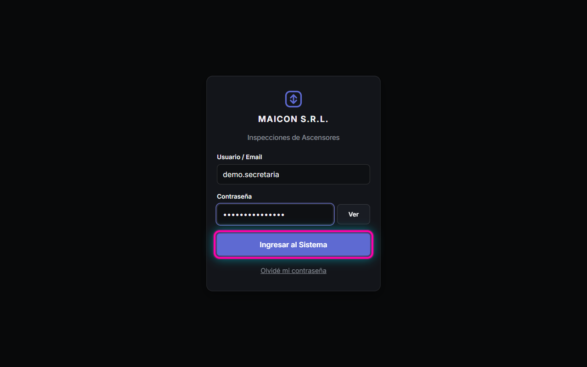

**Qué tenés que ver:** entrás a la pantalla principal. Si te equivocaste de usuario o de clave, aparece un mensaje de error y podés intentar de nuevo.

### Paso 2 · Si te olvidaste la contraseña

1. En la pantalla de ingreso tocá **Olvidé mi contraseña**.
2. Escribí tu **usuario** o tu **email**.
3. Tocá **Enviarme el enlace**.
4. Abrí tu correo: te llega un enlace para elegir una contraseña nueva.

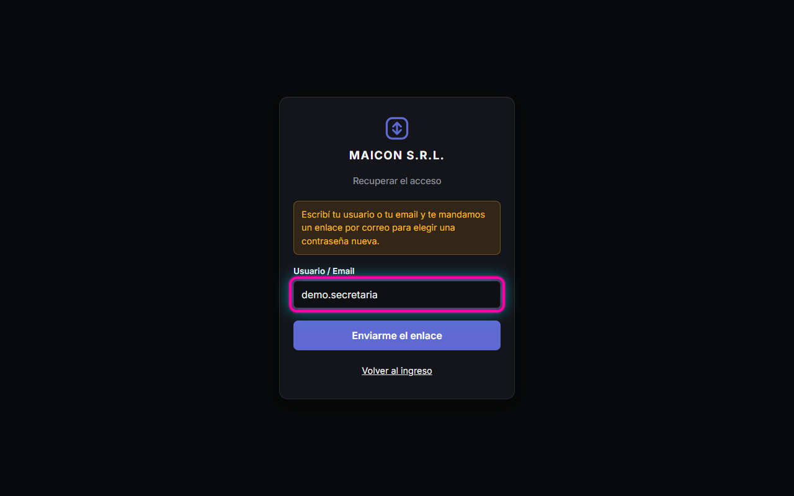

Para volver, tocá **Volver al ingreso**.

> Si tu cuenta **no tiene email cargado**, el sistema no puede mandarte el enlace. Pedile al Administrador que lo cargue o que te cree una clave nueva.

### Paso 3 · Conocer la pantalla principal

A la **izquierda** hay un menú con las secciones que tu rol puede usar (por ejemplo «Portal Firmante», «Secretaría (Edificios y Máquinas)», «Estado del Sistema»). Tocá una para ir a ella. Arriba hay un **buscador** para encontrar un consorcio, una máquina (M1, M2) o un portal.

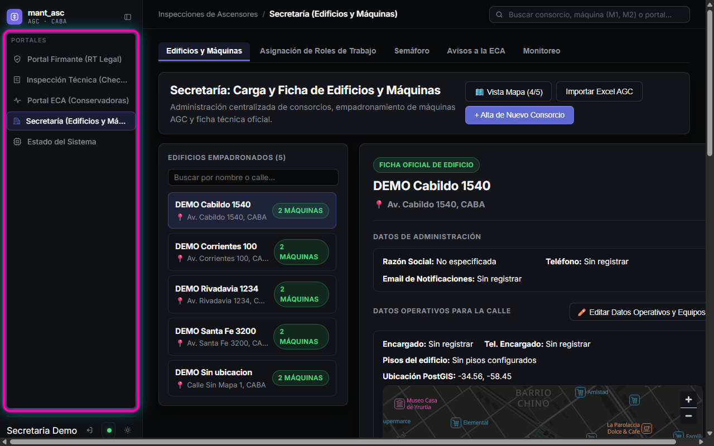

### Paso 4 · Cambiar entre tema oscuro y claro

Abajo a la izquierda hay un botón con el dibujo de un sol o una luna (**Cambiar tema visual**). Cada vez que lo tocás, la pantalla pasa de oscura a clara o al revés. Es solo cuestión de comodidad: no cambia ningún dato.

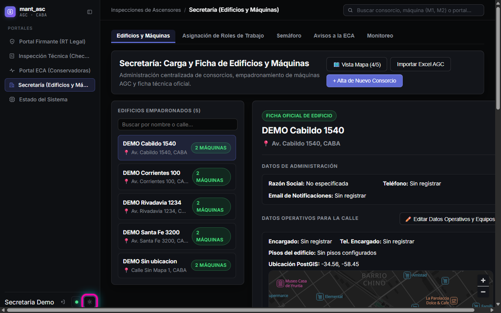

### Paso 5 · Salir

Tocá **Cerrar sesión** (junto a tu nombre, abajo a la izquierda). Hacelo siempre si usás una compu o un celular que no es tuyo.

---

## 4. Si sos de la Secretaría

Entrá a **Secretaría (Edificios y Máquinas)** en el menú. Arriba vas a ver cinco pestañas:

**Edificios y Máquinas · Asignación de Roles de Trabajo · Semáforo · Avisos a la ECA · Monitoreo**

### 4.1 Edificios y Máquinas

Es la lista de todos los edificios («consorcios») cargados y de sus ascensores («máquinas»).

1. Tocá la pestaña **Edificios y Máquinas**.
2. A la izquierda ves la lista de **edificios empadronados**, con su dirección y cuántas máquinas tienen.
3. Tocá un edificio: a la derecha se abre su **Ficha oficial**, con los datos del edificio y de sus ascensores.

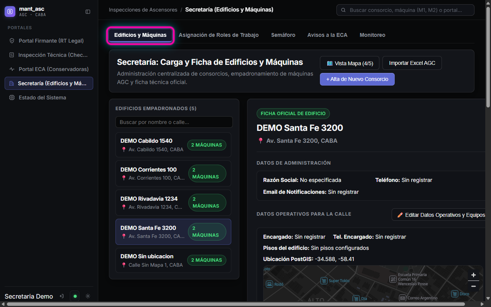

Arriba a la derecha hay tres botones:

- **Vista Mapa**: muestra los edificios sobre un mapa (ver 4.3).
- **Importar Excel AGC**: carga muchos edificios de una vez desde una planilla.
- **+ Alta de Nuevo Consorcio**: carga un edificio nuevo (ver 4.2).

### 4.2 Dar de alta un edificio nuevo

1. Tocá **+ Alta de Nuevo Consorcio**.
2. Completá el formulario. Los campos con **asterisco (\*)** son obligatorios:
   - **1. Datos del inmueble y consorcio:** nombre del consorcio\* y dirección en CABA\*.
   - **2. Datos de la administración:** razón social o administrador, teléfono y email.
   - **2B. Datos operativos para la calle (opcional):** nombre y teléfono del encargado del edificio, y la lista de pisos separados por coma.
   - **Ubicación geográfica en mapa:** tocá **un punto del mapa** donde está el edificio. Aparece un pin rojo. Si te equivocaste, **arrastrá el pin** hasta el lugar correcto.
   - **3. Máquinas AGC:** cargá los ascensores del edificio.
3. Guardá el formulario con el botón del final de la pantalla.

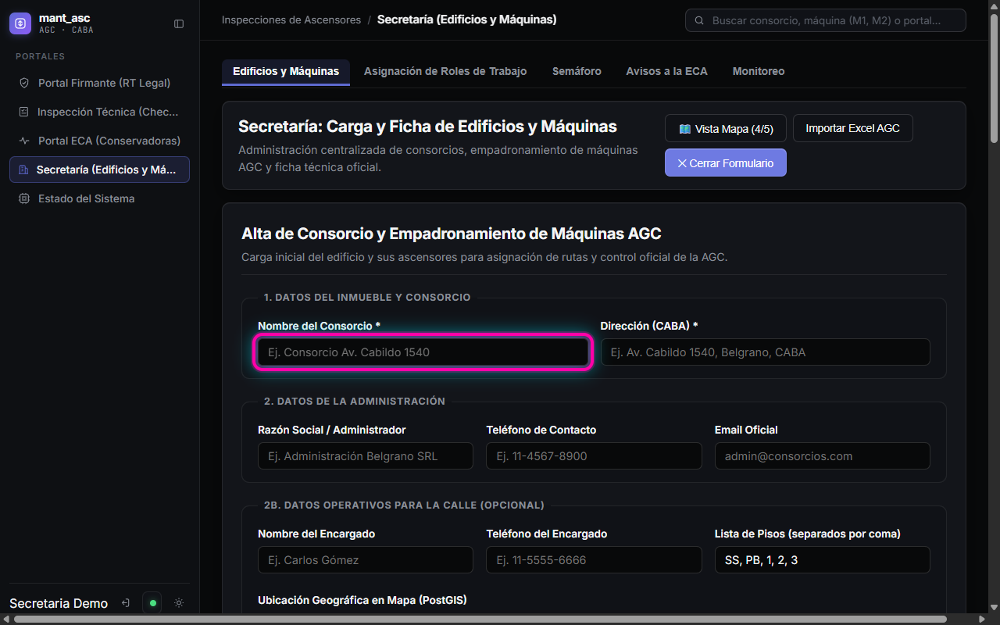

**Por qué importa el pin:** con la ubicación cargada, el RT de calle ve el edificio en su mapa y el Semáforo también. Un edificio **sin ubicación** no aparece en el mapa, pero sí en las listas.

### 4.3 Ver los edificios en el mapa

1. En **Edificios y Máquinas**, tocá **Vista Mapa**.
2. Ves todos los edificios con ubicación. El texto del botón dice cuántos hay, por ejemplo «4/5» (4 con ubicación de 5 en total).
3. Usá los botones **+** y **−** del mapa (o la rueda del mouse con la tecla **Ctrl**) para acercar y alejar. Arrastrá el mapa para moverlo.
4. Si hay muchos edificios juntos, algunos nombres se ocultan para que no se pisen. **Acercá** el mapa y reaparecen.

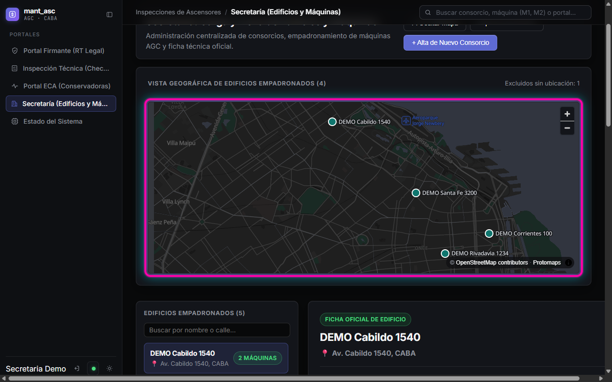

### 4.4 Asignación de Roles de Trabajo

Cada edificio tiene un **grupo de tres personas responsables**: el RT de calle, el Firmante y la ECA. Esta pestaña muestra quién es quién en cada edificio.

1. Tocá **Asignación de Roles de Trabajo**.
2. Cada fila muestra el edificio, su dirección, las tres personas (por ejemplo «rt.beto · Firmante Demo · ECA Demo») y la marca **ASIGNADO** si el grupo está completo.

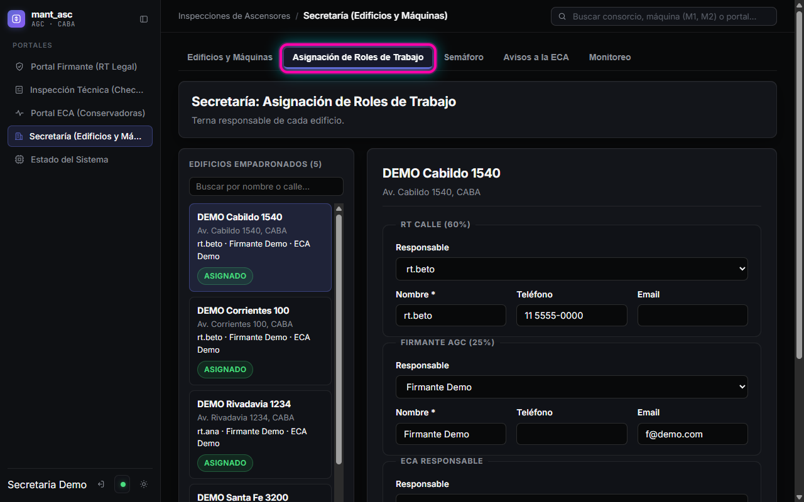

### 4.5 El Semáforo

El Semáforo te dice **qué edificios todavía no se inspeccionaron este mes**.

1. Tocá **Semáforo**.
2. Arriba ves la fecha («Al 21/11/2026») y un contador de **Rojo**, **Amarillo** y **Verde**.
3. Debajo ves el mapa con un **pin de color** por edificio, y más abajo la lista.

Los colores significan:

| Color | Qué quiere decir |
|---|---|
| **Verde** | Ya se inspeccionó este mes, o está pendiente pero estamos del día 1 al 10 |
| **Amarillo** | Pendiente, del día 11 al 20 |
| **Rojo** | Pendiente, del día 21 en adelante |

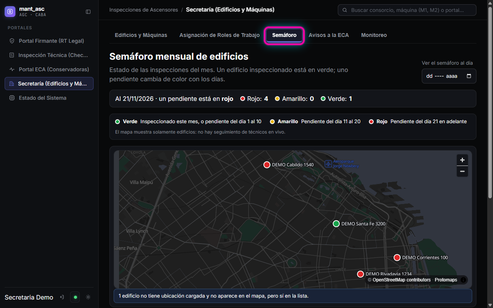

Podés cambiar la fecha con **Ver el semáforo al día** para ver cómo estaba (o cómo va a estar) otro día del mes.

> El mapa muestra **solamente edificios**. No muestra dónde está cada técnico en este momento: la aplicación no sigue a nadie.

#### Cambiar a la persona que va a un edificio (Reasignar)

En la lista, cada edificio pendiente tiene un botón **Reasignar**. Sirve para pasar el edificio a otro RT de calle (por ejemplo, si el primero se enfermó).

1. Tocá **Reasignar** en la fila del edificio.

   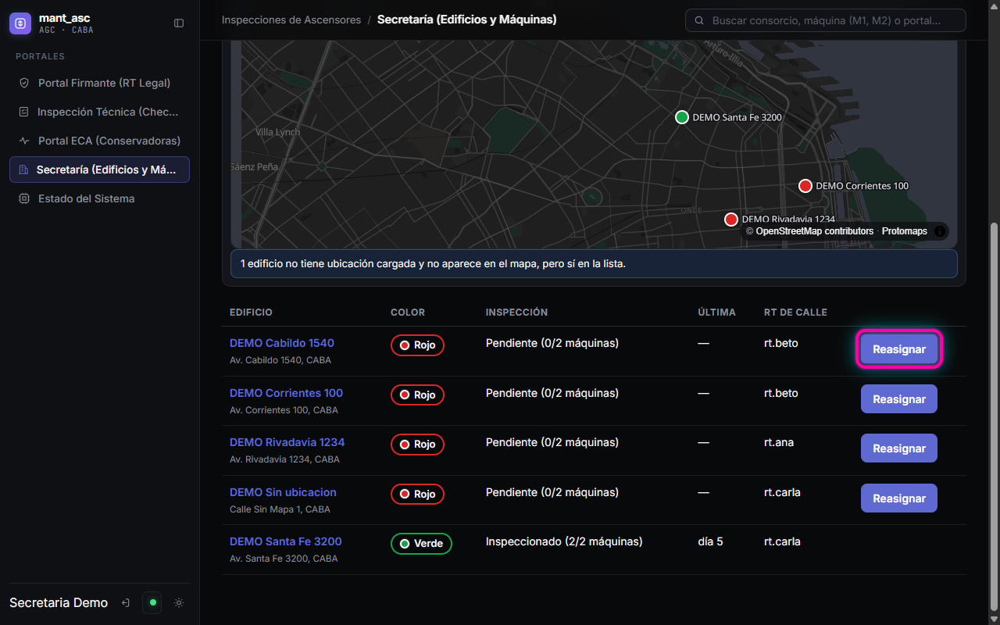

2. Se abre un panel. Muestra el **RT actual**, el **RT sugerido** (el que menos edificios pendientes tiene este mes) y una lista para elegir a otro.
3. Elegí a la persona.
4. Tocá **Confirmar reasignación**. Hasta que no toques ese botón **no cambia nada**. Si te arrepentís, tocá **Cancelar**.
5. El cambio queda **registrado a tu nombre** en «Reasignaciones registradas».

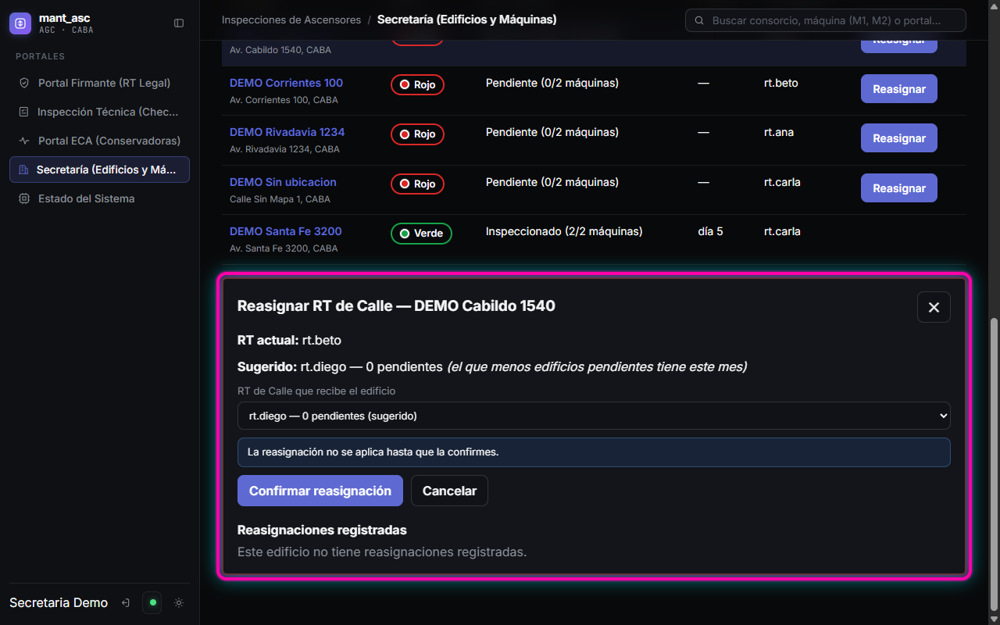

### 4.6 Avisos a la ECA

Cuando un ascensor tiene una **falla crítica**, el sistema prepara un aviso para la ECA y el Firmante. **Ningún aviso sale solo:** una persona de la Secretaría lo revisa y decide si se manda.

1. Tocá **Avisos a la ECA**.
2. Arriba hay un **cartel** que dice si WhatsApp está activo:
   - **«WhatsApp no configurado»**: los avisos aprobados **no salen por WhatsApp** (sí por correo). Es normal hasta hacer la puesta en marcha de la [sección 11](#11-puesta-en-marcha-de-los-avisos-por-whatsapp).
   - **«WhatsApp activo: Meta»** (o Twilio): los avisos aprobados salen también por WhatsApp.
3. Si no hay avisos, dice **«No hay avisos.»**

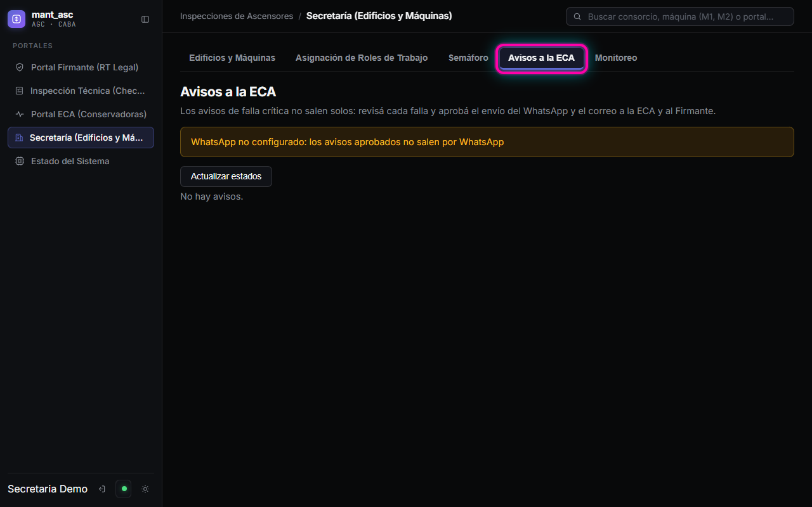

Cuando **hay** un aviso pendiente:

1. Leé el aviso (edificio, máquina, estado y detalle de la falla).
2. Tocá **Aprobar y enviar** si es correcto.
3. Mirá la lista de **envíos** del aviso: cada envío tiene su estado.

Ejemplo con el cartel «No configurado»:

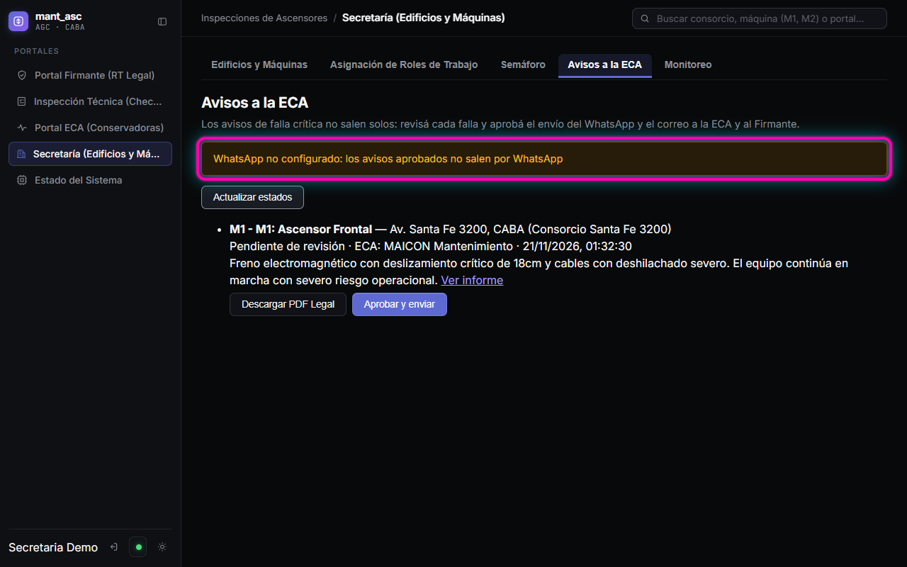

Ejemplo con WhatsApp activo:

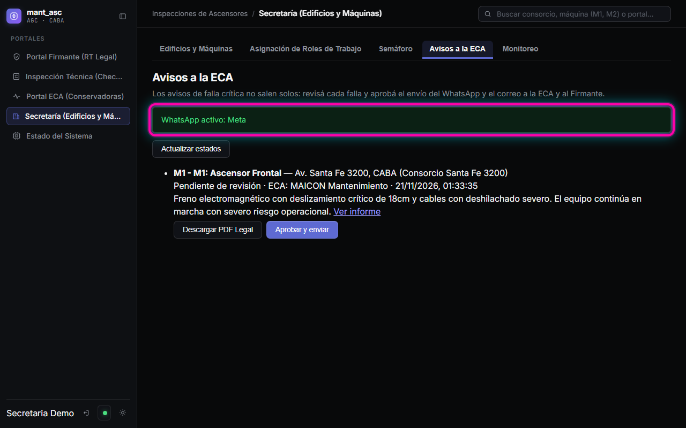

**Los estados de un envío de WhatsApp, de menor a mayor:**

| Estado | Qué significa en criollo |
|---|---|
| **Aceptado** | WhatsApp recibió el mensaje, pero **todavía no confirmó** que llegó |
| **Enviado** | WhatsApp lo mandó |
| **Entregado** | Llegó al teléfono |
| **Leído** | La persona lo abrió |
| **Falló** | No se pudo entregar. Se muestra el motivo |

El estado **no vuelve para atrás**: si ya figura «Leído», una noticia vieja no lo cambia a «Enviado».

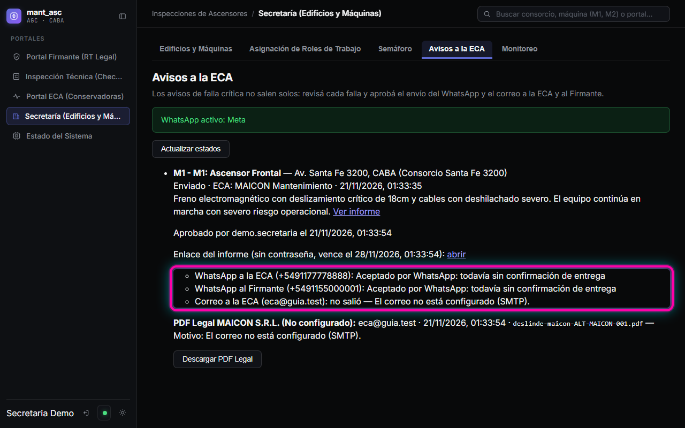

Para ver cómo avanzaron los envíos, tocá **Actualizar estados**. Un envío con problemas se puede volver a mandar con **Reintentar envío**.

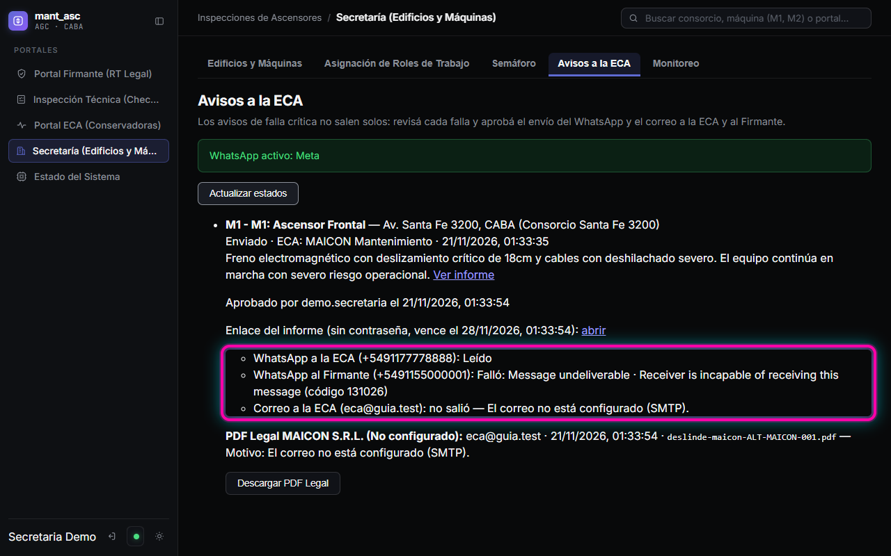

> Si aparece el cartel **«No se pudo consultar el estado de WhatsApp»**, la bandeja sigue funcionando; solamente no podés ver el estado real por un rato. Probá **Actualizar estados** más tarde.

### 4.7 Monitoreo

Es la **tabla de todas las visitas** del mes, con un mapa arriba.

1. Tocá **Monitoreo**.
2. Podés **filtrar** por dirección, por ECA, por inspector o por estado de la visita (**Recorrida**, **Pendiente de Visita**, **Advertencia**). El botón **Limpiar filtros** deja todo como estaba.
3. Cada fila muestra la dirección, la máquina, el inspector, el estado, la fecha y hora, el checklist, y el Firmante con su autorización.
4. Al final de cada fila hay acciones:
   - **Ver fotos e informe**: abre las fotos y el informe de la visita.
   - **Enviar Remito a ECA**: aparece en visitas recorridas.
   - **Reclamar a Admin**: aparece en visitas con advertencia.
   - Si dice **«Sin visita todavía»**, no hay nada para hacer: nadie visitó esa máquina.

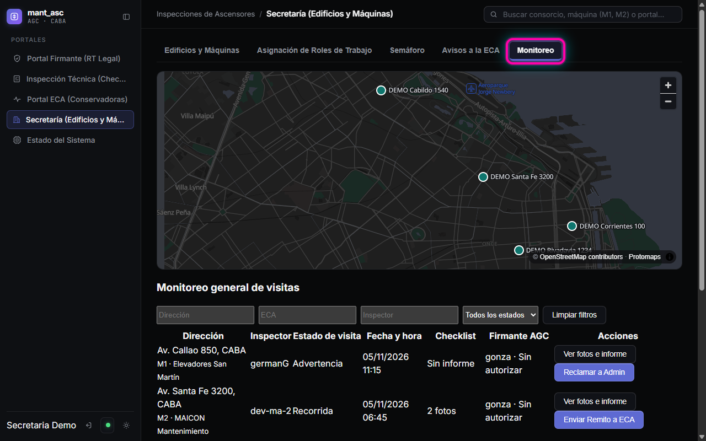

---

## 5. Si sos el RT de calle (con el celular)

El RT de calle usa la aplicación **desde el celular, parado frente al edificio**. Entrá con tu usuario (por ejemplo `rt.beto`). Abajo vas a ver dos botones: **Mapa** e **Inspección**.

### 5.1 El mapa y tus edificios del día

1. Entrá a **Mapa**. Arriba dice «Hola» y tu usuario, con la hora.
2. Ves un mapa con **un pin por cada edificio que tenés pendiente**. Cada pin tiene un color:
   - **Verde — Abierto ahora**: el edificio está abierto en este momento.
   - **Rojo — Cerrado**: está cerrado en este momento.
   - **Amarillo — A coordinar**: no hay horario cargado; hay que llamar para coordinar.
3. Más abajo está la lista **«Edificios pendientes de hoy»**.

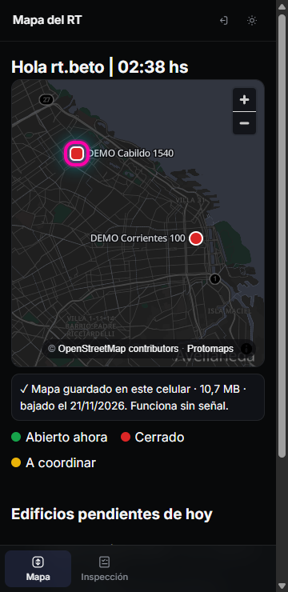

### 5.2 La tarjeta del edificio

Tocá un pin y aparece la **tarjeta del edificio** con:

- La **dirección**.
- El **estado** (abierto, cerrado o a coordinar).
- El **encargado** del edificio y su teléfono, si están cargados («Sin datos del encargado» si no).
- Los **horarios** de cada día.
- El botón **Cómo llegar**: abre la aplicación de mapas de tu celular con el camino.
- El botón **Verificar que estoy en el edificio**: confirma que estás en el lugar.

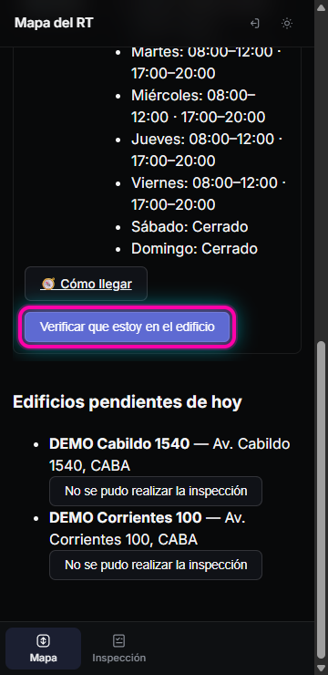

La **primera vez que entrás como RT de calle**, el sistema te muestra un **aviso de consentimiento** sobre el uso de tu ubicación (Ley 25.326). Hay que **leerlo y aceptarlo** para seguir: sin aceptarlo no se puede usar la pantalla. El texto aclara que la ubicación **no se usa para controlar tu recorrido ni tu horario** y que la ven la Secretaría y el Firmante del edificio. Para leerlo hace falta tener señal.

### 5.3 Usar el mapa sin señal

En la calle y en los sótanos a veces no hay señal. Por eso el mapa se puede **bajar una vez al celular** (ver la [sección 9](#9-estado-del-sistema)). Después, aunque no tengas señal:

- El mapa y los pines se siguen viendo.
- Un cartel te avisa que los edificios son **«los últimos datos descargados»** y de qué hora son.

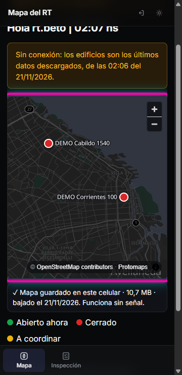

> **Sin señal no podés iniciar una inspección** nueva, porque necesita hablar con el sistema. Volvé a abrir la aplicación cuando tengas señal.

### 5.4 Hacer la inspección

1. Tocá **Inspección** (botón de abajo).
2. Seguí los pasos de la [sección 8](#8-inspección-técnica-el-checklist).

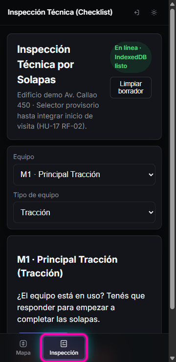

---

## 6. Portal Firmante

El **Firmante** es la persona responsable ante la AGC. En **Portal Firmante (RT Legal)** ve:

- Un resumen: **Total de máquinas**, **Recorridas**, **Pendientes**, **Advertencias** y **Autorizadas AGC**.
- Una tarjeta por cada máquina, con su edificio, la ECA, el RT de calle, el mes y el estado (**Recorrida**, **Pendiente de visita** o **Advertencia**).
- El botón **Auditar Informe y Fotos** de cada máquina.

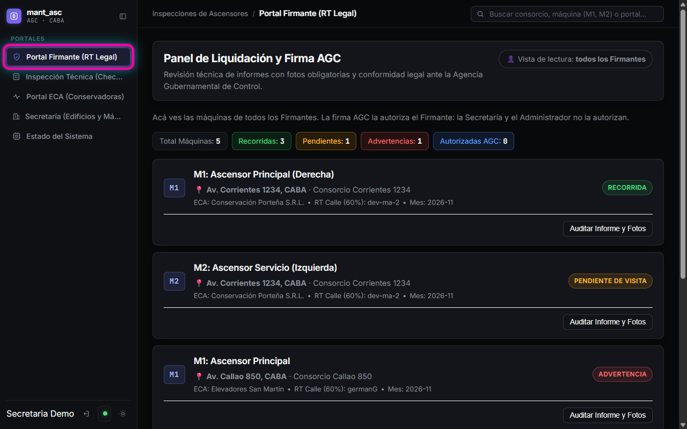

**Quién autoriza la firma:** solamente el **Firmante**. La Secretaría y el Administrador pueden **mirar** («Vista de lectura: todos los Firmantes») pero **no firman**. La pantalla lo recuerda con un cartel.

---

## 7. Portal ECA

La **ECA** (empresa conservadora) entra a **Portal ECA (Conservadoras)**. Es una pantalla **de solo lectura**: se mira, no se modifica.

1. Elegí la **empresa** en la lista de arriba.
2. Elegí el **mes** en «Período / Mes».
3. Mirá:
   - **Alertas críticas de flota**: máquinas **fuera de servicio** con el motivo y la fecha de detección. Cada una tiene el botón **Despachar Alerta WhatsApp**.
   - **Medidor de cobertura mensual**: cuántas máquinas hay, cuántas se inspeccionaron, cuántas se firmaron ante la AGC y cuántas faltan visitar.
   - La **tabla de flota**: una fila por máquina con su edificio, el RT de calle, el estado de la inspección y la certificación legal.

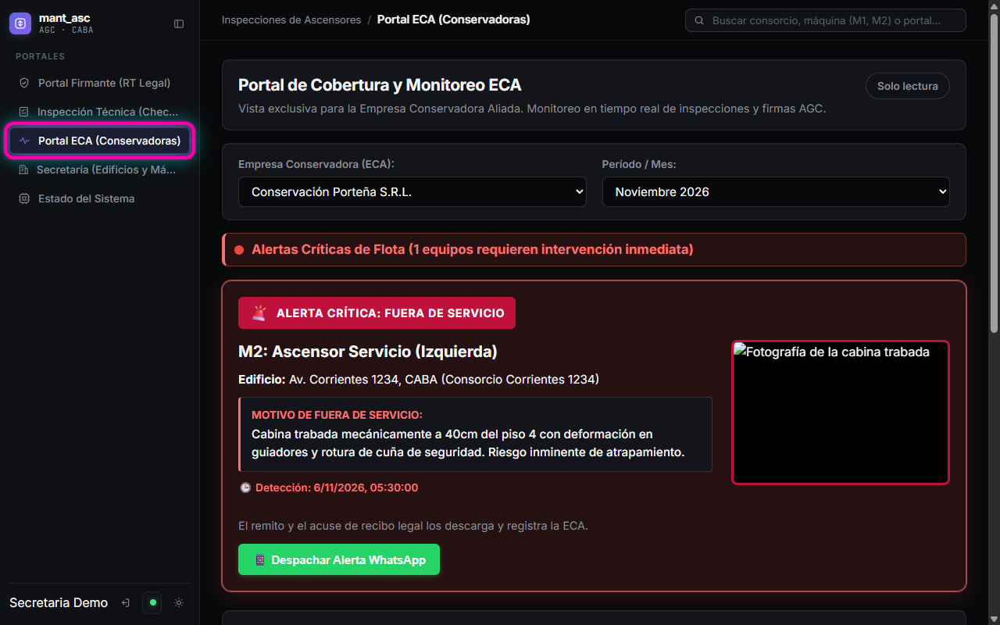

> Si el WhatsApp no está configurado, el envío por WhatsApp no sale. Ver la [sección 11](#11-puesta-en-marcha-de-los-avisos-por-whatsapp).

---

## 8. Inspección Técnica (el checklist)

Es la pantalla donde el RT de calle **completa la revisión de un ascensor**. Funciona por **solapas** (pestañas).

1. Tocá **Inspección Técnica (Checklist)** en el menú, o **Inspección** en el celular.
2. Arriba dice si estás **«En línea»** o sin conexión. Los datos que escribas se guardan en el aparato como **borrador**, para no perderlos si se corta la señal. El botón **Limpiar borrador** los borra.
3. Elegí la **máquina** (por ejemplo «M1 · Principal Tracción») y su **tipo de equipo** (Tracción, Hidráulico o Montavehículos).
4. Contestá **«¿El equipo está en uso?»**:
   - **Sí, en uso**: se habilitan las solapas para completar la revisión.
   - **No, fuera de servicio**: el equipo no está andando. Hay que explicar el motivo. Un equipo fuera de servicio o con falla crítica puede dar lugar a un aviso como los de la [sección 4.6](#46-avisos-a-la-eca).
5. Completá las solapas una por una y sacá las **fotos** que pida el checklist.

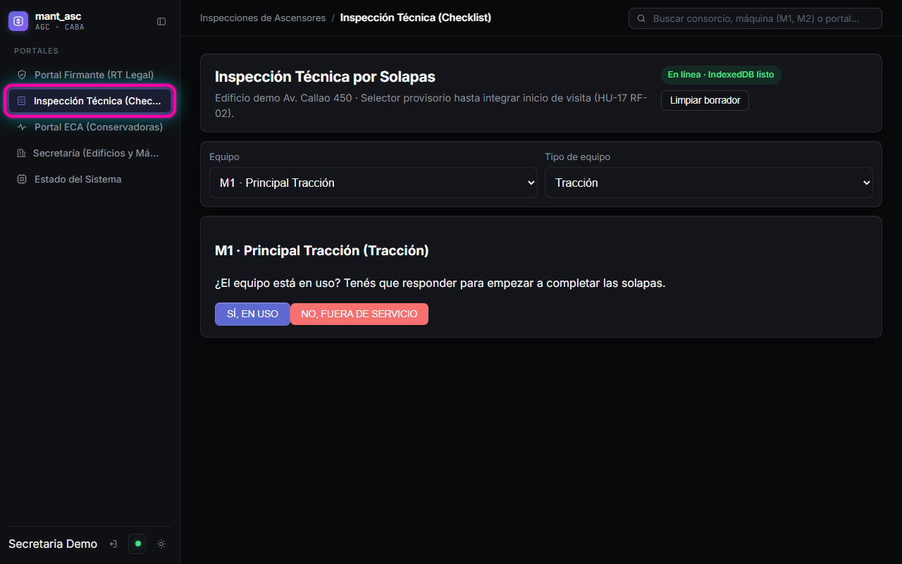

> En esta versión, el edificio de la pantalla («Edificio demo Av. Callao 450») es un **selector provisorio**: todavía no se conecta con «Inicio de visita». Es una limitación conocida (ver la [sección 14](#14-lo-que-la-aplicación-todavía-no-hace)).

---

## 9. Estado del Sistema

Sirve para saber si **todo está funcionando** y para **bajar el mapa al celular**.

1. Entrá a **Estado del Sistema**.
2. Mirá las tarjetas. Cada una indica «En línea» cuando anda bien:
   - **Backend (NestJS)**: el servidor de la aplicación.
   - **Base de datos**: donde se guarda todo.
   - **Modo offline (PWA)**: si la aplicación quedó preparada para trabajar sin señal.
   - **Interfaz**: el tema visual elegido.
3. Más abajo está **«Mapa de CABA para usar sin señal»**.
4. Con **wifi**, tocá **Descargar mapa para usar sin señal**. Baja un archivo de unos 11 MB **una sola vez**. Cuando termina, dice «**Mapa guardado en este celular**», con el tamaño y la fecha.
5. A partir de ahí, el mapa se ve completo **aunque no tengas señal**.

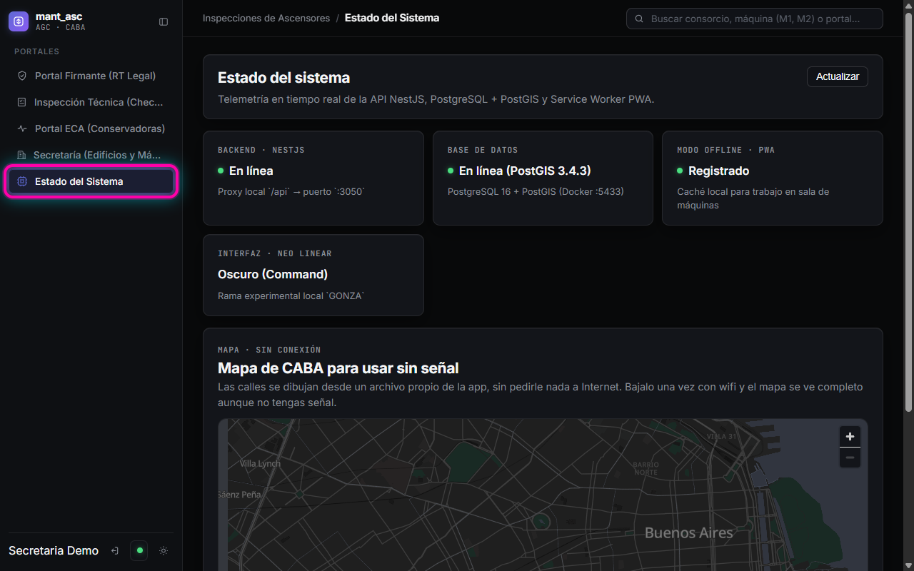

El botón **Actualizar** de la pantalla vuelve a consultar el estado.

---

## 10. Si sos Administrador: usuarios y permisos

Solamente el **Administrador** ve la sección **Usuarios y permisos**. Ahí se **crean las cuentas** de todas las personas.

### Crear una cuenta

1. Entrá a **Usuarios y permisos**.
2. En **Nueva cuenta**, completá:
   - **Usuario**: el nombre con el que va a entrar.
   - **Nombre y apellido**.
   - **Email**: ahí llega el enlace para elegir la contraseña.
   - **Rol (permisos)**: **RT de Calle**, **Secretaría**, **Firmante AGC**, **ECA** o **Administrador**. Debajo del rol hay una frase que explica qué puede hacer.
   - **Contraseña (opcional)**.
3. Tocá **Crear usuario**.

**Sobre la contraseña:**

- **La mejor opción es dejarla vacía.** El sistema genera una clave al azar que **nadie ve**, y la persona elige la suya con «Olvidé mi contraseña»: le llega el enlace por correo. Así nadie más conoce su clave.
- Si la escribís vos, tiene que tener **al menos 10 caracteres**.

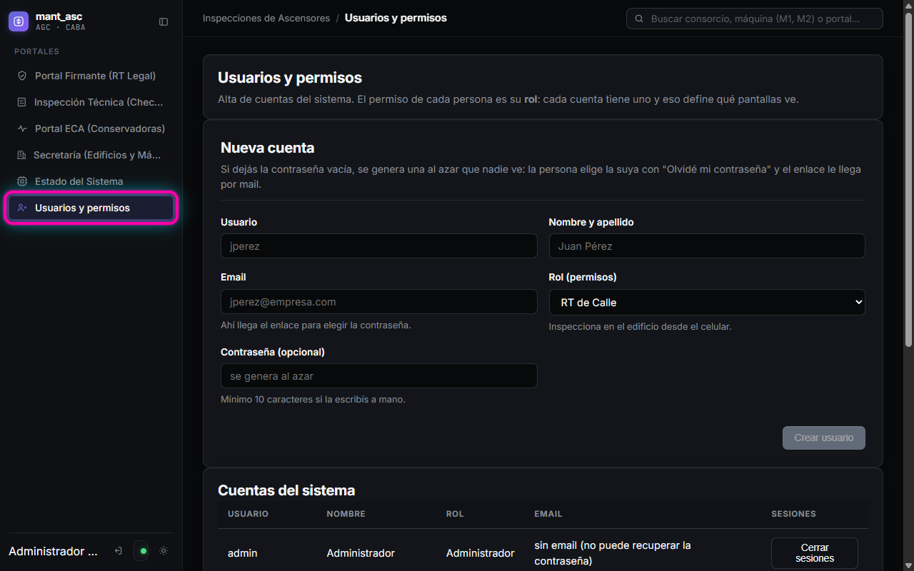

### La lista «Cuentas del sistema»

Muestra el **usuario**, el **nombre**, el **rol**, el **email** y las **sesiones**. Si una cuenta dice «sin email (no puede recuperar la contraseña)», cargale un email. El botón **Cerrar sesiones** saca a esa persona de todos los aparatos donde esté conectada: usalo si se perdió un celular.

---

## 11. Puesta en marcha de los avisos por WhatsApp

> Esta parte **no la hace el usuario común**. La hace quien administra el servidor, **una sola vez**. Se incluye para que se sepa qué falta si el cartel dice «WhatsApp no configurado».

Para que el sistema mande WhatsApp se necesita **una cuenta con un proveedor** (Meta o Twilio) y un **número de teléfono**. Mientras eso no esté, la aplicación funciona igual, pero los avisos solo salen por correo.

### Lista de verificación

| # | Qué hacer | Quién |
|---|---|---|
| 1 | Crear la cuenta con el proveedor (Meta WhatsApp Cloud API **o** Twilio) | El dueño de la empresa |
| 2 | Registrar y verificar el número de teléfono de la empresa | El dueño de la empresa |
| 3 | Registrar la **plantilla** del mensaje en el panel del proveedor y esperar su aprobación (puede llevar **días**) | El dueño de la empresa |
| 4 | Cargar las credenciales en las **variables de entorno del servidor** (nunca en el código ni en el repositorio) | Quien administra el servidor |
| 5 | Configurar el **webhook** para que el proveedor avise el estado de cada mensaje | Quien administra el servidor |
| 6 | Probar con un número propio y mirar el cartel de la bandeja de avisos | Secretaría |

- **El texto exacto de la plantilla** (qué copiar, las 5 variables y sus ejemplos) está en [RF-08-plantilla-whatsapp.md](../pruebas/hu-11-hu-11-notificaciones-automatic/RF-08-plantilla-whatsapp.md).
- **Las variables de entorno** están listadas, sin valores, en el archivo `.env.example` del repositorio.
- **El webhook** tiene dos direcciones: `/api/whatsapp/webhook/meta` y `/api/whatsapp/webhook/twilio`. Ver [RF-09-entrega.md](../pruebas/hu-11-hu-11-notificaciones-automatic/RF-09-entrega.md).

**Cómo saber que quedó bien:** en **Avisos a la ECA** el cartel pasa a **«WhatsApp activo: Meta»** (o Twilio), y al aprobar un aviso el envío avanza de «Aceptado» a «Entregado» y «Leído».

> **Aviso de seguridad.** Las credenciales **no se pegan en chats, mails ni documentos**. Si alguna se expuso, hay que cambiarla.

---

## 12. Problemas comunes

| Qué pasa | Qué hacer |
|---|---|
| **No me deja entrar** | Revisá mayúsculas y minúsculas del usuario y la clave. Si no te acordás, usá «Olvidé mi contraseña». |
| **No me llega el correo de recuperación** | Mirá en «No deseado» o «Spam». Si tu cuenta no tiene email cargado, pedile al Administrador que lo cargue. |
| **Me falta una pantalla del menú** | Tu rol no la usa. No es un error. El Administrador puede cambiarte el rol. |
| **El mapa no se dibuja** | Si dice «El mapa no está disponible», falta el archivo del mapa en el servidor: avisale a quien administra (el archivo viene con la app; ver README). Si dice «Mapa sin descargar», conectate a una red para bajarlo. Si no dice nada, probá con otro wifi. |
| **Un edificio no aparece en el mapa** | No tiene ubicación cargada. Abrí su ficha y fijá el punto en el mapa. Igualmente aparece en las listas. |
| **No hay mapa sin señal en el celular** | Con wifi, entrá a **Estado del Sistema** y tocá **Descargar mapa para usar sin señal**. |
| **Cartel «WhatsApp no configurado»** | Falta la puesta en marcha de la [sección 11](#11-puesta-en-marcha-de-los-avisos-por-whatsapp). Los avisos salen solo por correo. |
| **Un envío figura «Falló»** | Leé el motivo que se muestra. Corregí el dato (por ejemplo, el teléfono) y tocá **Reintentar envío**. |
| **Sin señal no puedo empezar la inspección** | Es así: necesita comunicarse con el sistema. Buscá señal o wifi. |
| **Perdí un celular con la aplicación abierta** | Avisale al Administrador: en **Usuarios y permisos** puede tocar **Cerrar sesiones**. |

---

## 13. Glosario

| Palabra | Qué quiere decir |
|---|---|
| **AGC** | Agencia Gubernamental de Control: el organismo de CABA que controla los ascensores |
| **ECA** | Empresa Conservadora Aliada: la empresa que mantiene los ascensores |
| **RT** | Responsable Técnico |
| **RT de Calle** | El técnico que visita el edificio con su celular |
| **Firmante** | El responsable técnico que firma los informes ante la AGC |
| **Consorcio** | El edificio y su administración |
| **Máquina** | Un ascensor (se nombran M1, M2, M3…) |
| **Ficha** | La hoja de datos oficial del edificio y sus máquinas |
| **Checklist** | La lista de puntos que se revisan en cada ascensor |
| **Semáforo** | El panel de colores que muestra qué edificios faltan inspeccionar |
| **Terna** | El grupo de tres responsables de un edificio (RT de calle, Firmante y ECA) |
| **Remito** | El comprobante de la visita que se manda a la ECA |
| **Falla crítica** | Una falla grave, por ejemplo un ascensor fuera de servicio |
| **Fuera de servicio** | El ascensor no funciona |
| **Pin** | El marcador de un edificio en el mapa |
| **Sin señal / offline** | Sin internet |
| **Borrador** | Lo que escribiste y se guardó en el aparato, todavía sin enviar |
| **Plantilla (WhatsApp)** | El texto del mensaje, aprobado de antemano por el proveedor |
| **Webhook** | La forma en que WhatsApp le avisa al sistema si un mensaje llegó |
| **PWA** | Una página web que se puede instalar como aplicación y funciona sin señal |

---

## 14. Lo que la aplicación todavía no hace

Para que no te lleves sorpresas, esto es lo que **hoy no está** o **no se pudo probar**:

- **El envío real por WhatsApp no se probó con Meta ni Twilio.** Todo está construido y probado con simulaciones; falta la cuenta y el número reales (ver [sección 11](#11-puesta-en-marcha-de-los-avisos-por-whatsapp)).
- **El historial de envíos de WhatsApp se guarda en memoria del servidor:** si el servidor se reinicia, se pierde.
- **No hay seguimiento de técnicos en vivo.** El mapa muestra solo edificios.
- **Sin señal no se puede iniciar una inspección.** Se ve el mapa y los últimos datos, nada más.
- **Los datos del Mapa del RT quedan guardados sin cifrar en el celular** (nombres, direcciones y teléfonos de los encargados) hasta que cerrás sesión. Por eso hay que **cerrar sesión** en aparatos compartidos.
- **La ficha del edificio no entra completa en un celular angosto** (360 px): hay que desplazarse hacia los costados. Está pensada para compu.
- **La pantalla de Inspección Técnica usa un selector provisorio de edificio**, todavía sin «Inicio de visita».
- **El zoom con dos dedos (pellizco) del mapa no se probó** en un celular físico.
- **El estado general de un aviso puede seguir diciendo «Enviado»** aunque WhatsApp falle después; el detalle real está en la lista de envíos de ese aviso.

Si encontrás otro problema, anotá **qué pantalla era, qué tocaste y qué mensaje apareció** (mejor con una captura) y pasáselo a quien administra el sistema.
