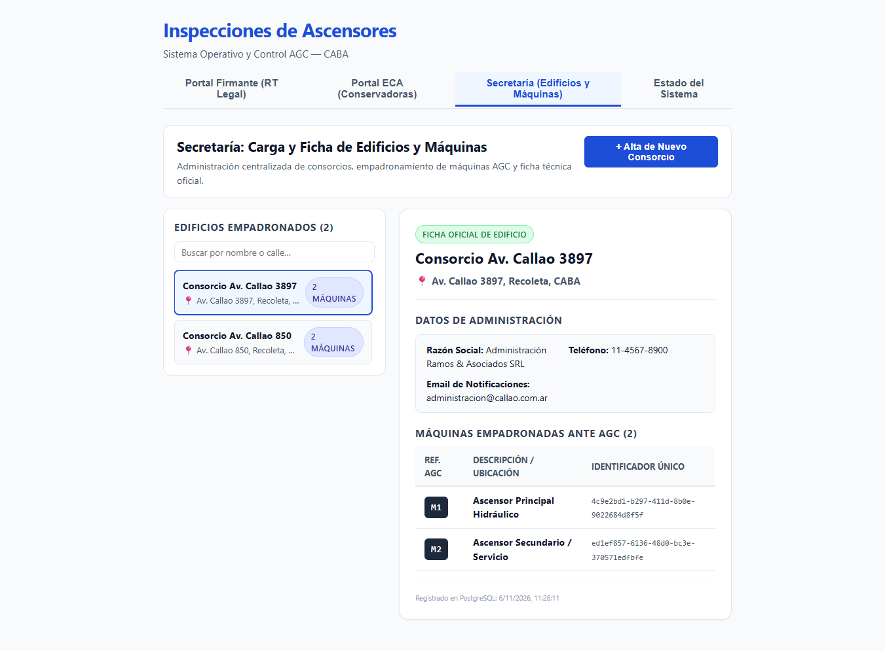

# HU-01 · Entrega — UI de Secretaría: Carga y Ficha de Edificios y Máquinas

- **Tarea:** HU-01 / RF-02 — `REQ-1791910394885`
- **Rama:** `feature/hu-01-hu-01-gestion-y-alta-de-eca-y/req-1791910394885-ui-de-secretaria-carga-y-ficha-de-edific`
- **Script del flujo integrado:** [RF-02-entrega.sh](RF-02-entrega.sh)

## 1. Qué quedó implementado

Se implementó en React (`apps/web`) la interfaz completa de usuario para el módulo de **Secretaría y Administración**:

1. **Formulario de Alta de Consorcios con Grilla Dinámica de Máquinas (`FormularioConsorcio.tsx`)**:
   - **Datos de inmueble**: Campos para Nombre del Consorcio y Dirección literal en CABA.
   - **Datos de administración**: Campos para Razón Social / Administrador, Teléfono y Email oficial de notificaciones.
   - **Grilla dinámica de Máquinas AGC**:
     - Botón `+ Agregar Otra Máquina` para añadir filas de ascensores en tiempo real.
     - Inputs para `Referencia AGC` (normalizada a mayúsculas, ej. `M1`, `M2`, `M3`) y `Descripción / Ubicación` (ej. `Ascensor Principal`, `Montacargas`).
     - Botón para quitar filas asegurando que al menos exista 1 máquina por consorcio.
     - Validación local y manejo de respuestas de error 400 del backend mostrando la lista completa de campos observados.
   - Conectado directamente a `POST /api/consorcios` con persistencia en PostgreSQL real.

2. **Ficha Técnica Oficial del Edificio (`FichaConsorcio.tsx`)**:
   - Visualización completa de los datos del consorcio: nombre, dirección literal con ícono de geolocalización, datos de contacto de la administración.
   - Tabla de máquinas empadronadas ante AGC con sus códigos (`M1`, `M2`), descripciones e identificadores únicos UUID generados por la base de datos.
   - Timestamp de fecha y hora de registro oficial.

3. **Vista Integral de Secretaría (`SecretariaView.tsx`)**:
   - Layout Master-Detail profesional:
     - Panel izquierdo con listado de todos los edificios empadronados, contador de máquinas asociadas y buscador rápido en tiempo real por nombre o dirección.
     - Panel derecho con la Ficha Técnica del consorcio seleccionado.
     - Botón en cabecera `+ Alta de Nuevo Consorcio` para desplegar el formulario de carga.
     - Al registrar un nuevo consorcio, se refresca la lista automáticamente y se selecciona la nueva ficha creada.

4. **Navegación en la aplicación (`App.tsx`)**:
   - Nueva pestaña **"Secretaría (Edificios y Máquinas)"** integrada junto al Portal Firmante y Portal ECA.

5. **Pruebas Automatizadas (`consorcios.test.ts`)**:
   - 6 pruebas en Vitest verificando fetch de listado, obtención de ficha por ID, creación exitosa en el endpoint y captura de errores de validación.

## 2. Cómo se levanta y cómo se prueba

Requisitos: Node.js 22 o superior, Docker y PostgreSQL levantados.

```bash
# Iniciar la aplicación web
npm run dev -w apps/web

# Ejecutar las pruebas automatizadas (Vitest)
npm test -w apps/web -- consorcios

# Ejecutar la verificación integrada del flujo
bash docs/pruebas/hu-01-hu-01-gestion-y-alta-de-eca-y/RF-02-entrega.sh
```

### Pruebas automatizadas (en verde)

| Comando | Resultado |
|---|---|
| `npm run typecheck --workspaces` | TypeScript compila sin errores en `@mant-asc/api` y `@mant-asc/web`. |
| `npm test -w apps/web` | 33 tests en verde (6 de `consorcios.test.ts` + 27 existentes). |
| `npm run verify` | 65 tests Jest en API + 33 tests Vitest en Web = 98 tests en verde total. |
| `npm run build -w apps/web` | Bundle Vite generado exitosamente con PWA y Service Worker. |

## 3. Criterios de Aceptación Cubiertos

- **TEST-1791910394895-0**: *La pestaña de administracion muestra el formulario de alta de consorcios con campos de direccion, administracion y grilla dinamica de maquinas AGC (M1, M2).*
- **TEST-1791910394900-2**: *El listado permite seleccionar cualquier consorcio y visualizar su ficha tecnica completa y maquinas asociadas.*

## 4. Evidencia Visual de Pruebas en el Navegador



- **Inspección en vivo**: Prueba realizada sobre formulario de alta de consorcio `+ Alta de Nuevo Consorcio`.
- **Validación**: Carga de dirección literal CABA (`Av. Callao 1540, Recoleta, CABA`), administración (`Administración Ramos & Asociados SRL`) y grilla de máquinas AGC (`M1: Ascensor Principal Hidráulico`).
- **Resultado comprobable**: Inserción exitosa en PostgreSQL/PostGIS, actualización inmediata del listado Master-Detail y renderizado de la Ficha Técnica Oficial del edificio.

