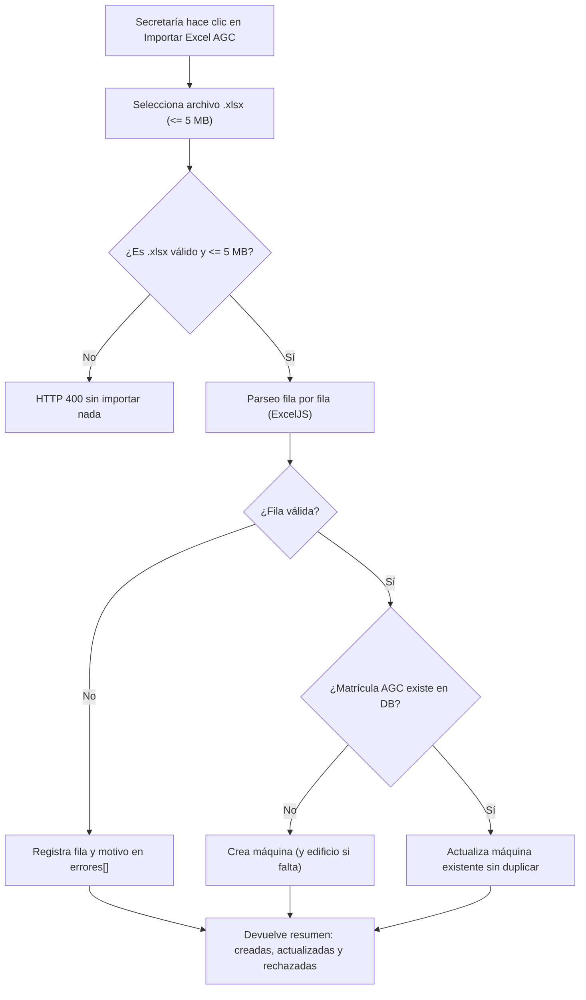

# HU-01 · RF-03 — Importar el listado Excel de la AGC (máquinas, ubicaciones y estados)

**Historia de Usuario:** HU-01: Gestión y Alta de ECA y Consorcios  
**Requerimiento:** RF-03 (`REQ-1794493276677`)  
**Desarrollador:** `gonza`  

## Qué quedó implementado

Se incorporó el importador oficial del padrón Excel de la AGC (`.xlsx`, hasta 5 MB) para que la Secretaría pueda dar de alta y actualizar edificios y máquinas sin duplicar matrículas AGC:

- **Migración de base de datos (`032_maquinas_estado_agc`)**: agrega la columna `estado_agc text` en la tabla `maquinas` para persistir el estado informado por la AGC (`APTO`, `NO APTO`, `OBSERVADO`, `CONDICIONAL`, `FUERA DE SERVICIO`, `PENDIENTE`, `CLAUSURADO`, `BAJA`).
- **Servicio `ImportadorAgcService` (`apps/api/src/consorcios/importador-agc.service.ts`)**:
  - Valida extensión `.xlsx`, tamaño `<= 5 MB` (5.242.880 bytes exactos), cabecera mágica OOXML (`PK\x03\x04`) y estructura válida del libro Excel mediante `exceljs`.
  - Mapea columnas obligatorias de forma insensible a tildes y mayúsculas: **Dirección**, **Matrícula AGC**, **Tipo de equipo** (`traccion`, `hidraulico`, `montavehiculos`) y **Estado** (`APTO`, etc.), más columnas opcionales (**Nombre Edificio**, **Descripción**, **Latitud**, **Longitud**).
  - Valida fila por fila: si una fila es inválida o tiene una matrícula AGC duplicada dentro del mismo archivo, se informa su número exacto de fila (`fila`) y el `motivo` sin interrumpir la importación del resto de las filas válidas.
- **Persistencia sin duplicados (`PgConsorciosRepository.importarMaquinasAgc`)**:
  - Crea consorcios nuevos por dirección cuando no existen y busca máquinas existentes por matrícula AGC (`LOWER(TRIM(referencia_agc))`) actualizando tipo, estado AGC, dirección y descripción sin duplicar registros.
- **Endpoints en `ConsorciosController`**:
  - `POST /api/consorcios/importar-agc` (`@Roles('secretaria', 'administrador')`): recibe `multipart/form-data` en el campo `archivo`. Todo archivo que no sea `.xlsx` o supere 5 MB se rechaza con **HTTP 400** (incluyendo captura de `PayloadTooLargeException` de Multer como 400).
  - `GET /api/consorcios/importar-agc/plantilla` (`@Roles('secretaria', 'administrador')`): descarga `plantilla-padron-agc.xlsx` lista para completar.
- **Interfaz Web (`SecretariaView.tsx`, `ImportadorExcelAgc.tsx`, `FichaConsorcio.tsx`)**:
  - En Secretaría aparece el botón `Importar Excel AGC`, que despliega el panel `Importar listado Excel de la AGC (.xlsx)` con los botones `Descargar plantilla .xlsx`, el selector de archivo `.xlsx` y el botón `Importar listado AGC`.
  - Muestra el resumen cuantitativo (`Máquinas creadas`, `Máquinas actualizadas`, `Filas rechazadas`, `Edificios creados`), tabla de errores por número de fila y detalle de máquinas procesadas.
  - La Ficha Técnica del consorcio (`FichaConsorcio.tsx`) agrega la columna `Estado AGC` en la tabla de máquinas.

## Flujo del circuito



## Cómo levantarlo y probarlo

```bash
# 1. Levantar PostgreSQL + PostGIS
npm run db:up

# 2. Cargar usuarios demo (si aún no están cargados)
bash docs/pruebas/hu-04-hu-04-semaforo-de-control-mens/RF-02-datos-demo.sh

# 3. Levantar API y Web
npm run dev

# 4. Correr script de entrega integrado (crea datos temporales y los limpia al terminar)
bash docs/pruebas/hu-01-hu-01-gestion-y-alta-de-eca-y/RF-03-entrega.sh

# 5. Correr prueba de carga (ej. 20 corridas)
bash docs/pruebas/hu-01-hu-01-gestion-y-alta-de-eca-y/RF-03-entrega.sh --carga 20
```

### Paso a paso manual en pantalla

1. Iniciar sesión en `https://localhost:8050` con rol Secretaría (`demo.secretaria`).
2. En el encabezado de Secretaría, presionar el botón `Importar Excel AGC`.
3. Opcionalmente presionar `Descargar plantilla .xlsx` para obtener un archivo modelo válido.
4. Seleccionar el archivo `.xlsx` en el campo `Archivo Excel AGC (.xlsx)` y presionar `Importar listado AGC`.
5. Verificar el panel de resultados con los contadores `Máquinas creadas`, `Máquinas actualizadas` y `Filas rechazadas`, más la tabla de errores por fila (si existieran) y el listado de edificios actualizado.

## Pruebas automáticas

- **API E2E**: `apps/api/test/importar-agc.e2e-spec.ts` — 5 pruebas (altas + re-importación sin duplicados, filas inválidas con número y motivo, rechazo 400 de archivos no `.xlsx`, rechazo 400 de archivos > 5 MB, roles 401/403 y descarga de plantilla `.xlsx`).
- **API Integración PostgreSQL**: `apps/api/test/importar-agc.int-spec.ts` — verifica persistencia real en PostgreSQL, actualización por matrícula AGC sin duplicados y columna `estado_agc`.
- **Web Unitarias**: `apps/web/src/consorcios/importador-agc.test.ts` — 3 pruebas (validación cliente de extensión y tamaño 5 MB, renderizado de controles literales en `SecretariaView` e `ImportadorExcelAgc`, y envío `multipart/form-data`).

## Supuestos y limitaciones

- Según P11 (`docs/cliente/DEFINICIONES-CLIENTE.md`), mientras MAICON provee el Excel real descargado de AGC, se trabaja con las columnas estándar `Dirección`, `Matrícula AGC`, `Tipo de equipo` y `Estado` (admitiendo múltiples alias sin distinguir tildes ni mayúsculas).
- Encargado, teléfono, horarios de atención y terna ECA/RT/Firmante se completan manualmente desde la ficha y pestaña de Asignación de Roles, tal como indicó el cliente.
