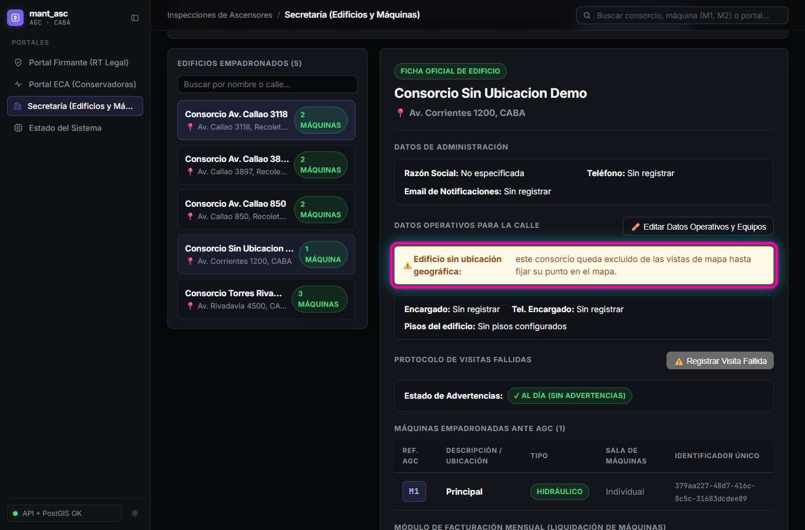
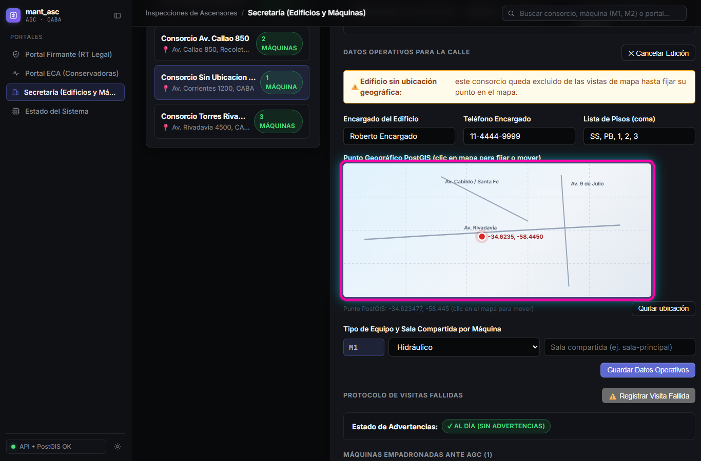
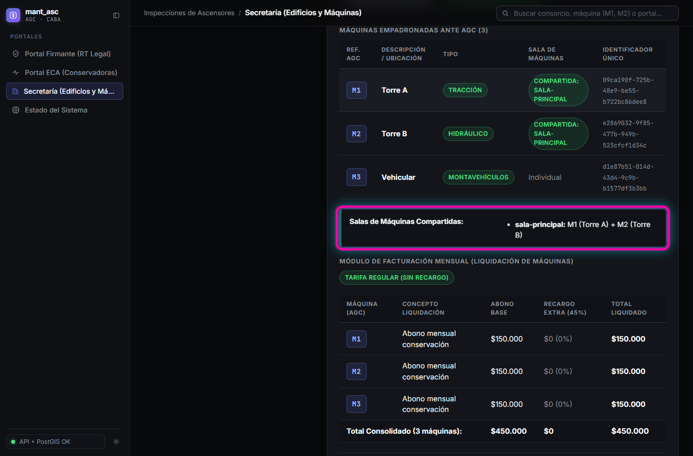

# Guía de Prueba — HU-01 · RF-05: Datos Operativos del Edificio y del Equipo para la Calle

**Requisito:** `REQ-1794493998460`
**Historia:** HU-01 — Gestión y Alta de ECA y Consorcios
**Fecha:** 2026-11-12

---

## Prerrequisitos

1. Base de datos PostgreSQL + PostGIS levantada (`npm run db:up`).
2. Entorno local activo (`npm run dev`), accesible en `https://localhost:8050`.
3. Estar en la pestaña **Secretaría** -> subpestaña **Edificios y Máquinas**.

---

## Caso 1: Edificio sin ubicación muestra advertencia y queda excluido del mapa

1. Abra un consorcio sin coordenadas asignadas (o dé de alta uno con el botón **+ Alta de Nuevo Consorcio** dejando el mapa sin clic).
2. Verifique en la ficha la advertencia resaltada bajo **Datos Operativos para la Calle**:
   > **Edificio sin ubicación geográfica: este consorcio queda excluido de las vistas de mapa hasta fijar su punto en el mapa.**

3. Verifique que al abrir **🗺️ Vista Mapa** o consultar `GET /api/consorcios/mapa`, este edificio no aparece entre los marcadores.

---

## Caso 2: Edición de encargado, pisos y punto geográfico PostGIS sobre el mapa

1. En la ficha del edificio, haga clic en **✏️ Editar Datos Operativos y Equipos**.
2. Complete los campos:
   - **Encargado del Edificio:** `Roberto Encargado`
   - **Teléfono Encargado:** `11-4444-9999`
   - **Lista de Pisos (coma):** `SS, PB, 1, 2, 3`
3. Haga clic sobre el mapa interactivo de CABA para fijar el punto geográfico PostGIS (`ubicacion`), y ajuste por cada máquina su **Tipo** (`Tracción`, `Hidráulico`, `Montavehículos`) y su **Sala de Máquinas** si la comparte.

4. Haga clic en **Guardar Datos Operativos**. El sistema persiste mediante `PUT /api/consorcios/:id` y desaparece la advertencia de falta de ubicación.

---

## Caso 3: Sala de máquinas compartida, tipo de equipo y Vista Mapa de Edificios

1. Seleccione un consorcio con 2 o más equipos en la misma sala (ej. `M1` de tipo **Tracción** y `M2` de tipo **Hidráulico** en `sala-principal`, más `M3` de tipo **Montavehículos**).
2. En la tabla **Máquinas Empadronadas ante AGC** verifique las columnas **Tipo** y **Sala de Máquinas**, y debajo el resumen **Salas de Máquinas Compartidas** agrupando los equipos juntos (`sala-principal: M1 (Torre A) + M2 (Torre B)`).
3. Haga clic en **🗺️ Vista Mapa** en la barra superior para corroborar la visualización exclusiva de edificios con ubicación PostGIS y el contador **Excluidos sin ubicación**.

