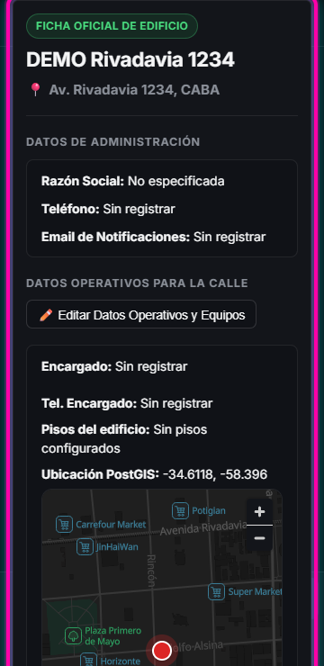
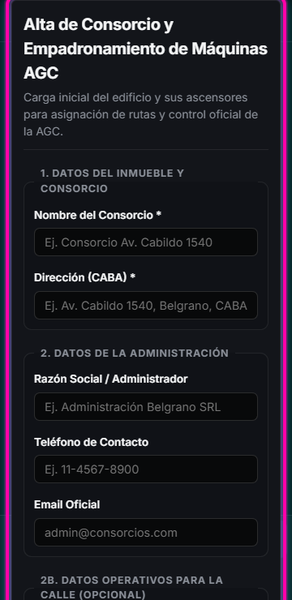
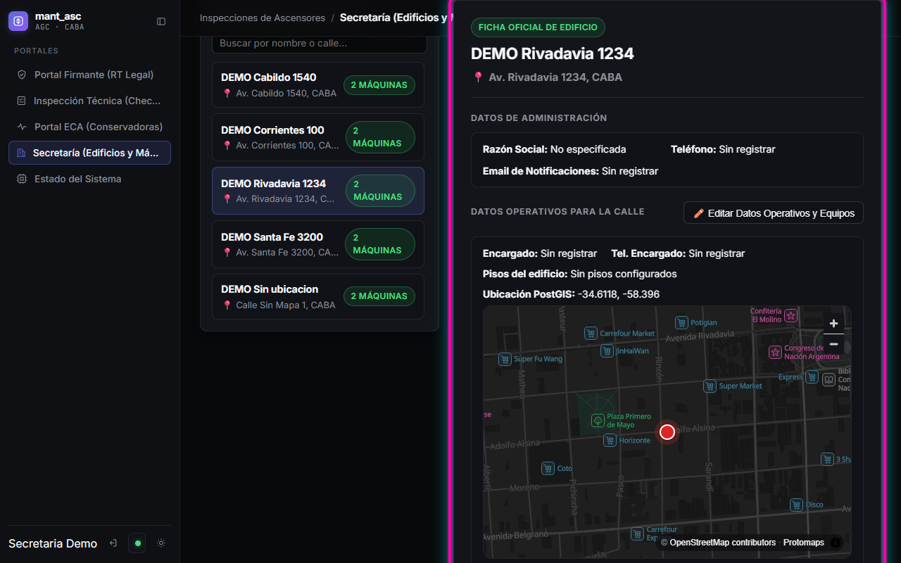
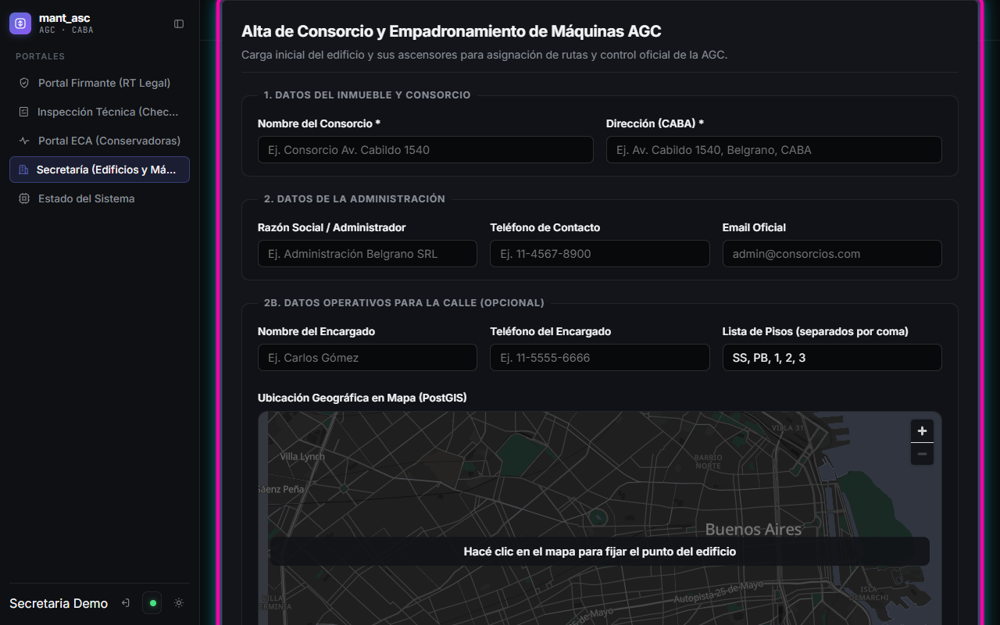

# HU-01 · RF-06 · Entrega — La ficha del edificio y el alta de consorcio entran en un celular de 360 px

- **Tarea:** HU-01 / RF-06 — `REQ-1795263643979`
- **Script:** [RF-06-entrega.sh](RF-06-entrega.sh) · **Prueba en el navegador y capturas:** [RF-06-capturas.cjs](RF-06-capturas.cjs)
- **Archivos cambiados:** [`apps/web/src/styles.css`](../../../apps/web/src/styles.css) y [`FichaConsorcio.tsx`](../../../apps/web/src/consorcios/FichaConsorcio.tsx) (una clase y una grilla en línea)

## 1. Qué quedó implementado

En un celular de 360 px, la pantalla de Secretaría medía **672 px** de ancho y el alta **730 px**. Había que desplazarla hacia los costados, y el mapa quedaba cortado. Las causas:

- La grilla de Secretaría (`340px 1fr` y, en celular, `1fr`) dejaba que el contenido más ancho estirara la columna. La tabla de máquinas mide unos 600 px.
- El bloque de máquinas del alta es un `fieldset`, y un `fieldset` no se achica por debajo de su contenido. Además, la fila de cada máquina no se acomodaba en varias líneas.
- En la edición de la ficha, las filas de máquinas (`80px 1fr 1fr`) y la grilla de tres campos tampoco se achicaban.

**Ahora:**

- Las grillas usan `minmax(0, 1fr)`: la columna mide lo que hay disponible, no lo que pide el contenido.
- Las tablas anchas (máquinas y facturación) se desplazan **dentro de su propia caja**, como ya estaba previsto con `.table-responsive`. La página no se mueve.
- Las solapas de Secretaría se desplazan dentro de su barra.
- En celular, las filas de máquinas del alta se acomodan en dos líneas, y los campos de los formularios van de a uno.

**En escritorio** la pantalla se ve igual, con la lista en su columna de 340 px. Lo único que cambia es un desborde que ya existía: la ficha en edición medía 1.355 px en una ventana de 1.280, por la grilla de tres campos. Ahora entra.

## 2. Cómo se levanta y se prueba

```bash
npm run db:up && npm run dev                                  # API
bash docs/pruebas/hu-04-hu-04-semaforo-de-control-mens/RF-02-datos-demo.sh
npm run build -w apps/web && npm run preview -w apps/web       # web compilada en https://localhost:4173
bash docs/pruebas/hu-01-hu-01-gestion-y-alta-de-eca-y/RF-06-entrega.sh
```

Sin la web compilada, el script igual corre los pasos 1 y 2 y avisa que omite el del navegador.

## 3. Qué datos hacen falta

Los datos de demo de HU-04 RF-02: usuario `demo.secretaria`, clave `Demo-Clave-2026`, edificio «DEMO Rivadavia 1234».

## 4. Qué endpoints o pantallas toca

Ningún endpoint. Pantallas: Secretaría (Edificios y Máquinas), con la lista, la ficha del edificio (lectura y edición) y el alta de nuevo consorcio.

## 5. Cómo se corre integrado

Resultado del 21/11/2026, en Chrome con Playwright:

| Condición | Resultado |
|---|---|
| 1. Ficha (lectura y edición) en 360 px: sin desplazamiento lateral y con el mapa completo | La página mide 360 px. El mapa mide 266 px en lectura y 300 px en edición, completo adentro |
| 2. Alta en 360 px: todos los campos, el mapa y los botones entran | La página mide 360 px; el mapa, 274 px; y los 23 campos y botones quedan adentro |
| 3. En escritorio se ven como antes | 1280 px: la lista sigue en 340 px. La ficha, la edición y el alta entran (la edición antes se salía 75 px) |
| 4. Guía visual con capturas de Playwright en 360 px y en escritorio | Pasos 1 a 4 de abajo |

`RF-06-entrega.sh`: 6 bien, 0 mal, 0 omitidos (con 7 comprobaciones en el navegador). La web completa: 616/616.

## Guía visual

Usuario `demo.secretaria`. Capturas con Playwright, con el elemento de cada paso resaltado en magenta.

### Paso 1 · Ficha del edificio en un celular de 360 px

En Secretaría, tocá «DEMO Rivadavia 1234».



**Qué tenés que ver:** la ficha ocupa el ancho de la pantalla, los datos se leen sin cortarse y el mapa entra completo. No hay barra de desplazamiento hacia los costados.

### Paso 2 · Alta de nuevo consorcio en 360 px

Tocá **+ Alta de Nuevo Consorcio**.



**Qué tenés que ver:** los campos van de a uno, el mapa entra completo y las filas de máquinas se acomodan en dos líneas.

### Paso 3 · Ficha en escritorio



**Qué tenés que ver:** igual que antes. La lista de edificios a la izquierda y la ficha a la derecha.

### Paso 4 · Alta en escritorio



**Qué tenés que ver:** igual que antes, con los campos en dos o tres columnas.

## Supuestos y límites

- Las tablas de máquinas y de facturación no se rediseñan para celular: se desplazan dentro de su caja. Pasarlas a tarjetas sería otra Tarea.
- Los cambios de estilo de los formularios (`.form-grid-2`, `.form-grid-3` y `.form-field > .field-input`) valen para toda la app. Revisé las pantallas de esta Tarea; en las demás, el cambio sólo evita que un campo se salga de su columna.
