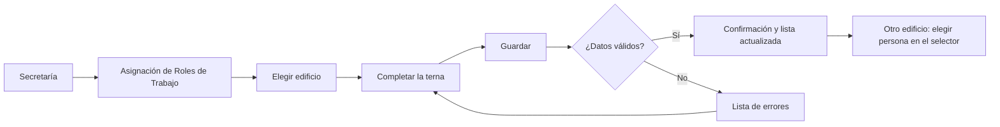
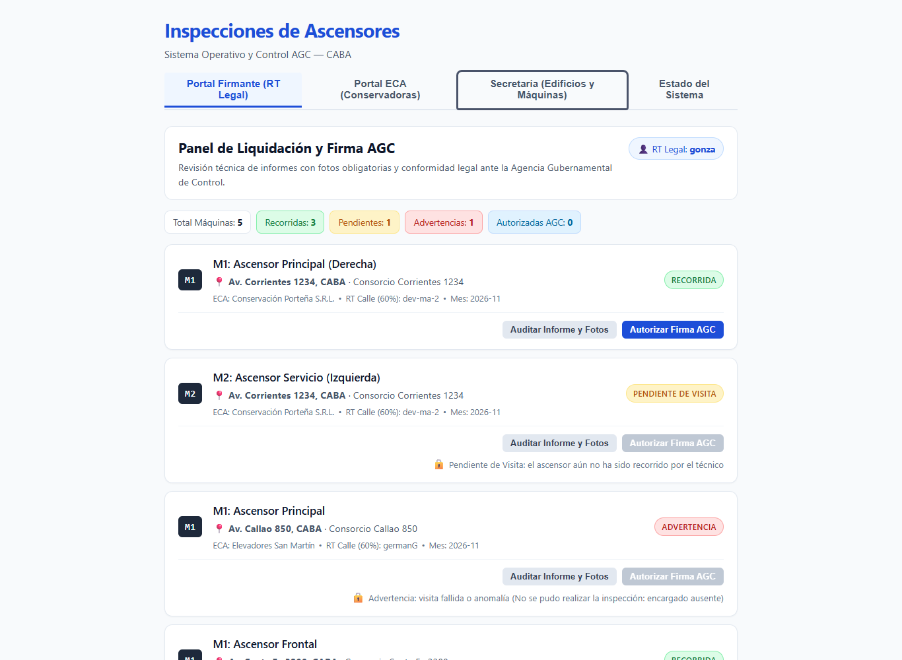
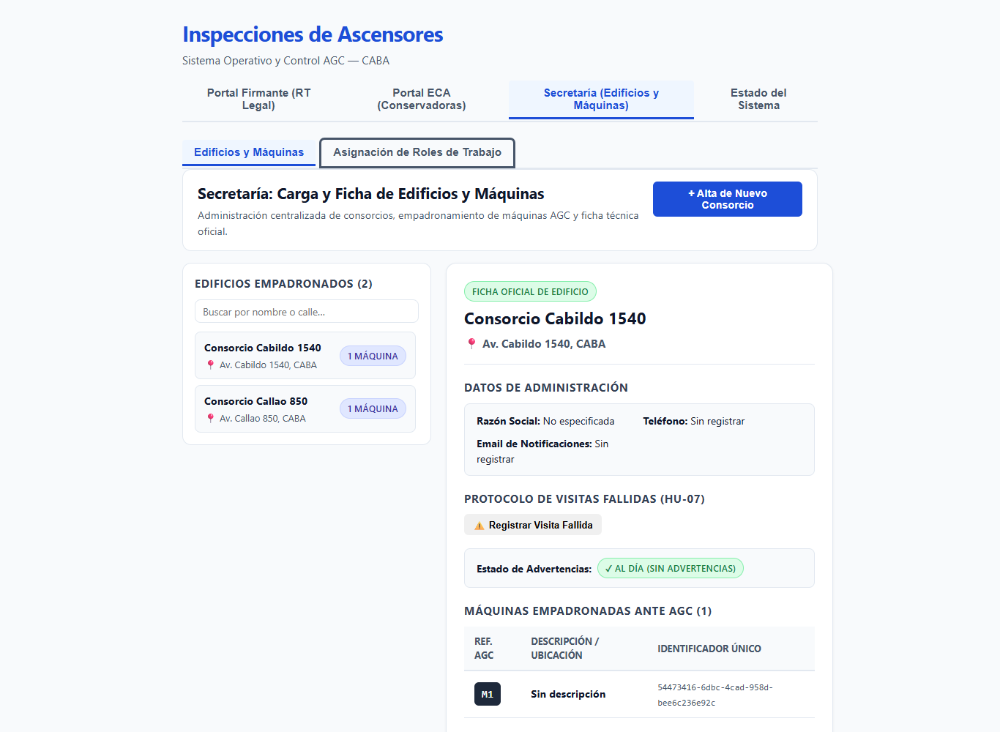
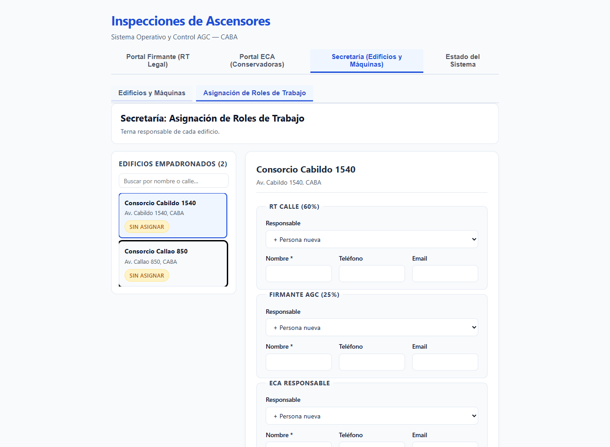
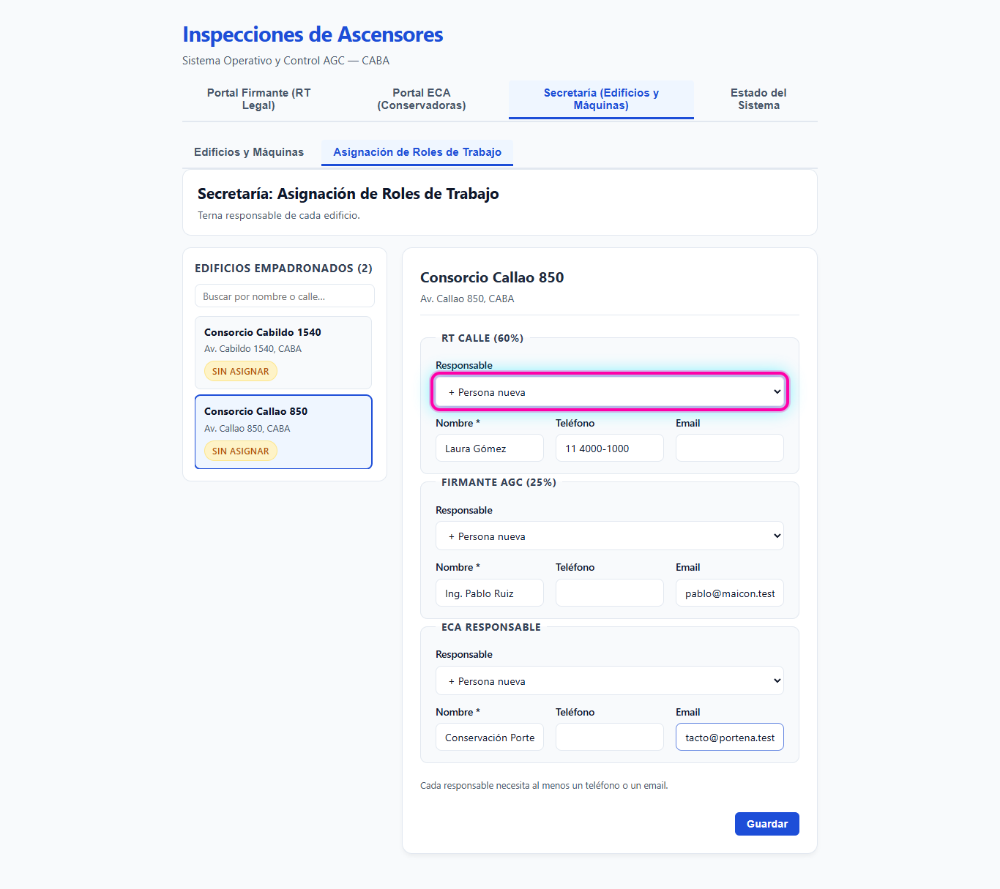
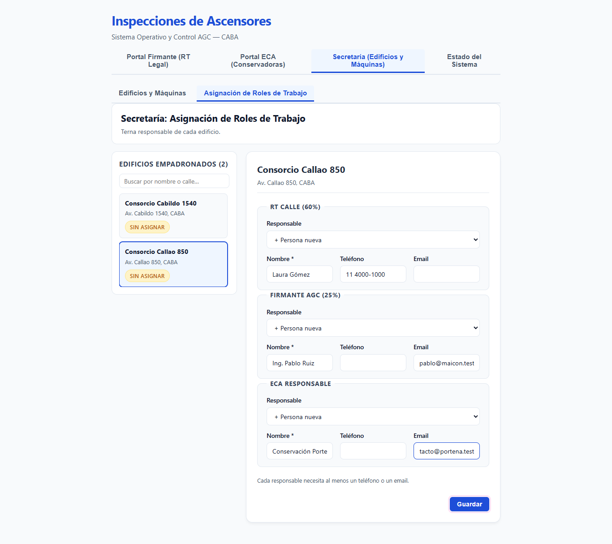
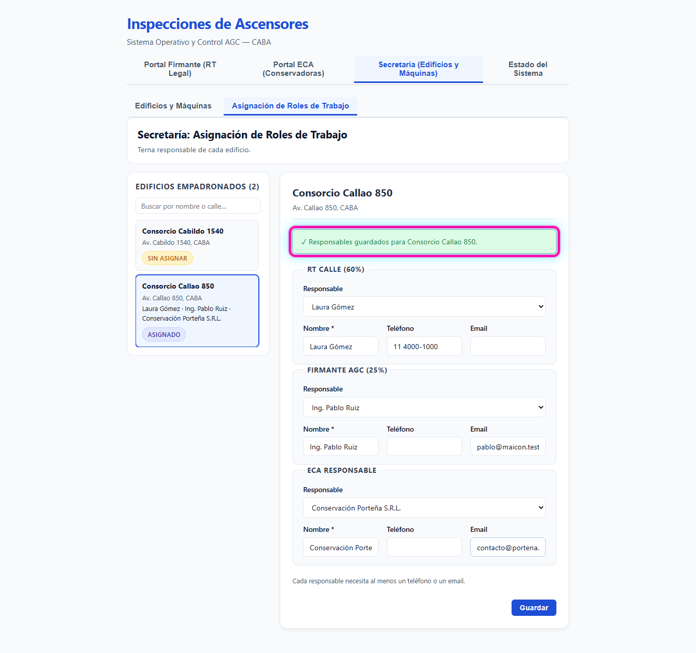
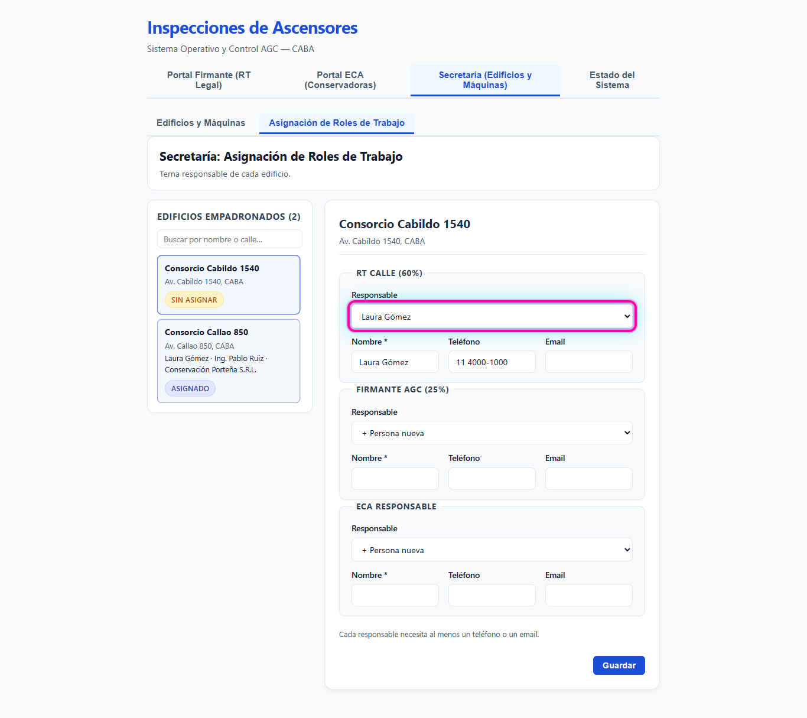

# HU-02 · RF-02 · Guía de prueba — Pestaña de Asignación de Roles de Trabajo

Recorrido de la pantalla con la que Secretaría asigna la terna de cada edificio.

**Antes de empezar:** tiene que haber al menos dos edificios en `Edificios Empadronados`. Si no hay, crealos con `+ Alta de Nuevo Consorcio` en la pestaña `Edificios y Máquinas`.

## Paso 1. Entrar a Secretaría

Abrí `https://localhost:8050` y apretá `Secretaría (Edificios y Máquinas)`.

## Paso 2. Abrir la pestaña

Apretá `Asignación de Roles de Trabajo`.

## Paso 3. Elegir el edificio

En `Edificios Empadronados`, apretá el edificio. Un edificio sin terna muestra el indicador `Sin asignar`.

## Paso 4. Completar la terna

Los bloques son `RT Calle (60%)`, `Firmante AGC (25%)` y `ECA Responsable`. Cada uno tiene el selector `Responsable`, con la opción `+ Persona nueva` y las personas que ya ocupan ese rol en otro edificio.

Con `+ Persona nueva` elegido, cargá:

| Bloque | `Nombre *` | `Teléfono` | `Email` |
|---|---|---|---|
| `RT Calle (60%)` | Laura Gómez | 11 4000-1000 | |
| `Firmante AGC (25%)` | Ing. Pablo Ruiz | | pablo@maicon.test |
| `ECA Responsable` | Conservación Porteña S.R.L. | | contacto@portena.test |

## Paso 5. Guardar

Apretá `Guardar`.

## Paso 6. Comprobar la confirmación

Aparece `✓ Responsables guardados para <nombre del edificio>.` Sin recargar la página, la fila del edificio pasa a `Asignado` y muestra los tres nombres.

## Paso 7. Reutilizar a una persona en otro edificio

Apretá otro edificio. En `RT Calle (60%)`, abrí el selector `Responsable` y elegí `Laura Gómez`: `Nombre *` y `Teléfono` se completan solos. Repetí con los otros dos roles y apretá `Guardar`.

## Comprobaciones adicionales

1. **Modificar:** en un edificio asignado, cambiá el `Nombre *` de `ECA Responsable`, apretá `Guardar` y recargá la página. El nombre nuevo sigue en la fila del edificio.
2. **Error:** dejá un responsable sin `Teléfono` ni `Email` y apretá `Guardar`. Aparece `Por favor corrija los siguientes errores:` y la terna anterior no cambia.
3. **Cambios sin guardar:** cambiá un dato sin apretar `Guardar` y apretá otro edificio. Aparece `Hay cambios sin guardar. ¿Salir y descartarlos?`. Con `Cancelar` seguís en el mismo edificio y conservás lo escrito.
