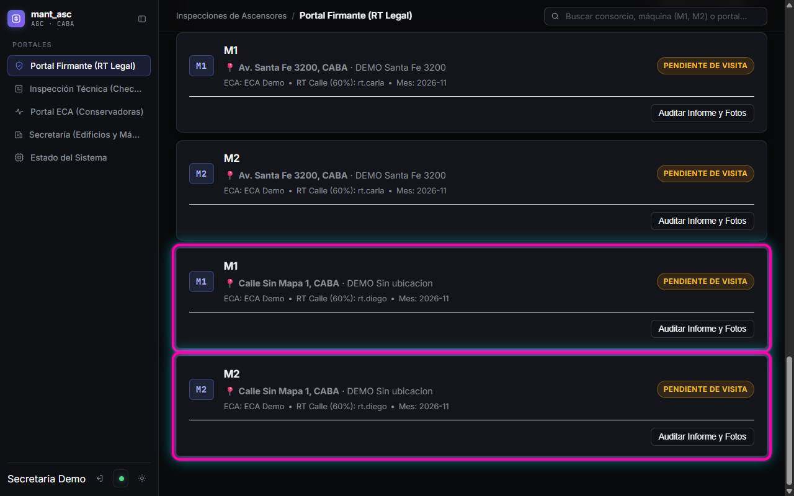

# HU-02 / RF-06 · Asignar o cambiar la terna actualiza la vista de firma de inmediato

- **Tarea:** HU-02 / RF-06 — `REQ-1795258625857` · **Script:** [RF-06-entrega.sh](RF-06-entrega.sh)
- **Qué resuelve:** el criterio 2 de HU-02 pedía que, al reasignar un RT de Calle o un Firmante, se actualizara *de inmediato* la vista de ruteo **y de firma** de los usuarios afectados. La de ruteo (Mapa del RT) ya leía la terna de la base. La de firma no: el Portal Firmante, el Portal ECA, el Monitoreo, los avisos y las paradas leían máquinas fijas en memoria, sin relación con los edificios reales.

## Qué cambió

Las máquinas de los edificios **con terna asignada** ahora salen de la base y siguen a su terna:

| Cuando… | La vista de firma… |
|---|---|
| se guarda la terna (`PUT /api/consorcios/:id/roles`) | muestra las máquinas del edificio con el RT de Calle, el Firmante y la ECA de la terna |
| se cambia el Firmante o el RT | los muestra de inmediato; el Firmante anterior deja de verlas |
| la Secretaría confirma una reasignación en el Semáforo | muestra el RT nuevo |
| se quita la terna o se borra el edificio | saca las máquinas |
| se edita el edificio (nombre, dirección, máquinas) | actualiza el nombre y la dirección y quita las máquinas dadas de baja |
| arranca la API | vuelve a cargar todas las ternas vigentes |

Un Firmante que ya no es el de la terna recibe **404** al autorizar o rechazar (igual que ante una máquina ajena). El Firmante se reconoce por su usuario, que puede ser el nombre con que la terna lo nombra o su email.

Dónde está: `apps/api/src/firmante/asignaciones-firmante.service.ts` (nuevo) y `FirmanteService.aplicarTernaDeEdificio`. Lo llaman `ConsorciosController` (guardar/quitar terna, editar/borrar edificio) y `SemaforoService.reasignar`.

## Cómo se probó

| Prueba | Resultado |
|---|---|
| `test/firmante-terna.e2e-spec.ts` (nuevo, 12 pruebas: los 6 criterios, el email, sin duplicados, las máquinas de ejemplo intactas, baja de una máquina y un fallo de sincronizar) | 12/12 |
| `npm run verify` (tipos + API) | OK, 1155/1155 |
| `npm run test:int` (con la base) | 188/188 |
| Web (`npm run test --workspace apps/web`, sin cambios) | 539/539 |
| `RF-06-entrega.sh` contra la API real y PostgreSQL | 14/14 |
| Criterio 6, reiniciando la API en modo desarrollo | las máquinas de los 5 edificios DEMO aparecieron con su terna |

## Guía visual

Portal Firmante como Secretaría (vista de todos los Firmantes), con las dos máquinas del edificio **DEMO Sin ubicacion** resaltadas.

### Paso 1 · Antes del cambio: el RT del edificio es rt.carla

### Paso 2 · Se cambia la terna y se vuelve a abrir el portal: el RT es rt.diego

La terna se cambió con `PUT /api/consorcios/:id/roles` (RT de Calle `rt.diego`, otro Firmante). No hizo falta reiniciar nada. Después se devolvió la terna original.

## Supuestos y límites

- **Las máquinas de ejemplo siguen ahí.** Las cinco máquinas fijas de `FirmanteService` (Av. Corrientes 1234, Callao 850, Santa Fe 3200) no se tocan, aunque haya un edificio de la base con la misma dirección: en la demo, «Av. Santa Fe 3200» aparece dos veces (la de ejemplo y la de «DEMO Santa Fe 3200»). Quitarlas es otra Tarea.
- **Las máquinas creadas desde la base nacen «Pendiente de Visita» del mes en curso.** La visita, la alerta o la firma que se registren sobre ellas viven en memoria, como las de ejemplo: se pierden al reiniciar la API, y al arrancar se vuelven a crear sin ese estado. Pasar visitas y firmas a la base es una Tarea más grande.
- **Cada Firmante necesita una cuenta.** La terna guarda un nombre, y para entrar al portal hace falta un usuario de rol Firmante cuyo usuario sea ese nombre o su email. La demo no tiene Firmantes: por eso el script crea dos de prueba y los borra.
- **Sin terna, el edificio no aparece en la vista de firma.**
- Si la sincronización falla (por ejemplo, la base cae justo después de guardar), la terna **sí** queda guardada y se registra un aviso en el log; la vista de firma se corrige al siguiente cambio o al reiniciar la API.
- Al arrancar, se lee la base como el sistema, con el alcance de un Administrador (la base lo exige por RLS).
