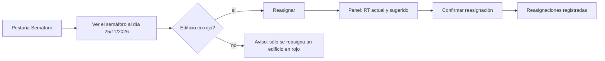
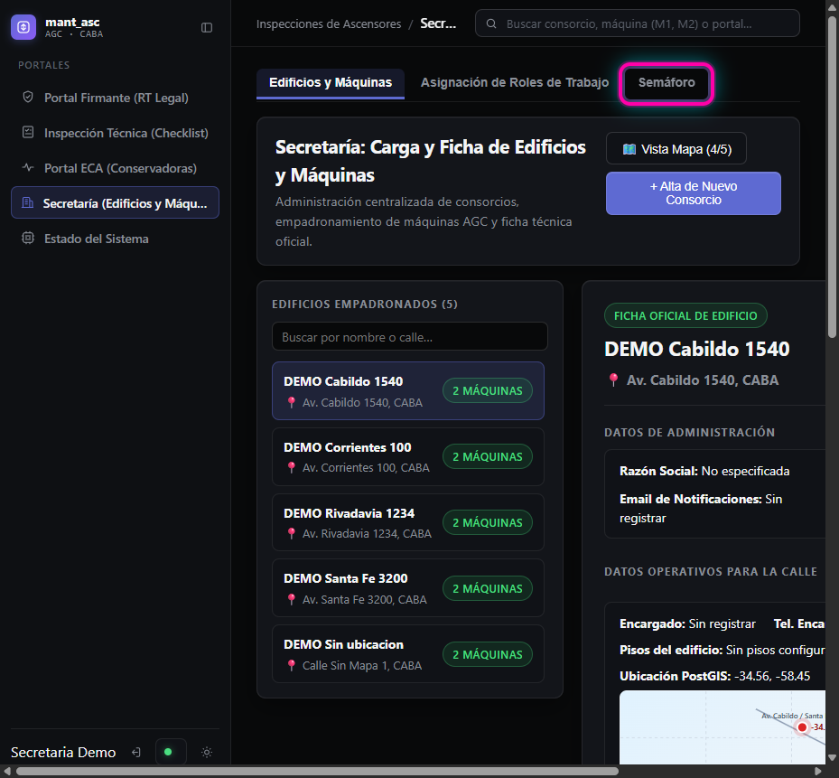
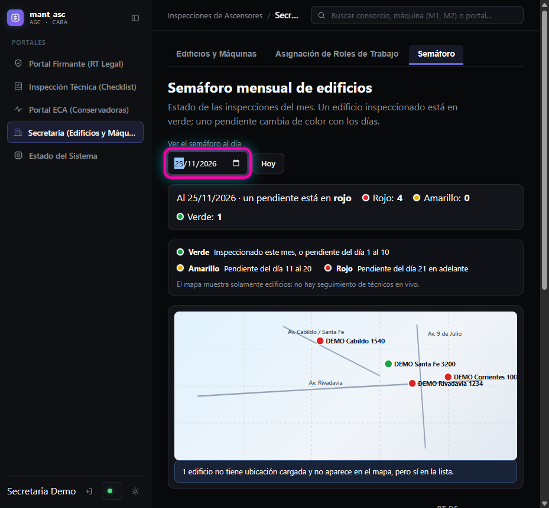
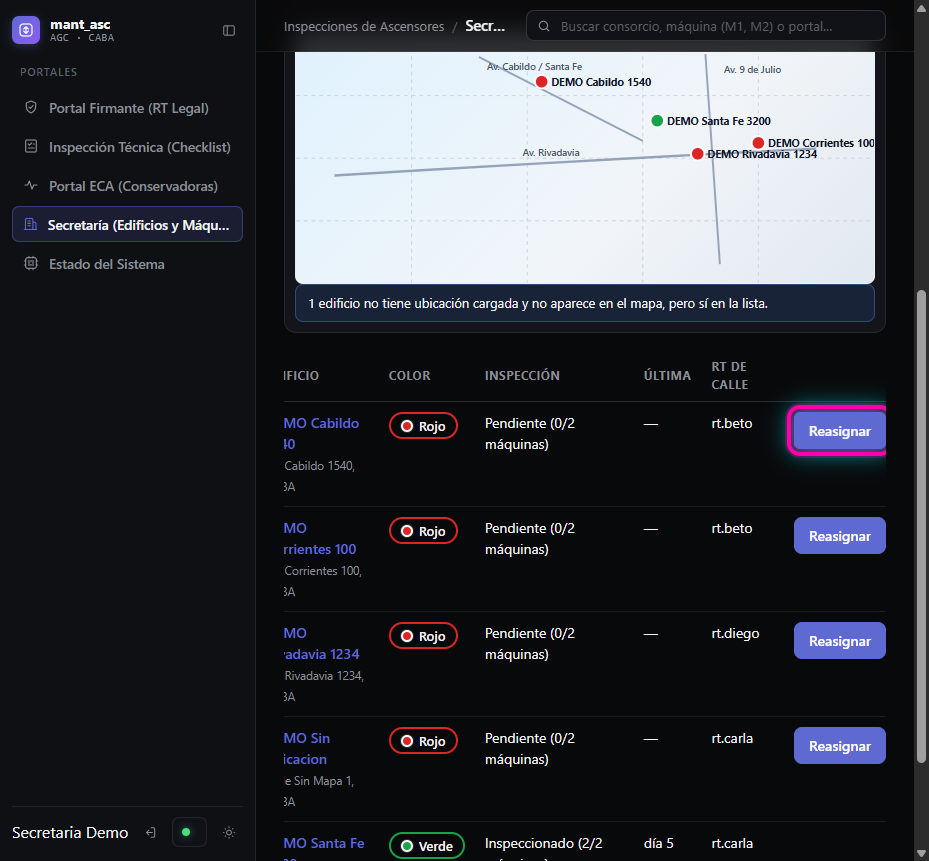
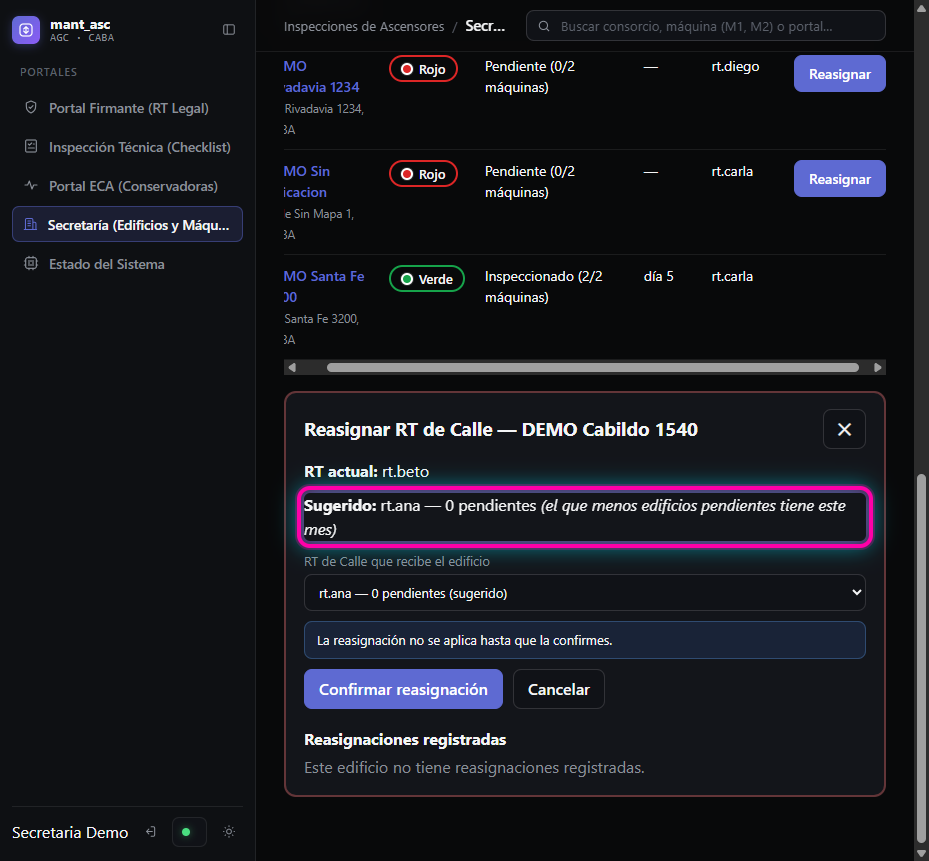
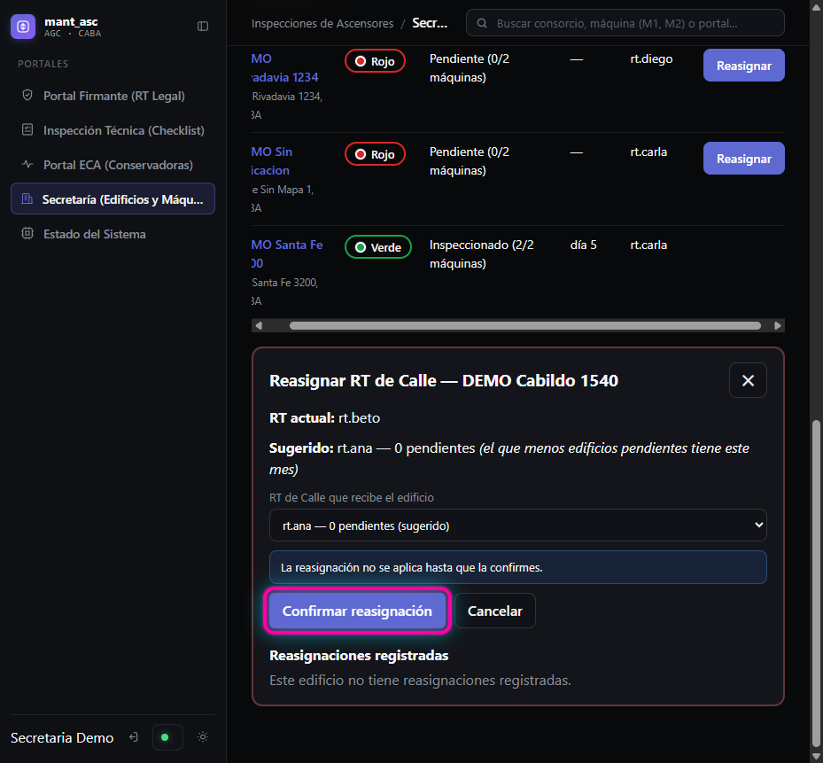
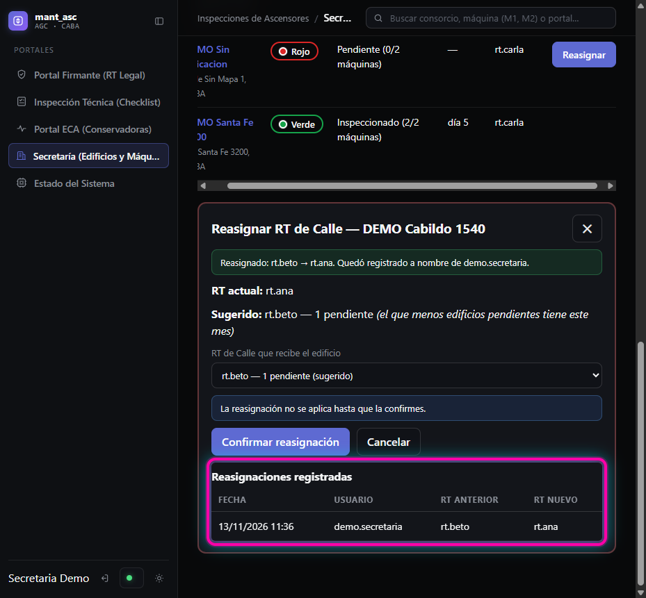

# HU-04 · RF-02 · Guía — Mapa de la Secretaría con el semáforo y reasignación del RT de Calle

Guía para probar la pantalla a mano en 5 minutos. Se entra a `https://localhost:8050` como un usuario con rol **Secretaría** (o Administrador). Las capturas tienen resaltado en magenta el elemento de cada paso.

**Datos que hacen falta.** Al menos: 3 usuarios con rol RT de Calle, y 4 edificios con ubicación, máquinas y terna asignada (uno con RT distinto de los demás), de los cuales uno ya inspeccionado este mes y uno sin ubicación. El script `RF-02-entrega.sh` arma datos parecidos para el flujo por API; para esta guía se usaron los edificios `DEMO …` y los usuarios `rt.ana`, `rt.beto`, `rt.carla` y `rt.diego` (ya borrados).

## Paso 1 — Abrir la pestaña `Semáforo`

En `Secretaría (Edificios y Máquinas)`, tocar la pestaña `Semáforo` (junto a `Edificios y Máquinas` y `Asignación de Roles de Trabajo`).

## Paso 2 — Ver el semáforo de un día de fin de mes

En `Ver el semáforo al día` elegir `25/11/2026`. Hoy no hay edificios en rojo, así que este campo sirve para ver cómo queda el mes.

**Qué tiene que verse (criterios 1 y 2):**
- Una línea `Al 25/11/2026 · un pendiente está en rojo` con los totales `Rojo`, `Amarillo` y `Verde`.
- La **leyenda** de los tres colores, con cuándo corresponde cada uno (`Verde` inspeccionado o pendiente del día 1 al 10; `Amarillo` pendiente del día 11 al 20; `Rojo` pendiente del día 21 en adelante).
- La nota `El mapa muestra solamente edificios: no hay seguimiento de técnicos en vivo.`
- **Un pin por edificio** con su color: rojos los pendientes, verde el inspeccionado. No hay ningún otro tipo de pin.
- Si algún edificio no tiene ubicación: `1 edificio no tiene ubicación cargada y no aparece en el mapa, pero sí en la lista.`

## Paso 3 — Apretar `Reasignar` en un edificio en rojo

En la lista, el botón `Reasignar` aparece sólo en las filas con color `Rojo`. También se puede tocar el pin rojo del mapa. Un pin o una fila verde o amarilla sólo muestra el aviso `… está en verde: sólo se reasigna un edificio en rojo.`

## Paso 4 — Leer la sugerencia (no se aplica nada)

Se abre el panel `Reasignar RT de Calle — <edificio>` con:
- `RT actual:` el RT que tiene hoy el edificio.
- `Sugerido:` el RT de Calle con **menos edificios pendientes del mes**, con su cantidad, que nunca es el actual.
- El selector `RT de Calle que recibe el edificio`, con todos los RT del que menos al que más edificios pendientes tiene; el sugerido viene elegido. Un edificio ya inspeccionado no suma carga.
- El aviso `La reasignación no se aplica hasta que la confirmes.`

## Paso 5 — Apretar `Confirmar reasignación`

Se puede cambiar el RT en el selector antes de confirmar. `Cancelar` o la `✕` cierran el panel sin cambiar nada.

## Paso 6 — Ver el registro (criterio 4)

Aparece el mensaje `Reasignado: <anterior> → <nuevo>. Quedó registrado a nombre de <usuario>.` y, en `Reasignaciones registradas`, una fila con **fecha y hora, usuario, RT anterior y RT nuevo**. Al confirmar, la lista se vuelve a cargar (en la columna `RT de Calle` el edificio debería mostrar al RT nuevo; esa fila no se ve en las capturas).

## Qué más probar

| Qué probar | Qué se espera |
|---|---|
| Abrir `Reasignar` y cerrar con `Cancelar` | No se registra nada |
| Dos pestañas: reasignar el mismo edificio en las dos | La segunda muestra que el RT cambió y no se aplica |
| `Hoy` junto al selector de fecha | Vuelve al día de hoy |
| Con una sesión de otro rol (por ejemplo RT de Calle) | La sugerencia y la reasignación no están permitidas (403) |
