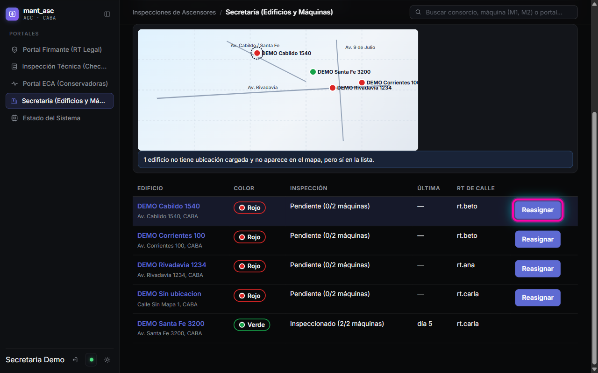
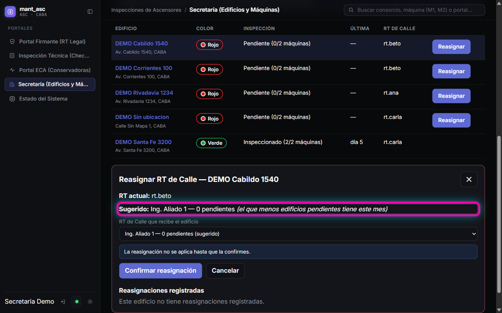
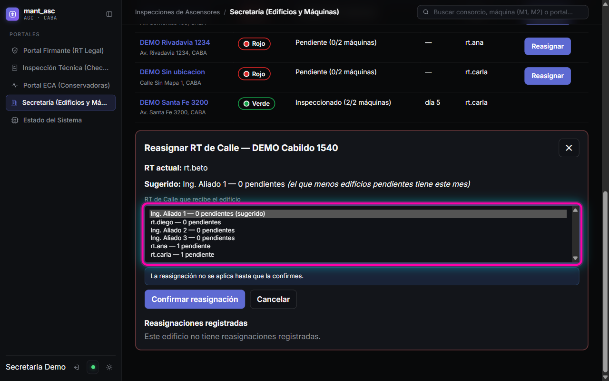

# HU-04 / RF-04 · Guía visual — Qué verifica el script arreglado, en pantalla

`RF-02-entrega.sh` comprueba por API que, al reasignar un edificio en rojo, el RT sugerido es el de menos edificios **pendientes** y que un edificio ya inspeccionado **no cuenta como carga**. Esta guía muestra lo mismo en el navegador, con los datos de demo.

- **Tarea:** RF-04 — `REQ-1795095941025` · **Entrega:** [RF-04-entrega.md](RF-04-entrega.md)
- **URL:** https://localhost:8050 · **Usuario:** `demo.secretaria` · **Clave:** `Demo-Clave-2026` · **Rol:** secretaria
- **Antes de empezar:** cargar los datos con `bash docs/pruebas/hu-04-hu-04-semaforo-de-control-mens/RF-02-datos-demo.sh` (para borrarlos, el mismo comando con `--limpiar`). Ingresar y abrir la solapa «Semáforo» con el día 25/11/2026, como en los pasos 1 a 3 de [RF-07-datos-de-demo.md](../hu-11-hu-11-notificaciones-automatic/RF-07-datos-de-demo.md).
- **Capturas:** sacadas con Playwright en una ventana de 1280 × 800, con el elemento de cada paso resaltado en magenta con `scrumDocs/resaltado-de-capturas.css`.

## Paso 1 · Apretar «Reasignar» en un edificio en rojo

Con el semáforo al 25/11/2026, en la lista de edificios apretá **Reasignar** en la fila de «DEMO Cabildo 1540», que está en rojo y es del RT `rt.beto`.

**Qué tenés que ver:** cuatro edificios en **Rojo** con su botón «Reasignar». «DEMO Santa Fe 3200» está en **Verde**, «Inspeccionado (2/2 máquinas)» el «día 5», y no tiene botón: solo se reasigna lo que está en rojo.

## Paso 2 · El RT sugerido

Se abre el panel «Reasignar RT de Calle — DEMO Cabildo 1540».

**Qué tenés que ver:** «RT actual: rt.beto» y «Sugerido: Ing. Aliado 1 — 0 pendientes (el que menos edificios pendientes tiene este mes)». La sugerencia nunca es el RT actual, y el panel avisa «La reasignación no se aplica hasta que la confirmes».

## Paso 3 · Los candidatos y sus pendientes

Abrí el desplegable «RT de Calle que recibe el edificio». En la captura está desplegado para que se vean todas las opciones a la vez.

**Qué tenés que ver:** los candidatos ordenados de menos a más carga: cuatro con «0 pendientes», `rt.ana — 1 pendiente` y **`rt.carla — 1 pendiente`**. `rt.beto`, el RT actual, no figura.

`rt.carla` tiene dos edificios, «DEMO Sin ubicacion» (pendiente) y «DEMO Santa Fe 3200» (inspeccionado, a la vista en la misma captura), y pesa **1**, no 2: el edificio ya inspeccionado no cuenta como carga. Es la verificación que fallaba en el script, porque la inspección de prueba no llegaba a cargarse.

Los «Ing. Aliado 1, 2 y 3» no son de los datos de demo: son RT que ya existen en la base local, y por eso aparecen con 0 pendientes.
