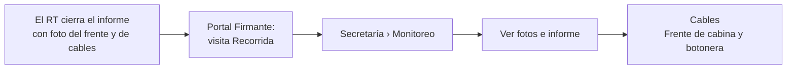
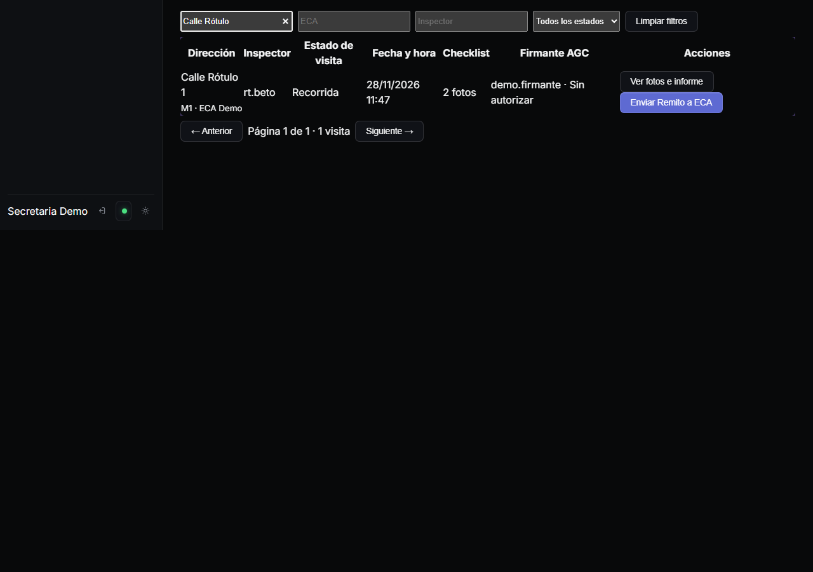
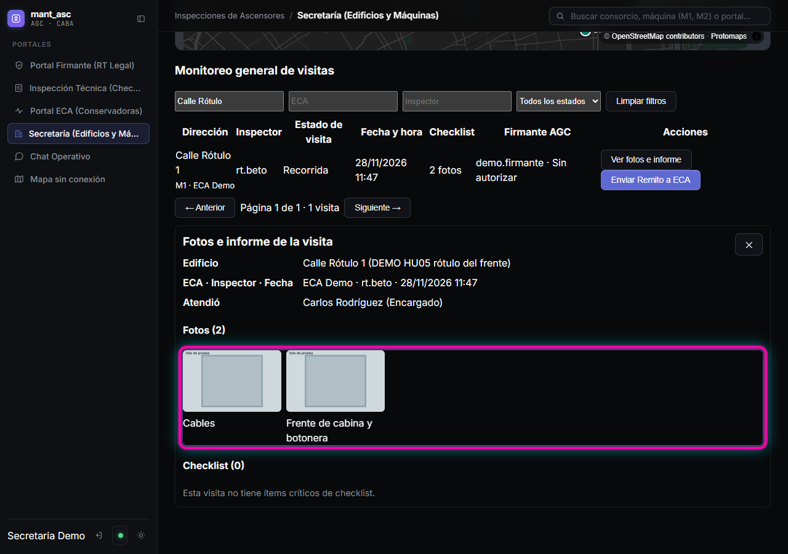

# HU-05 · RF-03 · Guía visual — El visor del backoffice dice «Frente de cabina y botonera»

Recorrido para quien nunca vio la pantalla: dónde se ve la foto del frente de un equipo en el backoffice y cómo se llama.

- **Usuarios:** `demo.secretaria` (mira), `rt.beto` (cierra el informe, por API) y `demo.admin` (arma y borra el edificio de prueba, por API), clave `Demo-Clave-2026`, datos de demo de HU-04 RF-02.
- **Datos:** un edificio de prueba, «Calle Rótulo 1», con la terna `rt.beto` · `demo.firmante` · ECA Demo. La API en vivo ya no tiene las máquinas de ejemplo (HU-08 RF-06), así que el recorrido es real: el RT cierra un informe con las dos fotos obligatorias de HU-17 RF-11 y el Portal Firmante crea la visita (HU-08 RF-07). **Al terminar, el script borra todo.**
- **Capturas:** sacadas con [RF-03-navegador.cjs](RF-03-navegador.cjs) (Playwright). Las fotos son imágenes dibujadas, con el rótulo «foto de prueba».
- **Entrega y script:** [RF-03-entrega.md](RF-03-entrega.md) · [RF-03-entrega.sh](RF-03-entrega.sh)

## Paso 1 · La visita en la tabla de monitoreo

Entrá como `demo.secretaria`, abrí **Secretaría (Edificios y Máquinas)** y la pestaña **Monitoreo**. Escribí «Calle Rótulo» en el filtro de dirección.

**Qué tenés que ver:** una fila de **Calle Rótulo 1** en estado **Recorrida**, con el checklist «2 fotos» y el botón **Ver fotos e informe**.

## Paso 2 · El visor de fotos

Tocá **Ver fotos e informe**.

**Qué tenés que ver:** en **Fotos (2)**, las dos miniaturas con sus rótulos: **Cables** y **Frente de cabina y botonera**. Antes de esta tarea, la segunda decía «Frente del edificio»: nombre equivocado, porque la foto es de la cabina y la botonera, no de la fachada. (La foto de la fachada es otra: la que se saca para certificar la presencia en una visita fallida, de HU-07 y HU-16, y no cambia.)

Si el equipo es **hidráulico** no hay foto de cables (no tiene cables de tracción): el visor muestra sólo **Frente de cabina y botonera**, y la alerta de cabina trabada, si la hay, aparece después con su propio rótulo.

> La captura `imagenes/RF-02-tablero-y-visor.png` de HU-05 RF-02 es de antes y todavía muestra el rótulo anterior.
