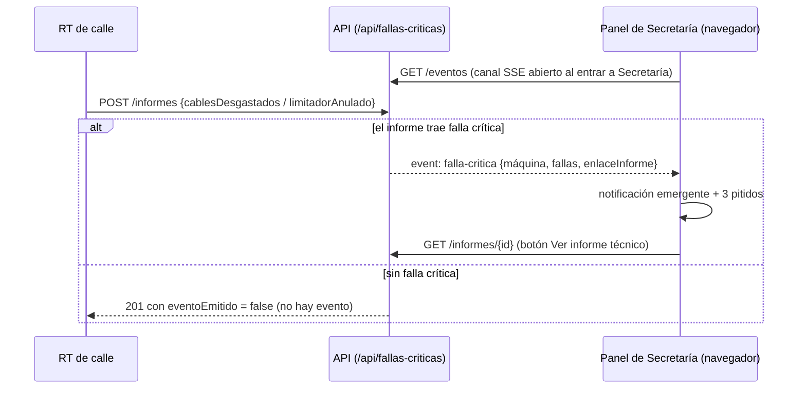
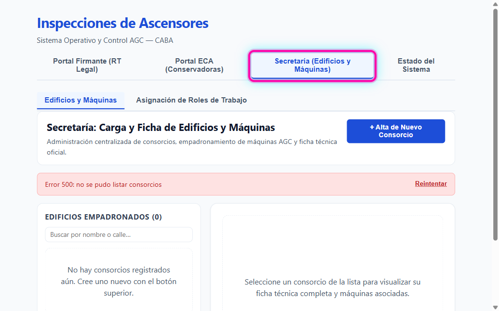
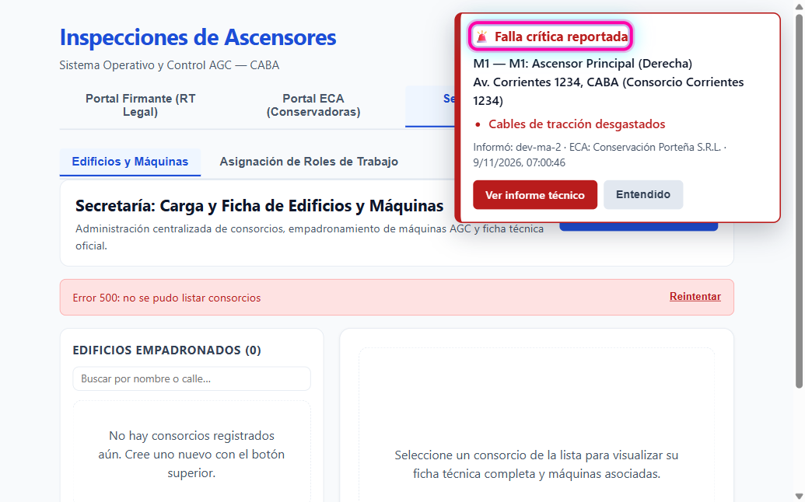
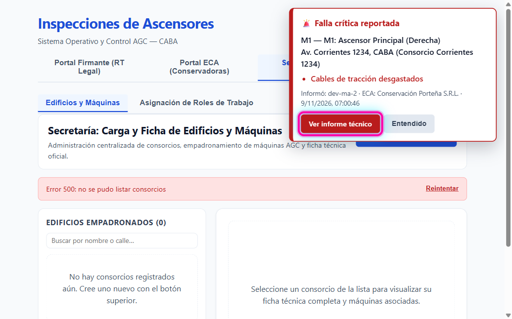
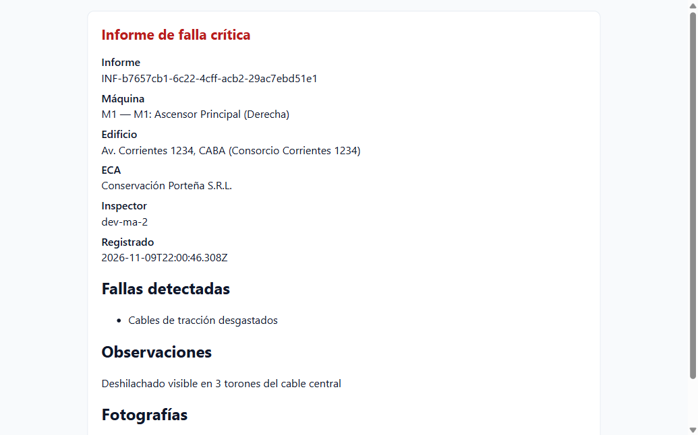

# HU-06 · RF-01 — Guía de prueba: Recepción de Falla Crítica y Alerta Emergente en Secretaría

- **Requerimiento:** `REQ-1791910396411`
- **Entrega:** [RF-01-entrega.md](RF-01-entrega.md) · **Script:** [RF-01-entrega.sh](RF-01-entrega.sh)

## Circuito probado



## Antes de empezar

- La app levantada (`npm run dev` desde la raíz) y abierta en el navegador.
- La carga del informe se hace por API: todavía no existe la pantalla del RT de calle (es otra
  Historia). Cualquier terminal con `curl` sirve.
- Sin base de datos, la pestaña `Edificios y Máquinas` muestra
  `Error 500: no se pudo listar consorcios`. No afecta esta prueba: la alerta no usa la base.

## Paso 1 — Entrar a Secretaría

Apretá la pestaña `Secretaría (Edificios y Máquinas)`. Desde ese momento el panel escucha las
fallas críticas. Entrar a la pestaña es además el clic que habilita el sonido en el navegador.



## Paso 2 — Cargar un informe con falla crítica y ver la alerta

Sin cerrar el navegador, en una terminal:

```bash
curl -s -X POST "<URL del entorno>/api/fallas-criticas/informes" \
  -H 'Content-Type: application/json' \
  -d '{"maquinaId":"MAQ-CORRIENTES-M1","inspector":"dev-ma-2","cablesDesgastados":true,"limitadorAnulado":false,"observaciones":"Deshilachado visible en 3 torones del cable central"}'
```

En menos de un segundo aparece arriba a la derecha la notificación `🚨 Falla crítica reportada`
y suenan **tres pitidos de dos tonos**. Muestra:

- `M1 — M1: Ascensor Principal (Derecha)` y `Av. Corrientes 1234, CABA (Consorcio Corrientes 1234)`
- la falla en rojo: `Cables de tracción desgastados`
- `Informó: dev-ma-2 · ECA: Conservación Porteña S.R.L.` con fecha y hora



Con `"limitadorAnulado":true` la falla dice `Limitador de velocidad anulado`; con los dos en
`true` aparecen las dos en la misma notificación. Con los dos en `false` **no aparece nada**: no es
una falla crítica.

## Paso 3 — Abrir el informe

Apretá `Ver informe técnico`. Se abre en una pestaña nueva.



## Paso 4 — El informe

La página dice `Informe de falla crítica` y trae máquina, edificio, ECA, inspector, fecha, la
sección `Fallas detectadas`, las observaciones y las fotografías si se cargaron. Abrirla **no**
registra ningún acuse de recibo legal.



De vuelta en Secretaría, `Entendido` cierra la notificación. Si llegaron varias, se muestra
`1 de N` y `Entendido` pasa a la siguiente.
