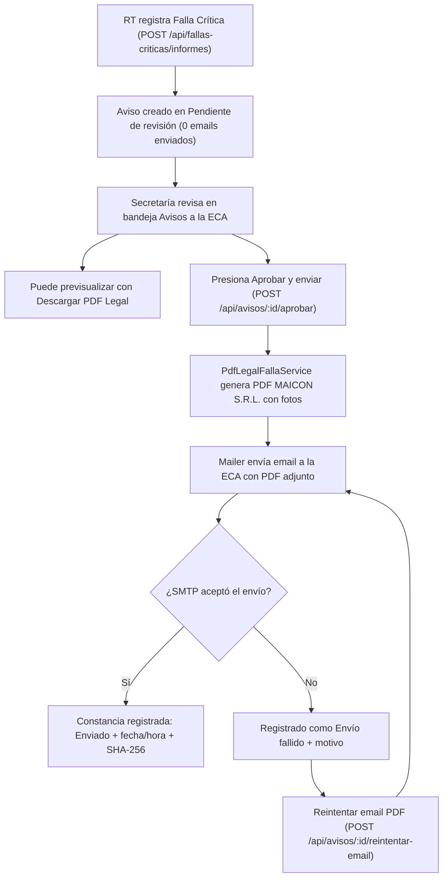

# HU-06 · RF-02 — Generación de PDF Legal MAICON S.R.L. y envío por email a la ECA

**Historia de Usuario:** HU-06: Gestión de Fallas Críticas y Deslinde de Responsabilidad Legal  
**Requerimiento:** RF-02 (`REQ-1791910396553`)  
**Desarrollador:** `gonza`  

## Qué quedó implementado

Se implementó la generación del documento PDF legal formal con membrete de **MAICON S.R.L.** para deslinde de responsabilidad por Falla Crítica y su envío por correo electrónico adjunto a la ECA únicamente tras la revisión y aprobación de la Secretaría:

- **`PdfLegalFallaService` (`apps/api/src/avisos/pdf-legal-falla.service.ts`)**:
  - Genera el PDF con `pdfkit` y texto sanitizado mediante `textoParaPdf` (sin símbolos rotos en WinAnsi).
  - Incluye membrete provisorio de **MAICON S.R.L.** (P13.a), datos del consorcio/edificio, dirección, máquina y matrícula AGC, ECA responsable, fecha de detección, listado numerado de fallas críticas, observaciones técnicas, **fotos adjuntas** (embebiendo imágenes PNG/JPEG base64 directamente en el PDF y listando referencias URL), cláusula formal de deslinde de responsabilidad legal y bloque de aprobación de Secretaría.
  - Calcula y expone el hash `SHA-256` del PDF generado (`X-PDF-SHA256`).
- **Extensión de `Mailer` (`apps/api/src/auth/mailer.ts`)**:
  - Soporta adjuntos (`adjuntos?: AdjuntoCorreo[]`) enviados vía `nodemailer` con `Content-Type: application/pdf` y remitente provisorio configurable (`SMTP_DESDE` / P10).
- **Integración con aprobación de Secretaría (`AvisosService` y `AvisosController`)**:
  - Registrar una Falla Crítica (`POST /api/fallas-criticas/informes`) **no envía ningún email**: crea el aviso en estado `Pendiente de revisión`.
  - `GET /api/avisos/:id/pdf-legal` (`@Roles('secretaria', 'administrador')`): genera y descarga el PDF legal (`application/pdf`).
  - `POST /api/avisos/:id/aprobar`: al aprobar la Secretaría, genera el PDF legal, resuelve el email de la ECA (explícito, desde la terna del edificio en `roles_edificio` o destino provisorio) y envía el correo con el PDF adjunto, registrando `constanciaEmailLegal` con estado, destino, remitente, fecha/hora exacta, nombre de archivo, hash SHA-256, tamaño e intentos.
  - Ante error SMTP, el envío queda registrado como **`Envío fallido`** con el motivo exacto, y puede reintentarse con `POST /api/avisos/:id/reintentar-email` (o volviendo a aprobar) sin duplicar WhatsApps ya enviados.
- **Interfaz Web (`BandejaAvisos.tsx` y `avisos.ts`)**:
  - En la bandeja `Avisos a la ECA`, cada aviso incluye el botón `Descargar PDF Legal`, muestra la constancia `PDF Legal MAICON S.R.L. (Enviado / Envío fallido)` con fecha y archivo, y ofrece `Reintentar email PDF` si el correo falló.

## Flujo del circuito



## Cómo levantarlo y probarlo

```bash
# 1. Levantar PostgreSQL + PostGIS y cargar usuarios demo
npm run db:up
bash docs/pruebas/hu-04-hu-04-semaforo-de-control-mens/RF-02-datos-demo.sh

# 2. Levantar API y Web
npm run dev

# 3. Ejecutar script integrado de entrega
bash docs/pruebas/hu-06-hu-06-gestion-de-fallas-critic/RF-02-entrega.sh

# 4. Ejecutar prueba de carga (ej. 25 generaciones de PDF legal)
bash docs/pruebas/hu-06-hu-06-gestion-de-fallas-critic/RF-02-entrega.sh --carga 25
```

### Paso a paso manual en pantalla

1. Iniciar sesión en `https://localhost:8050` como Secretaría (`demo.secretaria`).
2. Abrir la bandeja `Avisos a la ECA` luego de registrarse una falla crítica.
3. Confirmar que el aviso figura en `Pendiente de revisión` sin correos enviados.
4. Presionar `Descargar PDF Legal` y comprobar que descarga `deslinde-maicon-*.pdf` con membrete MAICON S.R.L., datos del edificio/máquina, fallas y fotos.
5. Presionar `Aprobar y enviar` y verificar el bloque `PDF Legal MAICON S.R.L.` con el estado, destino, fecha y hora. Si el servidor SMTP devuelve error, se muestra `Envío fallido` con el motivo y el botón `Reintentar email PDF`.

## Pruebas automáticas

- **API E2E**: `apps/api/test/pdf-legal-email.e2e-spec.ts` — 4 pruebas cubriendo los 4 criterios de aceptación (contenido real extraído del PDF con membrete + fotos embebidas y URL, cero correos al registrar falla y 409 en reintento sin aprobación, envío con PDF adjunto al aprobar con constancia y resolución de email desde `roles_edificio`, y registro `Envío fallido` + reintento sin duplicar WhatsApp).
- **Regresión Avisos**: `apps/api/test/avisos.e2e-spec.ts`, `apps/api/test/avisos-enlace.spec.ts` y `apps/api/test/informe-aviso.e2e-spec.ts` — 100% en verde.
- **Web Unitarias**: `apps/web/src/avisos/avisos.test.ts` — 9 pruebas (incluyendo `reintentarEmailAviso` y `descargarPdfLegalAviso`).

## Supuestos y limitaciones

- Logo definitivo, membrete gráfico final y textos jurídicos definitivos quedan sujetos a entrega de MAICON (P13.a); se emplea el membrete provisorio formal acordado.
- En entornos sin variables `SMTP_HOST`/`SMTP_USUARIO`/`SMTP_CLAVE` configuradas, el correo queda registrado con estado `No configurado` sin simular envío real.
