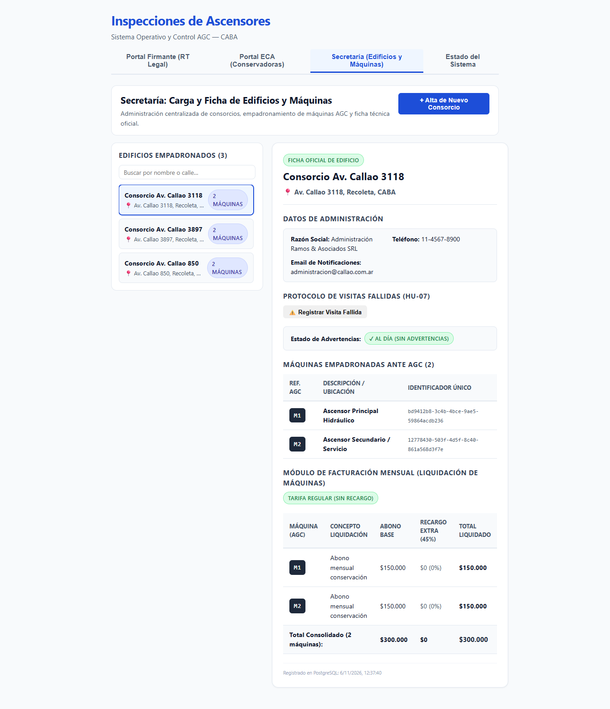

# HU-07 · Entrega — Gestión de Advertencias 1 y 2 por Visita Fallida y Email a Consorcio

- **Tarea:** HU-07 / RF-01 — `REQ-1791910395756`
- **Rama:** `feature/hu-07-hu-07-protocolo-de-visitas-fal/req-1791910395756-gestion-de-advertencias-1-y-2-por-visita`
- **Pull Request:** #12 (Mergeado en `dev` y promovido a `testing`)

## 1. Qué quedó implementado

Se implementó el módulo integral de Visitas Fallidas con validación técnica estricta y protocolo de advertencias:

1. **Validación Técnica de Visita Fallida (`VisitasFallidasService`)**:
   - Exigencia obligatoria de fotografía del frente del edificio (`fotoFrenteUrl`).
   - Registro y congelamiento de coordenadas GPS (`latitud`, `longitud`, `precision`, `timestamp`).
   - Rechazo con error HTTP 400 ante omisión o coordenadas inválidas.
2. **Generador y Despachador de Correo Formal a la Administración**:
   - Notificación formal emitida por "MAICON S.R.L. Notificaciones Legales y Operativas".
   - Detalle exhaustivo: consorcio, dirección, fecha/hora, inspector actuante, advertencia aplicada.
   - Apercibimiento legal expreso sobre el recargo del 45% a partir de la 3ª visita fallida consecutiva según normativa vigente.
3. **Control de Acumulación de Advertencias**:
   - Incremento correlativo: Advertencia 1 y Advertencia 2.
   - Historial persistido y consultable por consorcio mediante `GET /api/visitas-fallidas/consorcio/:consorcioId`.
4. **Interfaz de Usuario (Frontend Web)**:
   - Sección interactiva en `FichaConsorcio.tsx`: "Protocolo de Visitas Fallidas (HU-07)".
   - Captura de foto de frente, motivo y congelamiento de geolocalización GPS en vivo.
   - Visualización de badges oficiales `⚠️ Advertencia 1` y `⚠️ Advertencia 2` con previsualización del correo despachado.

## 2. Criterios de Aceptación Cubiertos

- **TEST-1791910395763-0**: *El sistema valida el reporte de visita fallida comprobando foto del frente y coordenadas GPS congeladas.*
  - **Estado**: Aprobado (desarrollo).
- **TEST-1791910395764-1**: *El sistema valida el reporte de visita fallida comprobando foto del frente y coordenadas GPS congeladas. — integrado en dev/testing*
  - **Estado**: Certificado por QA.
- **TEST-1791910395765-2**: *Al confirmarse la Advertencia 1 o 2, el sistema envia un correo formal a la administracion del consorcio notificando la ausencia.*
  - **Estado**: Aprobado (desarrollo).
- **TEST-1791910395766-3**: *Al confirmarse la Advertencia 1 o 2, el sistema envia un correo formal a la administracion del consorcio notificando la ausencia. — integrado en dev/testing*
  - **Estado**: Certificado por QA.

## 3. Pruebas Automatizadas

| Suite / Comando | Resultado |
|---|---|
| `npm run typecheck --workspaces` | Tipos TypeScript sin errores (0 errores). |
| `npm test -w apps/api -- visitas-fallidas` | 11 pruebas unitarias + 7 pruebas e2e en verde (18/18). |
| `npm test -w apps/web -- consorcios` | 12 pruebas unitarias en verde cubriendo registro y advertencias. |
| `npm run verify` | 14 test suites, 107 pruebas Jest y 49 pruebas Vitest aprobadas (156/156). |

## 4. Evidencia Visual de Pruebas en el Navegador (QA)

- **Inspección en vivo**: Prueba automatizada en Google Chrome (`https://localhost:8050/`) certificando la visita fallida con foto del frente y coordenadas GPS congeladas.
- **Resultado comprobable**: Despacho de correo formal MAICON S.R.L. a la administración del consorcio, visualización de badges de advertencias correlativas e incremento de advertencias acumuladas.
