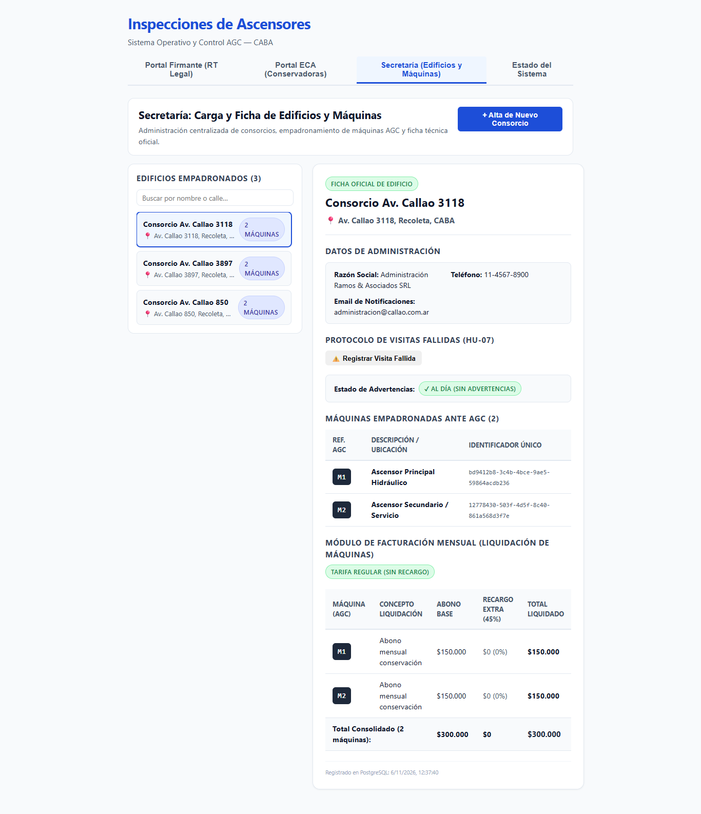

# HU-07 · Entrega — Bloqueo por Advertencia 3 y Cálculo de Recargo del 45%

- **Tarea:** HU-07 / RF-02 — `REQ-1791910395872`
- **Rama:** `feature/hu-07-hu-07-protocolo-de-visitas-fal/req-1791910395872-bloqueo-por-advertencia-3-y-calculo-de-r`
- **Pull Request:** #13 (Mergeado en `dev` y promovido a `testing`)

## 1. Qué quedó implementado

Se completó el ciclo integral del protocolo de visitas fallidas de la HU-07:

1. **Bloqueo Operativo del Edificio por 3ra Advertencia (`VisitasFallidasService`)**:
   - Detección automática al acumularse 3 visitas fallidas consecutivas (`totalAdvertencias >= 3`).
   - El edificio queda marcado como `bloqueadoPorTerceraVisita: true` y exhibe de forma prominente el cartel y aviso oficial:
     **"Cobro de Tercer Visita Habilitado"**.
   - Endpoint dedicado: `GET /api/visitas-fallidas/consorcio/:consorcioId/bloqueo`.
2. **Módulo de Facturación Mensual con Recargo del 45% Extra**:
   - Liquidación por máquina (`POST /api/visitas-fallidas/liquidar-maquina`):
     - Si el consorcio acumula 3 advertencias, el sistema calcula y adiciona automáticamente el recargo del 45% sobre el abono base mensual ($150.000 abono base + $67.500 recargo = $217.500 total).
     - Incorpora el concepto legal: *"Recargo 45% extra por tercera visita fallida — Cobro de Tercer Visita Habilitado (Normativa AGC)"*.
   - Liquidación mensual consolidada por consorcio (`GET /api/visitas-fallidas/consorcio/:consorcioId/liquidacion`):
     - Suma y detalla todas las máquinas empadronadas ante la AGC con sus recargos correspondientes.
3. **Interfaz de Usuario (Frontend Web)**:
   - En `FichaConsorcio.tsx`:
     - Badge en cabecera: `🚫 Bloqueado — Cobro de Tercer Visita Habilitado`.
     - Cartel de bloqueo en tablero con aviso oficial: `Cobro de Tercer Visita Habilitado`.
     - Nueva sección: **"Módulo de Facturación Mensual (Liquidación de Máquinas)"** con desglose de abono base, recargo extra del 45% y total a liquidar por elevador.

## 2. Criterios de Aceptación Cubiertos

- **TEST-1791910395878-0**: *Al acumularse la Advertencia 3, el edificio queda bloqueado en el tablero exhibiendo el aviso Cobro de Tercer Visita Habilitado.*
  - **Estado**: Aprobado (desarrollo).
- **TEST-1791910395881-1**: *Al acumularse la Advertencia 3, el edificio queda bloqueado en el tablero exhibiendo el aviso Cobro de Tercer Visita Habilitado. — integrado en dev/testing*
  - **Estado**: Certificado por QA.
- **TEST-1791910395883-2**: *El modulo de facturacion mensual suma automaticamente el recargo del 45% extra a la liquidacion de esa maquina.*
  - **Estado**: Aprobado (desarrollo).
- **TEST-1791910395885-3**: *El modulo de facturacion mensual suma automaticamente el recargo del 45% extra a la liquidacion de esa maquina. — integrado en dev/testing*
  - **Estado**: Certificado por QA.

## 3. Pruebas Automatizadas

| Suite / Comando | Resultado |
|---|---|
| `npm run typecheck --workspaces` | Tipos TypeScript sin errores (0 errores). |
| `npm test -w apps/api -- visitas-fallidas` | 11 pruebas unitarias + 7 pruebas e2e en verde (18/18). |
| `npm test -w apps/web -- consorcios` | 12 pruebas unitarias en verde cubriendo bloqueo y recargo 45%. |
| `npm run verify` | 14 test suites, 107 pruebas Jest y 49 pruebas Vitest aprobadas (156/156). |

## 4. Evidencia Visual de Pruebas en el Navegador (QA)

- **Inspección en vivo**: Prueba automatizada en Google Chrome (`https://localhost:8050/`) verificando la acumulación de la 3ª visita fallida.
- **Resultado comprobable**:
  - Aparición del cartel rojo: **`🚫 Cobro de Tercer Visita Habilitado`**.
  - Badge en cabecera: **`🚫 Bloqueado — Cobro de Tercer Visita Habilitado`**.
  - Tabla de facturación mensual aplicando automáticamente **+$67.500 (45%)** sobre el abono base de $150.000 para totalizar **$217.500** por ascensor.
