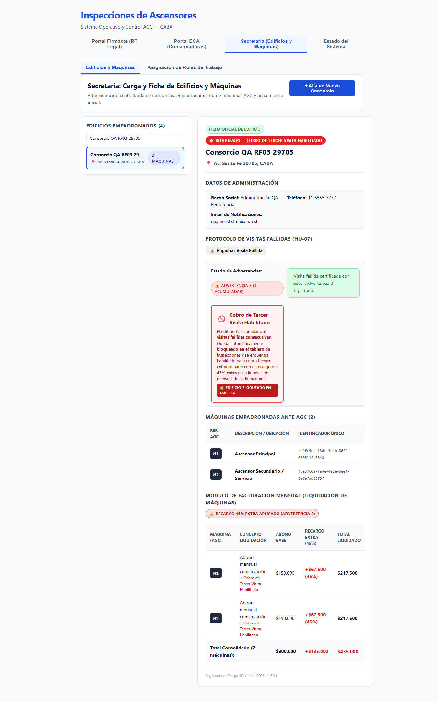
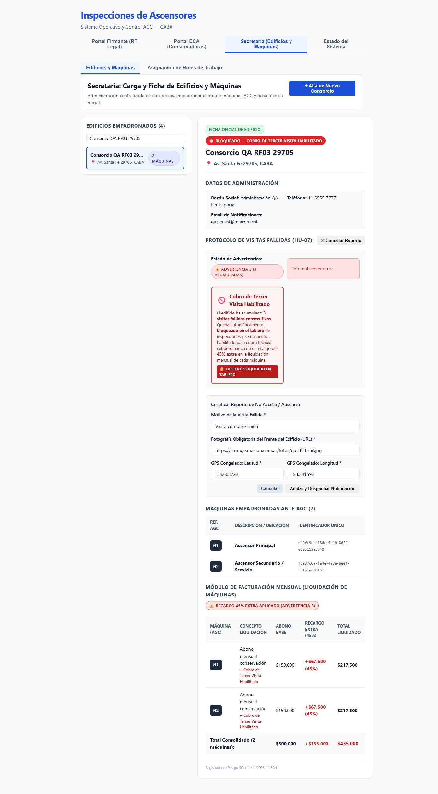

# HU-07 · RF-03 · Entrega — Persistir las visitas fallidas en PostgreSQL

- **Tarea:** HU-07 / RF-03 — `REQ-1794013110546`
- **Rama de entrega:** `feature/hu-07-hu-07-protocolo-de-visitas-fal/req-1794013110546-persistir-las-visitas-fallidas-en-postgr` (PR #20 mergeado en `dev` y promovido a `testing`)
- **Depende de:** HU-07 RF-01 (`REQ-1791910395756`), y se apoya en el filtro global de HU-01 RNF-01 (`REQ-1793979090598`) para traducir caracteres inválidos (`\u0000`) a HTTP 400
- **Script del flujo integrado:** [`RF-03-entrega.sh`](RF-03-entrega.sh)
- **Guía / Evidencia visual QA:** ver §6 y §7 abajo ([`RF-03-persistencia-post-reinicio.png`](imagenes/RF-03-persistencia-post-reinicio.png) y [`RF-03-error-base-caida.png`](imagenes/RF-03-error-base-caida.png)).

---

## 1. Qué quedó implementado

**El problema.** [`VisitasFallidasService`](../../../apps/api/src/visitas-fallidas/visitas-fallidas.service.ts) guardaba las visitas en el array en memoria `this.registros`, usaba un `INSERT INTO acuses_recibo_legal` con una columna inexistente (`metadata`) que omitía columnas `NOT NULL`, y descartaba el error en un `try/catch` (`debug`). Al reiniciar la API se perdían todas las visitas fallidas y el contador de advertencias volvía a `1`.

**La solución:**

1. **Migración `004_visitas_fallidas` ([`migrations.ts`](../../../apps/api/src/database/migrations.ts))**:
   - Crea la tabla `visitas_fallidas` con `orden` (`bigserial`), `id` (`text PRIMARY KEY`), `consorcio_id`, `consorcio_nombre`, `direccion`, `numero_advertencia` (`1..3`), `motivo`, `foto_frente_url`, `gps_latitud`, `gps_longitud`, `gps_precision`, `gps_timestamp`, `inspector`, `fecha_hora`, `email_notificacion` (`jsonb`) y `created_at`.
   - Índice `(consorcio_id, orden ASC)` para reconstruir cronológicamente el historial tras cualquier reinicio.
2. **Capa de Repositorio ([`visitas-fallidas.repository.ts`](../../../apps/api/src/visitas-fallidas/visitas-fallidas.repository.ts) y [`pg-visitas-fallidas.repository.ts`](../../../apps/api/src/visitas-fallidas/pg-visitas-fallidas.repository.ts))**:
   - En PostgreSQL (`PgVisitasFallidasRepository`), `registrar()` corre dentro de `db.transaction(...)` adquiriendo `pg_advisory_xact_lock(hashtext(consorcioId))`, lee `SELECT count(*) FROM visitas_fallidas WHERE consorcio_id = $1` e inserta la fila completa.
   - `listarPorConsorcio()` y `listarTodas()` leen directamente de PostgreSQL ordenadas por `orden ASC`.
   - **Sin `try/catch` que trague errores:** si PostgreSQL cae o rechaza el texto (por ejemplo, `\u0000`), la transacción hace `ROLLBACK` y el error sube al filtro global (HTTP 400 `"Datos inválidos"` para `22021`/`22P05`, HTTP 500 para fallos de base o conexión), sin informar nada como registrado.
   - En pruebas unitarias aisladas (`new VisitasFallidasService()`) y `createTestApp` por defecto usa `InMemoryVisitasFallidasRepository`.
3. **Servicio sin estado en memoria ([`visitas-fallidas.service.ts`](../../../apps/api/src/visitas-fallidas/visitas-fallidas.service.ts))**:
   - Usa `VisitasFallidasRepository` inyectado desde [`AppModule`](../../../apps/api/src/app.module.ts) y IDs UUID (`VF-<uuid>`) libres de colisiones bajo carga concurrente.

---

## 2. Cómo se levanta y se prueba

Desde la raíz de `pm_asc`:

```bash
npm run db:up
npm run dev
```

Prueba manual rápida contra PostgreSQL:

```bash
# 1. Registrar visita fallida (Advertencia 1)
curl -s -X POST http://127.0.0.1:3050/api/visitas-fallidas \
  -H 'Content-Type: application/json' \
  -d '{"consorcioId":"edif-prueba","motivo":"Encargado ausente","fotoFrenteUrl":"https://storage.maicon.com.ar/f1.jpg","gps":{"latitud":-34.6037,"longitud":-58.3816},"emailAdministracion":"admin@prueba.test"}'

# 2. Reiniciar la API (Ctrl+C y volver a levantar) y consultar el historial:
curl -s http://127.0.0.1:3050/api/visitas-fallidas/consorcio/edif-prueba

# 3. Registrar otra visita → devuelve numeroAdvertencia: 2
```

### Pruebas automatizadas en verde

| Comando | Qué cubre | Resultado observado |
|---|---|---|
| `npm run verify` | TypeScript API + Web, tests unitarios y e2e aislados (incluye [`visitas-fallidas.spec.ts`](../../../apps/api/test/visitas-fallidas.spec.ts), [`visitas-fallidas.e2e-spec.ts`](../../../apps/api/test/visitas-fallidas.e2e-spec.ts) y [`visitas-fallidas-persistencia.e2e-spec.ts`](../../../apps/api/test/visitas-fallidas-persistencia.e2e-spec.ts)) | **API: 20 suites, 149/149 OK · Web: 5 archivos, 64/64 OK · 0 errores TS** |
| `npm run test:int` | Integración real contra PostgreSQL + PostGIS (incluye [`visitas-fallidas-persistencia.int-spec.ts`](../../../apps/api/test/visitas-fallidas-persistencia.int-spec.ts) con reinicio `app.close()` → nueva instancia y validación columna a columna) | **6 suites, 24/24 OK** |

---

## 3. Qué datos hacen falta

Ninguno previo. Si se pasa el UUID de un consorcio creado previamente con `POST /api/consorcios`, resuelve su nombre, dirección, email de administración y máquinas registradas desde PostgreSQL; si se pasa un identificador simbólico de prueba, utiliza valores por defecto igualmente persistidos en `visitas_fallidas`. Las suites de integración y el script limpian sus propias filas al finalizar.

---

## 4. Endpoints y pantallas afectados

Ningún endpoint nuevo ni cambios de contrato en los existentes:
- `POST /api/visitas-fallidas`: ahora persiste transaccionalmente en `visitas_fallidas` y propaga errores HTTP 400 (`22021`/`22P05`) o HTTP 500 si falla PostgreSQL.
- `GET /api/visitas-fallidas/consorcio/:consorcioId`, `.../bloqueo`, `POST .../liquidar-maquina`, `GET .../liquidacion`, `GET /api/visitas-fallidas`: leen directamente de `visitas_fallidas` en PostgreSQL.

---

## 4.5. Cómo se corre integrado (script, reinicio real y corte de base)

Con `npm run db:up` y la API levantada (o `BASE_URL=http://127.0.0.1:3050` contra la API compilada):

```bash
bash docs/pruebas/hu-07-hu-07-protocolo-de-visitas-fal/RF-03-entrega.sh
bash docs/pruebas/hu-07-hu-07-protocolo-de-visitas-fal/RF-03-entrega.sh --carga 100
```

Resultados observados contra `node apps/api/dist/main.js` + PostgreSQL 16/PostGIS 3.4:
- **`RF-03-entrega.sh`**: **4 verificaciones OK, 0 fallidas** (`POST` → HTTP 201, fila completa en `visitas_fallidas`, acumulación 1→2→3 con bloqueo `true` y recargo `45%`, rechazo con `\u0000` → HTTP 400 `"Datos inválidos"` y filas `3 → 3`).
- **`RF-03-entrega.sh --carga 100`**: **100 corridas, 0 fallidas, promedio 61 ms, p95 79 ms, máxima 90 ms, 100 de 100 filas guardadas en PostgreSQL**.

**Pruebas manuales ejecutadas en proceso real (criterios 2 y 3):**
1. **Reinicio real de proceso OS:** Se registró visita 1 (`POST` → `numeroAdvertencia: 1`), se mató el proceso `node` (`PID 20748`) y se levantó un proceso nuevo (`PID 1864`). `GET /api/visitas-fallidas/consorcio/...` devolvió `totalAdvertencias: 1` con el motivo intacto, y un nuevo `POST` registró `numeroAdvertencia: 2`.
2. **Caída real de PostgreSQL (`docker stop mant-asc-db`):** `POST /api/visitas-fallidas` respondió **HTTP 500 `Internal server error`** (error `ECONNREFUSED`). Tras `docker start mant-asc-db` (healthy), el reintento respondió **HTTP 201** continuando en `numeroAdvertencia: 3`.

---

## 5. Qué quedó afuera y qué se asumió

- **`consorcio_id` como `text` sin clave foránea estricta hacia `consorcios`:** Se modeló así (análogo a `acuses_recibo_legal`) para no romper integraciones ni pruebas que envían identificadores de consorcio simbólicos en lugar de UUIDs registrados previamente, además de conservar el historial ante consultas administrativas. Al eliminar un consorcio con `DELETE /api/consorcios/:id`, no se borran en cascada filas previas de `visitas_fallidas`.
- **Correos de Advertencia 1 y 2:** Siguen generándose y guardándose en la columna `email_notificacion` (`jsonb`); el envío a un servidor SMTP real sigue fuera del alcance de esta tarjeta.
- **No-UUID en `buscarConsorcioInfo` y `listarMaquinasConsorcio`:** Cuando `consorcioId` no tiene formato UUID válido, se omite la consulta a `consorcios`/`maquinas` para evitar el error de tipo `uuid` (`22P02`) en PostgreSQL, aplicando valores por defecto mientras la visita sí se persiste en `visitas_fallidas`.

---

## 6. Certificación QA en Rama `testing` (`qa-ma-2`)

Verificado el **11/11/2026** directamente sobre la rama **`testing`** (`efe8018`, tras integrar PR #20 y promover `dev → testing`) contra PostgreSQL 16 + PostGIS 3.4.3 en máquina local de QA (`mant-asc-db`; el proyecto no tiene VM de testing configurada en Scrum):

| Verificación QA | Resultado observado |
|---|---|
| `npm run verify` | `tsc --noEmit` 0 errores · API Jest **20 suites, 149/149 OK** · Web Vitest **5 archivos, 64/64 OK** (**213/213**) |
| `npm run test:int -w apps/api` | **6 suites, 24/24 OK** contra PostgreSQL/PostGIS real (incluye `visitas-fallidas-persistencia.int-spec.ts` con reinicio real de instancia NestJS y verificación de columnas) |
| `RF-03-entrega.sh` | **4 verificaciones OK, 0 fallidas** (`HTTP 201`, fila completa en `visitas_fallidas`, secuencia 1→2→3 con bloqueo y 45%, rechazo `\u0000` → `HTTP 400` sin guardar filas). *(Durante QA se corrigió doble codificación UTF-8 en el propio `.sh`)* |
| `RF-03-entrega.sh --carga 100` | **100 corridas, 0 fallidas, promedio 60 ms, p95 74 ms, máxima 85 ms, 100/100 filas persistidas** |
| Pruebas exploratorias | Cadena SQL literal `"O'Reilly'; DROP TABLE visitas_fallidas; --"` guardada textualmente sin inyección; limpieza posterior `0` filas residuales |

**Criterios de Aceptación Certificados (Scrum Master AI):**
- `TEST-1794013110564-1` (Criterio 1): **Certificado en `testing`** — fila completa guardada en `visitas_fallidas`.
- `TEST-1794013110570-3` (Criterio 2): **Certificado en `testing`** — reinicio real del proceso OS de la API (`PID 8788 → PID 27216`), conservó `Advertencia 2` al recargar Chrome y la siguiente visita entró como `Advertencia 3` activando bloqueo y recargo del 45%.
- `TEST-1794013110589-5` (Criterio 3): **Certificado en `testing`** — carácter NUL (`22021`) responde `HTTP 400` sin guardar filas; con `docker stop mant-asc-db`, la UI exhibe error rojo `"Internal server error"` (`HTTP 500 ECONNREFUSED`) sin marcar la visita como registrada.

---

## 7. Evidencia Visual de Pruebas en Navegador Real (QA Chrome)

### 7.1 Persistencia tras reinicio de la API y continuidad hasta Advertencia 3 (Bloqueo + 45%)



- **Escenario ejecutado en Google Chrome (`https://localhost:8050`)**:
  1. Se dio de alta el consorcio real `Consorcio QA RF03 29705` en PostgreSQL y se registraron Advertencias 1 y 2.
  2. Se detuvo por completo el proceso `node` de la API (`PID 8788`) y se inició un nuevo proceso limpio (`PID 27216`).
  3. Al recargar Chrome (`page.reload()`), Secretaría recuperó desde PostgreSQL `⚠️ Advertencia 2 (2 acumuladas)`.
  4. Al registrar la 3ª visita fallida en pantalla, continuó en **`Advertencia 3`**, activó **`🚫 Bloqueado — Cobro de Tercer Visita Habilitado`** y aplicó el recargo **`+$67.500 (45%)`** por elevador (`$435.000` consolidado).

### 7.2 Propagación de error en UI ante caída real de PostgreSQL (`docker stop mant-asc-db`)



- Con el contenedor `mant-asc-db` detenido, al presionar **`Validar y Despachar Notificación`** la API devolvió `HTTP 500` (`ECONNREFUSED`) y el portal mostró la alerta roja **`Internal server error`**, manteniendo abierto el formulario sin confirmar ni inventar advertencias adicionales.
