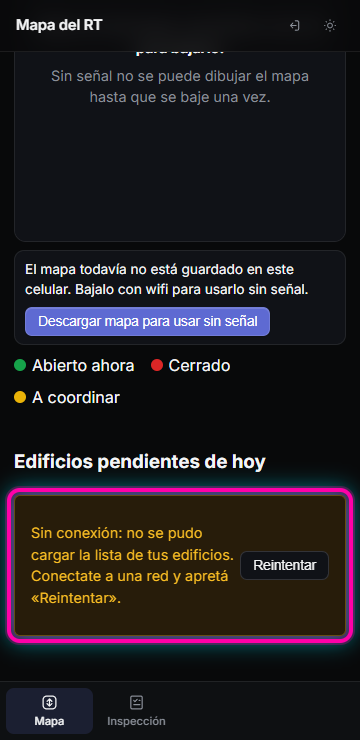
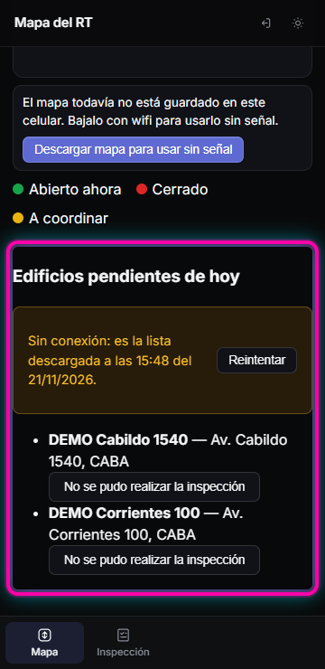
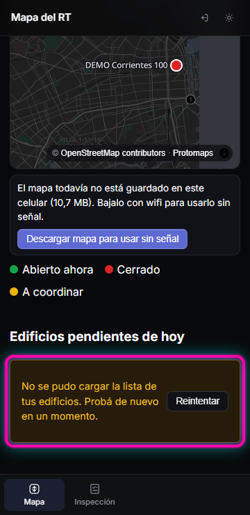

# HU-07 · RF-07 · Entrega — La lista «Edificios pendientes de hoy» del RT no se queda en «Cargando…» sin conexión

- **Tarea:** HU-07 / RF-07 — `REQ-1795285543235`
- **Script:** [RF-07-entrega.sh](RF-07-entrega.sh) · **Prueba en el navegador:** [RF-07-navegador.cjs](RF-07-navegador.cjs)
- **Archivos cambiados:** [`RecorridoRt.tsx`](../../../apps/web/src/visitasFallidas/RecorridoRt.tsx), [`constanciaVisita.ts`](../../../apps/web/src/visitasFallidas/constanciaVisita.ts), [`auth/sesion.ts`](../../../apps/web/src/auth/sesion.ts) y la prueba nueva [`recorridoSinConexion.test.ts`](../../../apps/web/src/visitasFallidas/recorridoSinConexion.test.ts)

## 1. Qué quedó implementado

**El problema.** Sin señal, el Mapa del RT mostraba los pines con los últimos datos descargados (HU-16 RF-05), pero la lista «Edificios pendientes de hoy» de abajo se quedaba para siempre en «Cargando tus edificios…». La causa: cuando el pedido fallaba, la lista recibía `null`, y `null` era también el valor de «todavía cargando».

**Ahora la lista distingue cuatro casos:**

| Situación | Qué ve el RT |
|---|---|
| Hay conexión | La lista, que además queda guardada en el celular con la hora de la descarga |
| Sin conexión, con una lista guardada | La última lista y el cartel «Sin conexión: es la lista descargada a las 15:48 del 21/11/2026.», con «Reintentar» |
| Sin conexión, sin una lista guardada | «Sin conexión: no se pudo cargar la lista de tus edificios. Conectate a una red y apretá «Reintentar».» |
| El servidor responde con error | «No se pudo cargar la lista de tus edificios. Probá de nuevo en un momento.», con «Reintentar». No se muestra la lista vieja, igual que en el Mapa del RT |

- **Al volver la señal** la lista se actualiza sola (evento `online`), y también con «Reintentar». No hace falta cerrar sesión.
- **La lista guardada es de quien la descargó.** Se guarda con el usuario, y otro usuario en el mismo celular no la ve. Además se borra al cerrar sesión, igual que los datos del Mapa del RT.
- **Al guardar una constancia de visita fallida**, el edificio sale también de la lista guardada. Así, si después se corta la señal, no vuelve a aparecer.
- Si el celular no tiene lugar para guardar, la lista funciona igual con conexión.

Se quitó `cargarRecorrido`, que ya no usaba nadie. La reemplaza `cargarRecorridoConRespaldo`.

## 2. Cómo se levanta y se prueba

```bash
npm run db:up && npm run dev                      # API
bash docs/pruebas/hu-04-hu-04-semaforo-de-control-mens/RF-02-datos-demo.sh
npm run build -w apps/web && npm run preview -w apps/web    # web compilada en https://localhost:4173
bash docs/pruebas/hu-07-hu-07-protocolo-de-visitas-fal/RF-07-entrega.sh
```

Sin la web compilada, el script igual corre los pasos 1 y 2 y omite el del navegador, avisándolo.

## 3. Qué datos hacen falta

Los datos de demo de HU-04 RF-02. La prueba entra como `rt.beto` (clave `Demo-Clave-2026`), que tiene 2 edificios pendientes.

## 4. Qué endpoints o pantallas toca

Ningún endpoint: la lista sigue usando `GET /api/recorrido`. Cambia la lista «Edificios pendientes de hoy» del Mapa del RT.

## 5. Cómo se corre integrado

Resultado del 21/11/2026, con la API y PostgreSQL 16 + PostGIS 3.4.3, y la web compilada en Chrome a 360 × 740:

| Condición | Resultado |
|---|---|
| 1. Sin conexión y sin lista guardada: aviso claro con «Reintentar» | Prueba de la lógica y navegador: aparece el aviso y ya no dice «Cargando…» |
| 2. Sin conexión con la lista descargada: la última lista y su hora | Los 2 edificios y «…descargada a las 15:48 del 21/11/2026» |
| 3. Al volver la conexión, la lista se actualiza sin cerrar sesión | Se carga sola al volver la red, y también con «Reintentar» |
| 4. Error del servidor con conexión: aviso con «Reintentar», no «Cargando…» | Con un 500 forzado aparece el aviso; al reintentar con el servidor de vuelta, llega la lista |
| 5. La lista es sólo del RT de la sesión y se borra al cerrarla | Otro usuario no la ve (prueba) y al cerrar sesión desaparece del celular (prueba y navegador) |
| 6. Pruebas de la web y Playwright en 360 px con la red cortada | `recorridoSinConexion.test.ts` 11/11, la web completa 606/606 y `RF-07-navegador.cjs` 12/12 |

`RF-07-entrega.sh`: 6 bien, 0 mal, 0 omitidos.

## Guía visual

Usuario `rt.beto`, clave `Demo-Clave-2026`, en un celular de 360 px. Capturas sacadas con `RF-07-navegador.cjs`, con el elemento de cada paso resaltado en magenta.

### Paso 1 · Sin señal y sin una lista guardada

Abrí el Mapa del RT sin conexión, la primera vez en ese celular.



**Qué tenés que ver:** debajo de «Edificios pendientes de hoy», el aviso amarillo «Sin conexión: no se pudo cargar la lista de tus edificios. Conectate a una red y apretá «Reintentar».», con el botón **Reintentar**. Antes decía «Cargando tus edificios…» para siempre.

### Paso 2 · Sin señal, con la lista ya descargada

Entrá con conexión una vez y después abrí la pantalla sin señal.



**Qué tenés que ver:** el cartel «Sin conexión: es la lista descargada a las 15:48 del 21/11/2026.» y los dos edificios, «DEMO Cabildo 1540» y «DEMO Corrientes 100», cada uno con «No se pudo realizar la inspección».

### Paso 3 · Con conexión, pero el servidor responde con error



**Qué tenés que ver:** el aviso «No se pudo cargar la lista de tus edificios. Probá de nuevo en un momento.» con **Reintentar**. Al apretarlo con el servidor de vuelta, aparece la lista.

## Supuestos y límites

- **La constancia sin señal no cambia.** Desde la lista guardada se puede abrir «No se pudo realizar la inspección», pero guardar la constancia sigue necesitando conexión, como antes. Esta Tarea es sólo la lista.
- La lista guardada es la del último momento con señal: si mientras tanto la Secretaría reasignó un edificio, el RT lo ve recién al volver la conexión. El cartel con la hora existe para eso.
- Las capturas de este documento las tomé con el mapa base sin descargar. Por eso arriba aparece «El mapa todavía no está guardado en este celular»; no tiene que ver con la lista.
