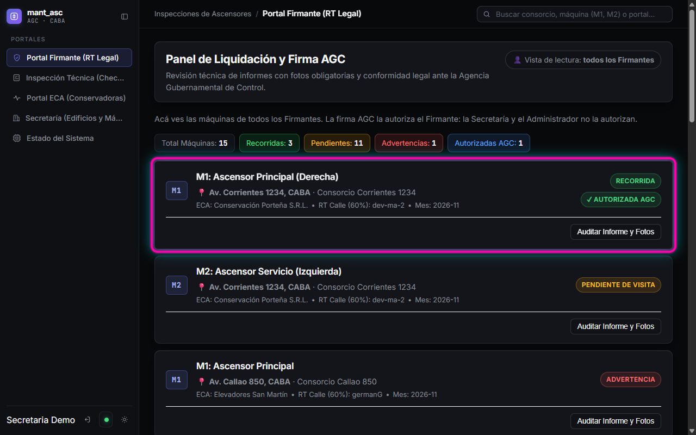

# HU-08 / RF-05 · Las visitas, firmas y avisos del Portal Firmante sobreviven a un reinicio de la API

- **Tarea:** HU-08 / RF-05 — `REQ-1795263641124` · **Script:** [RF-05-entrega.sh](RF-05-entrega.sh) (en dos fases, con el reinicio en el medio)
- **Qué resuelve:** hasta ahora las visitas, las firmas AGC, los rechazos y los avisos de plazo vencido vivían en memoria de `FirmanteService`. Cada reinicio de la API los borraba, y con ellos lo que muestran el Portal ECA, el Monitoreo y los avisos, que leen las mismas máquinas. Una firma AGC autorizada se perdía.

## Qué cambió

| Qué | Dónde queda |
|---|---|
| La visita de una máquina en un mes (con su firma AGC o su rechazo) y el estado de la máquina | tabla `firma_visitas`, una fila por máquina y mes |
| Los avisos de plazo vencido (5 días hábiles) | tabla `firma_avisos_plazo`, un solo aviso por visita (lo garantiza la base) |

- **Al arrancar** la API carga todo lo guardado. Una máquina que se crea después (las de los edificios con terna) recibe su visita guardada del mes en curso; una visita de un mes viejo no se aplica a la máquina de este mes.
- **La firma y el rechazo solo se dan por hechos si quedaron guardados.** Si la base no responde, la API responde **500**, deshace el cambio y la visita sigue sin firmar: se puede reintentar. (Igual criterio que el acuse de recibo, HU-10 RF-03.)
- **Los avisos de plazo** los genera el sistema al abrir la bandeja de la Secretaría, y se guardan **sin hacerla esperar**. Si no se guardan, se vuelven a generar en el siguiente pedido; un aviso ya guardado nunca se duplica.
- **RLS:** las dos tablas solo tienen política para la Secretaría y el Administrador. El sistema escribe con ese alcance en nombre del Firmante; quién puede ver y firmar qué lo sigue decidiendo `FirmanteService`.
- **Punto de entrada nuevo:** `FirmanteService.registrarVisita(maquinaId, visita)` registra y guarda la visita de una máquina (404 si no existe).

Dónde está: `apps/api/src/firmante/firma.repository.ts` (nuevo), `firmante.service.ts`, migración `033_firma_visitas`.

## Cómo se probó

| Prueba | Resultado |
|---|---|
| `test/firmante-persistencia.e2e-spec.ts` (nuevo, 11 pruebas con un reinicio simulado sobre los mismos repositorios) | 11/11 |
| `test/firmante-persistencia.int-spec.ts` (nuevo, PostgreSQL real, reiniciando la aplicación Nest) | 3/3 |
| `npm run verify` (tipos + API) | OK, 1166/1166 |
| `npm run test:int` | 191/191 |
| `RF-05-entrega.sh antes` → reinicio real de la API → `despues`, con PostgreSQL | 5/5 y 6/6 |

Lo que se comprobó con la API real: tras reiniciar, la firma tiene la misma fecha y protocolo y figura «✓ AUTORIZADA AGC», el rechazo conserva su motivo y su fecha, los avisos tienen las mismas fechas y ninguno se repite, y una firma ya dada no se puede dar dos veces ni rechazar (409).

## Guía visual

### Paso 1 · Después de reiniciar la API, la visita sigue firmada

Portal Firmante como Secretaría. La máquina M1 de Av. Corrientes 1234 se firmó antes del reinicio; con la API recién arrancada sigue «✓ AUTORIZADA AGC».

El rechazo y los avisos de plazo no tienen pantalla propia (la bandeja de la Secretaría es una ruta de la API: `GET /api/firmante/bandeja-secretaria`); el script los comprueba con la API.

## Supuestos y límites

- **Hoy ninguna parte del sistema crea la visita de una máquina de un edificio con terna.** El informe que cierra el RT (HU-18) no llega al Portal Firmante: las visitas que se firman son las de las máquinas de ejemplo. Esta Tarea deja listo dónde se guarda y cómo se registra una visita (`registrarVisita`), pero **conectar el informe cerrado con la visita es otra Tarea** (queda anotada en el tablero).
- Las 5 máquinas de ejemplo siguen existiendo (se retiran en HU-08 RF-06): sus visitas también se guardan, porque se identifican por el mismo código de máquina.
- La visita se guarda **completa como JSON** (fotos, firma del encargado, autorización): sirve para este paso, pero no permite consultar por columnas.
- **El mes de la máquina:** una máquina de un edificio con terna lleva el mes en que se creó (el del arranque de la API). Cambiado el mes, la máquina vuelve a «Pendiente de Visita» y la visita del mes anterior queda guardada pero no se muestra.
- Los datos que **no** son visitas, firmas ni avisos (la alerta crítica de la máquina, su estado operativo y su confirmación) siguen en memoria: son de HU-06 RF-08.
- Si la base no responde al arrancar, la API arranca igual, lo deja registrado y no muestra lo guardado hasta el próximo arranque.
