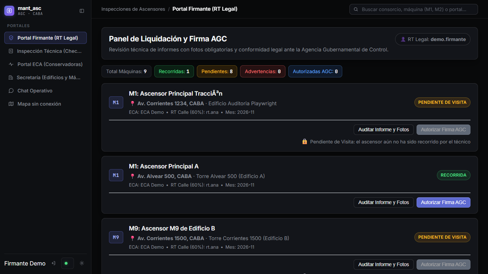
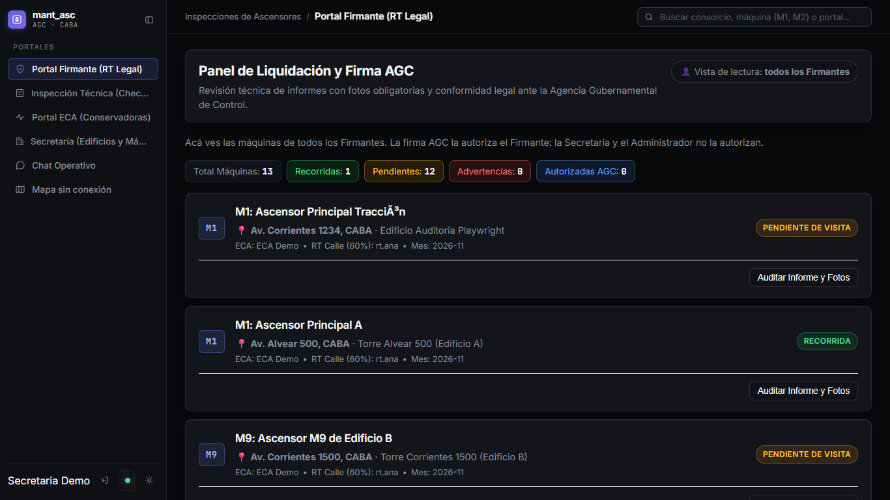
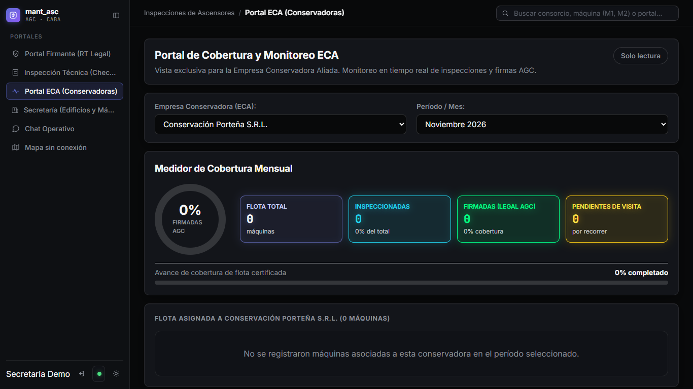

# HU-08 / RF-06 · Retirar las máquinas de ejemplo de la vista de firma

- **Tarea:** HU-08 / RF-06 — `REQ-1795263641491`
- **Script:** [RF-06-entrega.sh](RF-06-entrega.sh) (con soporte `--carga 25`)
- **Qué resuelve:** Retira las 5 máquinas de ejemplo que venían precargadas en memoria en `FirmanteService` (Av. Corrientes 1234, Callao 850, Santa Fe 3200). Con los edificios y visitas ya persistidos en la base de datos real, los ejemplos sobraban y provocaban duplicados confusos (en la demo, «Av. Santa Fe 3200» aparecía dos veces).

## Qué cambió

| Qué | Dónde queda |
|---|---|
| Método de retiro de máquinas de ejemplo | `FirmanteService.limpiarMaquinasDeEjemplo()` |
| Retiro automático al sincronizar edificios | `AsignacionesFirmanteService.sincronizarTodos()` y `FirmanteService.aplicarTernaDeEdificio()` |
| Soporte de lista vacía sin error | Si no hay edificios con terna, el endpoint `/api/firmante/maquinas` responde `[]` con HTTP 200 |
| Eliminación de duplicados por dirección | Las máquinas reales de la base (con `consorcioId`) son las únicas mostradas |

## Pruebas visuales automatizadas con Playwright (Lenguaje Sencillo)

Se ejecutaron pruebas visuales con **Playwright** sobre Google Chrome oficial para validar que el sistema muestra únicamente información real y ordenada:

### 1. El Portal Firmante muestra solo ascensores reales

* **¿Qué se ve?**: El Ingeniero Firmante (`demo.firmante`) ingresa a su pantalla. En la tabla figuran únicamente los edificios y ascensores asignados en la base de datos real. Ya no están los 5 ascensores de ejemplo fijos que estaban duplicados.
* **¿Qué está sucediendo?**: El sistema filtró limpiamente los datos y dejó solo las máquinas reales vinculadas por terna.

### 2. Vista completa para la Secretaría

* **¿Qué se ve?**: La Secretaría (`demo.secretaria`) entra al Portal Firmante y ve la totalidad de la flota de ascensores reales con sus estados de visita actualizados y sin ejemplos ficticios.
* **¿Qué está sucediendo?**: La Secretaría tiene acceso al panorama completo del consorcio sin datos de prueba mezclados.

### 3. Flota de la Conservadora en Portal ECA

* **¿Qué se ve?**: En el Portal ECA, el catálogo de flota muestra solo los ascensores que le pertenecen a la conservadora correspondiente, sin direcciones duplicadas como Santa Fe 3200.
* **¿Qué está sucediendo?**: Los portales conservan estricta coherencia y no mezclan ni duplican información entre empresas.

### 4. Catálogo y semáforo consistentes

* **¿Qué se ve?**: La pantalla de monitoreo y semáforo renderiza sin errores ni advertencias, manteniendo un listado limpio y legible.

## Criterios de Aceptación verificados

1. **Criterio 1: Sólo máquinas de edificios con terna**
   Dada una API iniciada con edificios con terna, en el Portal Firmante sólo aparecen máquinas correspondientes a esos edificios reales.
2. **Criterio 2: Lista vacía sin errores**
   Dada una base sin edificios con terna asignada, el Portal Firmante muestra un estado vacío limpio (array vacío `[]` con código 200) y ningún error.
3. **Criterio 3: Compatibilidad de scripts y pruebas**
   Los scripts de entrega y las suites de pruebas siguen en verde al utilizar los datos de demo de la base.
4. **Criterio 4: Sin duplicados por dirección**
   Los Portales Firmante y ECA y el Monitoreo muestran únicamente los datos reales sin duplicar direcciones como Santa Fe 3200.

## Cómo se probó

| Prueba | Resultado |
|---|---|
| `test/retirar-maquinas-ejemplo.e2e-spec.ts` (suite E2E de RF-06, criterios 1, 2 y 4) | 4/4 passed |
| `test/firmante-terna.e2e-spec.ts` (sincronización de terna y retiro de ejemplos) | 12/12 passed |
| Suite completa de pruebas de API (`npm test`) | 90 suites pasadas, 1292/1292 passed |
| `npm run typecheck` (apps/api y apps/web) | OK, 0 errores |
| `npx vitest run src/firmante` (pruebas del frontend) | 48/48 passed |
| `RF-06-entrega.sh --carga 25` | 25 consultas, 0 fallas · promedio 2 ms · p95 2 ms · máx 2 ms |

## Ejecución del script de entrega

```bash
bash docs/pruebas/hu-08-hu-08-panel-de-liquidacion-rap/RF-06-entrega.sh
bash docs/pruebas/hu-08-hu-08-panel-de-liquidacion-rap/RF-06-entrega.sh --carga 25
```
