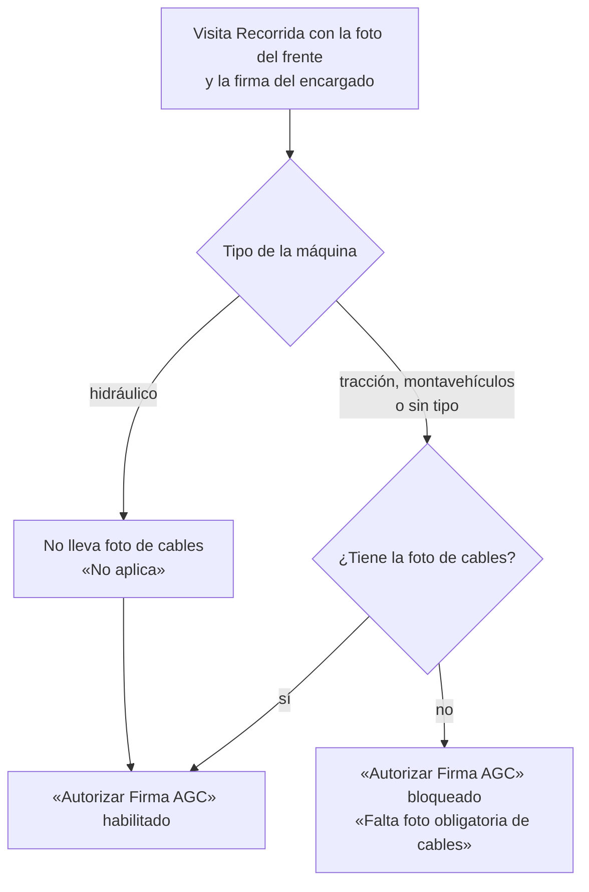
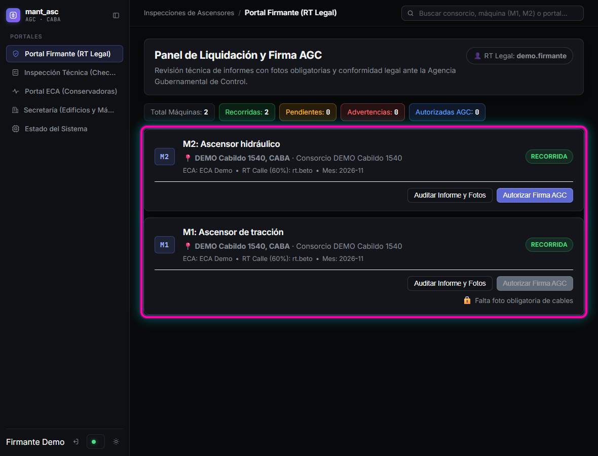
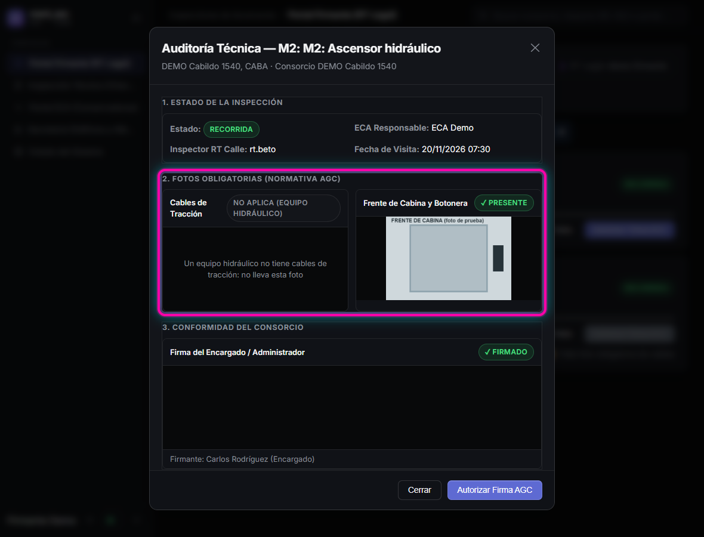
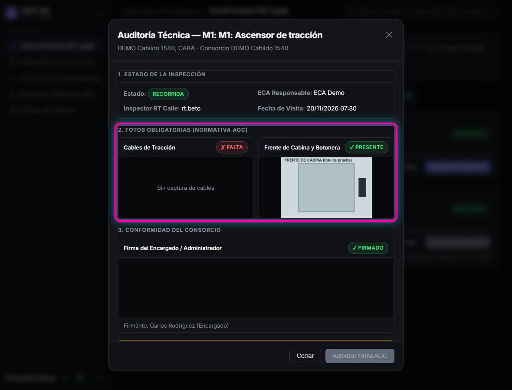

# HU-08 · RF-08 · Guía visual — El Portal Firmante y la foto de cables de un equipo hidráulico

Recorrido para quien nunca vio la pantalla: qué pide el Portal Firmante para autorizar la visita de un equipo **hidráulico** y de uno de **tracción**.

- **Usuario:** `demo.firmante` / `Demo-Clave-2026` (datos de demo de HU-04 RF-02), en una ventana de escritorio de 1180 × 900.
- **Capturas:** sacadas con [RF-08-navegador.cjs](RF-08-navegador.cjs) (Playwright). Los datos de demo no traen ninguna máquina hidráulica con la visita recorrida, así que el navegador responde la lista de máquinas con dos de ejemplo: un hidráulico y uno de tracción, ambos con la foto del frente (dibujada, con el rótulo «foto de prueba») y la firma del encargado, **sin foto de cables**. Es una prueba de la pantalla; lo que hace la API lo prueban las pruebas de la API y el script de entrega.
- **Entrega y script:** [RF-08-entrega.md](RF-08-entrega.md) · [RF-08-entrega.sh](RF-08-entrega.sh)

## Paso 1 · La lista de máquinas

Entrá al **Portal Firmante (RT Legal)**.

**Qué tenés que ver:**
- **M2: Ascensor hidráulico**, «Recorrida», con **Autorizar Firma AGC** habilitado y sin ningún motivo de bloqueo debajo. Tiene la foto del frente y la firma del encargado, y no necesita la de cables.
- **M1: Ascensor de tracción**, «Recorrida», con **Autorizar Firma AGC** bloqueado y el motivo **«🔒 Falta foto obligatoria de cables»**: este equipo sí tiene cables de tracción y su visita no trae la foto.

## Paso 2 · Auditar el informe de un hidráulico

En **M2: Ascensor hidráulico**, tocá **Auditar Informe y Fotos**.

**Qué tenés que ver:** en **2. Fotos obligatorias (Normativa AGC)**, la tarjeta **Cables de Tracción** dice **«No aplica (equipo hidráulico)»** —no «✗ Falta»— y explica que un hidráulico no lleva esa foto. La tarjeta **Frente de Cabina y Botonera** muestra **✓ Presente** y la foto. Abajo, **Firma del Encargado / Administrador: ✓ Firmado**, y el botón **Autorizar Firma AGC** está habilitado. (La API acepta esa autorización: lo comprueban las pruebas de la API.)

## Paso 3 · El de tracción sigue pidiendo los cables

Cerrá el modal y tocá **Auditar Informe y Fotos** en **M1: Ascensor de tracción**.

**Qué tenés que ver:** la tarjeta **Cables de Tracción** con **✗ Falta** y «Sin captura de cables», y el botón **Autorizar Firma AGC** deshabilitado. Sin la foto del frente, ningún equipo se autoriza, tampoco un hidráulico.
