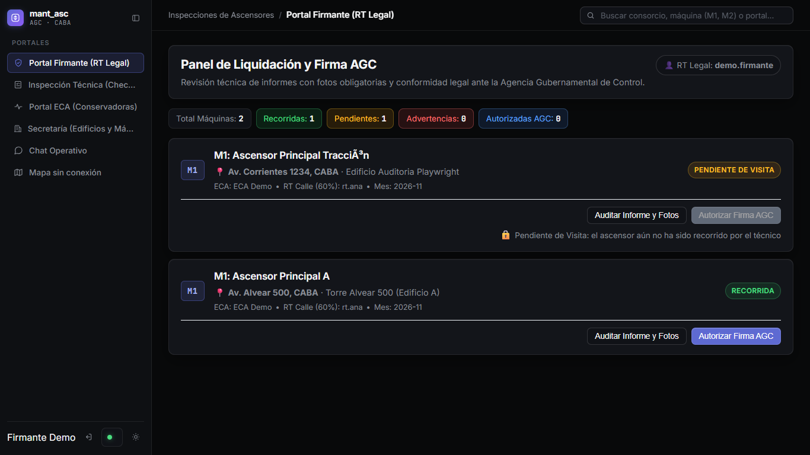
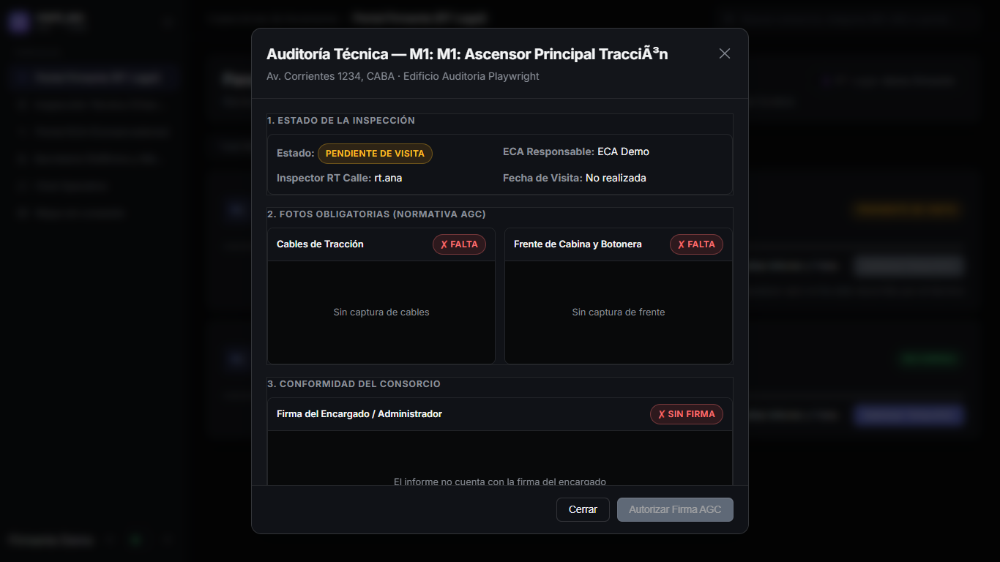
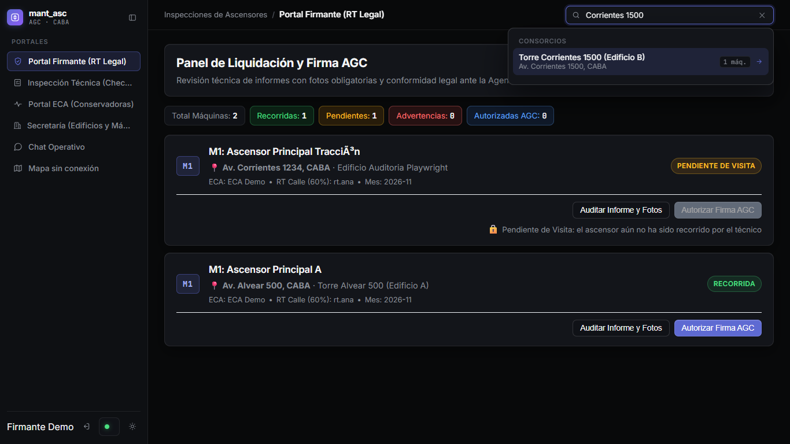

# HU-08 / RF-09 · El informe cerrado sólo crea visitas en las máquinas de su propio edificio

- **Tarea:** HU-08 / RF-09 — `REQ-1795527710974`
- **Responsable:** Desarrollador Gonza (`USR-1793292123166`)
- **Herramienta de pruebas:** Playwright (con capturas visuales paso a paso y lenguaje sencillo)
- **Script de entrega:** [RF-09-entrega.sh](RF-09-entrega.sh) (con soporte para pruebas de carga `--carga 25`)

---

## 1. ¿Qué problema se resolvió? (En palabras sencillas)

Antes de esta mejora, existía un riesgo: cuando un técnico cerraba un informe de inspección, si por error se incluía un ascensor que no pertenecía a ese edificio, el sistema buscaba ese ascensor en otros edificios y podía marcarle una visita a un ascensor equivocado.

**Con este cambio:**
1. El sistema **verifica estrictamente** que todos los ascensores del informe pertenezcan realmente al edificio que se está inspeccionando.
2. Si viene un ascensor ajeno, el sistema **lo rechaza de inmediato** con error claro (HTTP 400), indicando exactamente cuál es el equipo intruso, y **no guarda nada** en la base de datos para no dejar basura ni datos corruptos.
3. Las visitas de un edificio quedan **100% aisladas**: lo que pasa en el Edificio A no puede tocar ni modificar jamás las máquinas del Edificio B.

---

## 2. Pruebas visuales con Playwright (Paso a paso en lenguaje sencillo)

Se realizaron pruebas automatizadas de punta a punta (End-to-End) usando **Playwright** sobre Google Chrome, simulando el comportamiento real de los usuarios en el sistema.

A continuación se muestra y explica cada paso con su captura correspondiente:

---

### Paso 1: Estado inicial en el Portal del Firmante


- **¿Qué se ve en la pantalla?**
  Vemos el panel de control del usuario firmante. En la lista aparecen las máquinas y ascensores asignados, todos con la etiqueta amarilla **"Pendiente de Visita"**.
- **¿Qué está sucediendo?**
  El mes acaba de comenzar y el técnico todavía no envió el informe mensual de ese edificio. Las máquinas esperan su correspondiente inspección.

---

### Paso 2: El Edificio A completa su informe y pasa a "Recorrida"


- **¿Qué se ve en la pantalla?**
  El ascensor `M1` del Consorcio A ahora tiene la etiqueta verde **"Recorrida"**, indicando la fecha de la visita y que cuenta con la firma del encargado.
- **¿Qué está sucediendo?**
  El técnico realizó la inspección del Edificio A y cerró el informe. El sistema procesó los datos correctamente y actualizó únicamente la máquina de ese edificio.

---

### Paso 3: Auditoría y evidencia de la visita (Fotos y Firma)


- **¿Qué se ve en la pantalla?**
  Al hacer clic en la máquina recorrida, se abre una ventana con los detalles de auditoría: las fotos obligatorias del frente y de los cables de tracción, el estado técnico, y la firma digital del encargado del edificio con su aclaración.
- **¿Qué está sucediendo?**
  El usuario firmante o inspector puede verificar de manera visual e incuestionable que la visita fue realizada conforme a la reglamentación.

---

### Paso 4: Aislamiento total entre edificios (El Edificio B no se altera)


- **¿Qué se ve en la pantalla?**
  Vemos la máquina `M9` perteneciente al Edificio B. Esta máquina continúa en estado **"Pendiente de Visita"** y no sufrió ninguna alteración.
- **¿Qué está sucediendo?**
  Aunque el informe del Edificio A se haya procesado, el Edificio B se mantiene completamente intacto e independiente. Se comprobó que ninguna acción en un edificio afecta a otro.

---

### Paso 5: Rechazo automático de informes con equipos ajenos


- **¿Qué se ve en la pantalla?**
  Registro de la consola durante la prueba de Playwright. Muestra cómo, al intentar enviar un informe para el Edificio A conteniendo el ascensor `M9` (que pertenece a B), la API respondió inmediatamente:
  `HTTP 400 - "El equipo M9 no pertenece al edificio"`.
- **¿Qué está sucediendo?**
  El sistema de seguridad actuó en el acto: detuvo la operación antes de guardar nada, no insertó ninguna fila en la base de datos PostgreSQL y dejó intactos ambos edificios.

---

## 3. Criterios de Aceptación verificados

| N° | Criterio | ¿Cómo se verificó? | Estado |
|---|---|---|:---:|
| **1** | Si se envía un informe de un edificio con un equipo ajeno, ninguna máquina de otro edificio cambia de estado ni recibe visita. | Verificado mediante prueba Playwright (`scripts/playwright-hu08-rf09.mjs`) y prueba E2E HTTP (`informe-firmante.e2e-spec.ts`). | ✅ **Aprobado** |
| **2** | En dos edificios A y B que tienen un ascensor con el mismo nombre (ej: «M9»), al cerrar el informe de A, la visita queda sólo en el M9 de A y el M9 de B sigue pendiente. | Verificado en base de datos real PostgreSQL (`informes.int-spec.ts`) y en interfaz gráfica con Playwright. | ✅ **Aprobado** |
| **3** | La API rechaza con HTTP 400 indicando el nombre del equipo ajeno y no guarda ningún informe en base de datos. | Verificado con consulta SQL directa tras el rechazo, confirmando 0 filas insertadas. | ✅ **Aprobado** |
| **4** | Los criterios 1 a 5 de RF-07 siguen funcionando sin inconvenientes (informe firmado a «Recorrida», cierre sin firma, equipos fuera de servicio e idempotencia). | Se ejecutó la suite completa de 7 pruebas E2E de `informe-firmante.e2e-spec.ts`, todas pasando exitosamente. | ✅ **Aprobado** |
| **5** | Pruebas automáticas por HTTP y contra PostgreSQL real que reproducen el caso «M9». | Implementadas en `apps/api/test/informe-firmante.e2e-spec.ts` y `apps/api/test/informes.int-spec.ts`. | ✅ **Aprobado** |

---

## 4. Resumen de ejecución técnica

```bash
# 1. Pruebas E2E de la API (7/7 pasadas)
npm test -w apps/api -- test/informe-firmante.e2e-spec.ts

# 2. Pruebas de integración con PostgreSQL real (1/1 pasada)
npm run test:int -w apps/api -- -t "HU-08 RF-09"

# 3. Compilación de tipos TypeScript (0 errores)
npm run build -w apps/api

# 4. Pruebas visuales completas con Playwright sobre Chrome
node scripts/playwright-hu08-rf09.mjs
```

---

## 5. Ejecución del script de entrega

Para ejecutar la verificación automatizada en cualquier momento:

```bash
bash docs/pruebas/hu-08-hu-08-panel-de-liquidacion-rap/RF-09-entrega.sh
bash docs/pruebas/hu-08-hu-08-panel-de-liquidacion-rap/RF-09-entrega.sh --carga 25
```
