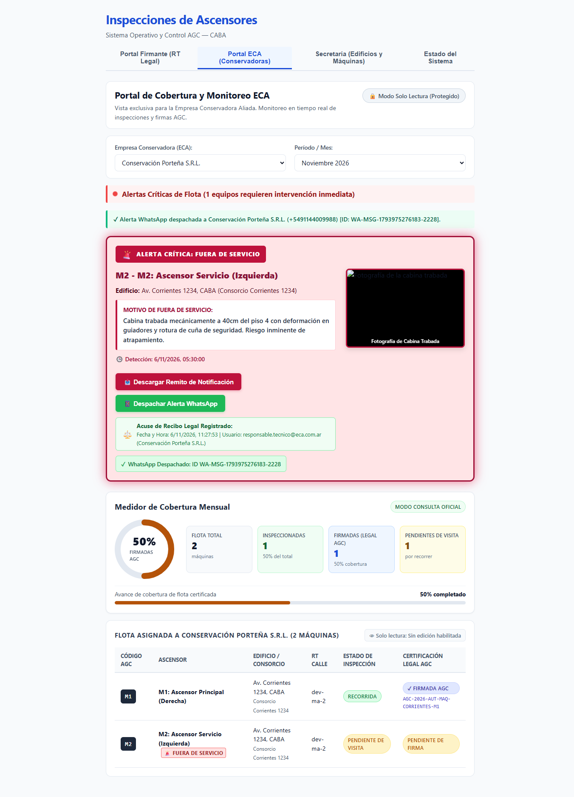

# HU-10 · Entrega — Carteles de Alerta de Fuera de Uso y Reparación Urgente en Portal ECA

- **Tarea:** HU-10 / RF-01 — `REQ-1791910396649`
- **Rama:** `feature/hu-10-hu-10-centro-de-alertas-critic/req-1791910396649-carteles-de-alerta-de-fuera-de-uso-y-rep`
- **Pull Request:** #8 (Mergeado en `dev`)

## 1. Qué quedó implementado

Se implementó en `apps/web` y `apps/api` el Centro de Alertas Críticas de Seguridad para el Portal ECA:

1. **Cartel Titilante de Fuera de Servicio (`.alerta-titilante-roja`)**:
   - Detección inmediata de equipos detenidos por riesgo operativo.
   - Animación CSS `@keyframes titilar-rojo` con reborde y sombra pulsante de alta visibilidad.
   - Exhibición destacada de la fotografía de la cabina trabada y el motivo de detención técnica.
2. **Cartel Gigante de Reparación Urgente (`.cartel-reparacion-urgente-gigante`)**:
   - Notificación visual de anomalías graves operando.
   - Desglose del checklist técnico de seguridad con 4 componentes críticos categorizados por severidad (Cerraduras electromecánicas, Paracaídas, Regulador de velocidad y Cables).
3. **Endpoint API Enriquecido**:
   - `GET /api/eca/alertas`: Retorna el catálogo filtrado de equipos críticos para la ECA.

## 2. Criterios de Aceptación Cubiertos

- **TEST-1791910396655-0**: *Si un ascensor es marcado como Fuera de Servicio, el Portal ECA exhibe una alerta titilante roja con el motivo de detención y fotografía destacada de la cabina trabada.*
- **TEST-1791910396660-2**: *Si el ascensor presenta anomalías graves pero continúa operando, el portal exhibe un cartel naranja gigante de Reparación Urgente con el checklist de seguridad detallado.*

## 3. Pruebas Automatizadas

| Suite / Comando | Resultado |
|---|---|
| `npm run typecheck --workspaces` | Tipos TypeScript sin errores. |
| `npm test -w apps/api -- eca` | 11 pruebas unitarias y 6 e2e en verde. |
| `npm test -w apps/web -- eca` | 18 pruebas en Vitest en verde. |

## 4. Evidencia Visual de Pruebas en el Navegador

- **Inspección en vivo**: Prueba automatizada en Google Chrome (`https://localhost:8050/`) accediendo a la solapa **Portal ECA (Conservadoras)**.
- **Validación visual**:
  - Cartel titilante rojo con fotografía de cabina trabada entre pisos 3 y 4.
  - Cartel naranja gigante con checklist de seguridad para reparación urgente.
