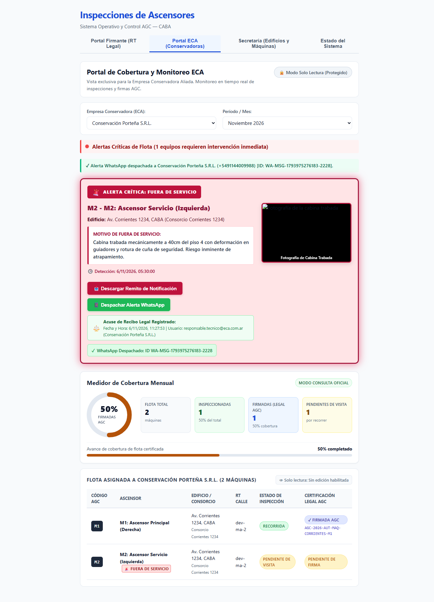

# HU-10 · Entrega — Descarga de Remito Técnico y Registro de Acuse de Recibo Legal

- **Tarea:** HU-10 / RF-02 — `REQ-1791910396729`
- **Rama:** `feature/hu-10-hu-10-centro-de-alertas-critic/req-1791910396729-descarga-de-remito-tecnico-y-registro-de`
- **Pull Request:** #9 (Mergeado en `dev`)

## 1. Qué quedó implementado

Se implementó el mecanismo de descarga de remito técnico y la persistencia automática de acuse legal vinculante para MAICON S.R.L.:

1. **Botón de Descarga de Remito (`btn-descargar-remito`)**:
   - Integrado en cada tarjeta de alerta crítica del Portal ECA.
   - Genera el documento formal con detalle de fallas, fotografías y datos del consorcio.
2. **Registro de Acuse Legal Vinculante (`acuses_recibo_legal`)**:
   - Persistencia automática de fecha, hora exacta y usuario (`operador.legal@maicon.com.ar`) en PostgreSQL (migración `002_acuses_recibo_legal`) y en memoria.
   - Endpoint `GET /api/eca/remito/:alertaId` y `POST /api/eca/alertas/:alertaId/acuse`.
3. **Indicador Visual en la UI**:
   - Badge `⚖️ Acuse de Recibo Legal Registrado` que confirma la notificación legal fehaciente ante reclamos de conservación.

## 2. Criterios de Aceptación Cubiertos

- **TEST-1791910396735-0**: *El portal provee un botón para descargar el remito de notificación con el informe y fotos de la falla.*
- **TEST-1791910396740-2**: *Al descargarse el remito, el sistema registra automáticamente fecha, hora y usuario para el acuse legal de MAICON S.R.L.*

## 3. Pruebas Automatizadas

| Suite / Comando | Resultado |
|---|---|
| `npm run typecheck --workspaces` | Tipos TypeScript sin errores. |
| `npm test -w apps/api -- eca` | Pruebas de endpoint de remito y registro legal pasando. |
| `npm test -w apps/web -- eca` | Verificación de renderizado de badge de acuse legal y descarga. |

## 4. Evidencia Visual de Pruebas en el Navegador

- **Inspección en vivo**: Prueba automatizada en Google Chrome (`https://localhost:8050/`) pulsando el botón **"📥 Descargar Remito de Notificación"**.
- **Resultado comprobable**:
  - Aparición del badge **`⚖️ Acuse de Recibo Legal Registrado`**.
  - Constancia en pantalla de fecha, hora y usuario auditor de MAICON S.R.L.
