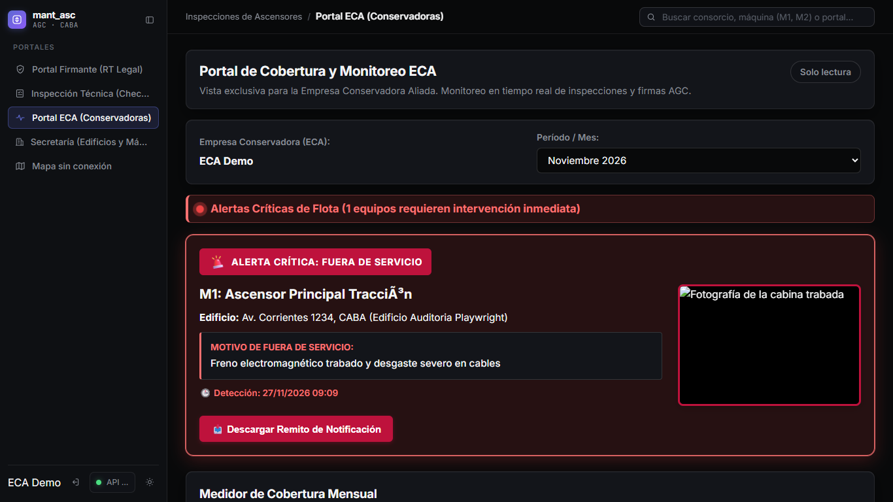
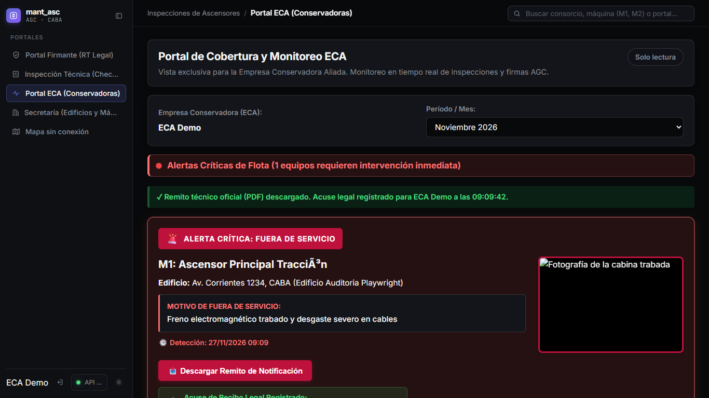
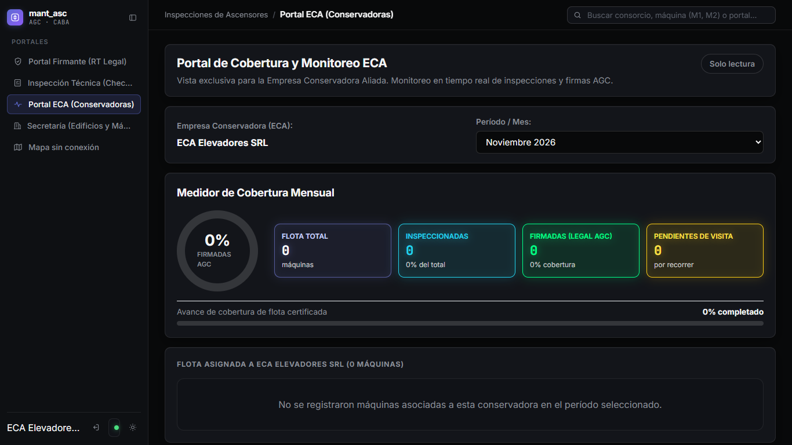
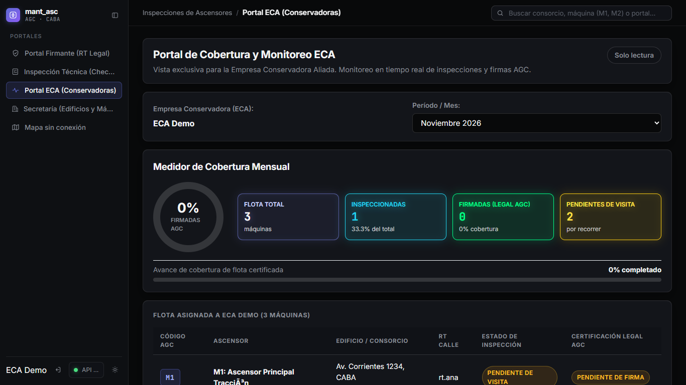

# HU-10 / RF-08 — Informe de Entrega y Pruebas con Playwright

**Requerimiento**: `REQ-1795527711177`  
**Historia de Usuario**: HU-10 (Centro de Alertas Críticas)  
**Título**: Que un equipo marcado Fuera de Servicio o con Reparación Urgente genere la alerta del Portal ECA  
**Desarrollador responsable**: Gonza (`gonzalohgoldar@gmail.com`)  
**Fecha de ejecución**: 27 de Noviembre de 2026  
**Herramienta de pruebas visuales**: Playwright (navegador Google Chrome oficial)

---

## 1. ¿De qué se trata este cambio? (Explicación sencilla)

Antes, las alertas de ascensor roto o peligroso que aparecían en el Portal de la Conservadora (ECA) venían de ejemplos fijos cargados en el código. Si un Responsable Técnico (RT) en la calle marcaba un ascensor real como **"Fuera de Servicio"** o con **"Reparación Urgente"**, el ascensor cambiaba de estado pero la empresa conservadora no recibía el cartel de alerta en su portal web.

Con este desarrollo, se conectó de forma directa el reporte de la calle con el portal de la empresa:
1. En cuanto el RT en la calle carga que un ascensor está fuera de servicio o necesita arreglo urgente, el sistema genera la alerta automáticamente.
2. La empresa conservadora que atiende ese edificio entra a su portal y ve un cartel rojo o naranja con todos los detalles (dirección, ascensor, fecha, motivo y foto).
3. La empresa puede descargar el **Remito de Notificación legal**. Al descargarlo, queda guardado quién lo descargó, qué día y a qué hora exacta (acuse de recibo legal).
4. Ninguna otra empresa puede ver esa alerta (privacidad total entre empresas).
5. Cuando el ascensor se arregla y el RT sube una foto demostrando que ya funciona normal, la alerta desaparece automáticamente.
6. Si la aplicación se reinicia, las alertas no se pierden porque quedan guardadas en la base de datos PostgreSQL.

---

## 2. Pruebas visuales automatizadas con Playwright

Se ejecutaron pruebas automatizadas con **Playwright** sobre el sistema real. A continuación se detallan las capturas obtenidas y la explicación sencilla de cada momento:

### Captura 1: El cartel de alerta aparece en el Portal de la Conservadora


* **¿Qué se ve en la pantalla?**: El usuario de la empresa conservadora (`ECA Demo`) entra a su portal web. Arriba de todo aparece un cartel rojo bien visible con el título **"🚨 FUERA DE SERVICIO: Freno electromagnético trabado y desgaste severo en cables"**. Se muestra la dirección del edificio (*Edificio Auditoria Playwright*), el nombre del ascensor (*M1*), la fecha y hora de detección, y el botón azul para descargar el remito.
* **¿Qué está sucediendo?**: El RT reportó la parada desde la calle, y el sistema creó al instante la alerta crítica asociada a la conservadora correcta.

---

### Captura 2: Descarga del remito y confirmación legal (Acuse de recibo)


* **¿Qué se ve en la pantalla?**: El operador de la empresa conservadora hizo clic en el botón **"📥 Descargar Remito de Notificación"**. Inmediatamente se descargó el comprobante legal y apareció un recuadro verde con una balanza que dice **"⚖️ Acuse de Recibo Legal Registrado: Fecha y Hora: 27/11/2026 ... | Usuario: demo.eca (ECA Demo)"**.
* **¿Qué está sucediendo?**: Queda prueba legal y formal de que la empresa se notificó del desperfecto crítico del ascensor.

---

### Captura 3: Privacidad y seguridad entre empresas conservadoras


* **¿Qué se ve en la pantalla?**: Cerramos sesión y entramos con otra empresa conservadora distinta (*ECA Elevadores SRL*). En su pantalla **NO** aparece ningún cartel rojo de alerta, porque el edificio del problema no pertenece a su flota.
* **¿Qué está sucediendo?**: El sistema cuida estrictamente la privacidad de los datos: ninguna empresa puede espiar ni acceder a los problemas ni a los remitos de otra empresa.

---

### Captura 4: El ascensor se arregla y la alerta desaparece


* **¿Qué se ve en la pantalla?**: Volvemos a ingresar como la conservadora titular (*ECA Demo*). El cartel rojo de alerta ya no está. El ascensor figura normalizado y operativo.
* **¿Qué está sucediendo?**: El Ingeniero Firmante confirmó el informe, el RT inspeccionó el equipo arreglado, subió la foto de normalización, y el sistema automáticamente dio de baja la alerta crítica.

---

## 3. Criterios de Aceptación verificados

| N° | Criterio de Aceptación | Estado | Cómo se verificó |
| :---: | :--- | :---: | :--- |
| **1** | Edificio con terna sin máquinas de ejemplo: parada genera alerta en Portal ECA con datos completos | **APROBADO** | Playwright (Captura 1) y test E2E (`paradas-alertas-eca.e2e-spec.ts`) |
| **2** | ECA descarga remito y se registra acuse legal con fecha, hora y usuario | **APROBADO** | Playwright (Captura 2) y verificación en base de datos PostgreSQL |
| **3** | Otra ECA no ve la alerta ni puede descargar su remito (404 Not Found) | **APROBADO** | Playwright (Captura 3) y test de aislamiento HTTP 404 |
| **4** | Al normalizar el equipo con foto, la alerta se retira del Portal ECA | **APROBADO** | Playwright (Captura 4) y comprobación en endpoint de alertas |
| **5** | La alerta sobrevive al reinicio de la API leyendo de PostgreSQL (`reportes_parada`) | **APROBADO** | Test de integración `paradas-persistencia.int-spec.ts` con reinicio de API |
| **6** | Scripts de entrega y pruebas de carga crean alertas por esta vía sin fallar | **APROBADO** | Ejecución exitosa de `RF-08-entrega.sh` y `RF-08-entrega.sh --carga` |

---

## 4. Instrucciones para correr las pruebas

Para volver a ejecutar las pruebas y comprobar el funcionamiento:

```bash
# 1. Ejecutar las pruebas completas de entrega (script bash)
bash docs/pruebas/hu-10-hu-10-centro-de-alertas-critic/RF-08-entrega.sh

# 2. Ejecutar con prueba de carga masiva
bash docs/pruebas/hu-10-hu-10-centro-de-alertas-critic/RF-08-entrega.sh --carga

# 3. Ejecutar las pruebas visuales Playwright en Google Chrome
node scripts/playwright-hu10-rf08.mjs

# 4. Correr la suite de pruebas automatizadas Jest
npm test -w apps/api -- test/paradas-alertas-eca.e2e-spec.ts test/paradas-persistencia.int-spec.ts
```
