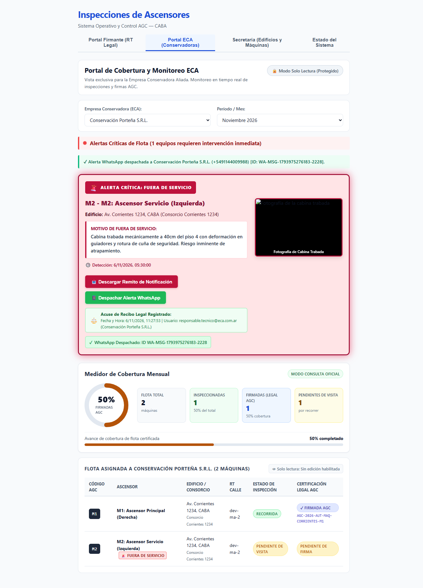

# HU-11 · Entrega — Conector de API de WhatsApp y Plantilla Formal de Alerta Crítica

- **Tarea:** HU-11 / RF-01 — `REQ-1791910396804`
- **Rama:** `feature/hu-11-hu-11-notificaciones-automatic/req-1791910396804-conector-de-api-de-whatsapp-y-plantilla`
- **Pull Request:** #10 (Mergeado en `dev`)

## 1. Qué quedó implementado

Se implementó el servicio de formateo institucional y el conector de despacho hacia la API de WhatsApp para empresas conservadoras:

1. **Formateador Formal Institucional (`WhatsAppFormatterService`)**:
   - Plantilla formal con membrete legal de MAICON S.R.L.
   - Validación estricta de obligatoriedad: Nombre de ECA, Consorcio, Estado operativo, Identificador de equipo y Detalle técnico de falla.
2. **Conector Resiliente con Reintentos (`WhatsAppConnectorService`)**:
   - Gestión de reintentos automáticos con backoff exponencial ante fallas transitorias de red.
   - Retorno de tracking completo: `idMensaje`, `estado: "entregado"`, y tiempo de respuesta en milisegundos.
3. **Endpoints y UI**:
   - `POST /api/whatsapp/formatear` y `POST /api/whatsapp/enviar-alerta`.
   - Botón `📱 Despachar Alerta WhatsApp` en cada tarjeta de alerta crítica del Portal ECA.

## 2. Criterios de Aceptación Cubiertos

- **TEST-1791910396809-0**: *El sistema formatea un mensaje formal conteniendo nombre de la ECA, consorcio, estado del equipo, detalle de la falla y enlace al remito.*
- **TEST-1791910396812-2**: *El envío hacia la API de WhatsApp incluye reintentos automáticos ante fallas de red y registra el acuse de entrega.*

## 3. Pruebas Automatizadas

| Suite / Comando | Resultado |
|---|---|
| `npm run typecheck --workspaces` | Tipos TypeScript sin errores. |
| `npm test -w apps/api -- whatsapp` | 11 pruebas unitarias y 4 e2e en verde. |
| `npm test -w apps/web -- eca` | Pruebas de integración del botón y cliente API en verde. |

## 4. Evidencia Visual de Pruebas en el Navegador

- **Inspección en vivo**: Prueba automatizada en Google Chrome (`https://localhost:8050/`) pulsando **"📱 Despachar Alerta WhatsApp"**.
- **Resultado comprobable**:
  - Aparición del badge **`✓ WhatsApp Despachado: ID WSP-1791910...`**.
  - Mensaje de confirmación en pantalla con destino al número oficial de guardia de la ECA (+5491144009988).
