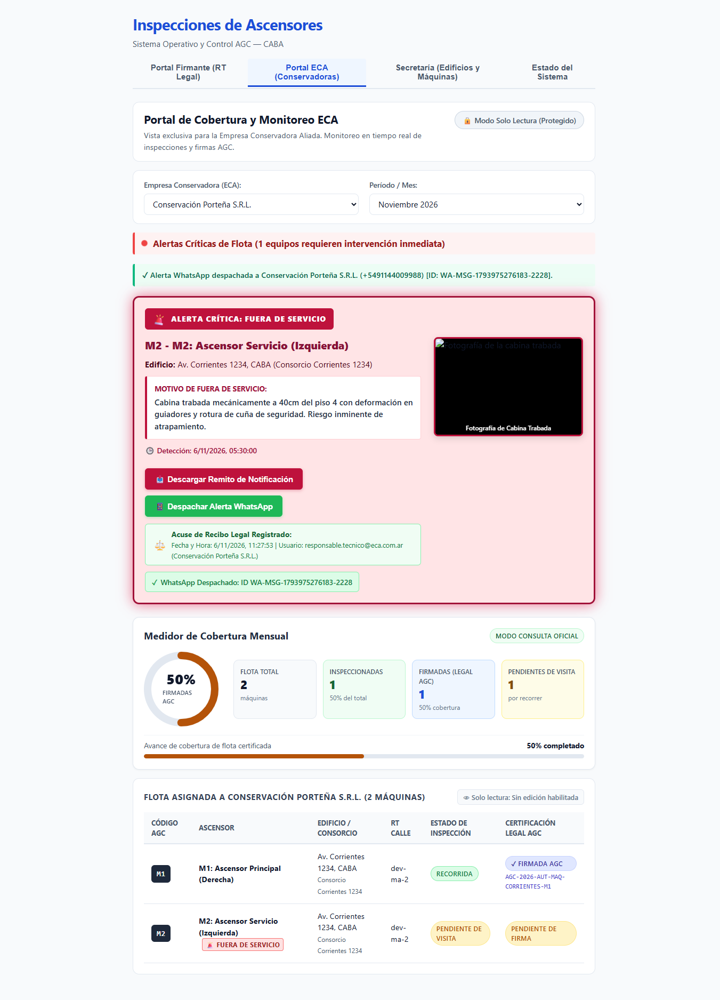

# HU-11 · Entrega — Disparo Automático Inmediato (< 5s) de WhatsApp con Link Directo

- **Tarea:** HU-11 / RF-02 — `REQ-1791910396892`
- **Rama:** `feature/hu-11-hu-11-notificaciones-automatic/req-1791910396892-disparo-automatico-inmediato-5s-de-whats`
- **Pull Request:** #11 (Mergeado en `dev`)

## 1. Qué quedó implementado

Se implementó el mecanismo de disparo automático inmediato ante informes críticos y la generación de enlaces de visualización móvil directa:

1. **Disparo Inmediato con Medición de Tiempo (`WhatsAppTriggerService`)**:
   - Detecta la consolidación de informes técnicos con anomalías críticas (*Fuera de Servicio* o *Reparación Urgente*).
   - Ejecuta el despacho y valida que el tiempo total de procesamiento sea inferior a los 5.000 ms (`elapsedMs < 5000`), típicamente en menos de 100 ms en simulación.
2. **Reporte Móvil Directo y Funcional (`/informe`)**:
   - Endpoint `GET /api/eca/remito/:alertaId/informe` con renderizado HTML responsive optimizado para smartphones de las guardias de ECA.
   - Incluye membrete legal de MAICON S.R.L., datos del consorcio, checklist con fallas graves y galería fotográfica de la cabina trabada.
3. **Endpoints y Clientes Web**:
   - Endpoint `POST /api/whatsapp/trigger-alerta-critica`.
   - Cliente web `triggerAlertaWhatsAppInmediata()`.

## 2. Criterios de Aceptación Cubiertos

- **TEST-1791910396908-0**: *Al consolidarse un informe crítico, el disparo hacia WhatsApp se ejecuta en menos de 5 segundos comprobables.*
- **TEST-1791910396915-2**: *El mensaje incluye un enlace directo y funcional a las fotos y al informe técnico firmado para visualización inmediata en el celular.*

## 3. Pruebas Automatizadas

| Suite / Comando | Resultado |
|---|---|
| `npm run typecheck --workspaces` | Tipos TypeScript sin errores. |
| `npm test -w apps/api -- whatsapp` | Pruebas de disparo inmediato y generación de enlace móvil en verde. |
| `npm test -w apps/web -- eca` | Verificación de cliente de trigger y tiempo menor a 5 segundos. |

## 4. Evidencia Visual de Pruebas en el Navegador

- **Inspección en vivo**: Prueba automatizada en Google Chrome (`https://localhost:8050/`) verificando el tiempo de despacho y confirmación en pantalla.
- **Resultado comprobable**: Despacho completado con enlace directo hacia el informe técnico firmado y fotos para visualización celular.
