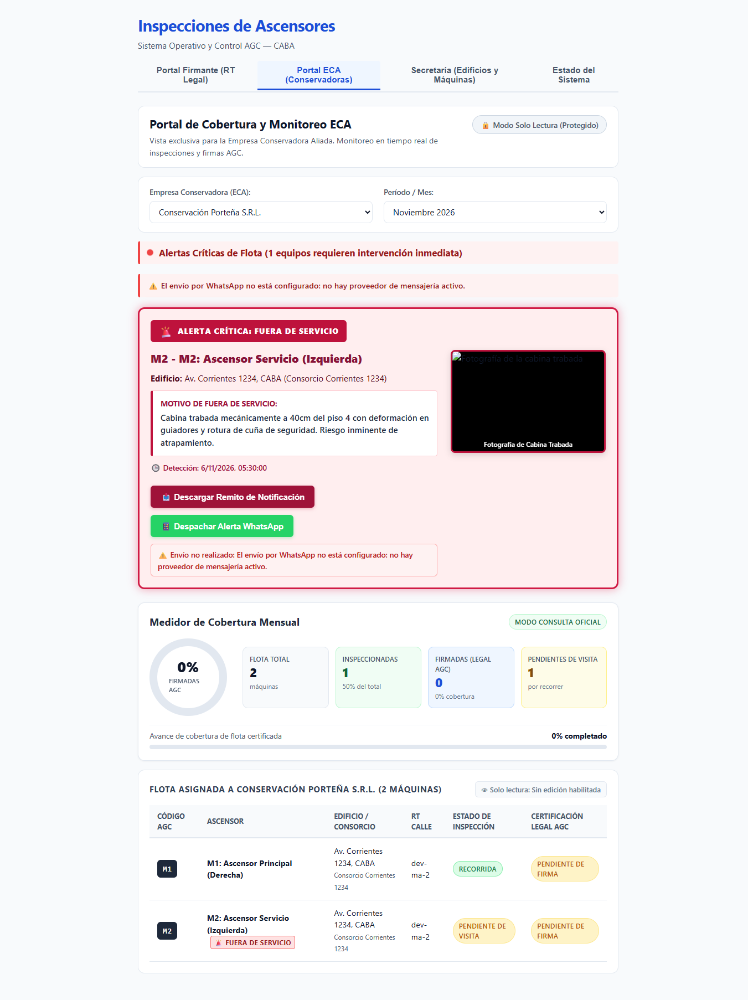

# HU-11 / RF-03 — No informar como entregado un WhatsApp que no se envió

- **Requerimiento:** `REQ-1794155773535`
- **Rama:** `feature/hu-11-hu-11-notificaciones-automatic/req-1794155773535-no-informar-como-entregado-un-whatsapp-q`
- **Responsable (Developer):** `gonza`

---

## 1. Qué quedó implementado

Se eliminó el comportamiento simulado que reportaba `estadoEntrega: 'entregado'` cuando no existía un proveedor real de WhatsApp configurado:

- **Contrato de tipos (`apps/api/src/whatsapp/whatsapp.types.ts`):**
  - Se incorporó el estado `'no_configurado'` a `EstadoEntregaWhatsApp` y la constante `MENSAJE_WHATSAPP_NO_CONFIGURADO` (`"El envío por WhatsApp no está configurado: no hay proveedor de mensajería activo."`).
  - Se agregó `RegistroEnvioWhatsApp` y los campos `envioRealizado`, `estado` (`'realizado' | 'no_realizado'`), `estadoEntrega` y `motivo` en `WhatsAppDisparoResult`.
- **Conector WhatsApp (`apps/api/src/whatsapp/whatsapp-connector.service.ts`):**
  - Cuando `!this.transport`, `enviarConReintentos()` no simula entrega exitosa: responde `{ ok: false, idMensaje: '', intentos: 0, estadoEntrega: 'no_configurado', error: MENSAJE_WHATSAPP_NO_CONFIGURADO }`.
  - Registra cada intento (manual o automático) mediante `registrarIntento()` en `historial`, consultable vía `getHistorialEnvios(alertaId?)`, y expone `estaConfigurado()`.
- **Disparo automático (`apps/api/src/whatsapp/whatsapp-trigger.service.ts`):**
  - Invoca al conector con `{ origen: 'automatico', alertaId, maquinaId, enlaceDirecto }`.
  - Si no hay proveedor configurado, registra el envío como `estado: 'no_realizado'`, emite `warn` en log y retorna `{ ok: false, envioRealizado: false, estado: 'no_realizado', estadoEntrega: 'no_configurado', idMensaje: '', motivo }`.
- **Controlador HTTP (`apps/api/src/whatsapp/whatsapp.controller.ts`):**
  - `POST /api/whatsapp/enviar-alerta` responde **HTTP `503 Service Unavailable`** cuando `estadoEntrega === 'no_configurado'` y **HTTP `502 Bad Gateway`** cuando `estadoEntrega === 'fallido'`.
  - Se agregó `GET /api/whatsapp/historial` (acepta query opcional `?alertaId=`) para auditar envíos realizados y no realizados.
- **Cliente web (`apps/web/src/eca/eca.ts`):**
  - `enviarAlertaWhatsApp()` y `triggerAlertaWhatsAppInmediata()` parsean respuestas no-2xx con `leerJsonSeguro()` y tratan respuestas con `ok: false`, `envioRealizado: false`, `estadoEntrega: 'no_configurado'` o `'fallido'` como `{ ok: false, data, error }`.
- **UI Portal ECA (`apps/web/src/eca/AlertasCriticas.tsx` y `apps/web/src/styles.css`):**
  - Se extrajo `AccionesAlertaCritica` y se incorporó estado de error por alerta (`waErrores`) junto con notificación tipada (`ok` / `error`).
  - Cuando el envío no se realiza, muestra el motivo en `.whatsapp-error-badge` (`data-testid="whatsapp-error-<maquinaId>"`) y en `.alerta-notificacion-error`, limpiando cualquier estado previo de enviado y **sin mostrar** `"WhatsApp Despachado"`.

---

## 2. Cómo se levanta y se prueba

Desde la raíz del repositorio (`pm_asc/`):

```bash
# Levantar base de datos (si se ejecuta entorno completo) y verificar suite + tipos
npm run verify
```

En la verificación automatizada ejecutada sobre este cambio:
- **TypeScript:** 0 errores en workspaces (`api`, `web`, `shared`).
- **API Jest (`apps/api`):** 20 suites passed, 154 tests passed.
- **Web Vitest (`apps/web`):** 5 archivos passed, 68 tests passed.

Para probar visualmente en navegador:
1. Levantar API (`npm run start:dev -w apps/api`) y Web (`npm run dev -w apps/web`), sin configurar proveedor de WhatsApp (`!transport`).
2. Abrir `https://localhost:8050` -> ingresar al **Portal ECA**.
3. En una máquina con alerta crítica (por ejemplo `M-5501`), hacer clic en **Despachar Alerta WhatsApp**.
4. Confirmar que aparece `⚠️ Envío no realizado: El envío por WhatsApp no está configurado: no hay proveedor de mensajería activo.` y **no** aparece `"WhatsApp Despachado"`.

---

## 3. Qué datos hacen falta

- **Sin datos previos obligatorios en PostgreSQL** para los endpoints de WhatsApp sin proveedor: la flota visible en el Portal ECA proviene del módulo `FirmanteService` y los endpoints `/api/whatsapp/*` operan sin variables de entorno de proveedor externo.

---

## 4. Endpoints y pantallas tocadas

- `POST /api/whatsapp/enviar-alerta` → retorna `503` con `{ ok: false, estadoEntrega: 'no_configurado', idMensaje: '', intentos: 0, error }` cuando no hay proveedor configurado (`502` si el proveedor activo falla).
- `POST /api/whatsapp/trigger-alerta-critica` → retorna `envioRealizado: false`, `estado: 'no_realizado'`, `estadoEntrega: 'no_configurado'`, `motivo` y registra el intento en historial.
- `GET /api/whatsapp/historial` (`?alertaId=...`) → lista registros de envíos (`manual` y `automatico`), incluyendo intentos `no_realizado`.
- `apps/web/src/eca/AlertasCriticas.tsx` / `PortalEca.tsx` (`AccionesAlertaCritica`) → feedback visual de error con motivo real del backend sin mostrar `"WhatsApp Despachado"`.

---

## 5. Cómo se corre integrado

Script ejecutable incluido en este directorio:

```bash
chmod +x docs/pruebas/hu-11-hu-11-notificaciones-automatic/RF-03-entrega.sh
BASE_URL=http://127.0.0.1:3050 ./docs/pruebas/hu-11-hu-11-notificaciones-automatic/RF-03-entrega.sh
BASE_URL=http://127.0.0.1:3050 ./docs/pruebas/hu-11-hu-11-notificaciones-automatic/RF-03-entrega.sh --carga 50
```

Resultados observados contra `apps/api` compilado (`http://127.0.0.1:3050`):
- **Modo normal:** `3 verificaciones OK, 0 fallidas` (`POST /api/whatsapp/enviar-alerta` -> HTTP `503` `no_configurado`; `POST /api/whatsapp/trigger-alerta-critica` -> `envioRealizado: false`, `estado: no_realizado`; `GET /api/whatsapp/historial?alertaId=ALT-MAICON-001` -> último registro `origen=automatico estado=no_realizado`).
- **Modo carga (`--carga 50`):** `corridas: 50 · falsos entregados / distinto de 503: 0 · promedio: 116 ms · p95: 132 ms · más lenta: 140 ms`.

---

## 6. Qué quedó afuera o se asumió

- El historial de intentos en `WhatsAppConnectorService` permanece **en memoria** en el alcance de `RF-03`.
- La integración con un **proveedor real de WhatsApp** (Meta Cloud API / Twilio), sus variables de entorno de configuración y la lectura del teléfono real de la ECA desde la tabla `roles_edificio` quedan fuera de alcance de `RF-03` y corresponden a **`HU-11 / RF-04`** (`REQ-1794155774018`).

---

## 7. Evidencia visual

Portal ECA tras hacer clic en **Despachar Alerta WhatsApp** sin proveedor configurado:


