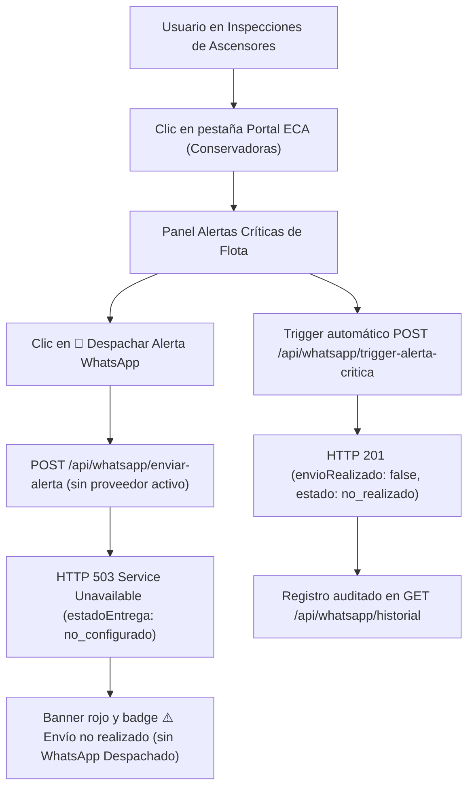
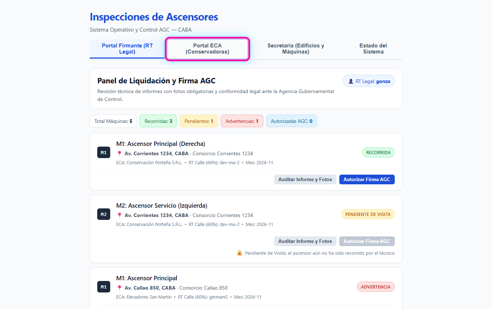
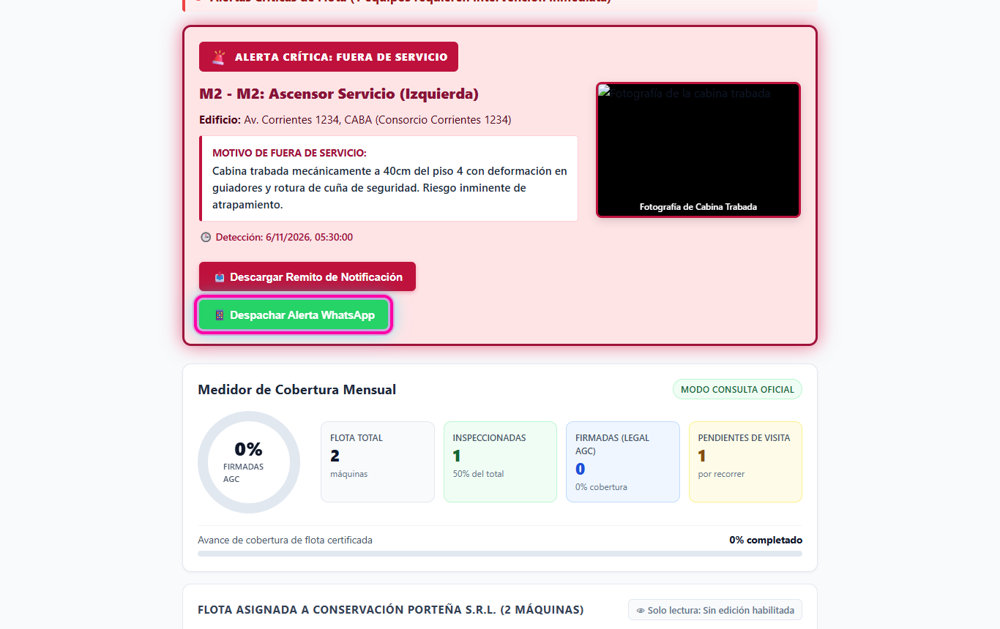
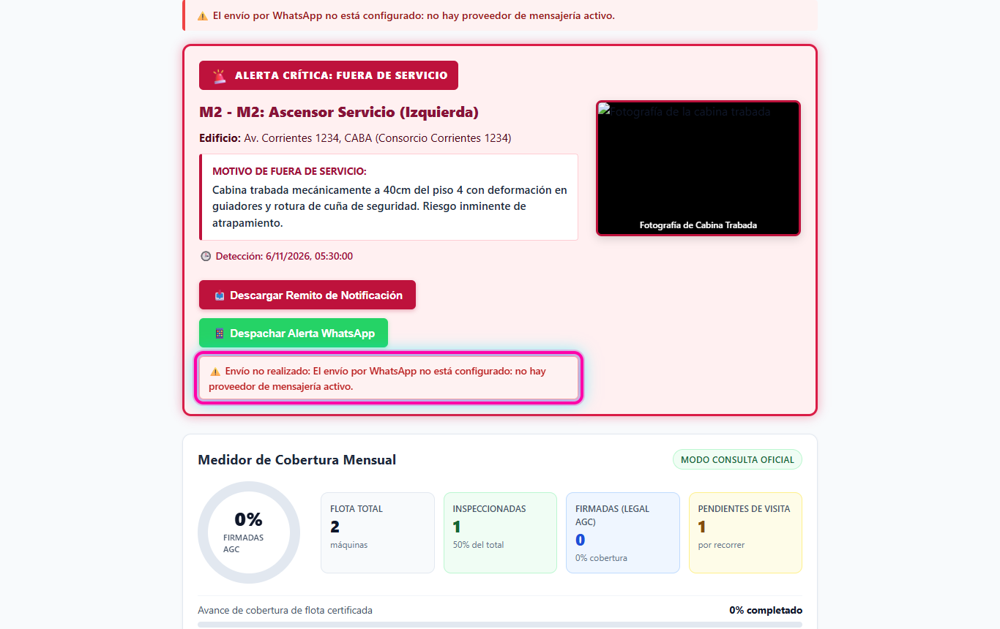

# Guía Visual de Pruebas QA — HU-11 / RF-03: No informar como entregado un WhatsApp que no se envió

- **Requerimiento:** `REQ-1794155773535` (`HU-11 / RF-03`)
- **Rama certificada:** `testing` (PR #21 integrado en `dev` y promovido a `testing`)
- **Dependencias certificadas (`tested`):** `HU-11 · RF-01` (`REQ-1791910396804`), `HU-11 · RF-02` (`REQ-1791910396892`)
- **Documento de entrega:** [`RF-03-entrega.md`](RF-03-entrega.md)
- **Script integrado:** [`RF-03-entrega.sh`](RF-03-entrega.sh)

---

## Circuito probado de punta a punta



---

## Precondiciones

- Entorno levantado desde la rama `testing` sin variables/proveedor de WhatsApp configurado (`!transport`).
- API corriendo en `http://127.0.0.1:3050` y Web corriendo en `https://localhost:8050`.
- Dependencias `HU-11 · RF-01` y `HU-11 · RF-02` ya certificadas (`tested`).

---

## Paso a paso en interfaz web (Criterio 2 — Prueba Manual)

### Paso 1 — Ingresar al Portal ECA desde la barra principal

En la pantalla inicial `Inspecciones de Ascensores`, hacer clic en la pestaña **`Portal ECA (Conservadoras)`** (`data-testid="tab-eca"`).



### Paso 2 — Ubicar la alerta crítica y presionar el botón de despacho

Dentro de `Portal de Cobertura y Monitoreo ECA` (con `Empresa Conservadora (ECA):` en `Conservación Porteña S.R.L.`, máquina `M2 - M2: Ascensor Servicio (Izquierda)`), bajar hasta la tarjeta de alerta y hacer clic en **`📱 Despachar Alerta WhatsApp`** (`data-testid="btn-whatsapp-M2"`).



### Paso 3 — Confirmar el rechazo explícito y ausencia de falso entregado

Verificar en pantalla que:
1. En la parte superior aparece el banner de error **`⚠️ El envío por WhatsApp no está configurado: no hay proveedor de mensajería activo.`**
2. Dentro de la tarjeta de la máquina aparece el badge rojo **`⚠️ Envío no realizado: El envío por WhatsApp no está configurado: no hay proveedor de mensajería activo.`**
3. En ningún lugar de la pantalla aparece **`WhatsApp Despachado`**.



---

## Verificación de API integrada y carga (Criterios 1 y 3)

Con el servidor `node apps/api/dist/main.js` arriba en `http://127.0.0.1:3050` sin proveedor activo:

```bash
BASE_URL=http://127.0.0.1:3050 ./docs/pruebas/hu-11-hu-11-notificaciones-automatic/RF-03-entrega.sh
BASE_URL=http://127.0.0.1:3050 ./docs/pruebas/hu-11-hu-11-notificaciones-automatic/RF-03-entrega.sh --carga 50
```

- **Flujo integrado:** `3 verificaciones OK, 0 fallidas` (`POST /api/whatsapp/enviar-alerta` → HTTP `503` `estadoEntrega: no_configurado`; `POST /api/whatsapp/trigger-alerta-critica` sobre `ALT-MAICON-001` → `envioRealizado: false`, `estado: no_realizado`; `GET /api/whatsapp/historial?alertaId=ALT-MAICON-001` → `origen: automatico`, `estado: no_realizado`).
- **Carga (`--carga 50`):** `50` corridas, **`0` falsos entregados / distinto de 503**, promedio **`125 ms`**, p95 **`142 ms`**, máxima **`159 ms`**.
- **Auditoría combinada:** consulta directa a `GET /api/whatsapp/historial` tras intento manual (`503`) y automático (`ALT-MAICON-001`) confirma `total: 2`, ambos con `envioRealizado: false`, `estado: "no_realizado"`, `estadoEntrega: "no_configurado"`.
