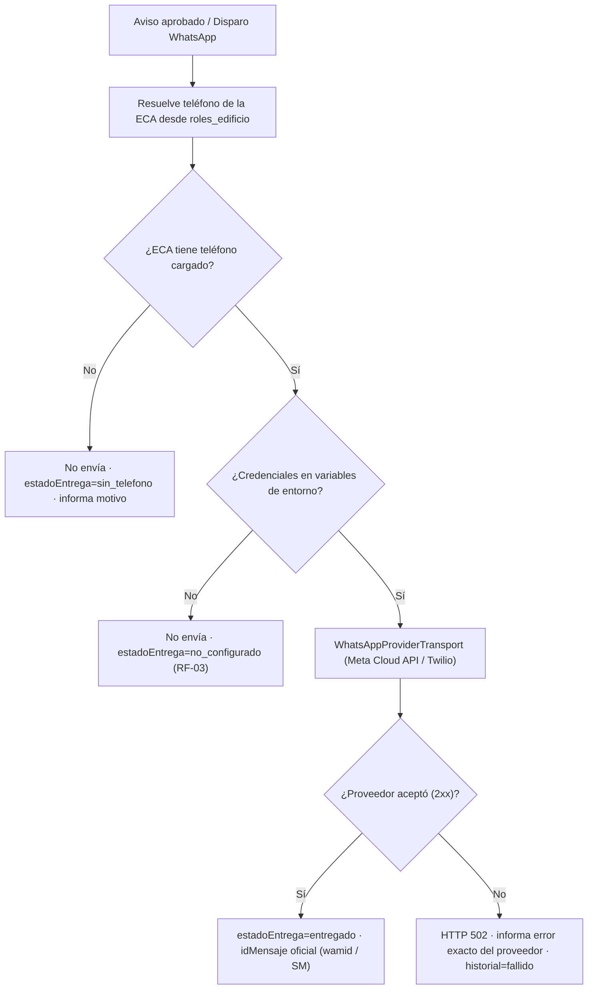

# HU-11 · RF-04 — Enviar las alertas por WhatsApp a través de un proveedor real

**Historia de Usuario:** HU-11: Notificaciones Automáticas de Alerta Crítica por WhatsApp  
**Requerimiento:** RF-04 (`REQ-1794155774018`)  
**Desarrollador:** `gonza`  

## Qué quedó implementado

Se conectó `WhatsAppConnectorService` con un transporte HTTP real compatible con **WhatsApp Cloud API de Meta** y **Twilio WhatsApp API** (modo prueba/sandbox y producción), eliminando el número fijo hardcodeado `+5491144009988` y resolviendo el teléfono destino desde la terna de roles del edificio (`roles_edificio`):

- **Configuración por variables de entorno (`apps/api/src/config.ts` y `.env.example`)**:
  - `WHATSAPP_PROVIDER` (`meta` o `twilio`).
  - Meta Cloud API: `WHATSAPP_META_ACCESS_TOKEN`, `WHATSAPP_META_PHONE_NUMBER_ID`, `WHATSAPP_META_API_VERSION` (def. `v21.0`), `WHATSAPP_META_BASE_URL` (def. `https://graph.facebook.com`).
  - Twilio WhatsApp API: `WHATSAPP_TWILIO_ACCOUNT_SID`, `WHATSAPP_TWILIO_AUTH_TOKEN`, `WHATSAPP_TWILIO_FROM`, `WHATSAPP_TWILIO_BASE_URL` (def. `https://api.twilio.com`).
  - Sin variables cargadas, `config.whatsapp` es `null` y el conector mantiene el comportamiento de HU-11 RF-03 (`no_configurado`, sin simular entrega).
  - Ninguna credencial real queda guardada en el repositorio ni se expone en `GET /api/whatsapp/estado`.
- **Transporte HTTP real (`apps/api/src/whatsapp/whatsapp-provider.transport.ts`)**:
  - Envía por `fetch` nativo al endpoint oficial de Meta (`POST /{version}/{phoneNumberId}/messages` con `Bearer` y JSON `messaging_product: "whatsapp"`) o Twilio (`POST /2010-04-01/Accounts/{sid}/Messages.json` con `Basic Auth` y `application/x-www-form-urlencoded`).
  - Devuelve el `idMensaje` oficial del proveedor (`wamid...` o `SM...`).
  - Parsea y propaga el mensaje de error exacto devuelto por el proveedor (`error.message`, `code`, `error_data.details` en Meta; `message` y `code` en Twilio).
- **Conector, Trigger y Bandeja de Avisos (`whatsapp-connector.service.ts`, `whatsapp-trigger.service.ts`, `avisos.service.ts`, `whatsapp.controller.ts`)**:
  - Eliminado el fallback fijo `+5491144009988`.
  - Resuelve el teléfono destino desde la terna de roles del edificio (`roles_edificio.eca_telefono`). Si no hay teléfono cargado, **no se realiza el envío** (`estadoEntrega: 'sin_telefono'`, HTTP `400` en `/api/whatsapp/enviar-alerta`, `estado: 'no_realizado'` en trigger e historial) y se informa el motivo: *"No se realizó el envío: la ECA responsable del edificio no tiene un teléfono cargado en la terna de roles."*
  - Si el proveedor rechaza el envío (`4xx` como número fuera de la lista de prueba de Meta, o `5xx`), se informa el error exacto del proveedor (HTTP `502`) y queda registrado como `fallido` en `/api/whatsapp/historial`.
  - Nuevo endpoint `GET /api/whatsapp/estado` que informa `{ configurado, proveedor }` sin exponer credenciales.

## Flujo del circuito



## Cómo levantarlo y probarlo

```bash
# 1. Configurar credenciales del proveedor en .env (NO commitear .env)
#    Para modo prueba de Meta Cloud API:
#      WHATSAPP_PROVIDER=meta
#      WHATSAPP_META_ACCESS_TOKEN=<token_temporal_meta>
#      WHATSAPP_META_PHONE_NUMBER_ID=<phone_number_id_meta>
#    Para Twilio WhatsApp Sandbox:
#      WHATSAPP_PROVIDER=twilio
#      WHATSAPP_TWILIO_ACCOUNT_SID=<AC...>
#      WHATSAPP_TWILIO_AUTH_TOKEN=<token>
#      WHATSAPP_TWILIO_FROM=whatsapp:+14155238886

# 2. Levantar PostgreSQL y correr script integrado de entrega
#    (levanta un receptor HTTP local del proveedor y una instancia de la API con env vars temporales)
npm run db:up
bash docs/pruebas/hu-11-hu-11-notificaciones-automatic/RF-04-entrega.sh

# 3. Correr con prueba de carga (ej. 25 envíos)
bash docs/pruebas/hu-11-hu-11-notificaciones-automatic/RF-04-entrega.sh --carga 25
```

## Pruebas automáticas

- **API E2E con servidor HTTP real**: `apps/api/test/whatsapp-proveedor.e2e-spec.ts` — 5 pruebas cubriendo los 4 criterios (envío HTTP real a Meta Cloud API y Twilio con credenciales por entorno, resolución de teléfono ECA desde terna de roles + bloqueo sin teléfono cargado, propagación del error exacto ante rechazo del proveedor + registro `fallido` en historial, y verificación de ausencia de credenciales y del número fijo `+5491144009988` en código y `.env.example`).
- **Regresión módulo WhatsApp y Avisos**: `apps/api/test/whatsapp.spec.ts`, `apps/api/test/whatsapp.e2e-spec.ts`, `apps/api/test/avisos.e2e-spec.ts`, `apps/api/test/config.spec.ts` — 40/40 tests en verde.

## Supuestos y limitaciones

- El número remitente definitivo de producción queda sujeto a la definición de MAICON (P13.b); el transporte ya soporta operar tanto en el modo de prueba de Meta Cloud API / Twilio Sandbox como en producción cambiando únicamente las variables de entorno.
