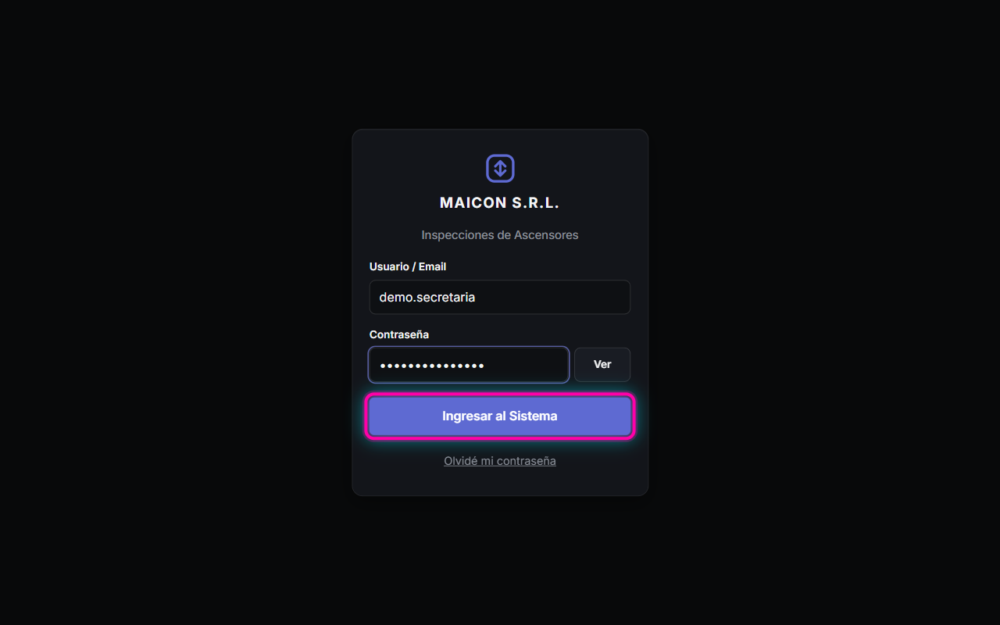
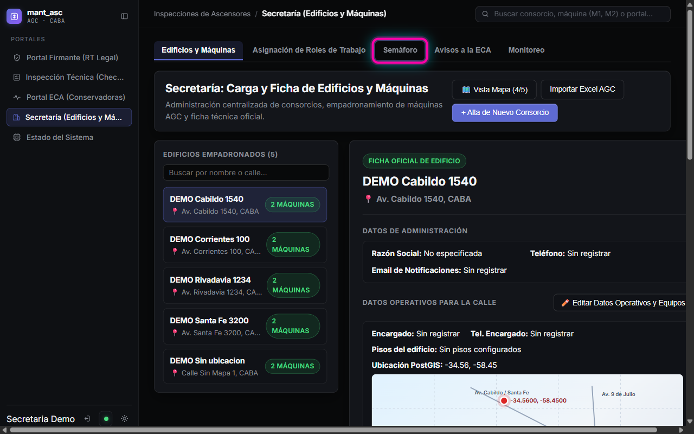
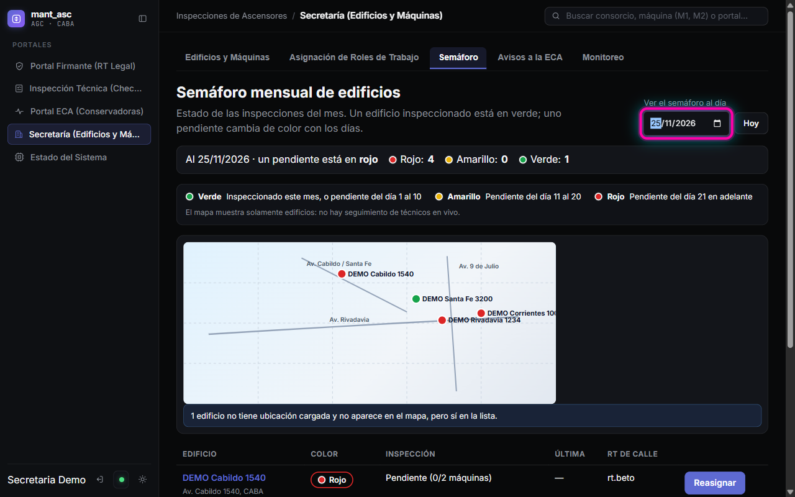
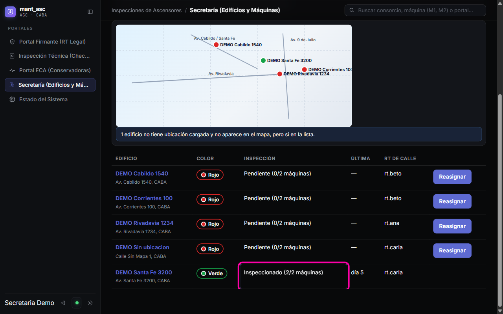

# HU-11 / RF-07 · Guía visual — Los datos de demo en pantalla

Esta guía muestra cómo se ven en el navegador los datos que carga `RF-02-datos-demo.sh` (HU-04) después de su arreglo. Los scripts de entrega de HU-11, HU-15 y HU-18 dependen de esos datos, y `RF-07-entrega.sh` los carga solo si faltan.

- **Tarea:** RF-07 — `REQ-1795091473089` · **Entrega:** [RF-07-entrega.md](RF-07-entrega.md)
- **URL:** https://localhost:8050 (la app levantada con `npm run dev`)
- **Usuario:** `demo.secretaria` · **Clave:** `Demo-Clave-2026` · **Rol:** secretaria
- **Antes de empezar:** cargar los datos con `bash docs/pruebas/hu-04-hu-04-semaforo-de-control-mens/RF-02-datos-demo.sh`. Para borrarlos, el mismo comando con `--limpiar`.
- **Capturas:** sacadas con Playwright en una ventana de 1280 × 800, con el elemento de cada paso resaltado en magenta con `scrumDocs/resaltado-de-capturas.css`.

## Paso 1 · Ingresar como la Secretaría demo

En la pantalla de ingreso, escribí `demo.secretaria` en «Usuario / Email» y `Demo-Clave-2026` en «Contraseña», y apretá **Ingresar al Sistema**.

**Qué tenés que ver:** el botón habilitado. Al apretarlo entrás a la app con tu nombre («Secretaria Demo») abajo a la izquierda.

## Paso 2 · Abrir la solapa «Semáforo»

Dentro de «Secretaría (Edificios y Máquinas)», apretá la solapa **Semáforo**. La pantalla de la captura es la de antes de apretarla: su lista de la izquierda muestra «EDIFICIOS EMPADRONADOS (5)», los cinco edificios DEMO. Al apretar la solapa se abre el semáforo del paso siguiente.

**Qué tenés que ver:** la solapa «Semáforo» marcada y, en la lista, «DEMO Cabildo 1540», «DEMO Corrientes 100», «DEMO Rivadavia 1234», «DEMO Santa Fe 3200» y «DEMO Sin ubicacion», cada uno con 2 máquinas.

## Paso 3 · Elegir el día 25/11/2026

En «Ver el semáforo al día», elegí el **25/11/2026**.

**Qué tenés que ver:** el resumen «Al 25/11/2026 · un pendiente está en **rojo**» con **Rojo: 4**, **Amarillo: 0** y **Verde: 1**. En el mapa, cuatro edificios en rojo y «DEMO Santa Fe 3200» en verde. El quinto edificio, «DEMO Sin ubicacion», no tiene ubicación: no aparece en el mapa pero sí en la lista.

## Paso 4 · Comprobar la inspección del 5/11

Bajá hasta la lista de edificios y mirá la fila de «DEMO Santa Fe 3200».

**Qué tenés que ver:** «DEMO Santa Fe 3200» en **Verde**, «Inspeccionado (2/2 máquinas)» y «día 5» en la columna «Última», con RT de Calle `rt.carla`. Los otros cuatro edificios están en **Rojo** con «Pendiente (0/2 máquinas)».

Esta fila es lo que arregló la tarea: el script cargaba esa inspección con la sesión de la Secretaría, el API la rechazaba con 403 y la fila salía sin inspeccionar. Ahora la carga el RT del edificio (`rt.carla`) con su propia sesión.
