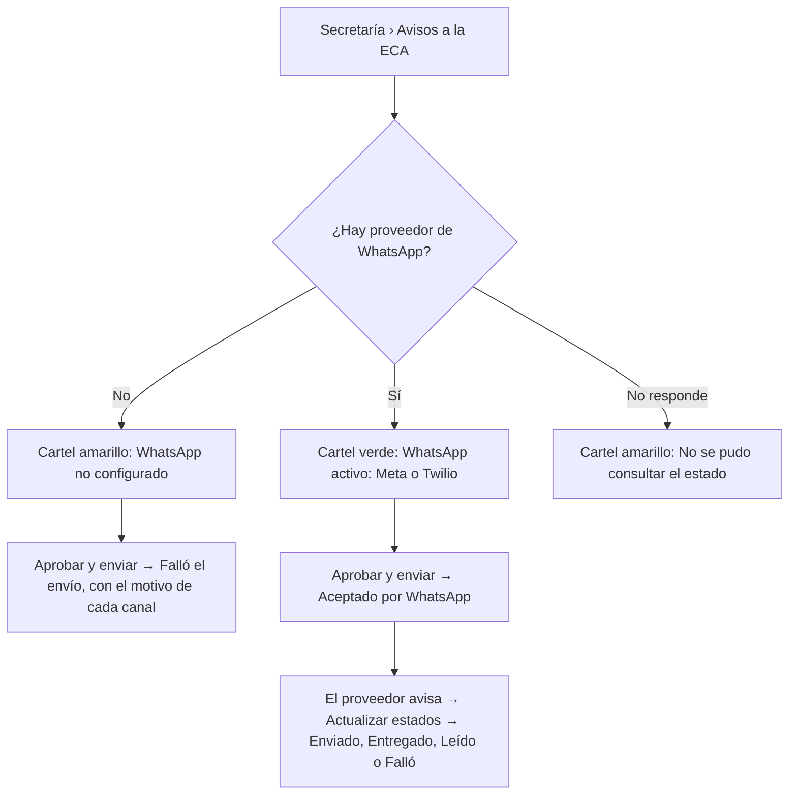
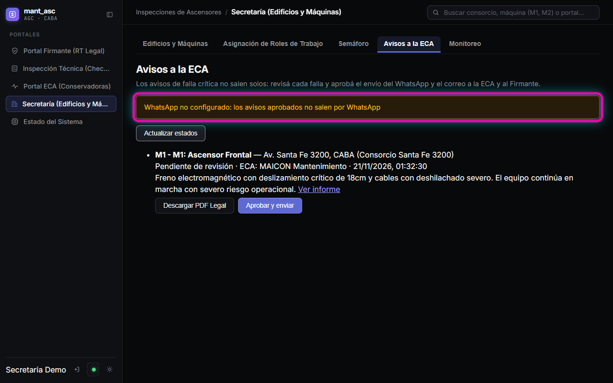
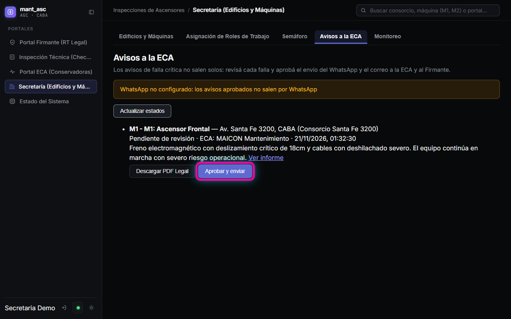
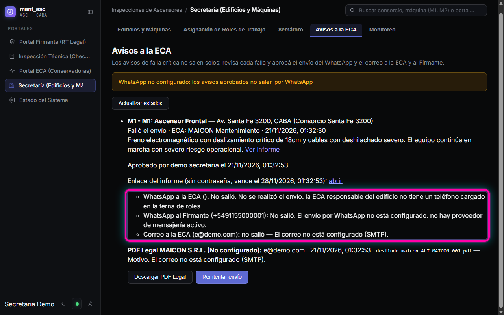
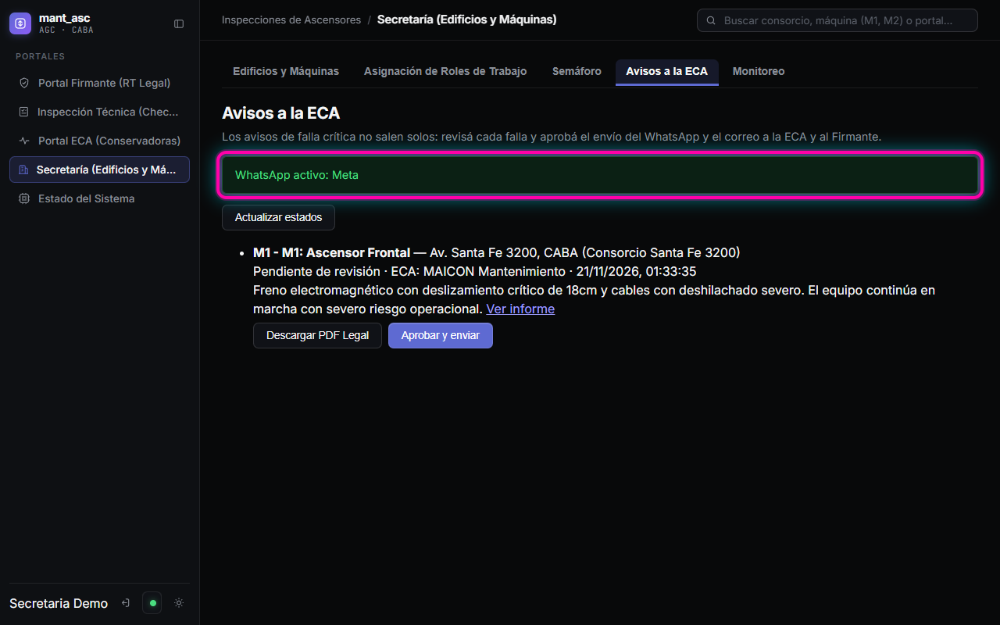
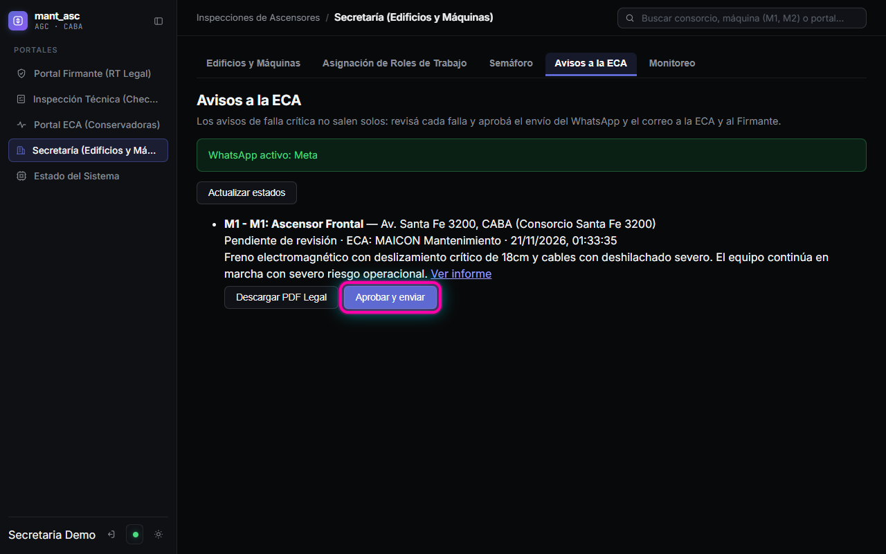
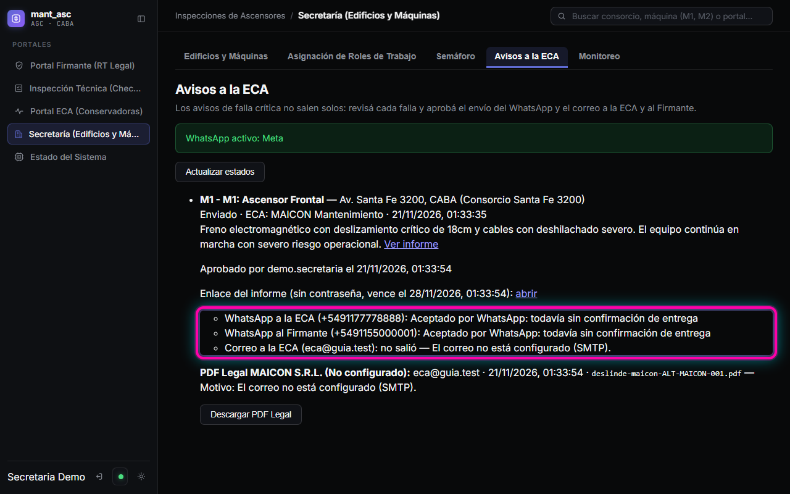
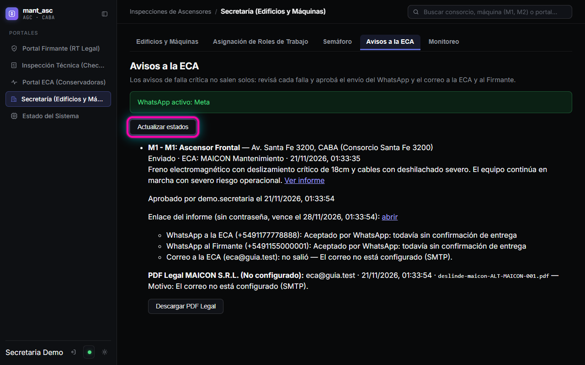
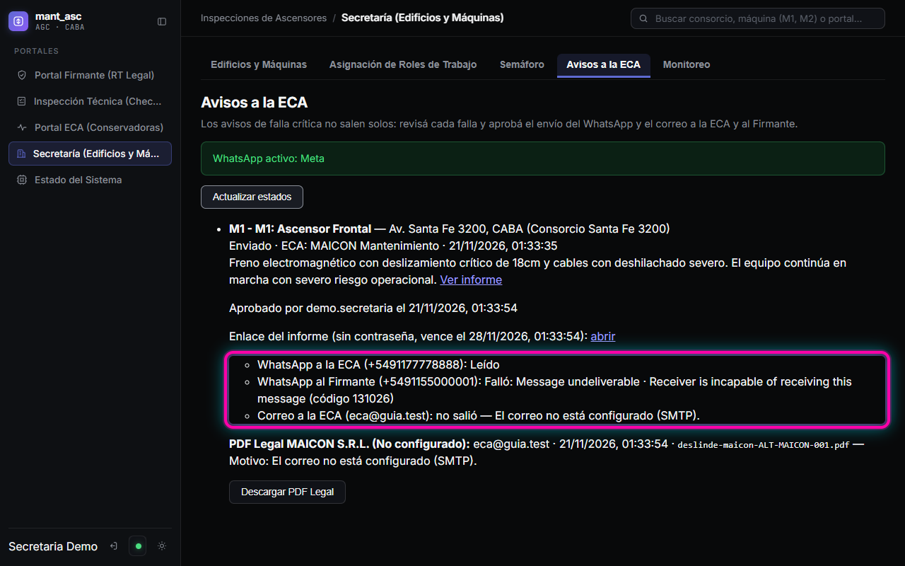
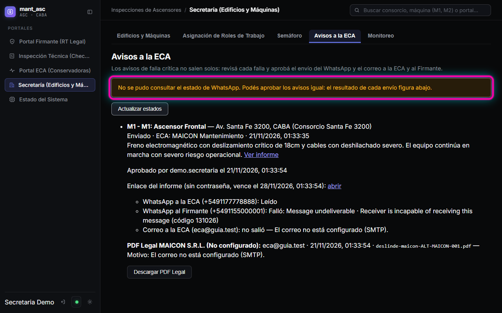

# HU-11 / RF-10 · Guía visual — La bandeja de avisos muestra si WhatsApp está activo y el estado real de cada envío

Esta guía muestra, paso a paso, lo que ve la Secretaría en «Avisos a la ECA»: un cartel que dice si WhatsApp está activo, y por cada envío lo que confirmó el proveedor (Aceptado, Enviado, Entregado, Leído o Falló con el motivo).

- **Tarea:** RF-10 — `REQ-1795097860686` · **Entrega:** [RF-10-entrega.md](RF-10-entrega.md)
- **URL:** https://localhost:8050 (la app levantada con `npm run dev`)
- **Usuario:** `demo.secretaria` · **Clave:** `Demo-Clave-2026` · **Rol:** secretaria
- **Antes de empezar:** cargar los datos de demo con `bash docs/pruebas/hu-04-hu-04-semaforo-de-control-mens/RF-02-datos-demo.sh`. Esta guía depende de HU-11 / RF-09, que es lo que hace cambiar los estados.
- **Capturas:** sacadas con Playwright en una ventana de 1280 × 800, con el elemento de cada paso resaltado en magenta con `scrumDocs/resaltado-de-capturas.css`.

## Con WhatsApp sin configurar

### Paso 1 · Mirar el cartel de arriba

Entrá a **Secretaría (Edificios y Máquinas)** y apretá la solapa **Avisos a la ECA**. Arriba de la lista, antes de aprobar nada, hay un cartel.

**Qué tenés que ver:** un cartel amarillo que dice «WhatsApp no configurado: los avisos aprobados no salen por WhatsApp». Debajo, el aviso «Pendiente de revisión» de «M1 - M1: Ascensor Frontal».

### Paso 2 · Aprobar igual

El botón sigue funcionando. Apretá **Aprobar y enviar**.

**Qué tenés que ver:** el botón habilitado, antes de apretarlo.

### Paso 3 · Ver por qué no salió

**Qué tenés que ver:** el aviso queda en «Falló el envío», como antes, y cada canal dice por qué no salió: «No salió: El envío por WhatsApp no está configurado: no hay proveedor de mensajería activo.» para el Firmante, y «No salió: No se realizó el envío: la ECA responsable del edificio no tiene un teléfono cargado en la terna de roles.» para la ECA. La diferencia con antes es que el cartel del paso 1 ya lo había explicado.

## Con WhatsApp activo

Para estas capturas la API se levantó con un proveedor de Meta de prueba, apuntado a un receptor local, y se cargó el teléfono de la ECA en la terna del edificio «Av. Santa Fe 3200, CABA». Los avisos de estado de los pasos 7 y 8 los mandó un script con la firma de Meta.

### Paso 4 · Mirar el cartel

**Qué tenés que ver:** un cartel verde que dice «WhatsApp activo: Meta» (o «WhatsApp activo: Twilio», según el proveedor). El cartel no muestra claves ni teléfonos.

### Paso 5 · Aprobar y enviar

**Qué tenés que ver:** el botón habilitado, antes de apretarlo.

### Paso 6 · Un envío aceptado todavía no es un envío entregado

**Qué tenés que ver:** los dos WhatsApp, el de la ECA y el del Firmante, dicen «Aceptado por WhatsApp: todavía sin confirmación de entrega». Que el proveedor haya aceptado el pedido no prueba que el mensaje haya llegado al celular.

### Paso 7 · Actualizar los estados

Cuando el proveedor avisa que el mensaje se entregó, se leyó o falló, la pantalla no se actualiza sola. Apretá **Actualizar estados**.

**Qué tenés que ver:** el botón, justo debajo del cartel, antes de apretarlo.

### Paso 8 · Leer el estado real

**Qué tenés que ver:** el WhatsApp a la ECA dice «Leído». El del Firmante dice «Falló: Message undeliverable · Receiver is incapable of receiving this message (código 131026)», que es el motivo y el código que informó el proveedor. El correo sigue diciendo que no está configurado.

## Si no se puede consultar el estado

### Paso 9 · El cartel avisa y la bandeja sigue usable

Si la pantalla no puede preguntar el estado de WhatsApp (se cortó la conexión, o la API no responde), el cartel lo dice y todo lo demás sigue funcionando.

**Qué tenés que ver:** un cartel amarillo que dice «No se pudo consultar el estado de WhatsApp. Podés aprobar los avisos igual: el resultado de cada envío figura abajo.». La lista de avisos y sus botones siguen ahí.
