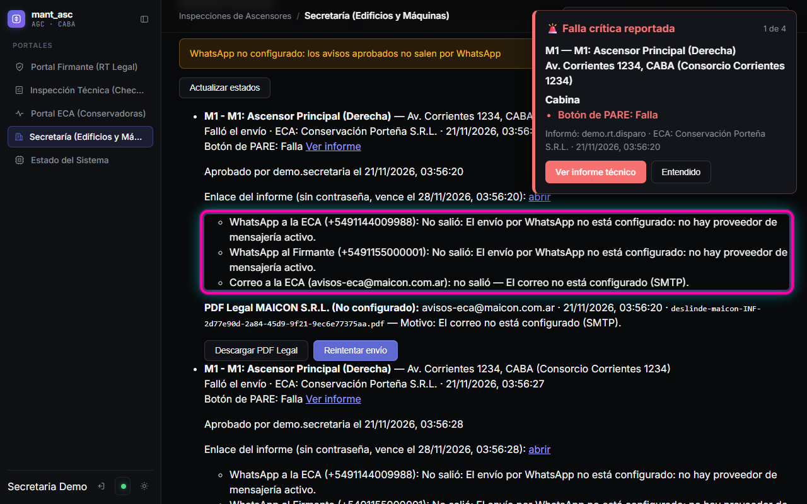

# HU-11 · RF-13 · Entrega — El historial de envíos de WhatsApp pide la sesión de la Secretaría

- **Tarea:** HU-11 / RF-13 — `REQ-1795263642719`
- **Script:** [RF-13-entrega.sh](RF-13-entrega.sh)
- **Archivos cambiados:** [`whatsapp.controller.ts`](../../../apps/api/src/whatsapp/whatsapp.controller.ts), la prueba nueva [`whatsapp-historial-sesion.e2e-spec.ts`](../../../apps/api/test/whatsapp-historial-sesion.e2e-spec.ts), [`informe-aviso.e2e-spec.ts`](../../../apps/api/test/informe-aviso.e2e-spec.ts) y los scripts de entrega RF-03, RF-04, RF-06, RF-09 y RF-10 de esta historia

## 1. Qué quedó implementado

`GET /api/whatsapp/historial` trae, de cada envío, el teléfono de destino, la ECA, el edificio y el estado. Hasta ahora **lo podía pedir cualquiera, sin sesión**. Ahora:

| Quién lo pide | Respuesta |
|---|---|
| Sin sesión, o con un token inválido o vencido | **401** |
| RT de Calle, Firmante o ECA | **403** |
| Secretaría o Administrador | **200** con los envíos, como antes |

La bandeja de avisos ya pedía el historial con la sesión de la Secretaría (`fetchConSesion`), así que en pantalla no cambia nada. `GET /api/whatsapp/estado` (el cartel «WhatsApp activo / no configurado») sigue sin pedir sesión, porque no trae datos de envíos.

**Scripts que se actualizaron**, porque pedían el historial sin sesión:
- RF-03, RF-04 y RF-06 usan la sesión que ya tenían (Secretaría o Administrador).
- RF-09 y RF-10 levantan sus propias APIs: ahora crean una Secretaría temporal (`qa.rf09.secretaria` / `qa.rf10.secretaria`), entran en cada API y la borran al terminar.

## 2. Cómo se levanta y se prueba

```bash
npm run db:up && npm run dev
bash docs/pruebas/hu-04-hu-04-semaforo-de-control-mens/RF-02-datos-demo.sh
bash docs/pruebas/hu-11-hu-11-notificaciones-automatic/RF-13-entrega.sh            # o con --carga 50
```

## 3. Qué datos hacen falta

Los datos de demo de HU-04 RF-02. El script entra como `demo.secretaria`, `demo.admin`, `rt.beto`, `demo.firmante` y `demo.eca`, todos con clave `Demo-Clave-2026`.

## 4. Qué endpoints o pantallas toca

`GET /api/whatsapp/historial` (ahora con `@Roles('secretaria', 'administrador')`). La bandeja de avisos sigue igual.

## 5. Cómo se corre integrado

Resultado del 21/11/2026, contra la API compilada de la rama (`API_PORT=3051`) y PostgreSQL 16 + PostGIS 3.4.3:

| Condición | Resultado |
|---|---|
| 1. Sin sesión → 401 | 401 sin sesión y con un token inválido; la respuesta no trae envíos |
| 2. RT de Calle, Firmante o ECA → 403 | `rt.beto`, `demo.firmante` y `demo.eca` reciben 403 |
| 3. Secretaría o Administrador → 200, y la bandeja sigue mostrando los envíos | `demo.secretaria` y `demo.admin` reciben 200. Las pruebas de la bandeja dan 26/26, y en Chrome la bandeja recibe 200 y muestra los envíos (captura) |

- `RF-13-entrega.sh --carga 50`: 10 bien, 0 mal; 50 pedidos sin fallos, unos 59 ms cada uno.
- Pruebas de la API: `whatsapp-historial-sesion.e2e-spec.ts` 8/8 y la suite completa 1216/1216.
- Scripts de esta historia que usan el historial: RF-03 6/6, RF-04 6/6, RF-05 14/14, RF-06 11/11, RF-09 12/12 y RF-10 6/6.

## Guía visual

### Paso 1 · La bandeja de la Secretaría sigue mostrando cada envío

Ingresá como `demo.secretaria` y abrí Secretaría (Edificios y Máquinas) › **Avisos a la ECA**.



**Qué tenés que ver:** debajo de cada aviso aprobado, la lista de envíos: «WhatsApp a la ECA (+5491144009988): No salió…», «WhatsApp al Firmante…» y «Correo a la ECA…». Ese estado sale del historial, que la bandeja pide con la sesión de la Secretaría.

La hora de la captura figura como «03:56» porque esta rama sale de `dev` sin el arreglo de HU-12 RF-03 (PR #99). Con ese arreglo se lee «15:56».

## Supuestos y límites

- Esta Tarea protege sólo el historial. **`POST /api/whatsapp/enviar-alerta` y `POST /api/whatsapp/trigger-alerta-critica` siguen sin pedir sesión**, así que cualquiera puede mandar un aviso. Lo dejo anotado para una Tarea aparte.
- El historial sigue en memoria. Guardarlo en PostgreSQL es HU-11 RF-12.
