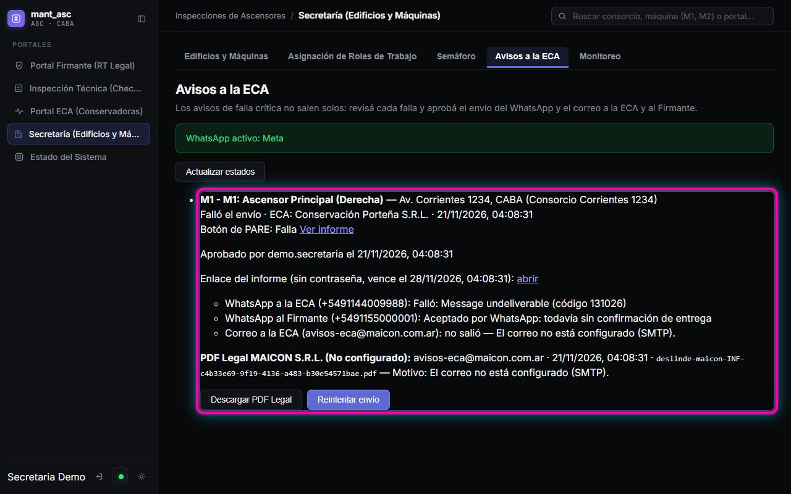
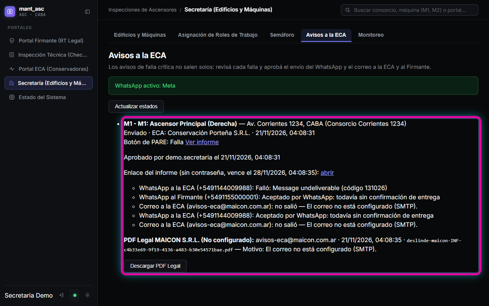

# HU-11 · RF-14 · Entrega — El estado del aviso refleja un WhatsApp que falla después de enviado

- **Tarea:** HU-11 / RF-14 — `REQ-1795263643018`
- **Script:** [RF-14-entrega.sh](RF-14-entrega.sh) · **Capturas:** [RF-14-capturas.cjs](RF-14-capturas.cjs)
- **Archivos cambiados:** [`avisos.service.ts`](../../../apps/api/src/avisos/avisos.service.ts), [`avisos.types.ts`](../../../apps/api/src/avisos/avisos.types.ts), [`whatsapp-connector.service.ts`](../../../apps/api/src/whatsapp/whatsapp-connector.service.ts), [`apps/web/src/avisos/avisos.ts`](../../../apps/web/src/avisos/avisos.ts), y las pruebas nuevas [`aviso-fallo-posterior.e2e-spec.ts`](../../../apps/api/test/aviso-fallo-posterior.e2e-spec.ts) y [`avisos.test.ts`](../../../apps/web/src/avisos/avisos.test.ts)

## 1. Qué quedó implementado

**El problema.** Cuando la Secretaría aprueba un aviso y el proveedor acepta los WhatsApp, el aviso pasa a «Enviado». Si después el proveedor avisa que uno de esos mensajes no se entregó (HU-11 RF-09), el aviso seguía diciendo «Enviado»: el fallo sólo se veía abriendo la lista de envíos de cada aviso.

**Ahora:**

- Cada WhatsApp del aviso guarda el **id de mensaje** que devolvió el proveedor (`wamid` de Meta o `SM` de Twilio).
- Cuando se lee la bandeja (o un aviso), cada envío se cruza con su registro del historial. Si el proveedor informó que falló, el envío pasa a fallido con el motivo del proveedor, y **el aviso vuelve a «Falló el envío»**. Con ese estado la bandeja ya ofrece **«Reintentar envío»**.
- **El reintento vuelve a mandar sólo lo que falló.** El WhatsApp que se entregó no se repite. Si sale bien, el aviso vuelve a «Enviado».
- **El fallo anterior no se pierde.** La lista de envíos conserva el intento fallido junto al nuevo, y el historial de WhatsApp lo sigue mostrando como fallido.
- Un mensaje **entregado o leído** no cambia. Un «failed» tardío del proveedor después de entregado se ignora, como ya hacía RF-09.

En la web, cada envío se cruza con su registro por el id de mensaje. Antes se cruzaba por alerta y teléfono, y se tomaba el registro más nuevo: después de un reintento, el envío que había fallado iba a mostrar «Entregado», el estado del reintento. Los envíos sin id de mensaje (los viejos) se siguen cruzando como antes.

## 2. Cómo se levanta y se prueba

```bash
npm run db:up
bash docs/pruebas/hu-11-hu-11-notificaciones-automatic/RF-14-entrega.sh          # o con --carga 10
```

El script compila la API y levanta su propia instancia con Meta configurado, contra un proveedor falso. Crea una Secretaría y un RT temporales y los borra al terminar. No necesita `npm run dev`.

Para las capturas hace falta una API con Meta configurado (puede ser con un proveedor falso), los datos de demo y la web compilada apuntando a esa API. Ver el encabezado de `RF-14-capturas.cjs`.

## 3. Qué datos hacen falta

Ninguno para el script. Para las capturas, los datos de demo de HU-04 RF-02 (`rt.beto` y `demo.secretaria`).

## 4. Qué endpoints o pantallas toca

- `GET /api/avisos` y `GET /api/avisos/:id` devuelven el estado actualizado con lo que informó el proveedor. Cada envío trae `idMensaje` y, si falló después, `falloInformadoEn`.
- `POST /api/avisos/:id/aprobar` («Reintentar envío») acepta el aviso que volvió a «Falló el envío».
- En pantalla: la bandeja «Avisos a la ECA».

## 5. Cómo se corre integrado

Resultado del 21/11/2026, con la API compilada y PostgreSQL 16 + PostGIS 3.4.3:

| Condición | Resultado |
|---|---|
| 1. Un aviso «Enviado» cuyo WhatsApp falla después muestra el fallo y ofrece «Reintentar envío» | La bandeja pasa a «Falló el envío», el envío a la ECA queda «El proveedor informó que el mensaje no se entregó: código 131026 · Message undeliverable» y aparece «Reintentar envío» (captura 1) |
| 2. Si el reintento sale bien vuelve a «Enviado» y el historial conserva el fallo | «Enviado»; se reenvió 1 mensaje (sólo el que falló); los envíos a la ECA quedan `fallido:wamid.RF14.1 \| ok:wamid.RF14.3` y el historial sigue mostrando el fallo (captura 2) |
| 3. Con todos los envíos entregados o leídos sigue «Enviado»; las pruebas de la bandeja siguen en verde | Entregado y leído: «Enviado»; un «failed» tardío no lo cambia. Bandeja 29/29 |

- `RF-14-entrega.sh --carga 10`: 14 ok, 0 con error. Los 10 ciclos de aprobar, fallo informado y reintento salieron sin fallos (unos 660 ms cada uno).
- `aviso-fallo-posterior.e2e-spec.ts`: 6/6. `npm run verify`: API 1214/1214 y web 598/598.
- `RF-14-capturas.cjs`: 4/4.

## Guía visual

Usuario `demo.secretaria`, clave `Demo-Clave-2026`, con WhatsApp de Meta configurado. Capturas con Playwright en 1280 × 800, con el aviso resaltado en magenta.

### Paso 1 · El proveedor avisa que un WhatsApp no se entregó

Abrí Secretaría (Edificios y Máquinas) › **Avisos a la ECA**.



**Qué tenés que ver:** el aviso dice **«Falló el envío»** aunque se había aprobado y enviado. En la lista, «WhatsApp a la ECA (+5491144009988): Falló: Message undeliverable (código 131026)». Abajo, el botón **Reintentar envío**.

### Paso 2 · Reintentar

Apretá **Reintentar envío**.



**Qué tenés que ver:** el aviso vuelve a **«Enviado»**. La lista conserva «WhatsApp a la ECA…: Falló: Message undeliverable (código 131026)» y suma un nuevo «WhatsApp a la ECA…: Aceptado por WhatsApp». El WhatsApp al Firmante no se repitió.

En las capturas la hora figura «04:08», porque esta rama sale de `dev` sin el arreglo de HU-12 RF-03 (PR #99). Con ese arreglo se lee «16:08».

## Supuestos y límites

- **El estado se actualiza al leer la bandeja.** La bandeja no se refresca sola: hace falta abrirla o apretar «Actualizar estados», como ya pasaba con el estado de cada envío (RF-10).
- **Lo que falta para el usuario:** el aviso pasa a «Falló el envío», pero no hay un cartel ni un aviso aparte que lo destaque frente a los que fallaron al aprobar. Si se quiere distinguir un fallo «después de enviado», sería otra Tarea.
- El correo a la ECA no cambió: si nunca salió (por ejemplo, sin SMTP configurado), el reintento lo vuelve a intentar, como antes.
- Los avisos y el historial de WhatsApp siguen en memoria. Guardarlos en PostgreSQL es HU-11 RF-11 y RF-12.
