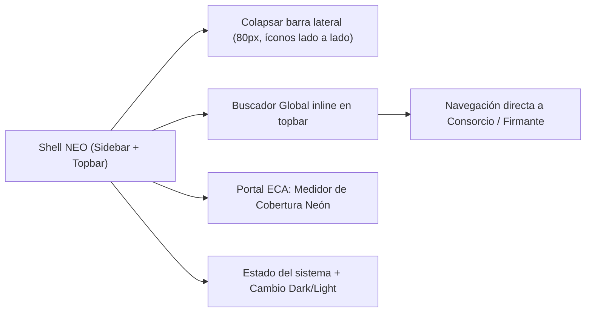
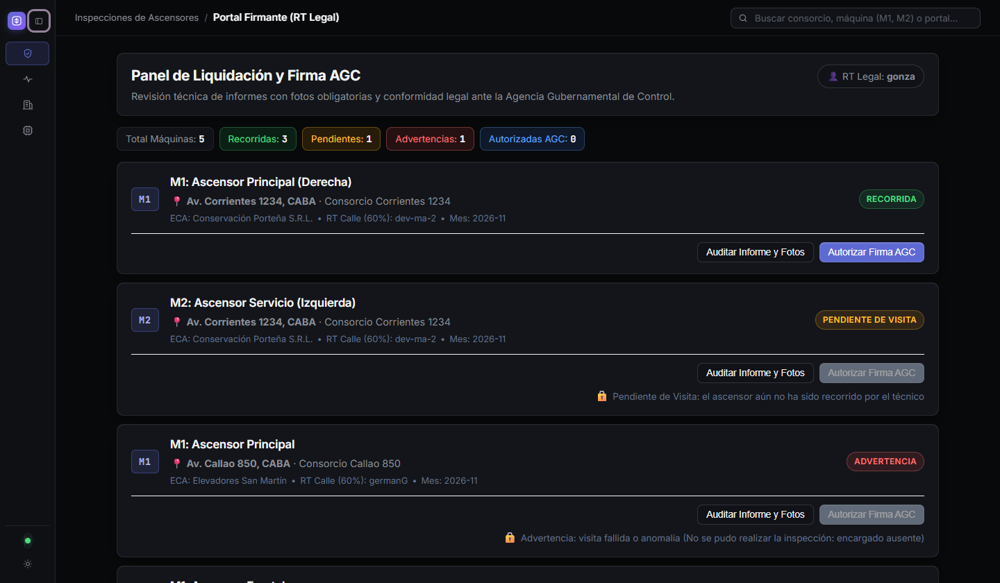
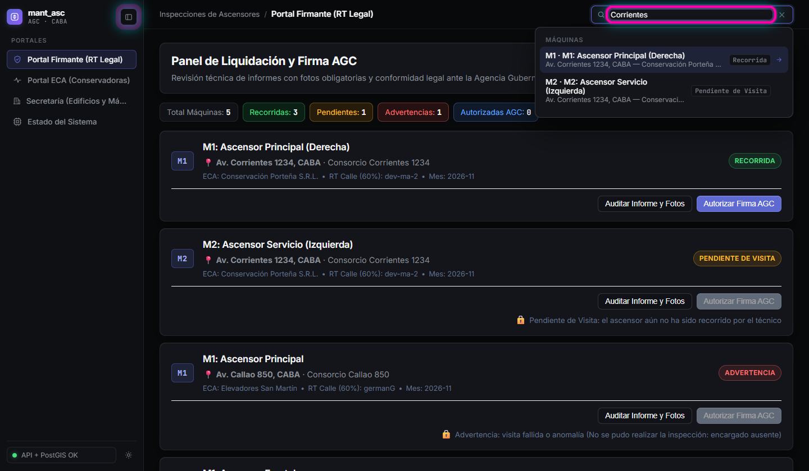
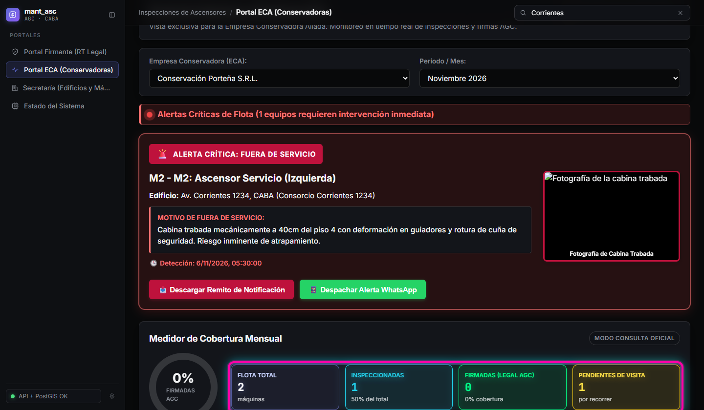
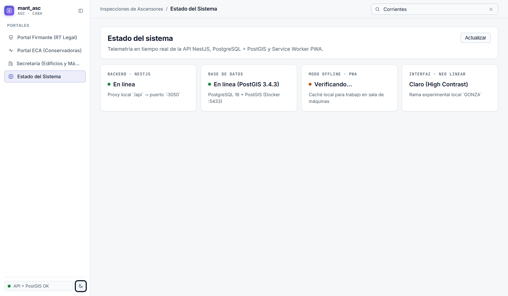

# HU-12 · RF-01 — Shell Visual NEO Linear, Sidebar Colapsable, Cobertura Neón y Buscador Inline

**Requerimiento:** `REQ-1794486918351` — Shell Visual NEO Linear (Dark/Light), Sidebar Colapsable, Cobertura Neón y Buscador Global Inline  
**Probar en:** `https://localhost:8050`  
**Suite automatizada:** `npm run verify` (`22 suites / 170 tests` en `apps/api` · `7 archivos / 82 tests` en `apps/web`)

---

## Flujo visual

---

## Pasos de verificación en pantalla

### Paso 1 — Colapsar sidebar manteniendo íconos lado a lado sin superposición
1. Abrir `https://localhost:8050`.
2. Hacer clic en el botón `Alternar barra lateral` (al lado del ícono cuadrado violeta de `mant_asc`).
3. Confirmar que el panel izquierdo pasa a ancho compacto (`80px`) y el botón `Alternar barra lateral` permanece **al lado** del cuadrado violeta sin encimarse ni quedar cortado.

### Paso 2 — Buscador global inline en barra superior (reemplazo de Ctrl+K)
1. Volver a expandir la barra lateral con `Alternar barra lateral`.
2. Hacer foco en el campo `Buscar consorcio, máquina (M1, M2) o portal…` (`data-testid="global-search-input"`).
3. Escribir `Corrientes` y verificar que se despliega la lista `Resultados de búsqueda` (`data-testid="global-search-results"`) agrupada por sección y sin abrir modal `Ctrl+K`. Al hacer clic en un resultado, navega directo al portal y registro seleccionado.

### Paso 3 — Medidor de Cobertura Mensual con recuadros neón de alto contraste
1. En la navegación lateral, abrir `Portal ECA (Conservadoras)` (`data-testid="tab-eca"`).
2. Observar el panel `Medidor de Cobertura Mensual`: cada tarjeta (`Flota Total`, `Inspeccionadas`, `Firmadas (Legal AGC)`, `Pendientes de Visita` y `Con Advertencia`) muestra bordes e indicadores en colores neón diferenciados de alta legibilidad sobre fondo oscuro.

### Paso 4 — Cambio de tema Dark / Light y vista Estado del sistema
1. Seleccionar `Estado del sistema` (`data-testid="tab-sistema"`) para verificar las tarjetas bento de conectividad (`API NestJS`, `PostgreSQL + PostGIS`, `PWA Service Worker`).
2. Presionar `Cambiar tema visual` (`data-testid="btn-toggle-theme"`) en la barra superior para alternar entre modo oscuro y claro (`Modo Claro` / `Modo Oscuro`) manteniendo el contraste en toda la interfaz.

