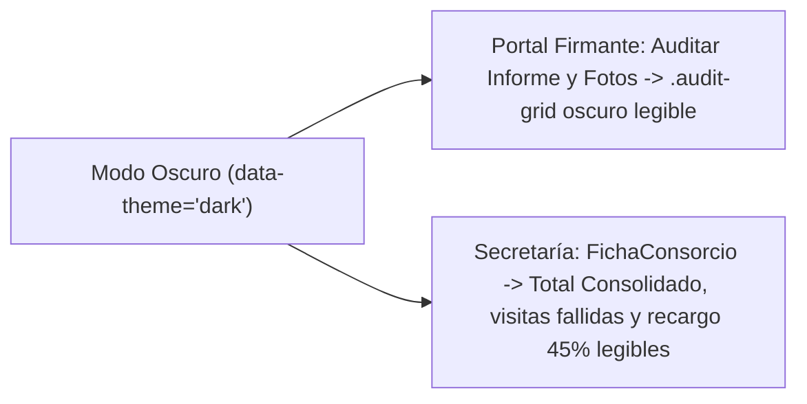
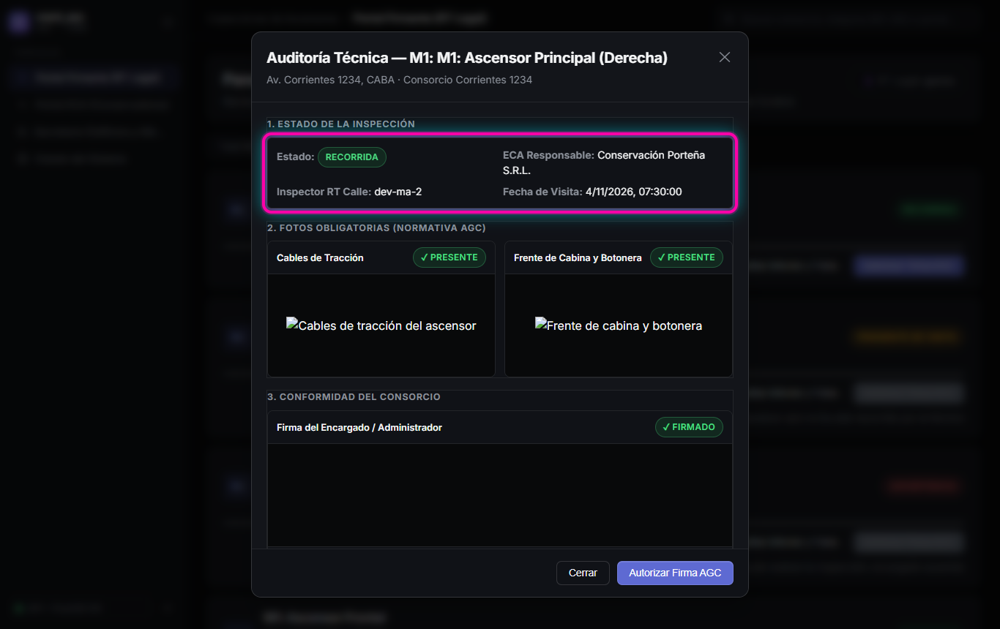
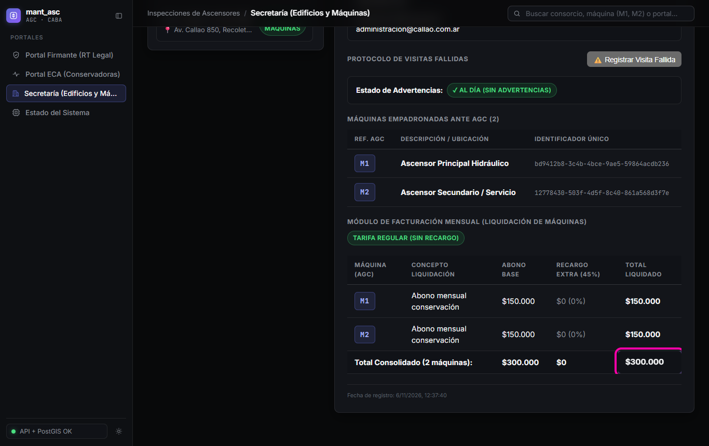

# HU-12 · RF-02 (FIX) — Contraste de textos y contenedores en Modo Oscuro

**Requerimiento:** `REQ-1794488168014` — FIX: Corregir contraste de textos y contenedores en Modo Oscuro  
**Probar en:** `https://localhost:8050` (con `data-theme="dark"` activo)  
**Suite automatizada:** `npm run verify` (`22 suites / 170 tests` en `apps/api` · `6 archivos / 79 tests` en `apps/web` en rama aislada; `7 archivos / 82 tests` en rama `GONZA`)

---

## Flujo visual

---

## Pasos de verificación en pantalla

### Paso 1 — Contraste en `1. ESTADO DE LA INSPECCIÓN` dentro de `ModalAuditoria`
1. Abrir `https://localhost:8050` en modo oscuro (`Portal Firmante (RT Legal)`).
2. Presionar `Auditar Informe y Fotos` en cualquier máquina.
3. Verificar que el bloque `1. ESTADO DE LA INSPECCIÓN` (`.audit-grid`) utiliza fondo oscuro (`#101217`) y texto blanco/gris legible (`Estado:`, `ECA Responsable:`, `Inspector RT Calle:`, `Fecha de Visita:`).

### Paso 2 — Contraste en totales y recargos de `FichaConsorcio`
1. Ir a `Secretaría (Edificios y Máquinas)` (`data-testid="tab-secretaria"`).
2. Desplazarse al `MÓDULO DE FACTURACIÓN MENSUAL (LIQUIDACIÓN DE MÁQUINAS)`.
3. Verificar que la fila `Total Consolidado`, el total `data-testid="total-liquidacion-consorcio"` y el formulario de visitas fallidas (`--surface-sunken: #101217`) mantienen contraste legible sin fondo blanco ni texto oscuro invisible.

