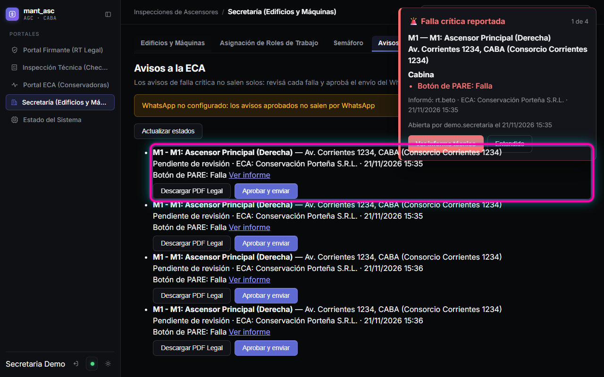
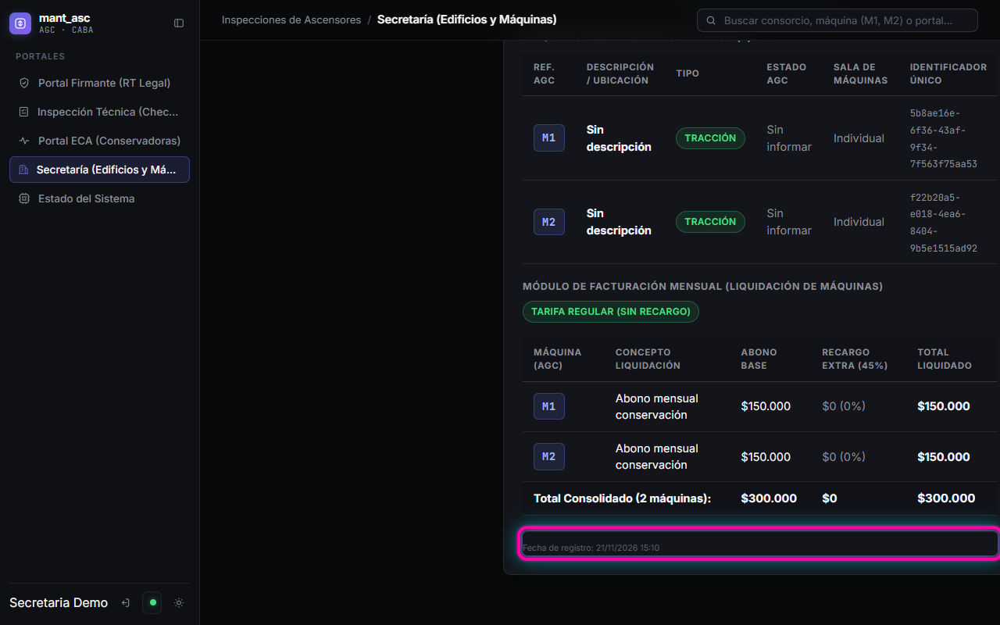

# HU-12 · RF-03 · Entrega — Las horas se muestran en formato de 24 horas en toda la app

- **Tarea:** HU-12 / RF-03 — `REQ-1795285543504`
- **Script:** [RF-03-entrega.sh](RF-03-entrega.sh) · **Capturas:** [RF-03-capturas.cjs](RF-03-capturas.cjs)
- **Código nuevo:** [`apps/web/src/fechas/formato.ts`](../../../apps/web/src/fechas/formato.ts) y su prueba [`formato.test.ts`](../../../apps/web/src/fechas/formato.test.ts)

## 1. Qué quedó implementado

Antes, la web escribía las fechas con `toLocaleString('es-AR')`. En Chrome eso usa el reloj de 12 horas **sin** «a. m.» ni «p. m.»: una falla crítica de las 15:15 aparecía como «21/11/2026, 03:15:00», como si fuera de la madrugada.

Ahora todas las fechas con hora salen de una sola función compartida, `fechas/formato.ts`:

| Función | Ejemplo |
|---|---|
| `fechaHora(valor)` | `21/11/2026 15:15` |
| `fechaHora(valor, { segundos: true })` | `21/11/2026 15:15:07` |
| `fechaHora(valor, { anio: false })` | `21/11, 15:15` |
| `hora(valor)` / `hora(valor, { segundos: true })` | `15:15` / `15:15:07` |

- Siempre en **24 horas** (`hourCycle: 'h23'`): la medianoche es `00:05`, nunca `24:05`.
- Siempre en la **hora de Buenos Aires**, aunque el navegador esté configurado en otra zona.
- Un valor vacío o inválido devuelve texto vacío, y cada pantalla decide qué mostrar en su lugar («—», «No realizada», «Recién creado»).

Pantallas que cambiaron: la bandeja de avisos (alta, aprobación, vencimiento del enlace y constancia de email), la fecha de registro de la ficha del edificio, las alertas críticas del Portal ECA (detección y acuse legal), el cartel de falla crítica, la auditoría del Portal Firmante, la hora de las fotos y del guardado de la Inspección Técnica, y la constancia de visita fallida.

Los registros legales (acuse de la ECA, autorización del Firmante, constancia de visita fallida, hora de las fotos) mantienen los segundos, como antes. El Monitoreo y la cola de informes ya mostraban 24 horas; ahora usan la misma función, con el mismo resultado.

**Lo que no cambia:** las fechas sin hora (por ejemplo, la fecha de descarga del mapa) y los montos de la facturación, que siguen con separador de miles es-AR. El cartel «Sin conexión…» del Mapa del RT ya armaba la hora en 24 horas por su cuenta y quedó igual.

## 2. Cómo se levanta y se prueba

```bash
bash docs/pruebas/hu-12-hu-12-interfaz-neo-linear-side/RF-03-entrega.sh
```

El script no necesita la API ni la base. Para las capturas, con la API y los datos de demo de HU-04 RF-02:

```bash
npm run build -w apps/web && npm run preview -w apps/web     # https://localhost:4173
node docs/pruebas/hu-12-hu-12-interfaz-neo-linear-side/RF-03-capturas.cjs
```

## 3. Qué datos hacen falta

Para el script, ninguno. Para las capturas, los datos de demo (`RF-02-datos-demo.sh`). El script de capturas registra una falla crítica como `rt.beto` para que haya un aviso en la bandeja.

## 4. Qué endpoints o pantallas toca

Ningún endpoint. Sólo cambia cómo la web muestra las horas en las pantallas de la sección 1.

## 5. Cómo se corre integrado

Resultado del 21/11/2026:

| Condición | Resultado |
|---|---|
| 1. Una hora de la tarde se lee «15:15», nunca «03:15» | `formato.test.ts` 7/7. Antes: `21/11/2026, 03:15:00`; ahora: `21/11/2026 15:15` |
| 2. Todas las horas salen de la función compartida | Ningún `toLocaleString` ni `toLocaleTimeString` con hora en `apps/web/src`, y lo controla una prueba. 9 archivos usan `fechas/formato` |
| 3. Las fechas sin hora no cambian | La fecha de descarga del mapa y los montos siguen igual |
| 4. Prueba con mañana, tarde, medianoche y otra zona horaria; `npm run verify` en verde | 09:05, 15:15, 00:05 y un proceso en Asia/Tokyo que igual muestra 15:15. Web 602/602 |
| 5. Captura con Playwright de la bandeja y la ficha | Pasos 1 y 2 de abajo |

`RF-03-entrega.sh`: 7 bien, 0 mal.

## Guía visual

Usuario `demo.secretaria`, clave `Demo-Clave-2026`. Capturas con Playwright en 1280 × 800, tomadas a las 15:36 de Buenos Aires, con el elemento de cada paso resaltado en magenta.

### Paso 1 · Bandeja de avisos

En «Secretaría (Edificios y Máquinas)», abrí la solapa **Avisos a la ECA**.



**Qué tenés que ver:** el aviso dice «Pendiente de revisión · ECA: Conservación Porteña S.R.L. · 21/11/2026 15:35». Antes decía «21/11/2026, 03:35:00». El cartel de arriba a la derecha, «Falla crítica reportada», también muestra «21/11/2026 15:35».

### Paso 2 · Ficha del edificio

En **Edificios y Máquinas**, elegí «DEMO Rivadavia 1234» y bajá hasta el final de la ficha.



**Qué tenés que ver:** «Fecha de registro: 21/11/2026 15:10». Antes decía «21/11/2026, 03:10:xx».

## Supuestos y límites

- La hora se muestra siempre en la de Buenos Aires, porque los edificios están en CABA. Si algún día hay usuarios en otra zona horaria, ven la hora de Buenos Aires, no la suya.
- Se quitaron los segundos de las fechas que no son registros legales (bandeja, ficha, detección de la alerta), porque no agregaban información.
- La API no cambia: sigue mandando las fechas en ISO (UTC).
