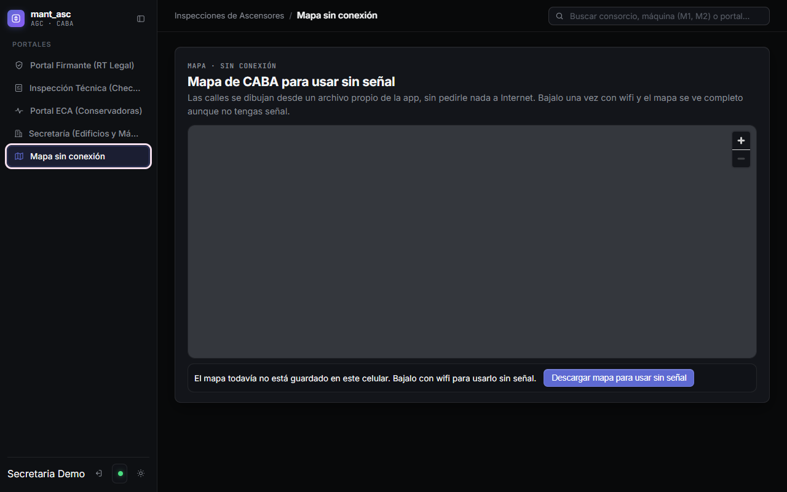
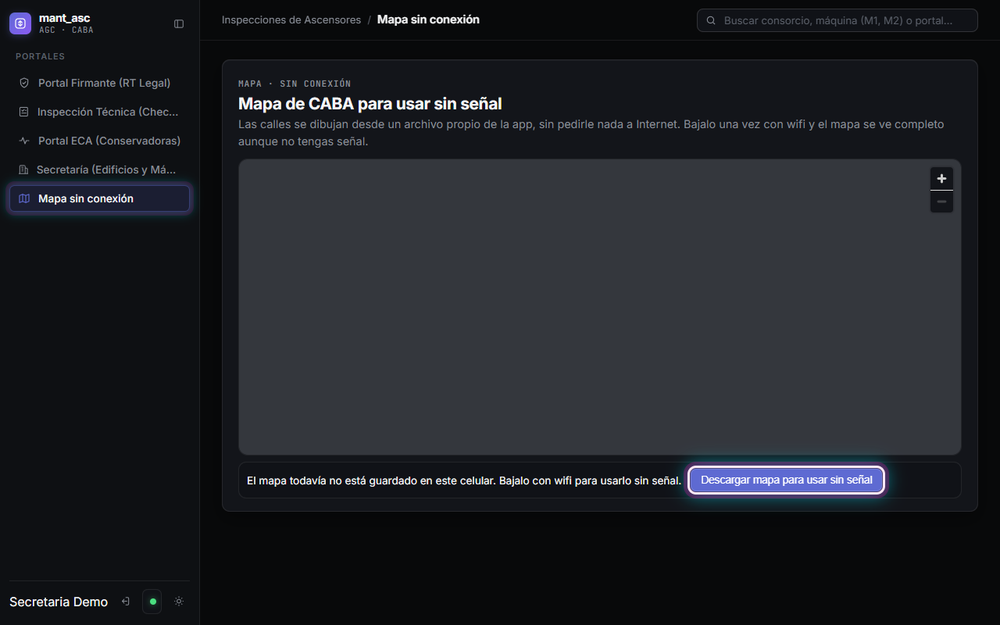
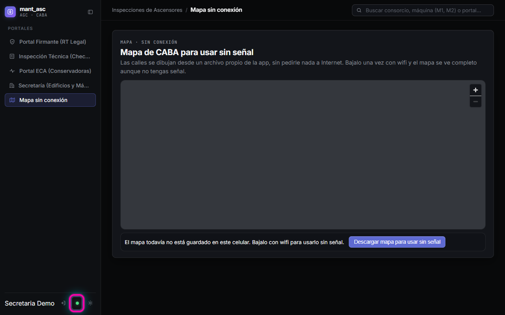
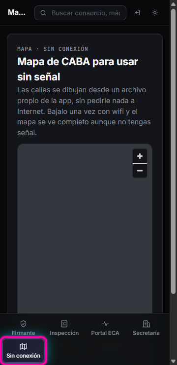

# HU-12 · RF-04 — Retirar la telemetría de «Estado del sistema» y dejar el mapa sin conexión en su pestaña

**Historia de Usuario:** HU-12: Interfaz NEO Linear, Sidebar Colapsable y Buscador Global Inline
**Requerimiento:** RF-04 (`REQ-1795610054276`)
**Tipo:** Funcional. Pedido del usuario del 25/11/2026: «esa sección no sirve de nada».

## El problema

La vista «Estado del sistema» mostraba un encabezado y cuatro tarjetas con texto de desarrollo que no le sirve a quien usa la aplicación: «Backend · NestJS» con «Proxy local `/api` → puerto `:3050`», «Base de datos» con «PostgreSQL 16 + PostGIS (Docker :5433)», «Modo offline · PWA» y «Interfaz · Neo Linear» con «Rama experimental local `GONZA`».

## Qué cambia

| | Antes | Ahora |
|---|---|---|
| Pestaña del menú | «Estado del Sistema» (`tab-sistema`); en el celular, «Sistema» | **«Mapa sin conexión»** (`tab-mapa-sin-conexion`); en el celular, **«Sin conexión»** |
| Contenido | Encabezado + 4 tarjetas + el panel del mapa | **Solo el panel «Mapa de CABA para usar sin señal»**, con su botón para bajar el mapa |
| Buscador global | «Estado del Sistema» (salud de API, PostGIS, Service Worker) | «Mapa sin conexión» (palabras clave: mapa, offline, descargar, celular) |
| Indicador del pie del menú | Un **botón** «API + PostGIS OK» que llevaba a esa pestaña | Un **indicador** (`role="status"`), sin enlace: sigue avisando «Conectando…» / «API + PostGIS OK» / «Revisar sistema» |
| `GET /api/health` | igual | igual (lo piden RO-01 RF-01 y los chequeos de despliegue) |

Se retiraron también el estilo de las tarjetas (`neo-bento-*`), el estado del service worker que las alimentaba (`useServiceWorkerState`) y el ícono de la pestaña vieja. La navegación (pestañas por rol y comandos del buscador) salió de `App.tsx` y `GlobalSearch.tsx` a `ui/navegacion.ts`, y el indicador a `ui/IndicadorEstado.tsx`, para poder probarlos.

### Quién ve la pestaña

La **Secretaría, el Administrador, el Firmante y la ECA**. El **RT no**: su menú es «Mapa del RT» e «Inspección», y baja el mapa desde su propio mapa (el control de descarga está en cada mapa). Es lo mismo que antes; esta tarjeta no cambia los permisos.

## Cómo probarlo

```bash
npm run db:up
bash docs/pruebas/hu-04-hu-04-semaforo-de-control-mens/RF-02-datos-demo.sh
# con la API y la web levantadas (npm run dev; BASE_URL por defecto https://localhost:8050):
BASE_URL=https://localhost:8050 bash docs/pruebas/hu-12-hu-12-interfaz-neo-linear-side/RF-04-entrega.sh
```

El script no crea ni modifica datos. Da **6 verificaciones OK**; contra el estado anterior, 1 OK y 5 errores. Comprueba: `GET /api/health` (200 con la versión de PostGIS), que en el código de la web no quede nada de las tarjetas, que la API siga leyéndose solo para el indicador, las pruebas de la web, que las guías ya no describan la pantalla retirada como si existiera, y que el script de HU-12 RF-01 siga pasando.

**La pantalla (criterios 1, 2 y 3), a mano:** ingresar como Secretaría (`demo.secretaria` / `Demo-Clave-2026`).

1. En el menú lateral ahora dice **«Mapa sin conexión»**. Apretarla.

   

2. La pestaña **no tiene encabezado «Estado del sistema» ni tarjetas**: solo el panel «Mapa de CABA para usar sin señal», con el mapa y el botón **«Descargar mapa para usar sin señal»**, que funciona igual que antes.

   

3. Al pie del menú, el indicador de estado (el punto verde; con el menú ancho dice «API + PostGIS OK»). **No es un botón**: apretarlo no cambia de pantalla.

   

4. En el buscador de arriba, escribir «sin conexion»: aparece **«Mapa sin conexión»**. Escribir «estado del sistema»: ya no aparece nada.
5. En un celular (o a 360 px de ancho), la barra de abajo dice **«Sin conexión»**.

   

Se recorrió en un navegador real (los cinco pasos, y además el botón de tema y el menú colapsado a 80 px por el criterio 1 de HU-12 RF-01).

## Pruebas automáticas

- **Web** — `ui/navegacion.test.ts` (30 pruebas): la pestaña (nombre, identificador, testId, ícono propio), quién ve cada pestaña por rol (la Secretaría, el Firmante y la ECA sin Usuarios; el Administrador con Usuarios; el RT solo su mapa y la inspección), el buscador (un comando por portal, a dónde lleva cada uno, que «sin conexion», «offline», «mapa» y «descargar» lo encuentren y que «estado del sistema», «postgis», «salud» y «service worker» ya no encuentren nada), el indicador (texto y color según el estado, que ya no sea un botón y que colapsado muestre solo el punto) y que el panel del mapa siga dibujándose sin texto de telemetría.
- **Suite completa de la web:** 694 pruebas en 37 archivos. La API no se toca.
- **27 mutaciones** (la pestaña con el nombre, la etiqueta, el testId o el ícono viejos; los roles que ven cada pestaña; los comandos del buscador, sus palabras clave y sus destinos; el indicador con otro texto, otro color, como botón, sin su rol o sin su identificador): las 27 hacen fallar alguna prueba. Dos sobrevivieron al principio (el ícono y los identificadores de los comandos no se comprobaban) y se reforzaron las pruebas.

## Supuestos y limitaciones

- **El cableado de `App.tsx` no tiene prueba automática** (la pantalla entera no se dibuja en las pruebas): que use `itemsDeNavegacion`, `IndicadorEstado` y el panel del mapa. Se verificó en el navegador.
- **Se pierde la forma visual de comprobar el service worker** (la fila «Service worker» de la tarjeta). Queda en el navegador: F12 → Application → Service workers. Las guías de RO-01 RF-01 lo dicen.
- **La barra inferior del celular parte los botones en dos filas a 360 px** cuando hay cinco pestañas (todos los roles menos el RT). Ya pasaba antes con «Sistema»; esta tarjeta no la cambia.
- **Capturas anteriores:** las guías de HU-12 RF-01, HU-16 RF-03 y RO-01 RF-01 conservan capturas hechas cuando la pantalla existía. Cada una lo aclara en el texto; no se volvieron a sacar.
- **HU-12 RF-01:** su criterio 1 nombraba la «vista bento Estado del sistema». Se corrigió en el tablero (con la clave de PM) y se recertificó su prueba; el script de entrega de esa tarjeta, además, **pedía datos sin sesión** (como el resto de los viejos) y se adaptó para ingresar como la Secretaría de demo.
- El indicador del pie del menú puede verse solo como un punto cuando el nombre del usuario ocupa el ancho (como antes de esta tarjeta).
