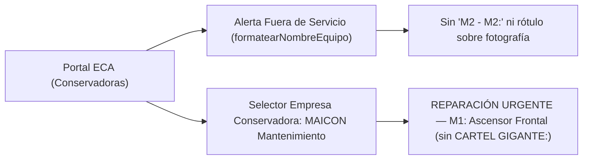
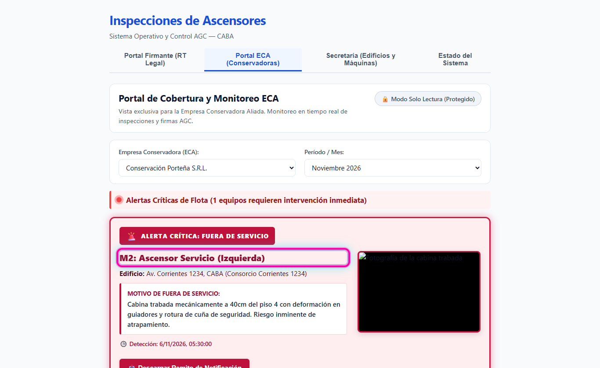
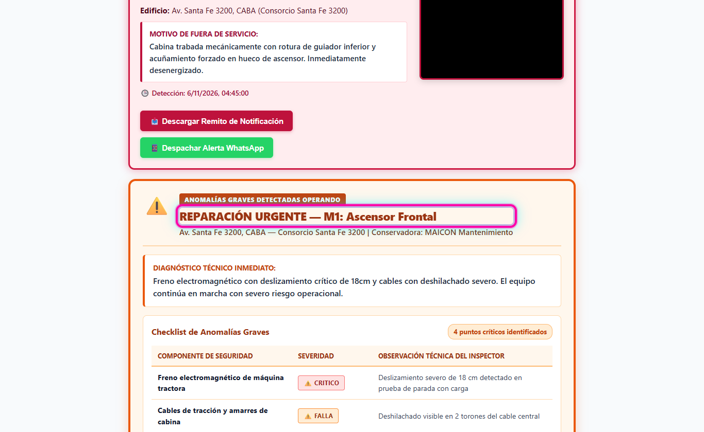

# HU-13 · RF-01 — Alertas Críticas del Portal ECA sin prefijos obvios ni códigos duplicados

**Requerimiento:** `REQ-1794486918510` — Alertas Críticas del Portal ECA sin prefijos obvios ni códigos duplicados  
**Probar en:** `https://localhost:8050` → `Portal ECA (Conservadoras)`  
**Suite automatizada:** `npm run verify` (`22 suites / 170 tests` en `apps/api` · `6 archivos / 79 tests` en `apps/web`)

---

## Flujo visual

---

## Pasos de verificación en pantalla

### Paso 1 — Alerta de Fuera de Servicio sin código duplicado ni rótulo superpuesto en foto
1. Abrir `https://localhost:8050` y entrar a `Portal ECA (Conservadoras)` (`data-testid="tab-eca"`).
2. En la tarjeta `ALERTA CRÍTICA: FUERA DE SERVICIO`, confirmar que el título (`data-testid="titulo-fuera-de-servicio"`) muestra `M2: Ascensor Servicio (Izquierda)` (formateado con `formatearNombreEquipo`, sin repetir `M2 - M2:`) y la imagen no lleva texto superpuesto.

### Paso 2 — Alerta de Reparación Urgente sin prefijo `CARTEL GIGANTE:`
1. En el selector `Empresa Conservadora (ECA)` (`data-testid="select-eca"`), elegir `MAICON Mantenimiento`.
2. Verificar en el bloque `ANOMALÍAS GRAVES DETECTADAS OPERANDO` que el título (`data-testid="titulo-reparacion-urgente"`) dice `REPARACIÓN URGENTE — M1: Ascensor Frontal` sin el prefijo obvio `CARTEL GIGANTE:`.

