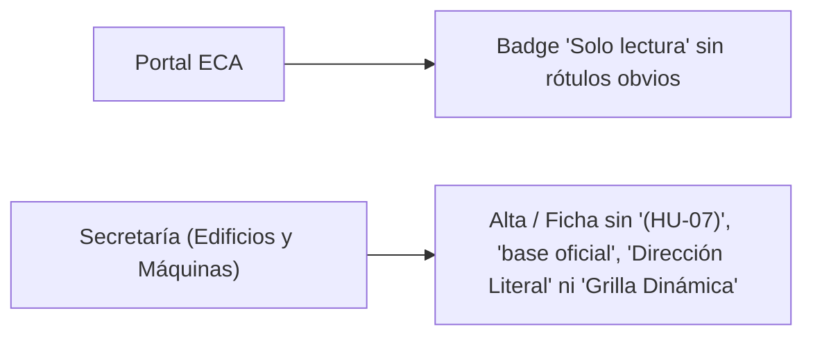
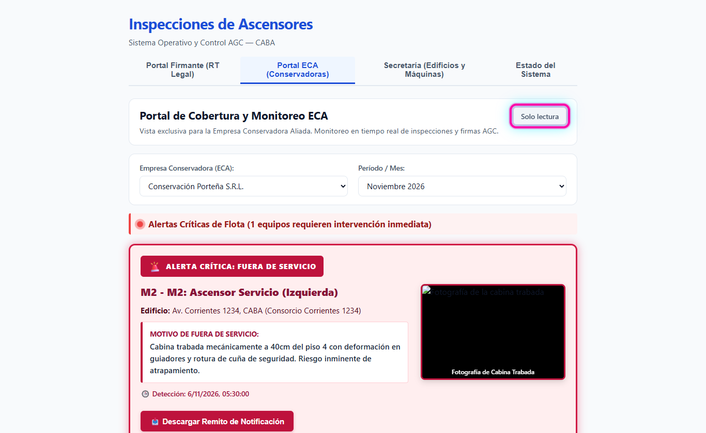
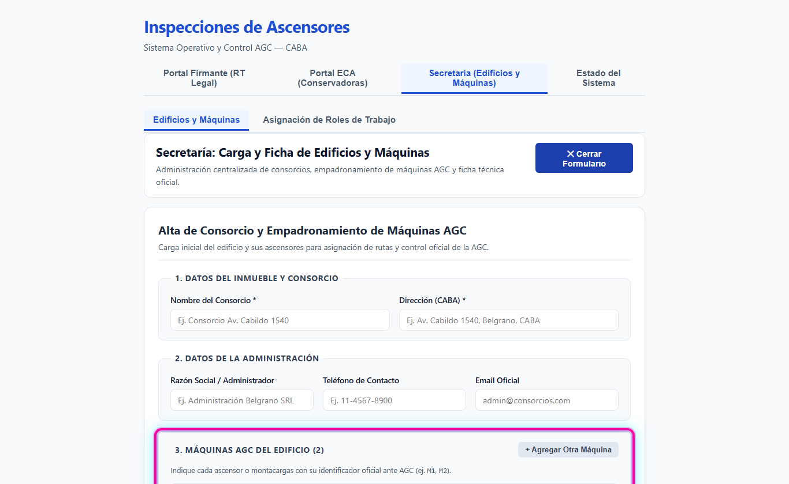

# HU-13 · RF-02 — Limpieza de badges obvios y jerga técnica en Portal ECA y Consorcios

**Requerimiento:** `REQ-1794486918616` — Limpieza de badges obvios y jerga técnica en Portal ECA y Consorcios  
**Probar en:** `https://localhost:8050` → `Portal ECA (Conservadoras)` y `Secretaría (Edificios y Máquinas)`  
**Suite automatizada:** `npm run verify` (`22 suites / 170 tests` en `apps/api` · `6 archivos / 79 tests` en `apps/web`)

---

## Flujo visual

---

## Pasos de verificación en pantalla

### Paso 1 — Encabezado limpio `Solo lectura` en Portal ECA
1. Abrir `https://localhost:8050` y seleccionar `Portal ECA (Conservadoras)` (`data-testid="tab-eca"`).
2. Confirmar que el indicador de estado (`data-testid="badge-solo-lectura"`) muestra `Solo lectura`, eliminando `Modo Solo Lectura (Protegido)`, `Modo Consulta Oficial` y `Solo lectura: Sin edición habilitada`.

### Paso 2 — Formulario y Ficha de Consorcio sin jerga técnica interna
1. Ir a `Secretaría (Edificios y Máquinas)` (`data-testid="tab-secretaria"`).
2. Presionar `+ Alta de Nuevo Consorcio` (`data-testid="btn-toggle-formulario"`) y verificar que los rótulos visibles muestran `Dirección (CABA) *` y el bloque de máquinas sin referencias internas (`Dirección Literal`, `Grilla Dinámica`, `(HU-07)`, `base oficial`).

