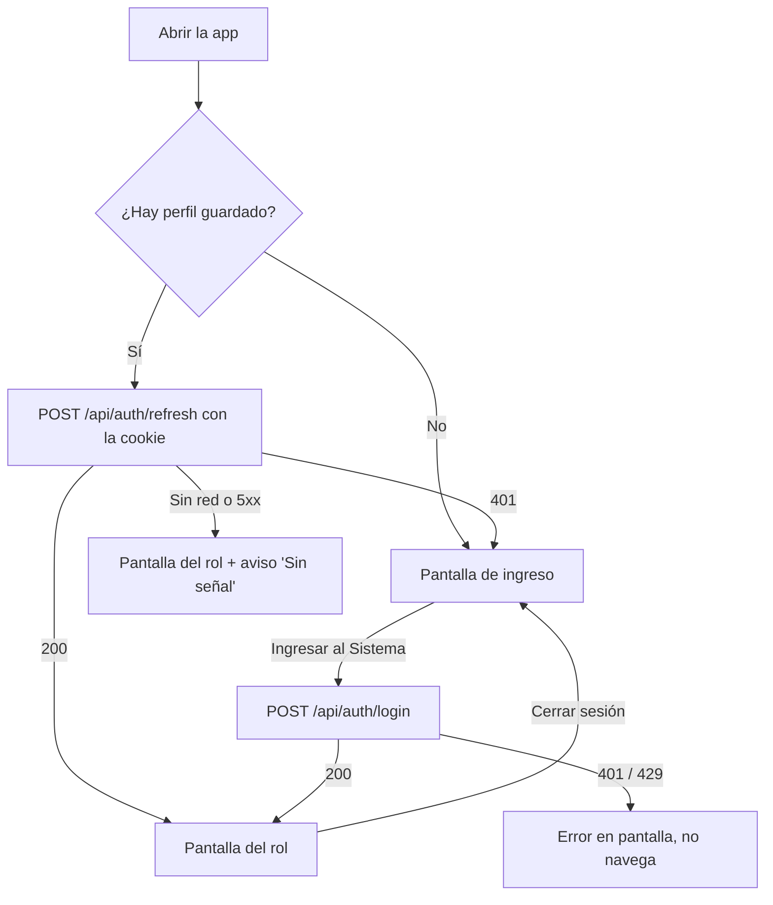
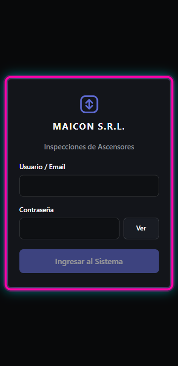
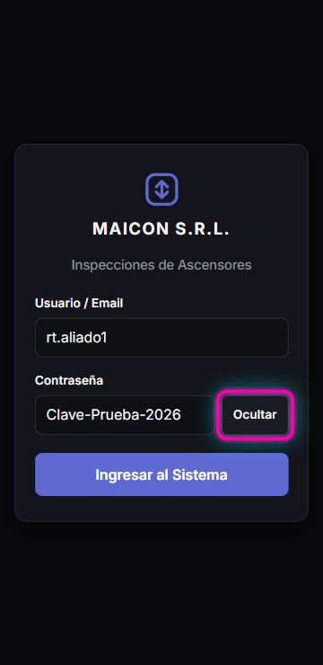
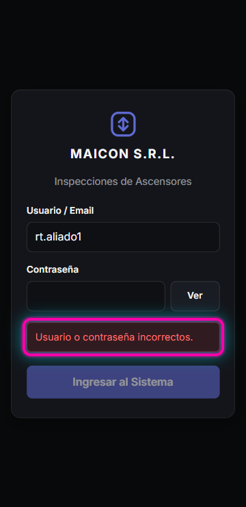
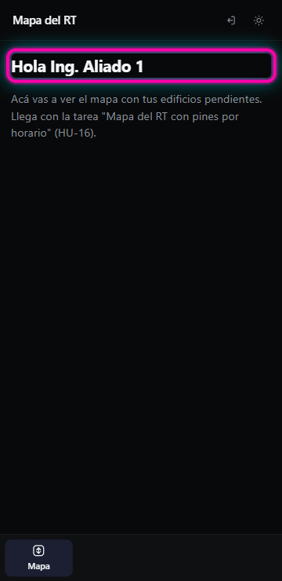
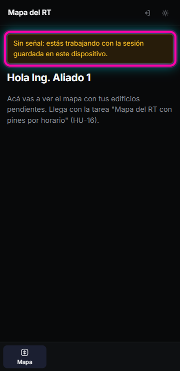

# HU-14 / RF-02 · Guía de pruebas — Pantalla de ingreso

- **Tarea:** RF-02 — `REQ-1794493998996`
- 🌐 **Probar en:** https://localhost:8050
- **Entrega:** [RF-02-entrega.md](RF-02-entrega.md) · **Script:** [RF-02-entrega.sh](RF-02-entrega.sh)

## Condiciones previas

- `npm run db:up` y `npm run dev` corriendo, con el `.env` de [`.env.example`](../../../.env.example). Tiene que incluir `ADMIN_INICIAL_USUARIO=admin` y `ADMIN_INICIAL_PASSWORD=Admin-Desarrollo-2026`.
- Un RT de Calle de prueba. Se crea con el token del Administrador:

  ```bash
  TOKEN=$(curl -s --ssl-no-revoke -X POST -H 'Content-Type: application/json' \
    -d '{"usuario":"admin","password":"Admin-Desarrollo-2026"}' https://localhost:8050/api/auth/login \
    | node -pe "JSON.parse(require('fs').readFileSync(0)).accessToken")
  curl -s --ssl-no-revoke -X POST -H 'Content-Type: application/json' -H "Authorization: Bearer $TOKEN" \
    -d '{"usuario":"rt.aliado1","nombre":"Ing. Aliado 1","rol":"rt_calle","password":"Clave-Prueba-2026"}' \
    https://localhost:8050/api/usuarios
  ```

- Navegador con la vista de celular de 360 × 740: F12, luego el ícono de dispositivo (Ctrl+Shift+M), y escribir 360 × 740.

## Flujo probado



## Paso 1 — La pantalla (condiciones 1 y 4)

Abrir https://localhost:8050 en la vista de 360 px.

Se ve:
- el logo con `MAICON S.R.L.`;
- los campos `Usuario / Email` y `Contraseña`;
- el botón `Ver`;
- el botón `Ingresar al Sistema`, deshabilitado mientras falte algún campo.

No aparece barra de desplazamiento horizontal. En la consola, `document.documentElement.scrollWidth` da `360`.



## Paso 2 — Ver u ocultar la contraseña (condición 1)

1. Escribir `rt.aliado1` en `Usuario / Email`.
2. Escribir `Clave-Prueba-2026` en `Contraseña`.
3. Tocar `Ver`. La contraseña se ve en claro y el botón pasa a decir `Ocultar`; para un lector de pantalla, su nombre cambia de `Mostrar contraseña` a `Ocultar contraseña`.
4. Tocar `Ocultar` para volver a taparla.



## Paso 3 — Credenciales inválidas (condición 3)

1. En `Contraseña`, escribir `Clave-Equivocada-1`.
2. Tocar `Ingresar al Sistema`.

Aparece en rojo `Usuario o contraseña incorrectos.`. La pantalla no cambia y el campo de la contraseña se vacía.

Tras 5 intentos fallidos seguidos, el mensaje pasa a ser `Demasiados intentos fallidos. Probá de nuevo en 15 minutos.`.



## Paso 4 — Credenciales válidas: el RT entra a su mapa (condición 2)

1. En `Contraseña`, escribir `Clave-Prueba-2026`.
2. Tocar `Ingresar al Sistema`.

Se abre `Mapa del RT` con el saludo `Hola Ing. Aliado 1`. La barra de abajo tiene un solo botón, `Mapa`: el RT de Calle no ve los portales de oficina.

El mapa con los edificios llega con la tarea "Mapa del RT con pines por horario" (HU-16). Por ahora la vista muestra el saludo y ese aviso.

Con otro rol, cada uno entra a su portal:

| Rol | Pantalla inicial |
|---|---|
| Secretaría y Administrador | `Secretaría (Edificios y Máquinas)` |
| Firmante | `Portal Firmante (RT Legal)` |
| ECA | `Portal ECA (Conservadoras)` |



## Paso 5 — Sin señal, la sesión sigue (condición 5)

Esta prueba usa el **build de producción**, porque en desarrollo el service worker no guarda la app completa:

```bash
npm run build -w apps/web
cd apps/web && npx vite preview --port 8060
```

1. Abrir https://localhost:8060, ingresar como `rt.aliado1` / `Clave-Prueba-2026` y recargar una vez, para que el service worker tome el control.
2. Cortar la red: F12 → `Network` → `Offline`.
3. Recargar la página.

La app abre igual, en `Mapa del RT` con `Hola Ing. Aliado 1`, y arriba se ve en amarillo `Sin señal: estás trabajando con la sesión guardada en este dispositivo.`.

Al volver a `No throttling` y recargar, el aviso desaparece. La sesión solo termina al tocar `Cerrar sesión` (ícono de salida, arriba a la derecha) o si el servidor la rechaza al volver la señal.

Corrida del 12/11/2026 en Chrome 157 (Playwright, 360 × 740) contra el build de producción: sin red, la vista del RT abre con el aviso; con red, el aviso desaparece.



## Cerrar sesión

El ícono de salida tiene `aria-label` `Cerrar sesión` y está arriba a la derecha en el celular, y abajo en la barra lateral en la computadora. Al tocarlo:
- vuelve a la pantalla de ingreso;
- se borra el perfil guardado en el dispositivo;
- la cookie de refresco deja de servir (`POST /api/auth/refresh` responde `401`).
