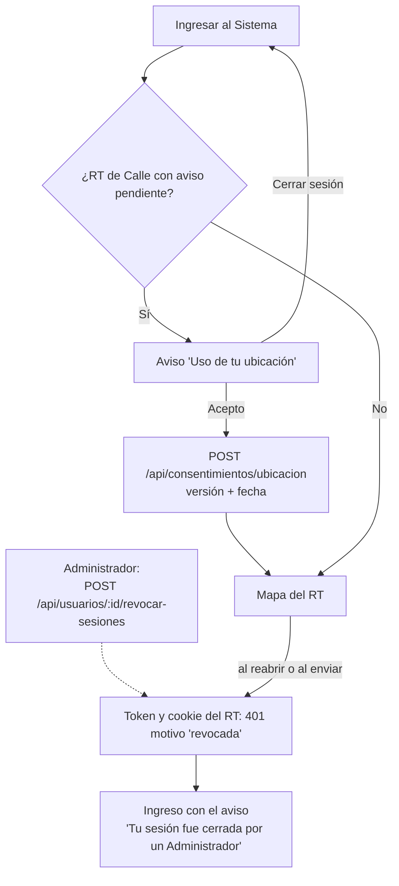
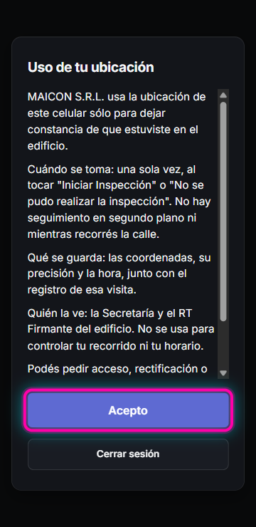
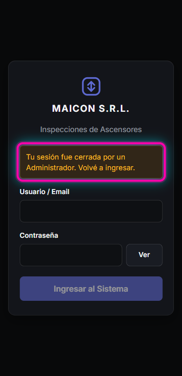

# HU-14 / RNF-01 · Guía de pruebas — Consentimiento de ubicación y revocación de sesiones

- **Tarea:** RNF-01 — `REQ-1794493999191`
- 🌐 **Probar en:** https://localhost:8050
- **Entrega:** [RNF-01-entrega.md](RNF-01-entrega.md) · **Script:** [RNF-01-entrega.sh](RNF-01-entrega.sh)

## Condiciones previas

- `npm run db:up` y `npm run dev` corriendo, con el `.env` de `.env.example`, que incluye el Administrador `admin` / `Admin-Desarrollo-2026`.
- Un RT de Calle **nuevo** que todavía no haya aceptado el aviso. Se crea igual que en la [guía de RF-02](RF-02-pantalla-de-ingreso.md#condiciones-previas), por ejemplo con `rt.nuevo3` / `Clave-Prueba-2026`.
- Navegador en vista de celular de 360 × 740.

## Flujo probado



## Paso 1 — El aviso de ubicación bloquea hasta aceptarlo (condición 1)

1. Ingresar como el RT nuevo.
2. En lugar del mapa aparece `Uso de tu ubicación` con 5 párrafos y la línea `Versión del aviso: ubicacion-2026-11-v1`. Los párrafos dicen:
   - **para qué** se usa: dejar constancia de que estuvo en el edificio;
   - **cuándo se toma:** una sola vez, al tocar "Iniciar Inspección" o "No se pudo realizar la inspección", sin seguimiento en segundo plano;
   - **qué se guarda;**
   - **quién la ve:** la Secretaría y el RT Firmante del edificio;
   - sus **derechos** según la Ley 25.326.
3. Recargar la página: el aviso vuelve a aparecer. No hay forma de llegar al mapa sin aceptarlo; la única otra opción es `Cerrar sesión`.
4. Tocar `Acepto`. Se abre `Mapa del RT`. Al recargar o volver a ingresar, el aviso ya no aparece.



Para ver la aceptación en la base:

```bash
docker exec mant-asc-db psql -U ascensores -d ascensores -c \
  "select u.usuario, c.version, c.aceptado_en from consentimientos_ubicacion c join usuarios u on u.id = c.usuario_id"
```

Corrida del 12/11/2026: `rt.nuevo3 | ubicacion-2026-11-v1 | 2026-11-12 15:38:27.446+00`.

## Paso 2 — La ubicación solo se toma en dos momentos (condición 2)

No tiene pantalla todavía: los botones `Iniciar Inspección` y `No se pudo realizar la inspección` llegan con HU-16. Lo que queda garantizado desde ahora es esto:

- **Un único punto de lectura:** toda lectura de la ubicación pasa por `tomarUbicacion(motivo)`, en `apps/web/src/auth/ubicacion.ts`.
- **Solo dos motivos posibles:** `'inicio-inspeccion' | 'visita-fallida'`.
- **Una lectura fresca por vez**, con `getCurrentPosition` y `maximumAge: 0`.
- **Ningún seguimiento:** el test `ubicacion.test.ts` recorre todo `apps/web/src` y falla si alguien llama a `watchPosition` o lee `navigator.geolocation` en cualquier otro archivo.

```bash
grep -rnE '\.watchPosition\s*\(' apps/web/src --include=*.ts --include=*.tsx | grep -v .test.   # → nada
grep -rlE 'navigator\??\.geolocation|\.getCurrentPosition\s*\(' apps/web/src | grep -v .test.  # → apps/web/src/auth/ubicacion.ts
```

## Paso 3 — El Administrador revoca las sesiones (condición 3)

Con el RT adentro en el celular, el Administrador revoca sus sesiones:

```bash
ID=$(docker exec mant-asc-db psql -U ascensores -d ascensores -tAc "select id from usuarios where usuario='rt.nuevo3'")
TOKEN=$(curl -s --ssl-no-revoke -X POST -H 'Content-Type: application/json' \
  -d '{"usuario":"admin","password":"Admin-Desarrollo-2026"}' https://localhost:8050/api/auth/login \
  | node -pe "JSON.parse(require('fs').readFileSync(0)).accessToken")
curl -s --ssl-no-revoke -o /dev/null -w '%{http_code}\n' -X POST -H "Authorization: Bearer $TOKEN" \
  https://localhost:8050/api/usuarios/$ID/revocar-sesiones      # → 204
```

Desde ese momento, el token de acceso del RT (aunque falten minutos para que venza), cualquier envío con ese token y el refresco con su cookie responden `401` con `"motivo":"revocada"`. Las demás personas no se ven afectadas. El script de entrega lo verifica en su sección 3.

## Paso 4 — La app cierra la sesión y lo informa (condición 4)

1. En el celular del RT, recargar la página (equivale a reabrir la app).
2. Aparece la pantalla de ingreso con el aviso en amarillo `Tu sesión fue cerrada por un Administrador. Volvé a ingresar.`. El perfil guardado se borra (`localStorage` `mant_asc_sesion` queda en `null`).
3. Volver a ingresar con la contraseña: entra de nuevo.

Si la revocación llega **durante un envío**, con la app abierta, pasa lo mismo:
- la app recibe el 401 y vuelve al ingreso con el aviso;
- el envío **no se reintenta**.

Corrida del 12/11/2026: un único `POST /api/consentimientos/ubicacion`, que terminó en `SesionRevocadaError` y en la pantalla de ingreso con el aviso.


