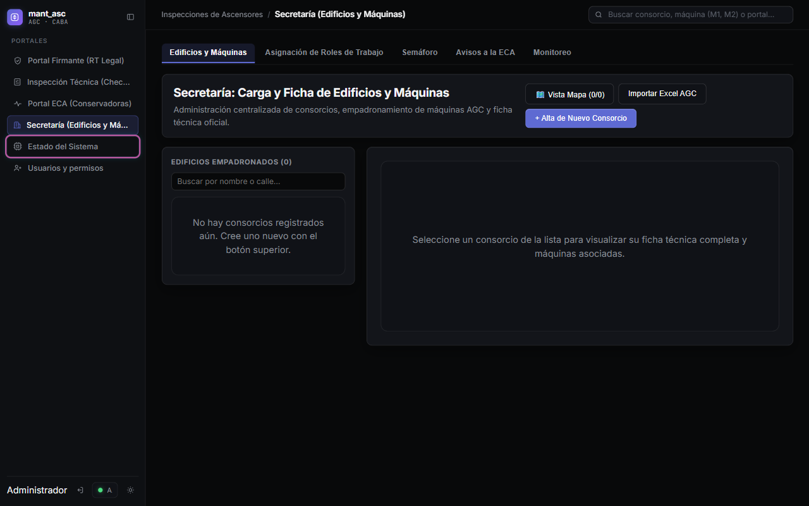
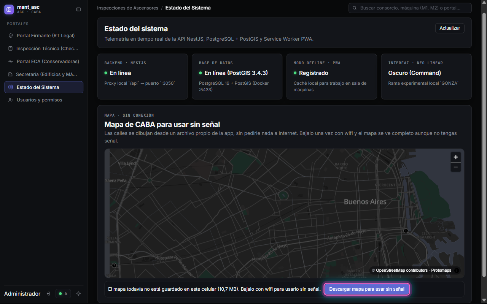
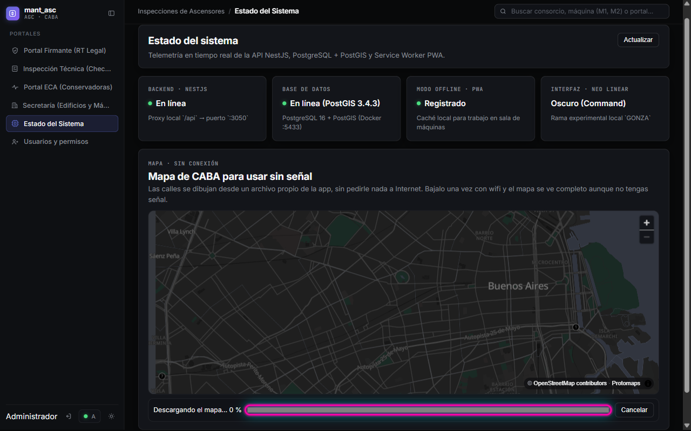
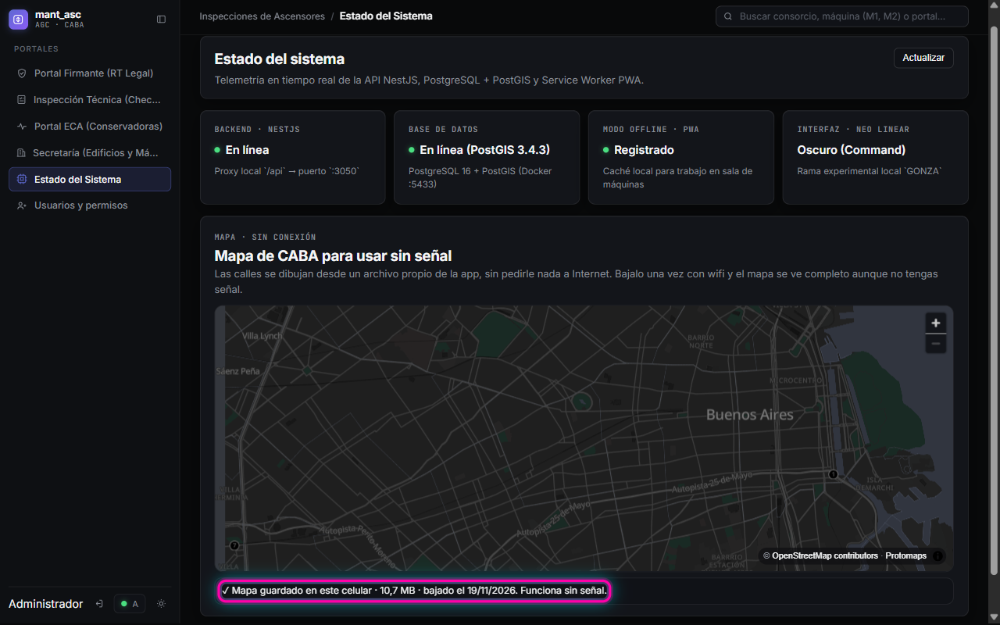
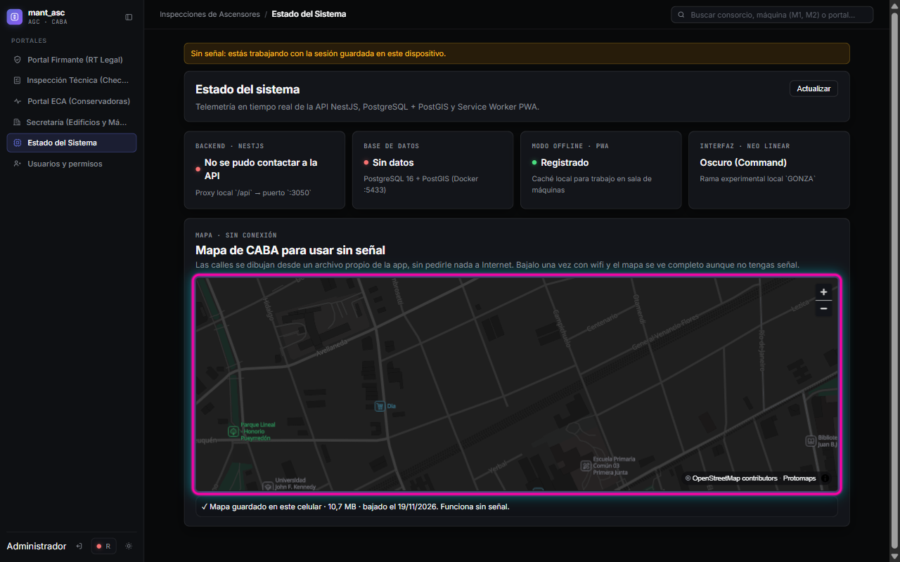
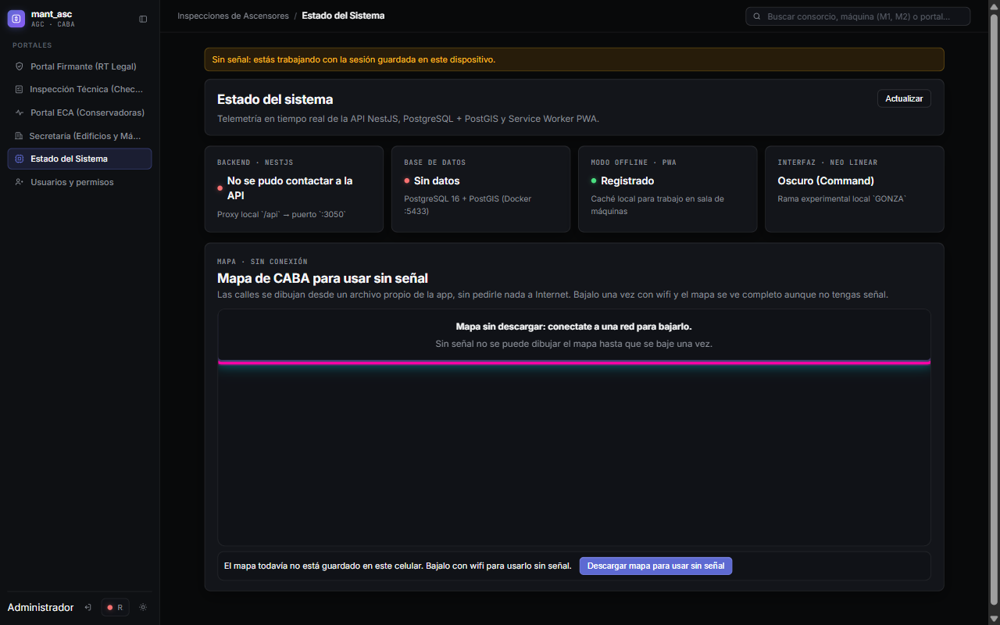
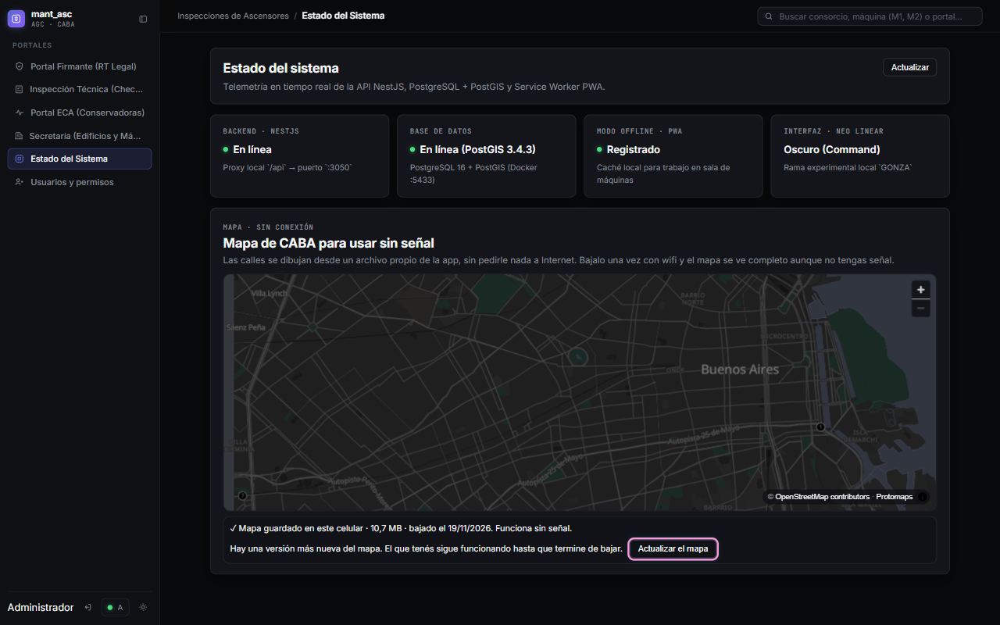
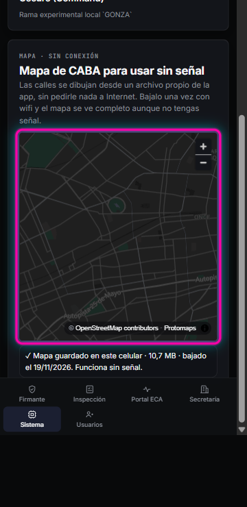
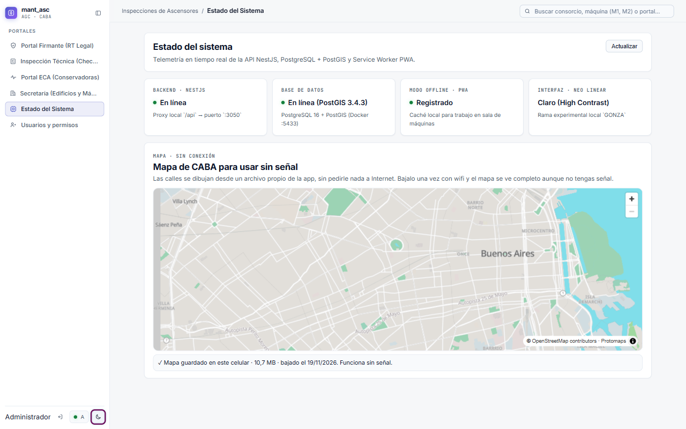

# HU-16 / RF-03 · Guía visual — El mapa de CABA que se dibuja sin conexión

Esta guía muestra, paso a paso, cómo bajar el mapa de CABA al celular y cómo se ve **sin wifi y sin señal**. El mapa vive hoy en la pestaña «Mapa sin conexión» (antes «Estado del sistema»); los mapas del resto de las pantallas se apoyan en este mismo archivo (tareas siguientes).

- **Tarea:** RF-03 — `REQ-1795097971049` · **Entrega:** [RF-03-entrega.md](RF-03-entrega.md)
- **Usuario:** `admin` · **Clave:** `Admin-Desarrollo-2026`
- **Capturas:** sacadas con Playwright en una ventana de 1280 × 800 (el paso 8, de 360 × 740, es un celular), con el elemento de cada paso resaltado en magenta con `scrumDocs/resaltado-de-capturas.css`.

**Antes de empezar**

1. El mapa ya viene en el repositorio (`apps/web/public/mapa/caba.pmtiles`): no hace falta generarlo. Para actualizarlo: `npm run mapa:generar` (~1 minuto, necesita Internet) y subir el archivo.
2. Para los pasos 5 y 6 (sin conexión) hace falta la app **compilada**, porque el service worker de desarrollo no guarda la app entera: `npm run build -w apps/web` y `npm run preview -w apps/web`, y entrar a https://localhost:4173. Los demás pasos se ven igual en https://localhost:8050 con `npm run dev`.
3. Para «cortar la red» en el navegador: DevTools › Network › «Offline» o el modo avión del celular.

## Paso 1 · Entrar a «Mapa sin conexión»

Ingresá y apretá **Mapa sin conexión** en la barra lateral (en el celular, **Sin conexión** en la barra de abajo). _La captura es anterior a HU-12 RF-04 y todavía muestra el nombre viejo de la pestaña, «Estado del Sistema»._

## Paso 2 · El mapa y el botón para bajarlo

En la pestaña está el panel «Mapa de CABA para usar sin señal». Con conexión, el mapa se dibuja leyendo el archivo del servidor, y debajo dice que todavía no está guardado en este celular y cuánto pesa.

**Qué tenés que ver:** el mapa de CABA con calles, barrios y el río, los botones de acercar y alejar, la atribución «© OpenStreetMap contributors · Protomaps», y «El mapa todavía no está guardado en este celular (10,7 MB)».

## Paso 3 · Bajarlo, con su avance

Apretá **Descargar mapa para usar sin señal**.

**Qué tenés que ver:** «Descargando el mapa… 0 %», una barra de avance y el botón **Cancelar**. Si cancelás, o si se corta la conexión, no se pierde nada: el mapa que ya tuvieras guardado sigue sirviendo. *(En la red local el archivo baja en una fracción de segundo; para la captura se demoró el pedido unos segundos.)*

## Paso 4 · Queda guardado en el celular

Cuando termina, el panel lo confirma y el mapa pasa a leerse desde el celular, ya sin pedirle nada al servidor.

**Qué tenés que ver:** «✓ Mapa guardado en este celular · 10,7 MB · bajado el 19/11/2026. Funciona sin señal.»

## Paso 5 · Sin wifi y sin señal

Cortá la red (modo avión) y recargá la página. La app abre igual, con el aviso «Sin señal: estás trabajando con la sesión guardada en este dispositivo». Entrá otra vez a «Mapa sin conexión» y acercá el mapa con **+**.

**Qué tenés que ver:** el mapa se dibuja completo, con calles, nombres de calles, parques y comercios, **aunque la API figure «No se pudo contactar» y la base «Sin datos»**. Se puede acercar, alejar y arrastrar, desde ver todo CABA hasta el nivel de la cuadra (zoom 17).

## Paso 6 · Sin red y sin haber bajado el mapa

Si nunca se bajó el mapa y no hay red, la pantalla lo dice en lugar de dejar un recuadro en blanco o roto.

**Qué tenés que ver:** «**Mapa sin descargar: conectate a una red para bajarlo.** Sin señal no se puede dibujar el mapa hasta que se baje una vez.» Al volver la conexión, el mapa se dibuja solo, sin recargar la página.

## Paso 7 · Hay una versión más nueva

Cuando el servidor tiene otra versión del archivo, la app lo avisa (con conexión).

**Qué tenés que ver:** «Hay una versión más nueva del mapa. El que tenés sigue funcionando hasta que termine de bajar.» y el botón **Actualizar el mapa**. La versión vieja se reemplaza recién cuando la nueva terminó de bajar y se comprobó que es un mapa válido.

## Paso 8 · En un celular

En un ancho de 360 px, el mapa ocupa el ancho disponible. En esta pantalla se maneja con los gestos cooperativos: la rueda del mouse (o un dedo) sigue moviendo la página, y para acercar el mapa se usa Ctrl + rueda (o dos dedos para moverlo).

## Paso 9 · Tema claro y oscuro

El mapa sigue al tema de la app: al apretar el botón de tema, cambia al instante, sin recargar.

**Qué tenés que ver:** en el tema claro, parques en verde, el río en celeste, avenidas blancas y nombres legibles; en el oscuro (pasos anteriores), la misma información en grises.
