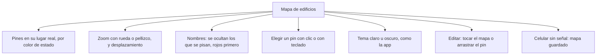
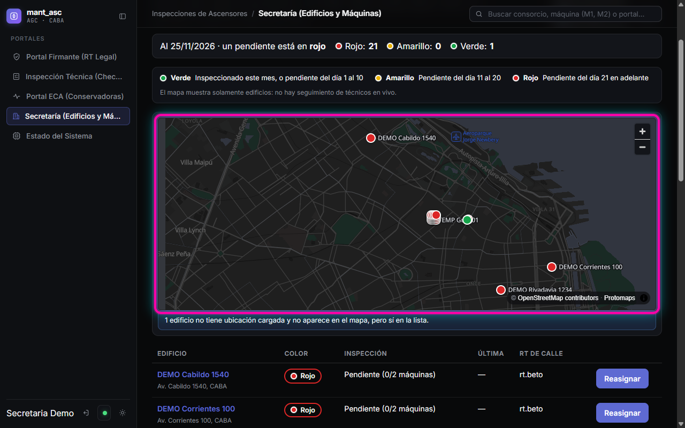
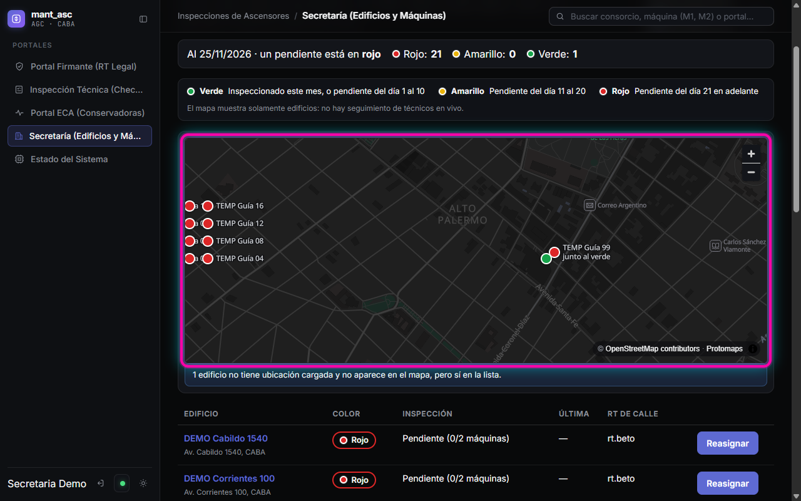
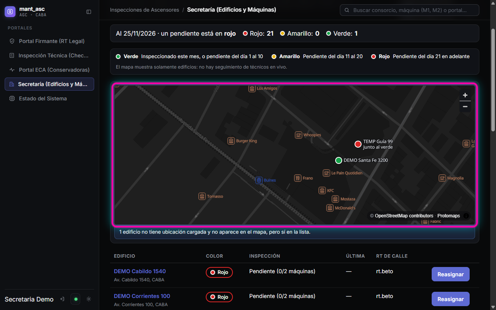
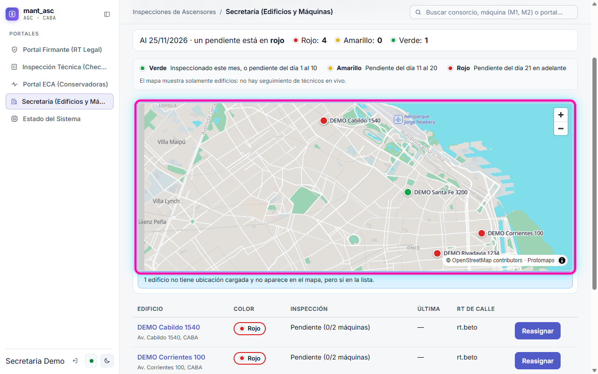
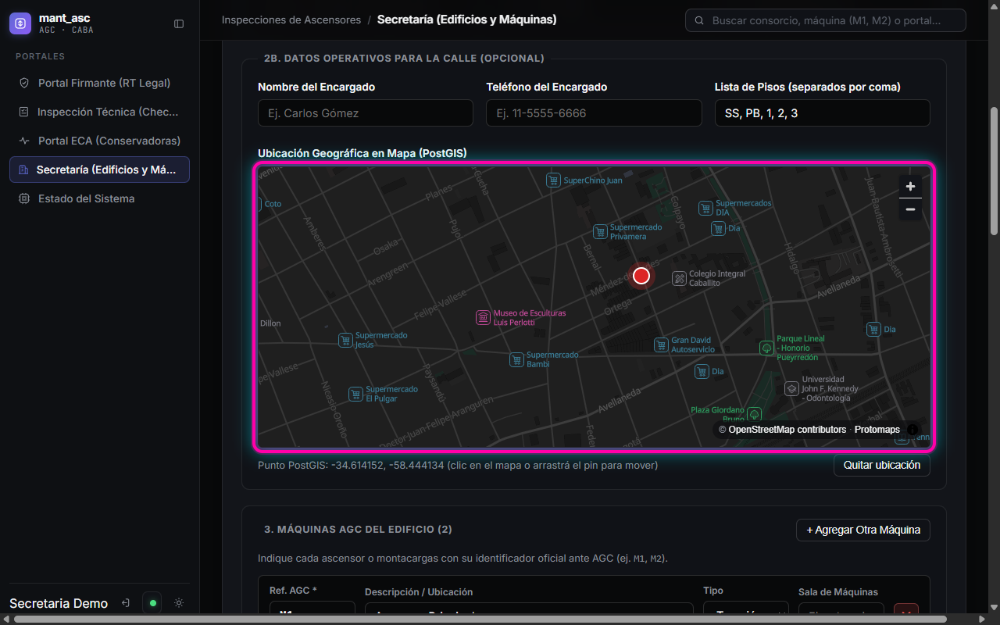
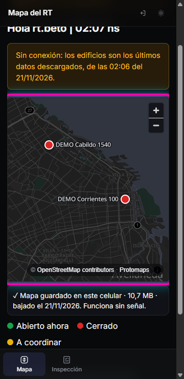

# HU-16 / RF-04 · Guía visual — El mapa de edificios con pines por estado, zoom y nombres que no se pisan

Esta guía muestra cómo se ve y cómo se maneja el mapa nuevo: pines de color en los lugares reales, nombres que no se pisan, zoom, teclado, tema claro y oscuro, edición del punto de un edificio y uso en un celular sin señal.

- **Tarea:** RF-04 — `REQ-1795097971265` · **Entrega:** [RF-04-entrega.md](RF-04-entrega.md)
- **URL:** https://localhost:8050 (la app levantada con `npm run dev`)
- **Usuario:** `demo.secretaria` · **Clave:** `Demo-Clave-2026` · **Rol:** secretaria (el paso 6 usa `rt.beto`, el mismo usuario y clave de demo)
- **Antes de empezar:** cargar los datos de demo con `bash docs/pruebas/hu-04-hu-04-semaforo-de-control-mens/RF-02-datos-demo.sh` y tener el mapa base (ya viene en el repositorio desde HU-16 RF-06; solo se genera de nuevo con `npm run mapa:generar` para actualizarlo).
- **Capturas:** sacadas con Playwright en 1280 × 800 (el paso 6, en 360 × 740), con el elemento de cada paso resaltado en magenta con `scrumDocs/resaltado-de-capturas.css`.
- **Una aclaración:** este componente recién se usa en pantallas con RF-05. Estas capturas se sacaron con las dos Tareas juntas, en el Semáforo, en el alta de consorcio y en el Mapa del RT.

## Paso 1 · Abrir el Semáforo con muchos edificios

En «Secretaría (Edificios y Máquinas)» abrí la solapa **Semáforo** y elegí el **25/11/2026**. Para estas capturas se cargaron 16 edificios más, juntos en un mismo barrio, y uno pegado a «DEMO Santa Fe 3200»: 21 edificios en total.

**Qué tenés que ver:** los 21 pines (en rojo los pendientes, en verde el inspeccionado) y sólo algunos nombres: los que entran sin pisarse. El mapa se abre encuadrando a todos los edificios con margen.

## Paso 2 · Acercar: el rojo conserva su nombre

Acercá con la rueda del mouse sobre el pin verde (en el celular, con dos dedos).

**Qué tenés que ver:** el pin verde «DEMO Santa Fe 3200» y un pin rojo a unos 35 metros. Se ven los dos pines, pero sólo el nombre del rojo: cuando dos nombres se pisan se conserva el del estado más urgente.

## Paso 3 · Acercar más: reaparece el otro nombre

Seguí acercando.

**Qué tenés que ver:** con el mapa más cerca, los dos nombres entran y se ven.

## Paso 4 · Tema claro

Apretá **Cambiar tema visual** (abajo a la izquierda).

**Qué tenés que ver:** el mapa pasa a los colores claros, con los pines y los nombres de los cuatro edificios.

## Paso 5 · Fijar o mover el punto de un edificio

En «Edificios y Máquinas» apretá **+ Alta de Nuevo Consorcio**. En el mapa, tocá el lugar del edificio: queda un pin rojo y abajo dice «Punto PostGIS: …» con la latitud y la longitud con 6 decimales. Después arrastrá el pin para ajustarlo.

**Qué tenés que ver:** el pin rojo en el punto tocado y el texto «Punto PostGIS: -34.614858, -58.445432 (clic en el mapa o arrastrá el pin para mover)». Al arrastrar el pin, las coordenadas cambian y siguen teniendo 6 decimales. **Quitar ubicación** borra el punto.

## Paso 6 · En el celular, sin señal

Entrá como `rt.beto` en un celular, abrí el mapa y apretá **Descargar mapa para usar sin señal** (una sola vez, con conexión). Después, sin señal, el mapa sigue andando.

**Qué tenés que ver:** un cartel amarillo «Sin conexión: los edificios son los últimos datos descargados, de las 02:06 del 21/11/2026.», el mapa dibujado, los dos pines con sus nombres completos (el de «DEMO Corrientes 100» queda a la izquierda de su pin para no cortarse en el borde) y abajo «✓ Mapa guardado en este celular · 10,7 MB · bajado el 21/11/2026. Funciona sin señal.».
