# HU-16 / RF-05 · Guía visual — El mapa nuevo en las cinco pantallas, en escritorio y en el celular

Esta guía muestra cada pantalla que usa el mapa, con el mapa nuevo, en una computadora (1280 × 800) y en un celular de 360 × 740, y el Mapa del RT sin conexión.

- **Tarea:** RF-05 — `REQ-1795097971367` · **Entrega:** [RF-05-entrega.md](RF-05-entrega.md) · **El componente:** [RF-04-guia-visual.md](RF-04-guia-visual.md)
- **URL:** https://localhost:8050 (la app levantada con `npm run dev`)
- **Usuario:** `demo.secretaria` / `Demo-Clave-2026` (rol secretaria) para las pantallas 1 a 5, y `rt.beto` / `Demo-Clave-2026` (rol RT de Calle) para la 6.
- **Antes de empezar:** cargar los datos de demo con `bash docs/pruebas/hu-04-hu-04-semaforo-de-control-mens/RF-02-datos-demo.sh` y tener el mapa base (ya viene en el repositorio desde HU-16 RF-06; solo se genera de nuevo con `npm run mapa:generar` para actualizarlo).
- **Capturas:** sacadas con Playwright, con el mapa de cada paso resaltado en magenta con `scrumDocs/resaltado-de-capturas.css`.

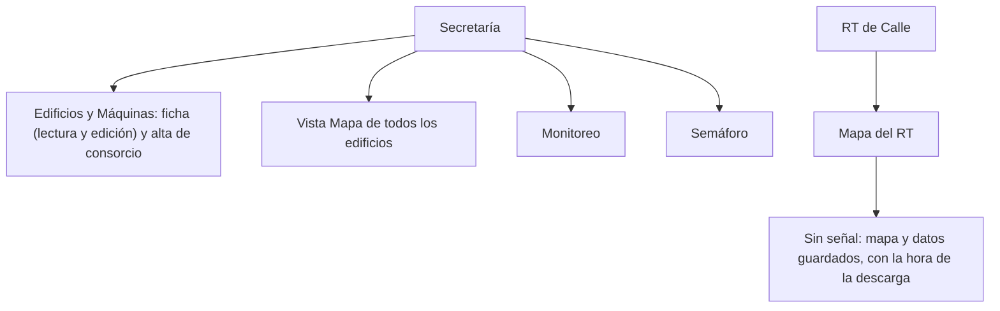

## Pantalla 1 · Ficha del edificio, en lectura

En «Secretaría (Edificios y Máquinas)», elegí «DEMO Santa Fe 3200» en la lista. Abajo de los datos operativos está el mapa con el punto del edificio.

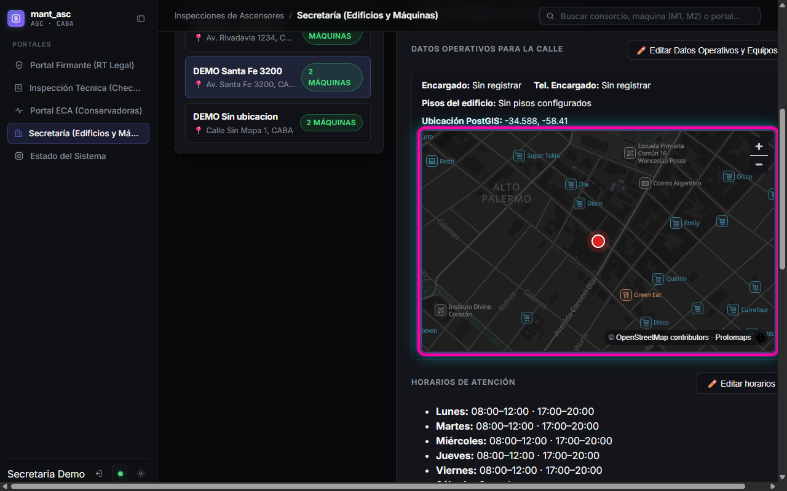

**Qué tenés que ver (escritorio):** el mapa de la zona con las calles y los comercios, y el pin rojo del edificio. El dibujo anterior era un recuadro con tres avenidas.

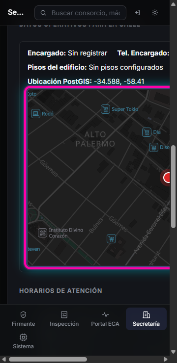

**Qué tenés que ver (celular):** el mapa, aunque cortado a la derecha: esta pantalla ya era más ancha que el celular antes de este cambio (la lista y la ficha suman 340 + 736 px), así que el mapa ocupa el ancho de la ficha y se desplaza con ella.

## Pantalla 2 · Ficha del edificio, en edición

Apretá **✏️ Editar Datos Operativos y Equipos**. Sobre «Punto Geográfico PostGIS» está el mapa para mover el punto.

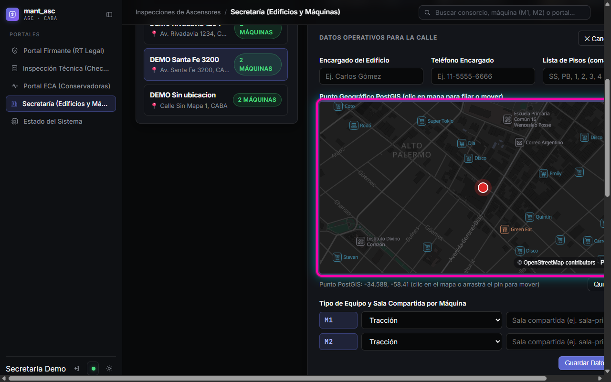

**Qué tenés que ver (escritorio):** el mapa con el pin rojo y, abajo, «Punto PostGIS: -34.588, -58.41 (clic en el mapa o arrastrá el pin para mover)» y el botón **Quitar ubicación**.

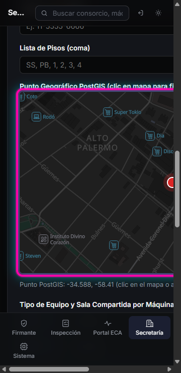

**Qué tenés que ver (celular):** lo mismo, con el mismo límite de ancho que la pantalla 1.

## Pantalla 3 · Alta de consorcio

Apretá **+ Alta de Nuevo Consorcio**. En «Ubicación Geográfica en Mapa (PostGIS)» tocá el mapa para fijar el punto.

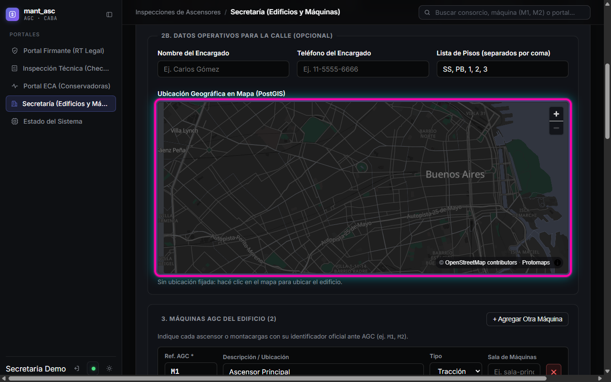

**Qué tenés que ver (escritorio):** el mapa de CABA sin pin y el mensaje «Hacé clic en el mapa para fijar el punto del edificio».

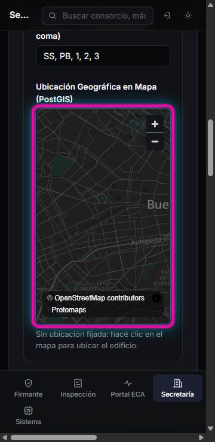

**Qué tenés que ver (celular):** el mismo mapa, en el ancho del formulario.

## Pantalla 4 · Secretaría: la vista de mapa

En «Edificios y Máquinas» apretá **🗺️ Vista Mapa**.

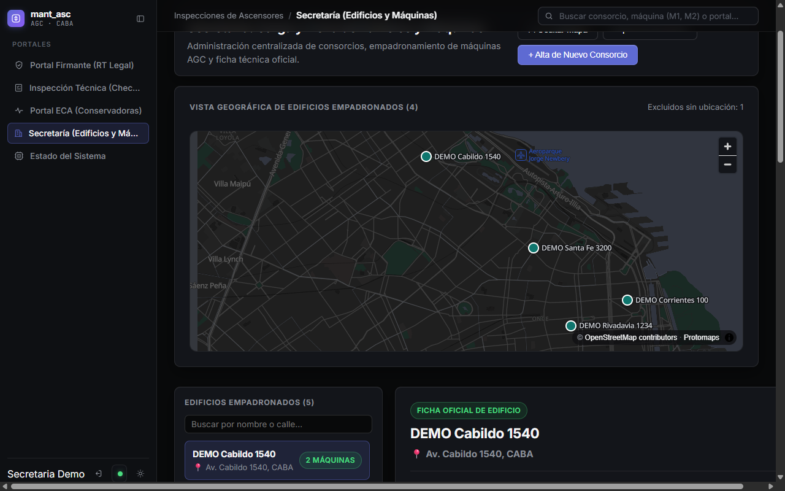

**Qué tenés que ver (escritorio):** un pin por edificio con ubicación y su nombre. Arriba dice cuántos edificios quedaron afuera por no tener ubicación.

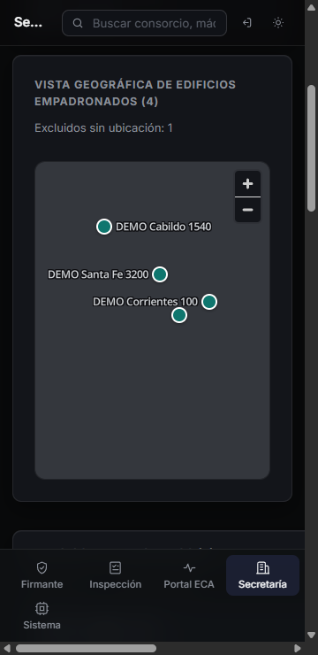

**Qué tenés que ver (celular):** los mismos pines y nombres en el ancho del celular.

## Pantalla 5 · Secretaría: Monitoreo

Apretá la solapa **Monitoreo**. Arriba del tablero está el mapa de todos los edificios.

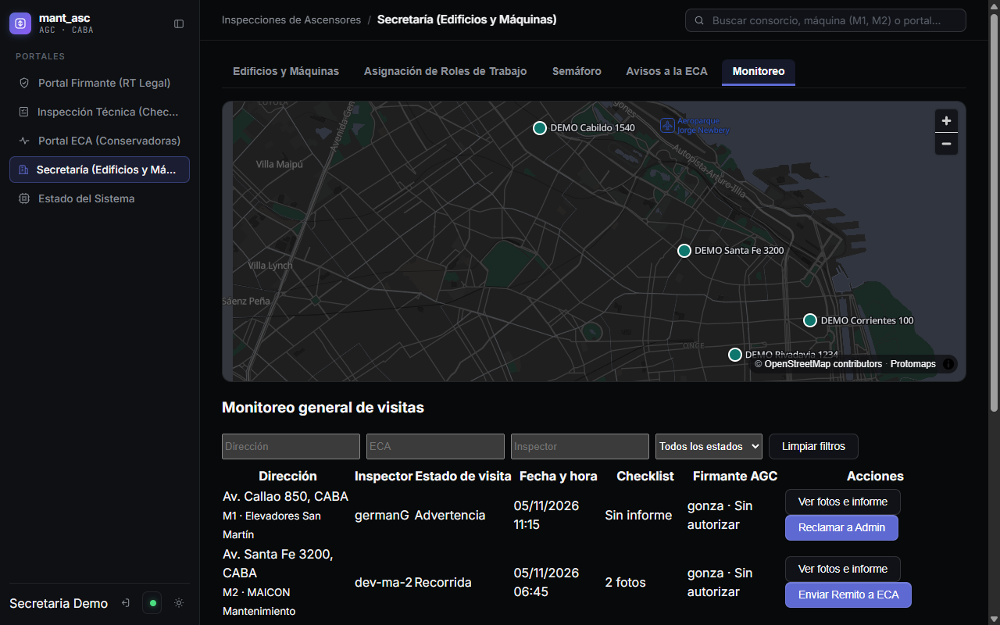

**Qué tenés que ver (escritorio):** el mapa con los cuatro edificios con ubicación.

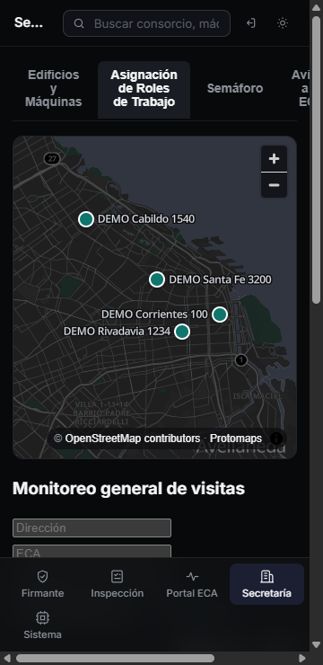

**Qué tenés que ver (celular):** el mapa ocupa el ancho disponible, sin desbordar la pantalla.

## Pantalla 6 · Semáforo

Apretá la solapa **Semáforo** y elegí el **25/11/2026**.

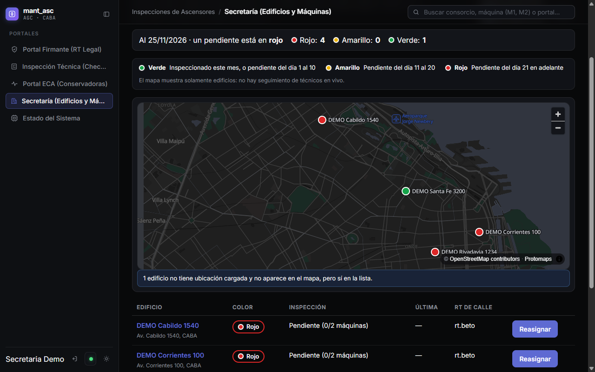

**Qué tenés que ver (escritorio):** cuatro pines en rojo y uno en verde (el quinto edificio no tiene ubicación y se avisa abajo), arriba la leyenda de colores y la nota «El mapa muestra solamente edificios: no hay seguimiento de técnicos en vivo.»

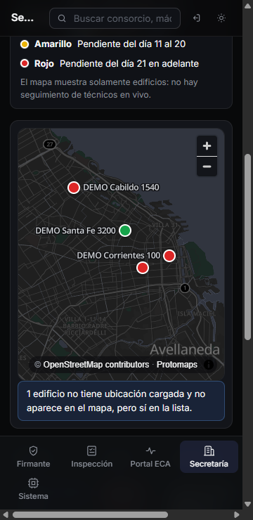

**Qué tenés que ver (celular):** los cinco elementos (leyenda, nota, mapa, aviso de sin ubicación) en una columna; los nombres de los edificios se acomodan a un lado u otro del pin para no cortarse.

## Pantalla 7 · Mapa del RT

Entrá como `rt.beto`. La pantalla inicial es el mapa con los edificios pendientes de la zona.

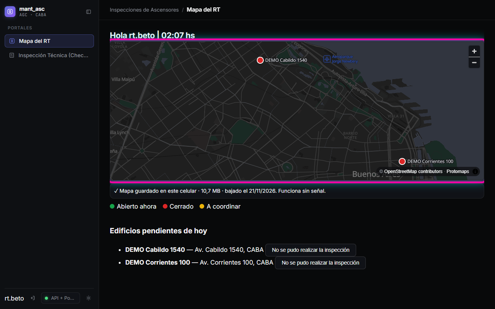

**Qué tenés que ver (escritorio):** un pin por edificio pendiente, pintado según esté abierto (verde), cerrado (rojo) o «A coordinar» (amarillo), y la leyenda abajo.

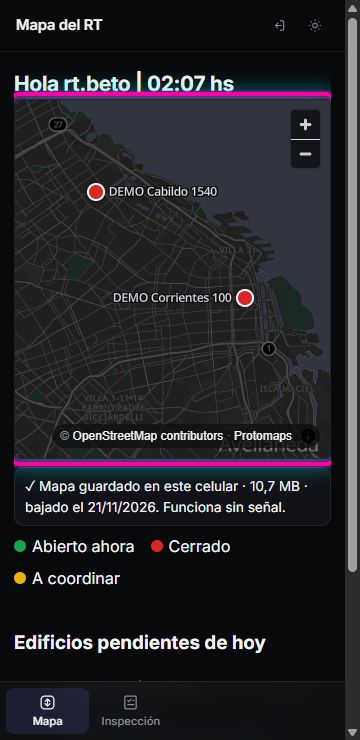

**Qué tenés que ver (celular):** el mapa en el ancho de la pantalla, con «Descargar mapa para usar sin señal» debajo.

### Sin conexión

Apretá **Descargar mapa para usar sin señal** una vez, con conexión. Después, sin señal, abrí la app.

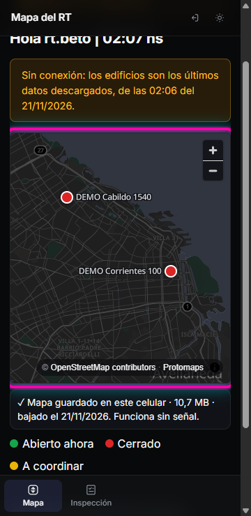

**Qué tenés que ver:** un cartel amarillo que dice «Sin conexión: los edificios son los últimos datos descargados, de las 02:06 del 21/11/2026.», el mapa dibujado desde el celular y los pines con los colores calculados con la hora actual del celular. Al volver la señal, la pantalla baja los datos de nuevo y el cartel desaparece (así está programado; no se probó en el navegador).
