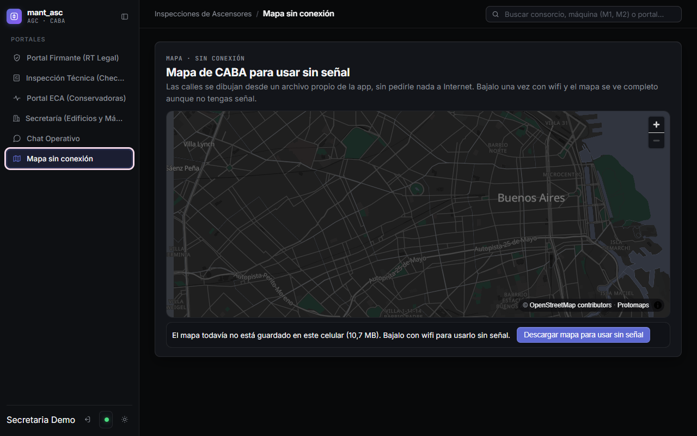
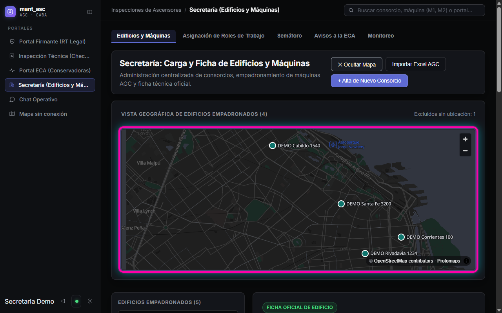
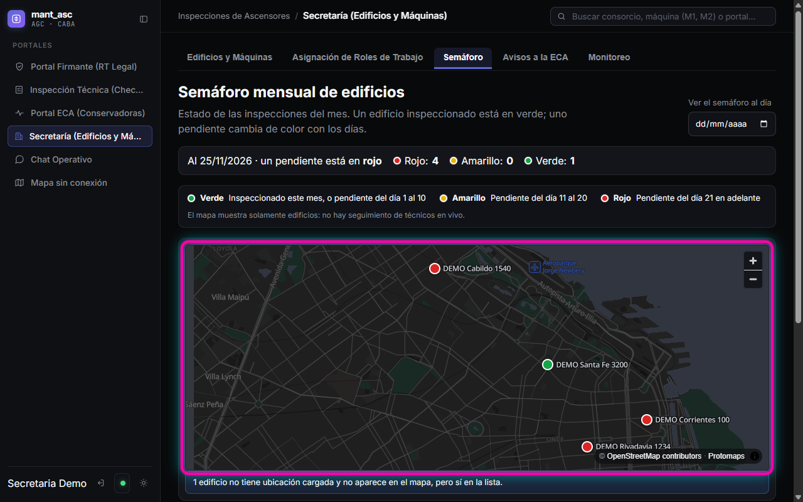
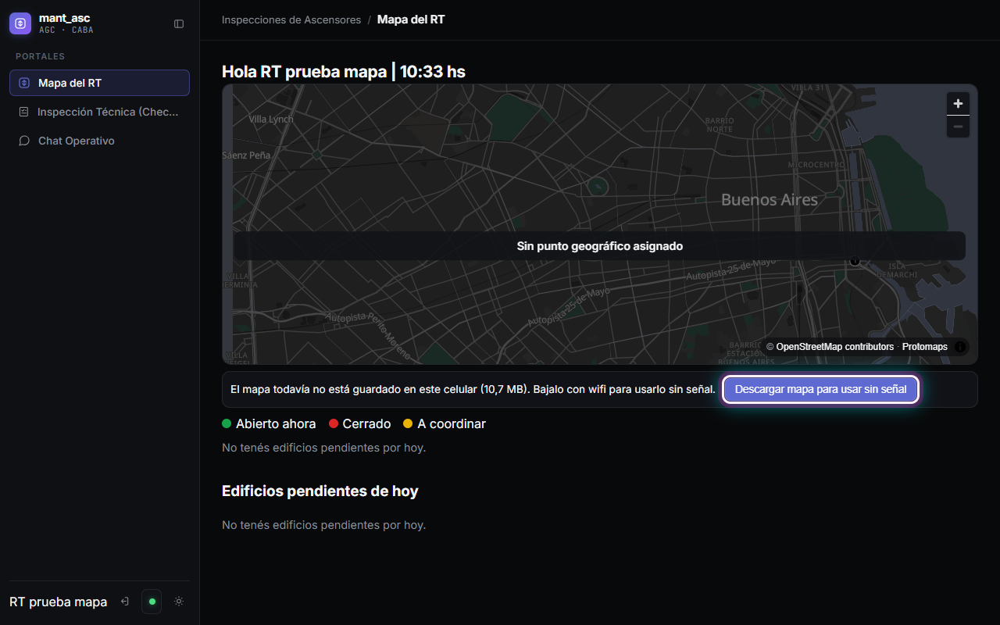
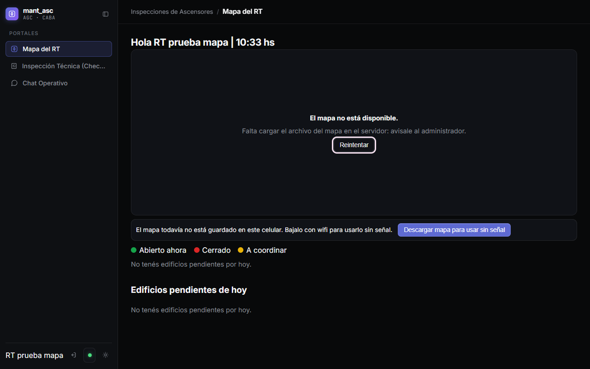

# HU-16 · RF-06 — Que los mapas se vean: el archivo del mapa va con el sitio y la app avisa cuando falta

**Historia de Usuario:** HU-16: Mapa del RT y llegada al edificio
**Requerimiento:** RF-06 (`REQ-1795613107749`)
**Tipo:** Funcional. Pedido del usuario del 25/11/2026: «arregles los mapas porque no se ven».

## El problema

En el sitio desplegado **ningún mapa se dibujaba**: ni el de la Secretaría, ni el de la ficha del edificio, ni el del alta de consorcio, ni el del Semáforo, ni el del RT, ni «Mapa sin conexión». Se veía un recuadro vacío.

La causa, comprobada pidiéndole el archivo al sitio:

- Los mapas leen las calles de **`/mapa/caba.pmtiles`** (10,67 MB). Ese archivo **estaba en el `.gitignore`**: se generaba con `npm run mapa:generar` pero no se subía al repositorio. El sitio se arma desde el repositorio, así que **nunca lo tuvo**. (La guía de RF-03 ya lo advertía: «el despliegue tiene que correr `npm run mapa:generar` antes de compilar» y «el mapa en línea sin el archivo no se probó».)
- Cuando el archivo falta, el servidor no contesta 404: contesta **200 con la página de la aplicación** (`text/html`, 924 bytes). La librería del mapa intenta leer esa página como si fuera el mapa, no dibuja nada, y **la aplicación igual lo marcaba como «listo»**, sin ningún aviso. Por eso nadie lo notó desde adentro.
- Las tipografías y los íconos del mapa sí estaban en el repositorio y se servían bien: el problema era solo el archivo de las calles.

## Qué cambia

| | Antes | Ahora |
|---|---|---|
| El archivo del mapa | Fuera del repositorio (`.gitignore`); había que generarlo a mano en cada lugar donde se armara el sitio | **Va en el repositorio** (`apps/web/public/mapa/caba.pmtiles`, 10,67 MB, compilación Protomaps del 25/11/2026); `.gitattributes` lo marca binario para que git no le toque ni un byte |
| Si el archivo falta | Mapa vacío marcado «listo», sin aviso | Cartel **«El mapa no está disponible. Falta cargar el archivo del mapa en el servidor: avisale al administrador.»** con botón **«Reintentar»** |
| «Descargar mapa para usar sin señal» con el archivo ausente | Mostraba un tamaño falso (el de la página) y ofrecía bajarla como si fuera el mapa | No muestra tamaño; si se aprieta, dice que el mapa no está disponible en el servidor y **no guarda nada** |
| Procedencia | Solo en la guía | `apps/web/public/mapa/LEEME.txt` junto al archivo: fuente, fecha, licencia ODbL y cómo actualizarlo |

Detalles del código:

- **`archivoDelServidor`** (`mapa/descarga.ts`) pide al servidor solo los primeros 7 bytes (`Range`) y comprueba que sean «PMTiles». Reconoce una página (`text/html`), un 404 o cualquier otra cosa como «ausente»; si no hay red, no decide (sigue el camino de sin conexión de siempre). Si el servidor ignora el pedido de rango y manda todo el archivo, lee solo el comienzo y cancela.
- **`AvisoDelMapa`** (`mapa/AvisoDelMapa.tsx`): los carteles que se ponen sobre el mapa, sacados de `MapaBase` para poder probarlos. Se suma el estado `sin-archivo`.
- El cartel de «no disponible» quedó **por encima** de lo que otras pantallas dibujan sobre el mapa (en el mapa del RT, «Sin punto geográfico asignado» tapaba el botón «Reintentar»).

## Cómo probarlo

```bash
npm run db:up                  # solo si querés ver la app completa
npm run dev                    # la web (y la API)
BASE_URL=https://localhost:8050 bash docs/pruebas/hu-16-hu-16-mapa-del-rt-y-llegada-al/RF-06-entrega.sh
```

Da **10 verificaciones OK**; contra el estado anterior (sin el archivo), 2 OK y 6 errores. Comprueba: que git versione el archivo y que lo que guarda sea **idéntico** al archivo (mismo hash), su cabecera (PMTiles v3, zoom 0 a 15, recuadro de CABA), que el servidor lo entregue por rangos (206 y «PMTiles»), que se sirvan las tipografías y los íconos, las pruebas de la web y que las guías ya no digan que el archivo no va al repositorio.

**Contra el sitio desplegado**, sin tocar nada del repositorio local:

```bash
BASE_URL=https://<el sitio> SOLO_SITIO=1 bash docs/pruebas/hu-16-hu-16-mapa-del-rt-y-llegada-al/RF-06-entrega.sh
```

**La pantalla (criterios 2 y 3), a mano:** con la web levantada.

1. Ingresar como Secretaría (`demo.secretaria` / `Demo-Clave-2026`) → **«Mapa sin conexión»**: se dibuja el mapa de CABA con calles, parques, el río y nombres de calles.

   

2. **Secretaría** → «Vista Mapa»: el mapa de los edificios, con un pin por cada uno y la atribución «© OpenStreetMap contributors · Protomaps» abajo a la derecha. En la misma pantalla, la ficha del edificio también tiene su mapa; y en «Alta de Nuevo Consorcio», el mapa para fijar la ubicación.

   

3. **Secretaría → Semáforo**: el mapa con los pines rojos, amarillos y verdes.

   

4. Ingresar como **RT** (y aceptar el aviso de ubicación): el **Mapa del RT** se dibuja y, debajo, el botón **«Descargar mapa para usar sin señal»**, ahora con el tamaño: «(10,7 MB)».

   

5. **El aviso cuando falta el archivo.** Para verlo sin romper nada: en las herramientas del navegador (F12 → Network) bloquear la dirección `/mapa/caba.pmtiles` o, más simple, renombrar el archivo y recargar. El mapa muestra el cartel **«El mapa no está disponible»** con el botón **«Reintentar»**; el botón de descarga, si se aprieta, dice que el mapa no está disponible en el servidor y no guarda nada. Al volver el archivo y apretar «Reintentar», el mapa se dibuja.

   

Se recorrió en un navegador real: los seis mapas (los de la Secretaría —lista, ficha y alta—, el Semáforo, el del RT y «Mapa sin conexión») quedaron en estado «listo» con pedidos parciales (206) al archivo y ninguna respuesta HTML; y el caso del archivo ausente se simuló haciendo que el servidor contestara su página, como pasaba en el sitio.

## Pruebas automáticas

- **Web** — `mapa/archivo-en-el-repositorio.test.ts` (7 pruebas): el archivo existe, pesa entre 1 y 60 MB, es un PMTiles v3 de zoom 0 a 15 con el recuadro de CABA, git no lo ignora y lo trata como binario. `mapa/archivo-servidor.test.ts` (31 pruebas): la comprobación del archivo (válido por rango o aunque el servidor ignore el rango, con el comienzo partido en pedazos, página con 200 o con 206, sin tipo de contenido, 404/403/500 aunque el cuerpo diga «PMTiles», sin red, sin flujo), que el tamaño y la «versión nueva» no se dejen engañar por una página, el mensaje de la descarga y los carteles (el texto, que no hable de comandos, y que el botón **haga** lo que dice al apretarlo).
- **`src/mapa`:** 88 pruebas en 6 archivos. **Suite completa de la web:** 732 en verde y 1 que falla y no es de esta tarjeta (`fechas/formato.test.ts`: el chat de HU-19 usa `toLocaleTimeString`; falla igual sobre `dev` sin este cambio). Una prueba que antes se omitía por falta del archivo (`fuenteBlob`) ahora corre y pasa. La API no se toca.
- **27 mutaciones** (el rango, la caché, el reconocimiento de la página y del 404, la comparación con «PMTiles», sin red, la lectura del comienzo y su cancelación, el tamaño y la versión nueva, el mensaje de la descarga, el texto, el identificador y el botón de cada cartel): las 27 hacen fallar alguna prueba. Cinco sobrevivieron al principio (que una página o un 404 nunca cuenten como válidos aunque su cuerpo diga «PMTiles», la rama sin flujo y que «Reintentar» realmente reintente) y se reforzaron las pruebas.

## Supuestos y limitaciones

- **El repositorio crece 10,67 MB para siempre** (queda en el historial aunque algún día se borre). **Cada vez que se regenere el mapa y se suba, suma otros ~10 MB**: conviene hacerlo pocas veces, solo si cambian los datos de OpenStreetMap que importan. Quedó así por decisión del usuario (la alternativa era generarlo al armar el sitio, pero el repositorio no dice cómo se arma el sitio, y sin internet o sin los scripts de npm los mapas seguirían vacíos).
- **El sitio se arma desde `dev`**: el archivo llega con el próximo armado. La verificación sobre el sitio desplegado (criterio 5) se hace con `SOLO_SITIO=1` una vez que se despliega.
- **El cableado de `MapaBase`** (que pregunte por el archivo antes de dibujar) no tiene prueba automática: es un efecto de React y las pruebas dibujan solo el HTML inicial. Se verificó en el navegador (el cartel, el reintento y los seis mapas).
- **Si no hay red**, la comprobación no decide y sigue el camino de siempre (usar la copia guardada o avisar «Mapa sin descargar»): no cambió.
- Con el archivo ausente, el control de descarga sigue diciendo «El mapa todavía no está guardado en este celular…»: el error aparece al apretar el botón.
- **Datos del mapa:** el archivo es de la compilación `20261125` de Protomaps (las guías de RF-03 hablaban de la `20261118`, la que había cuando se entregó).
- **Licencia:** los datos son de OpenStreetMap (ODbL). La atribución se ve sobre cada mapa y en `LEEME.txt`. El repositorio es público: el archivo queda publicado con esa atribución.
- **Guías y comentarios corregidos** (README, manual de uso, guía de Android, entregas y guías visuales de HU-16 RF-03/04/05, comentarios de `config.ts` y del generador): decían que el archivo «no está en git».
