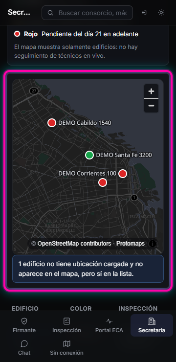
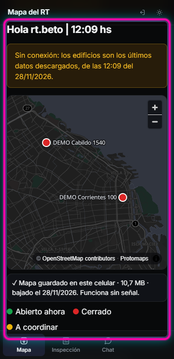

# HU-16 · RF-07 · Entrega — [FIX] La guía de Android incluye el mapa en las 8 pantallas y la prueba del Mapa del RT sin señal

- **Tarea:** HU-16 / RF-07 — `REQ-1795872287430`
- **Rama:** `feature/hu-16-hu-16-mapa-del-rt-y-llegada-al/req-1795872287430-fix-la-guia-de-android-incluye-el-mapa-e`
- **Script:** [RF-07-entrega.sh](RF-07-entrega.sh) · **Recorrido con Playwright:** [RF-07-navegador.cjs](RF-07-navegador.cjs)
- **Es sólo documentación:** no cambia ningún archivo de `apps/`. La guía que se corrige es [docs/android/INSTALAR-Y-PROBAR-EN-ANDROID.md](../../android/INSTALAR-Y-PROBAR-EN-ANDROID.md).

## 1. Qué quedó implementado

- **Un error de la guía, corregido:** el paso 1 de la prueba sin señal mandaba a «Estado del Sistema», una pestaña que ya no existe. Ahora manda a **Mapa sin conexión** (en la barra de abajo del celular, **Sin conexión**). Lo descubrió el recorrido con Playwright al intentar seguir la guía al pie de la letra.
- **Sección nueva 5.2, «El mapa en las demás pantallas»:** una tabla con las **8 pantallas** donde está el mapa (ficha en lectura, ficha en edición, alta de consorcio, vista de mapa, Monitoreo, Semáforo, Mapa del RT y Mapa sin conexión), cómo se llega a cada una y qué tiene que verse (cantidad de pines, colores por estado, leyenda). Debajo, **cómo mirarlas en el celular**: calles y nombres, gestos, ancho de pantalla, qué pasa al tocar un pin y el tema claro y oscuro.
- **La prueba que faltaba, en la misma sección:** el **Mapa del RT sin señal con el mapa ya bajado**, paso a paso, con qué tiene que verse con la red cortada (cartel amarillo con la hora de los datos, mapa dibujado desde el celular, pines con su nombre) y con captura.
- **Registro de la prueba (sección 10):** una columna por pantalla (1 a 8), más **RT sin señal**; el encabezado y la fila para completar tienen las mismas 18 columnas.
- **Qué falta (sección 9):** se agregó, sin maquillar, que las 8 pantallas se recorrieron en un navegador de escritorio que emula 360 px y **no en un Android real**, y que el tiempo del Mapa del RT sin señal tampoco se midió en un celular.
- Se renumeraron las secciones 5.3 (PWA) y 5.4 (resto de la app).

## 2. Cómo se levanta y se prueba

```bash
npm install
npm run db:up && npm run dev             # API en http://127.0.0.1:3050
bash docs/pruebas/hu-04-hu-04-semaforo-de-control-mens/RF-02-datos-demo.sh
npm run build -w apps/web && npm run preview -w apps/web     # https://localhost:4173
bash docs/pruebas/hu-16-hu-16-mapa-del-rt-y-llegada-al/RF-07-entrega.sh
```

`--sin-navegador` se salta el recorrido con Playwright (y lo dice: no cuenta como bien). `--carga N` abre N veces el Mapa del RT y mide.

## 3. Qué datos hacen falta

Los de demo (`RF-02-datos-demo.sh` de HU-04): `demo.secretaria`, `demo.admin` y `rt.beto`, clave `Demo-Clave-2026`, y el mapa base `caba.pmtiles` (ya viene en el repo).

## 4. Qué endpoints o pantallas toca

Ninguno. Las 8 pantallas se leen y se recorren, pero **no se guarda nada**: el script abre la edición de una ficha y el alta de consorcio y los cancela.

## 5. Cómo se corre integrado

Medido el 28/11/2026:

| Qué | Resultado |
|---|---|
| `RF-07-entrega.sh --carga 20` | 16 ok, 0 con error |
| Recorrido con Playwright (celular de 360 px) | 9 de 9 comprobaciones |
| Carga: 20 aperturas del Mapa del RT | 0 fallos · promedio 749 ms · p95 759 ms · máx 767 ms (desde la sesión iniciada hasta el mapa dibujado) |
| Mapa del RT recargado sin red | mapa con sus 2 pines en 1,4 a 1,7 s (en 4 corridas) |
| Las comprobaciones sí fallan cuando la guía está mal | Con una copia de la guía con la ruta vieja, sin la sección 5.2 y sin las columnas del registro, el script marcó los 3 errores; y con el botón mal nombrado («Verificar ubicación» en vez de «Verificar que estoy en el edificio») marcó el error |
| Error encontrado antes de mergear | La guía decía que la tarjeta del Mapa del RT tiene «Verificar ubicación»; el botón real es «Verificar que estoy en el edificio». Se corrigió y el script ahora comprueba que 14 textos de botones, carteles y leyendas que cita la guía existen tal cual en la app |

Recorrido por pantalla (`pines` y tiempo hasta que el mapa está dibujado, con la sesión iniciada): ficha en lectura 1 pin · 1,6 s; ficha en edición 1 pin · 1,5 s; alta de consorcio sin pin · 1,2 s; vista de mapa 4 pines; Monitoreo 4 pines; Semáforo 4 pines (3 rojos y 1 verde) · 1,4 s; Mapa del RT 2 pines · 4 s con el login incluido; Mapa sin conexión sin pines.




| Condición de aprobación | ¿Cubierta? | Cómo se comprobó |
|---|---|---|
| 1. La guía lista las pantallas donde está el mapa y qué se mira en cada una (calles con nombre, pines por estado, abrir un pin) | Sí | Script pasos 1 a 3 (8 filas, cada una con su mapa en la app) y recorrido de Playwright (9 comprobaciones) · guía 5.2 |
| 2. La prueba sin señal incluye una pantalla con pines, además de la del mapa sin conexión, y qué se espera ver con la red cortada y con el mapa guardado | Sí | Guía 5.2, «La prueba importante» · recorrido paso 9 (cartel, `data-origen=guardado`, 2 pines) · captura `RF-07-mapa-rt-sin-conexion.png` |
| 3. El registro tiene una columna por pantalla del mapa y los vínculos siguen funcionando | Sí | Script paso 4 (8 columnas + «RT sin señal», 18 en total) y paso 5 (los 3 vínculos de la guía llevan a un archivo) |

## 6. Qué quedó afuera y qué se asumió

- **No se probó en un Android real:** todo lo que dice la tabla del 5.2 sale de un navegador de escritorio con la pantalla de un celular de 360 px y el tacto emulado. La guía lo dice. Si en un celular algo no coincide, hay que corregir la guía (o la app) en esa misma tarea.
- **La ficha del edificio y el alta de consorcio desbordan el ancho del celular** (ya lo hacían antes del mapa nuevo, HU-16 RF-05). La guía lo avisa para que no se anote como error nuevo. Arreglar ese diseño es otra tarea.
- **Los colores de los pines del Mapa del RT dependen de la hora:** el sábado 28/11 a mediodía los dos salieron en rojo («Cerrado»). El recorrido sólo exige que estén los dos pines y la leyenda, no un color.
- **«Al volver la conexión, el cartel tiene que desaparecer»** quedó escrito en la guía como **sin verificar**: no se probó.
- **Los datos de demo tienen que estar cargados:** sin `RF-02-datos-demo.sh` de HU-04 las cifras de la tabla (4 pines, 3 rojos y 1 verde) no coinciden.
