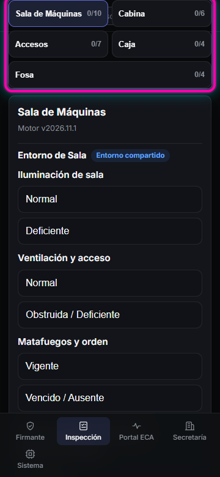
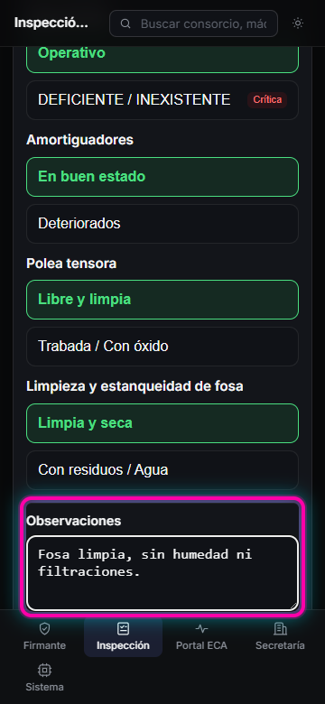

# HU-17 · RF-04 · Guía visual — Pantalla de solapa generada desde el motor

Pantalla genérica mobile-first (`360 px`) que renderiza las 5 solapas (`Sala de Máquinas`, `Cabina`, `Accesos`, `Caja`, `Fosa`) directamente desde el motor configurable versionado.

## Paso 1 · Vista móvil `360 px` con las 5 solapas y opciones táctiles sin desplazamiento horizontal

Al seleccionar **Inspección** desde la barra inferior móvil (o lateral en escritorio), se muestran las 5 solapas generadas desde la configuración, el conteo `respondidos/total` y los ítems filtrados por tipo de equipo (`traccion`, `hidraulico`, `montavehiculos`), sin desplazamiento horizontal ni zoom en `360 px`.

## Paso 2 · Tilde verde al completar todos los ítems aplicables y campo Observaciones

La solapa **Fosa** (y cualquiera de las 5) recibe la tilde verde (`✓`) únicamente cuando todos los ítems aplicables al tipo de equipo seleccionado están respondidos, acompañada por el campo libre **Observaciones** preparado para teclado o dictado por voz.

