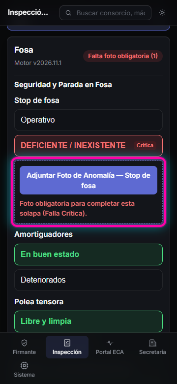
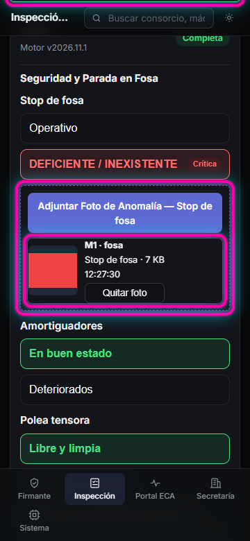

# HU-17 · RF-05 · Guía visual — Fotos por anomalía

Flujo de carga y compresión local (`<= 500 KB`) de fotografías al marcar una falla desde el celular (`360 px`).

## Paso 1 · Falla Crítica seleccionada exige "Adjuntar Foto de Anomalía" e impide completar la solapa

Al marcar una opción de Falla Crítica (por ejemplo *Stop de fosa — DEFICIENTE / INEXISTENTE*), aparece el botón **Adjuntar Foto de Anomalía — Stop de fosa** junto al aviso de obligatoriedad, bloqueando la tilde verde de la solapa hasta adjuntar la foto. Una opción correcta no muestra el botón.

## Paso 2 · Compresión a <= 500 KB, metadatos de trazabilidad y tilde habilitada

Al adjuntar una imagen desde el celular, `comprimirFotoAnomalia` la comprime a JPEG `<= 500 KB` guardando equipo (`M1`), solapa (`fosa`), ítem (`Stop de fosa`) y hora exacta, habilitando la tilde verde `✓` en la solapa.

