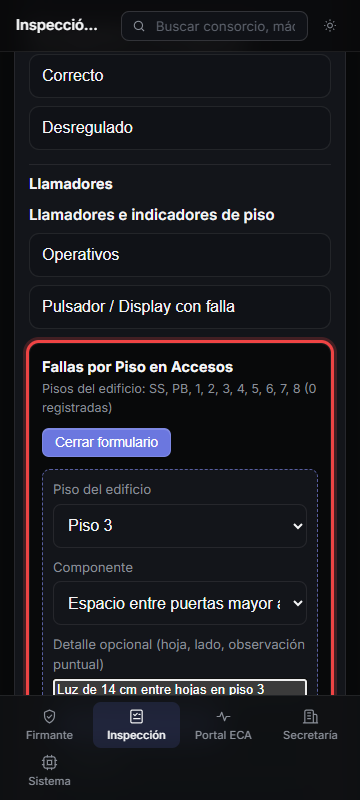
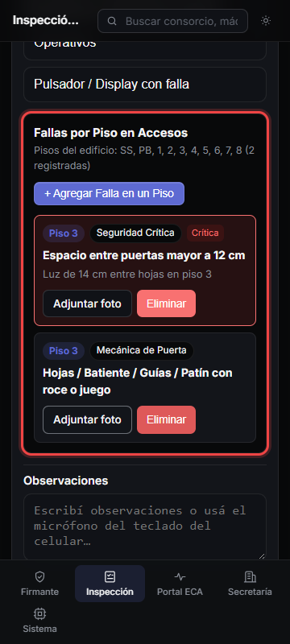

# Guía visual — HU-17 RF-06: Fallas por Piso en Accesos

Pantalla móvil (`360×800`) en la solapa **Accesos** con carga dinámica de fallas por piso del edificio.

## Paso 1 — Formulario `"+ Agregar Falla en un Piso"`

Selector de piso desde la lista del edificio (`SS, PB, 1..8`), catálogo agrupado en **Seguridad Crítica** (incluyendo **Espacio entre puertas mayor a 12 cm**), **Mecánica de Puerta** y **Llamadores**, más detalle opcional.

## Paso 2 — Múltiples fallas cargadas y eliminación puntual

Varias fallas en un mismo piso (por ejemplo dos anomalías en **Piso 3**) y botón **Eliminar** sobre cada ítem antes de cerrar la solapa.

