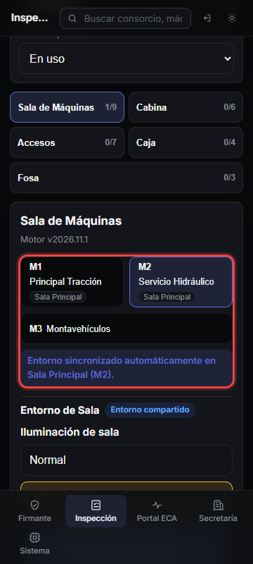
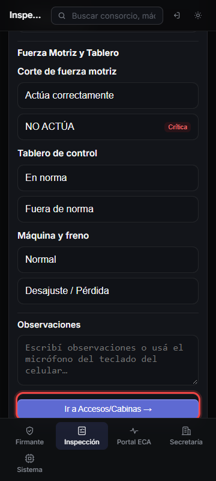

# Guía visual — HU-17 RF-07: Navegación por Estaciones y Sala Compartida

Pantalla móvil (`360×800`) recorriendo por estaciones con cambio rápido de máquina (`M1`, `M2`, `M3`), propagación automática de entorno de sala compartida y avance entre estaciones.

## Paso 1 — Selector `M1 · M2 · M3` por estación y Sala Compartida

Los selectores de máquina aparecen en cada solapa; al cargar un ítem de entorno en `M1` (**Sala Principal**), `M2` lo hereda automáticamente mientras `M3` (**Sala independiente**) queda aislado.

## Paso 2 — Botón `"Ir a Accesos/Cabinas"` hacia la estación siguiente

Al pie de **Sala de Máquinas**, el botón **"Ir a Accesos/Cabinas →"** avanza directo a la estación siguiente conservando lo cargado en cada máquina.

